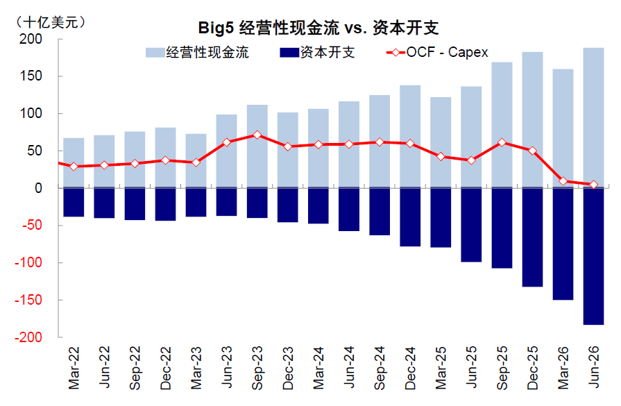
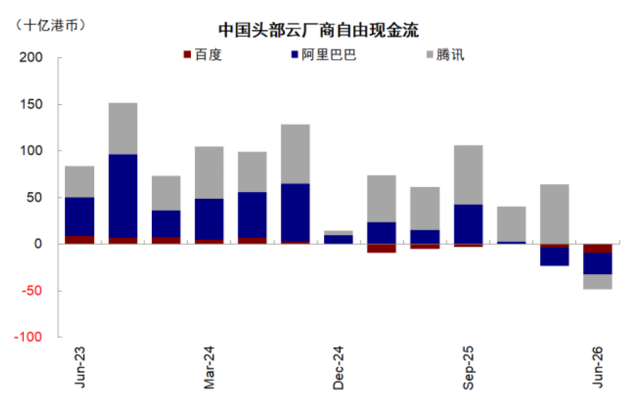
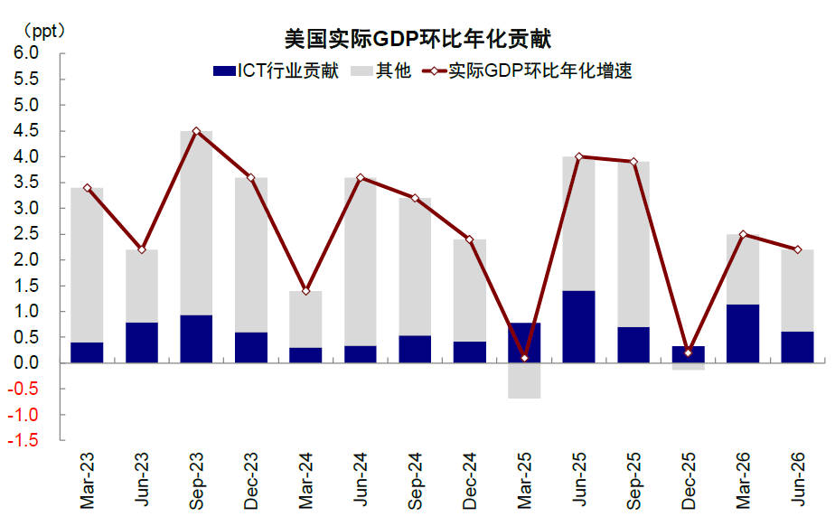
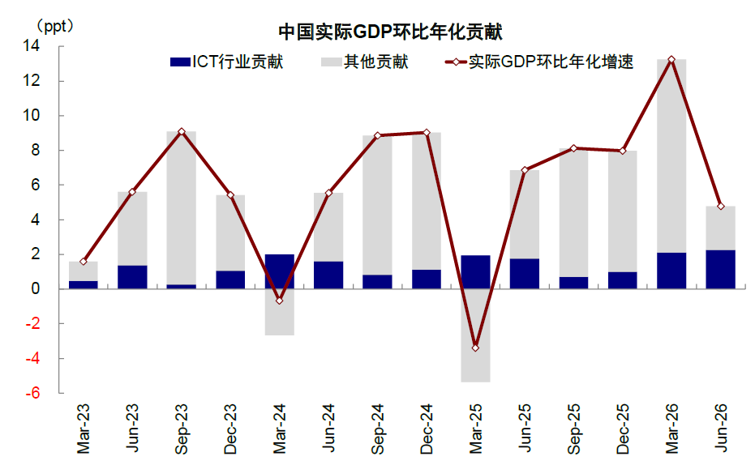
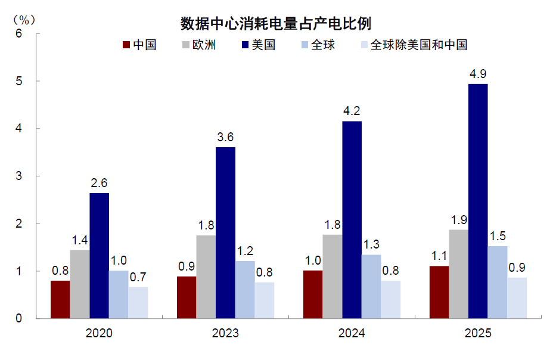
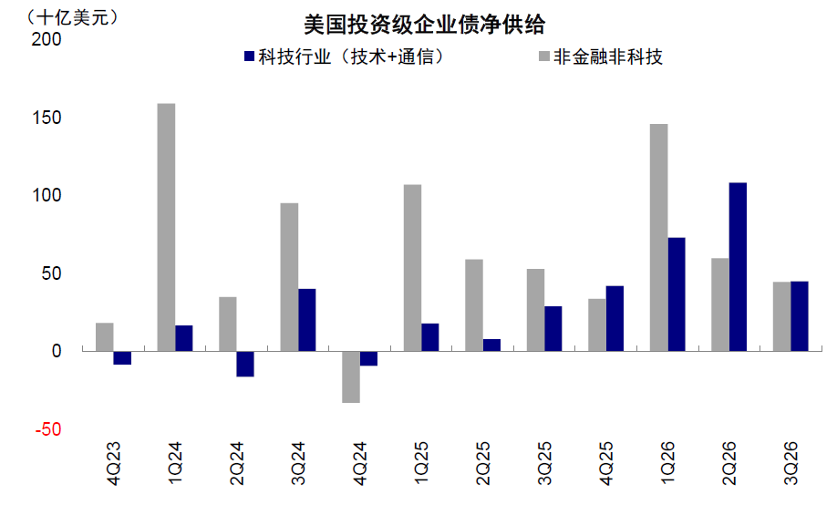
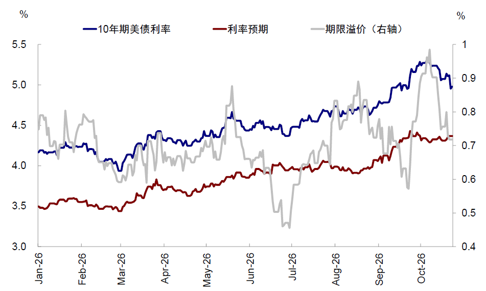
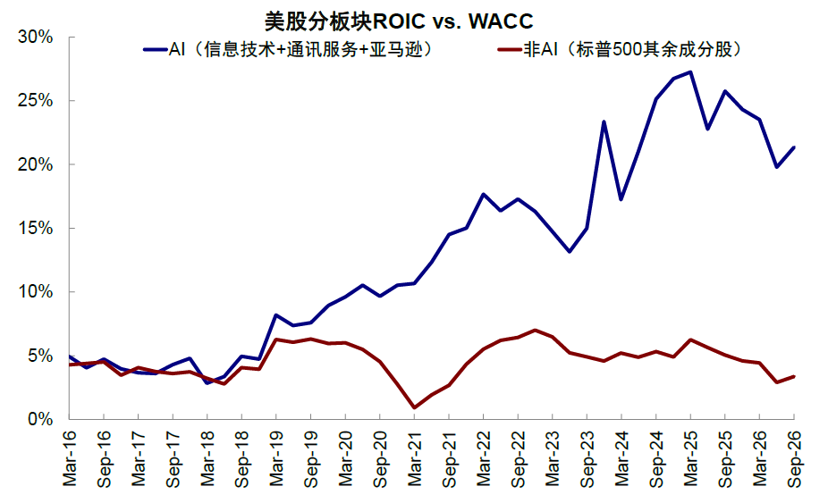
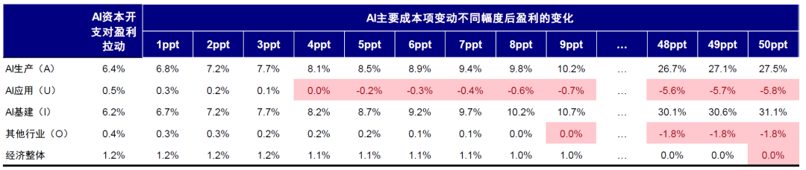
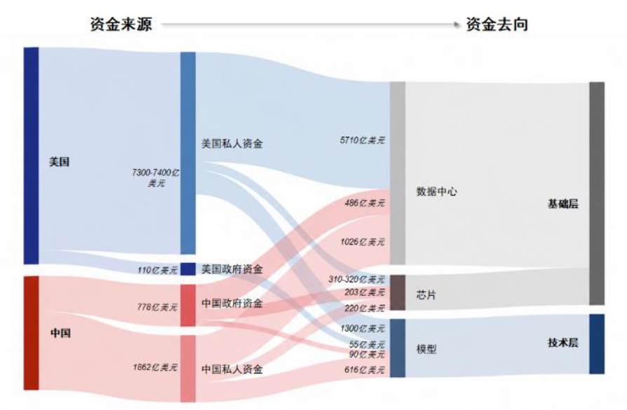

# AI投资扩张与传统需求挤出争论：2026年10月

华尔街见闻页面署名赵颖，2026-10-26转述中金点睛。本文按本地转载及全部27图整理，观察包含截至2026年二、三季度的财务与宏观数据，部分中国部门份额只到2025年。数字归于文章所引研究，未逐项另取原始数据复算。[来源与实际阅读范围](../40_sources/S-WS-3784433.md)。

文章提出的问题是：AI投资曾经通过采购、出口、财富和生产率支持其他部门；在投入越来越需要外部资金、共同资源供给跟不上时，它会在什么条件下挤压传统需求？全文把私人投资回报与全社会净收益分开，并比较中美传导路径。以下按这一问题保留论证，通用过程由[资源挤出与政策约束](../20_mechanisms/投资扩张的资源挤出与政策约束.md)维护。

## 资金转折：现金缺口、经营回报和信用价格分别说明什么

作者用CoreWeave信用风险与Anthropic收入增长的联系，提出应将资金成本与经营回报共同观察。客户收入能否兑现，会影响云厂商投入能否收回；CDS价格反映保护的交易条件，本身没有识别合同责任或价格变动原因。[原图1](../40_sources/S-WS-3784433.md#figure-001)。

作者按Big5云厂商样本估计，二季度ROIC约19.9%、WACC约9.6%；中国腾讯、阿里巴巴、百度加权ROIC约11.9%。这说明集团经营回报与资本成本之间仍有空间，但新AI项目能否收回投入还取决于增量收入、利用率和设备寿命。[指标解释](../10_concepts/云服务与超大规模云厂商.md#investment-return-financing)，[原图2、4及样本口径](../40_sources/S-WS-3784433.md#figure-002)。

资本开支先付款而收入后兑现时，经营现金流减资本开支会下降。图3的美国Big5合计末端仍略高于零；正文另称除微软、Meta外主要厂商已为负，合计图不能逐家验证。图5显示中国三家公司末期均为负，单位为十亿港币。各图保存其集团样本，不能直接充当全部AI项目的盈利率。

自由现金流转负意味着当期经营现金已不足以覆盖所列资本开支，需要更多动用存量现金、融资或调整支出。它标记资金来源组成与融资承接压力的变化；此前由自有现金支付的建设也已占用电力、设备与施工资源。实物挤压是否发生，仍要看这些资源的供给和其他使用者受到的影响。

## 作者的四部门观察框架

作者把经济活动分为AI生产、AI基建、AI应用及其他部门：生产包括计算机、软件和云服务；基建包括能源、建筑、金属和设备；应用包括金融、专业服务和研发等。这个划分用于研究投入、应用和成本承担位置，不能将被归为“应用”的整个行业都解释为已经使用AI或因AI取得全部利润。

图6美国AI生产份额从2022年的7.9%升至2026年上半年的10.3%；基建7.3%、应用33.3%、其他51.1%。图7中国2025年生产4.9%、基建13.6%、应用32.1%、其他49.4%。两国截止期与分类基础不同，“五五开”是在作者划分下的近似结构描述。[原图6—7](../40_sources/S-WS-3784433.md#figure-006)。

## 拉动渠道：采购和出口、居民财富与生产率

文章估计，2026年二季度美国实际GDP环比年化增长2.2%，广义AI需求贡献28%、拉动约0.6个百分点；中国季调环比折年增长4.77%，相关贡献47%。图8、9的实际图例是“ICT行业贡献”，不能无说明地与全文AI生产和基建集合等同。贡献占比描述增长来源，经济水平中AI部门占比是另一个量。作者另称AI相关产品对中国净出口同比增长贡献超过60%，净出口对GDP增长贡献21%、拉动0.6个百分点；其指标和比较期也要分别保留。

股市上涨可能通过资产持有者的消费、雇佣和支付扩散到其他部门。作者引用研究称股票财富增加1美元，对应每年约3.2美分实际消费增加；图10展示的却是财富冲击后非贸易部门工资响应，纵轴为bp、横轴为季度。它支持观察传导过程，单凭图内3.22不能重新构造每美元消费系数。

文中另称美国居民含权资产占比约47%，图11末端为2026年6月；图12显示A股样本当年中位数回报末端约−17.2%；图13为2025E中国居民资产结构，含权资产4.7%、住房58.6%。它们提示资产暴露与收益分布影响财富传导，不宜仅以一个股票指数上涨推断所有居民财富同时增加。[原图10—13](../40_sources/S-WS-3784433.md#figure-010)。

生产率渠道来自在给定质量下节省完成任务的时间与资源，并使知识、软件和组织经验传播。文章转述Anthropic估算部分任务平均完成时间缩短80%，还比较2025年美国生成式AI聊天工具年度消费者剩余1162亿美元与模型购买支出142亿美元。消费者剩余描述用户愿付与实际支付之间的福利差额，市场支出描述交易金额；不同估计范围和方法未在转载展开，本轮不能把两数之比8.2直接当作全部AI投资的社会回报率。效率、价格与总算力需求的过程可接[已有机制](../20_mechanisms/模型效率、推理成本与总算力需求.md)。

## 实物资源：新订单也会成为其他使用者的成本

投资需要真实设备、供电接入、施工与人员。在供给调整之前，AI项目提高愿付价格或占用交付时段，供应商收入增长和其他使用者成本增加可以同时出现。作者列举私营数据中心建造支出自2022年底以来增长近5倍，图14则显示美国数据中心耗电占产电量由2020年2.6%升至2025年4.9%、全球由1.0%升至1.5%。比例变化提示需要调查当地供给弹性，并不直接给出电价冲击。

文中称当年存储价格上涨110%、美国PPI电子元件及配件同比由上年底约4%最高升至6月29%。转载没有列出足以复算该涨幅的产品篮子与报价数据，保留为作者的成本观察。

## 金融资源：价格压力与融资数量须同时看

作者讨论两个渠道：融资成本上升，以及新增AI公司债与其他资产争取投资者承接。其列举美国30年按揭约7.5%、小企业短贷约8.2%，这些融资条件在转载中没有逐项原始时点表，不能直接归因给AI。

信用市场内部反应也不一致。作者判断高收益债压力较明显，投资级整体相对科技的恶化未同样显著；这是价格条件的观察，不能据此直接推算少发了多少债。[原图15—16及利差口径](../40_sources/S-WS-3784433.md#figure-015)。

从数量看，作者称科技占非金融企业债发行的比例已到40%—50%，图17显示不同季度大幅变化，[图17](../40_sources/S-WS-3784433.md#figure-017)末端不宜固定使用单一份额；图18非金融非科技投资级净供给在2026年前三季仍为正。文章因此也认为当时对非AI融资的挤出尚不显著。科技发行增加可与其他部门融资共同增加；要估计被挤出的量，还需要没有该投资冲击时的反事实及承接资料。作者转述市场预期2027年科技龙头再增加2000—3000亿美元信用债发行，本次未核原预测名单和金额。

## 政策取舍：强部门与弱部门对同一利率承受力不同

文章认为，AI需求与投入成本保持强势时，传统住房等部门可能已受高融资成本压制，央行需要在总体价格和弱部门需求之间作取舍。正文称年初以来十年美债利率上升79bp，实际利率贡献71bp、通胀预期贡献9bp，并引用自然利率由0.99%升至1.44%的估计。图19实际展示的是十年收益率、利率预期和期限溢价，无法用于核认上述实际利率—通胀预期分解；自然利率估计也未给出完整模型与版本。

岗位变化又会改变政策取舍。作者以2023年以来非农增加约470万人、教育健康增加278万人、商业服务减少37万人、信息业减少30万人、金融活动减少9万人等说明部门分化。[就业原图20—21](../40_sources/S-WS-3784433.md#figure-020)还需区分信息业与较宽的科技样本。这组行业共变没有排除利率、周期与其他技术变化，因此保持作者关于AI岗位替代的解释身份，不据图独立认定全部减少岗位由AI造成。

## “临界点”是当时作者的条件测算

文章区分Big5云厂商与股票AI样本。前者ROIC约20%、WACC约9%；后者把信息技术、通信服务和亚马逊归为AI，其余标普成分归为非AI。图22两线实际是ROIC与WACC差值，末端AI约21个百分点、非AI约3个百分点，不能读成它们各自的ROIC水平。

作者在ROIC固定、回报差回到历史均值且β等条件不变的设定下，倒推云厂商对应十年美债收益率约7%—7.5%；按非AI回报差及按揭—租金回报比较，倒推传统部门约4%—4.2%。再按部门贡献或市值权重加权，提出全经济约5.5%—6%的可承受范围。[图23—24](../40_sources/S-WS-3784433.md#figure-023)分别展示情景推演及按揭利率、国债利率与租金回报比较；期限、风险、费用及资本利得仍不同。上述数值保存为作者当时的条件判断，没有变成美联储反应规则、已验证的经济崩溃阈值或本库通用模型。

图25进一步设定云厂商资本开支9000亿美元，并考虑进口漏出等，估计成本上涨约3.6%可抵消应用部门原收益、约8.6%可抵消其他部门原收益，约50%使全经济净拉动归零。表格列题为价格变化幅度，单元格是盈利变化口径；截面部门划分、投入产出系数和传递假设均会影响结果。此处保留表格及测算前提，用来理解作者为何认为下游承压可能较早，不复现为可直接套用的成本模型。

## 中国：财政信贷配置及战略目标怎样进入判断

作者认为，美国AI投入主要依靠私人资金，中国则至少约三成来自政策相关资金。中国的传导因此还要看预算与信贷投向：文章称财政资源更多向“六张网”等新质生产力建设倾斜，新增贷款向科技集中，而房地产、消费相关贷款占比下降。对应的实际问题是，获得支持的项目能否扩张、其他申请者能否找到替代资金；份额下降本身尚未说明其融资绝对量减少。[一般数量配置过程](../20_mechanisms/投资扩张的资源挤出与政策约束.md#logic-3)。图26保留作者对中美资金来源和去向的描述，统计期与分类边界见[来源记录](../40_sources/S-WS-3784433.md#figure-026)。

这种配置有长期战略理由。文章引用“十五五”关于科技自立自强、新质生产力的部署，认为自主可控和科技创新使政策愿意承受一定短期压力。同时，作者指出当年消费仍弱、居民资产负债表收缩：如果公共支出和贷款新增支持偏向建设，而没有充分带动居民收入、消费与传统部门订单，投资增长可能与弱部门承压并存。新增财政与信贷总量若同步扩大，也可以缓和这种取舍。

作者据此提出三个政策观察维度：增长能否支持2035年目标、就业是否进一步恶化、杠杆及资产负债表还能承受多少低回报投资。文章比较广义赤字率8%以上、非金融部门杠杆约308%与美国约251%，但转载没有完整披露财政边界和对应时点。低回报建设若主要靠续借维持，风险可能留在银行和地方政府资产负债表；这是作者的风险判断。图27计算机通信电子约78%、通用设备约74%为产能利用率的历史分位，不能记作实际利用率。[原图27](../40_sources/S-WS-3784433.md#figure-027)。

中金当时判断，战略目标明确、短期压力仍可控而财政空间有限，财政力度和方向大幅转向仍需时间或更大压力。这个判断没有给出确定的政策转向日期。

## 如何继续对照当时判断

以下检验以2026-10-26为信息日，区分中金当时预期与本库整理的条件推演，未填入后来的实现结果。

### 随后季度：公司投入、回款与实物供给

中金把AI投资回报兑现与大模型应用进展视为关键。本库据此追踪美国Big5及腾讯、阿里巴巴、百度随后季度的资本开支、经营现金流、现金余额和融资组成，并把集团数字与实际云服务交付、客户回款对应。资本开支增加且已交付服务与收入、现金回款同步扩张，供应商产能也及时增加，更支持需求向其他部门扩散；若支出先增而回款持续落后，外部融资承接压力会加大。

实物挤压需另看机房接电等待、合同电价、关键设备交期，以及使用相同资源的非AI企业成本和订单。AI建设增长同时伴随这些瓶颈加剧、下游利润受压，更支持资源挤压解释；新增供给上线、单位任务资源消耗下降而下游订单改善，则削弱该解释。不能仅以自由现金流转负判定实物挤压开始。

### 2027年：新增科技债由谁承接

文章转述科技龙头信用债发行再增加2000—3000亿美元的市场预期；应先核实际发行主体、期限、到期偿还与净融资，再比较非金融非科技企业的净供给、发行利差和融资推迟情况。2026年前三季非科技净供给仍正，是当时“数量挤出尚不显著”的反向证据。

若2027年科技发行扩大、非科技融资也增加且发行条件稳定，说明资金承接同步扩张，科技份额上升不能等同挤出。若在可比风险和期限下，非科技企业融资报价明显恶化、可融数量下降或项目被迫延期，同时投资者配置向科技债转移，才更支持融资重分配；还需区分国债供给、整体风险偏好及企业自身需求变化。

### 随后季度：中国投向变化是否传到弱部门

对中国，先比较财政预算与实际支出的用途、新增贷款总量及科技、房地产和消费相关贷款的数量与份额，再观察弱部门订单、居民收入消费和就业。若科技支持增加的同时总财政支出、银行资本与信贷供给扩张，传统用途绝对支持并未减少，就不能将份额变化认定为数量挤出；若其他用途实际支持下降、替代融资难获且项目收缩，配置取舍的解释会更强。

若建设订单逐步带动就业、居民收入和消费，支持长期投入正在形成需求扩散；若投资继续扩张而消费、就业及债务偿付持续恶化，则作者提出的短期压力与资产负债表约束更值得重估。未来政策是否扩大总支持、调整投向，须按实际公告与执行观察，不由作者的利率情景阈值推导日期。
