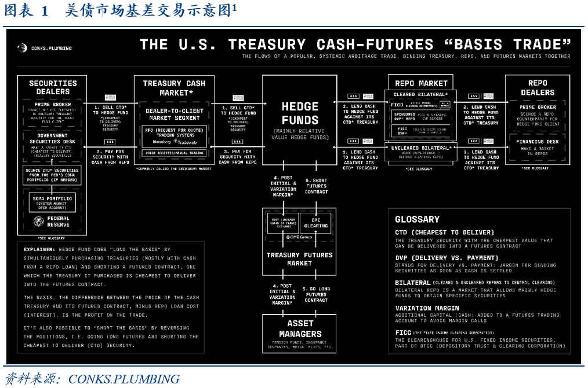
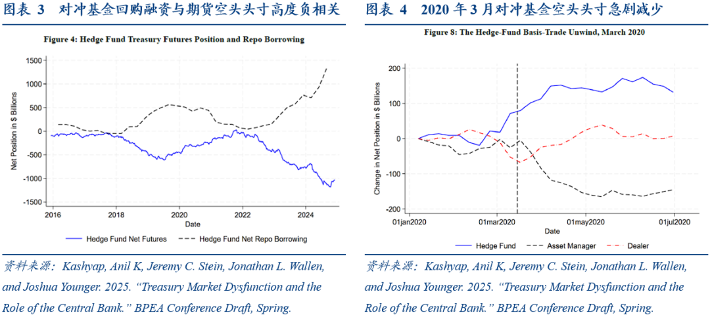
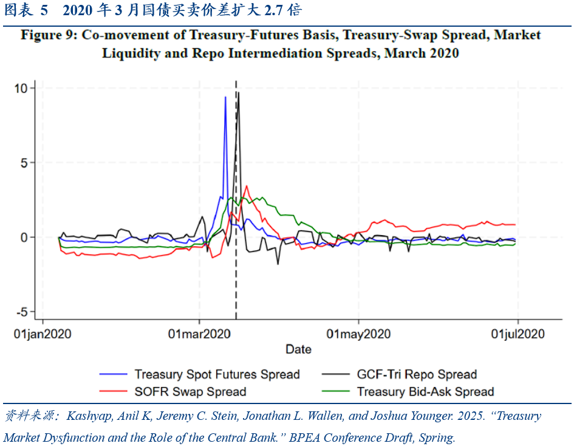
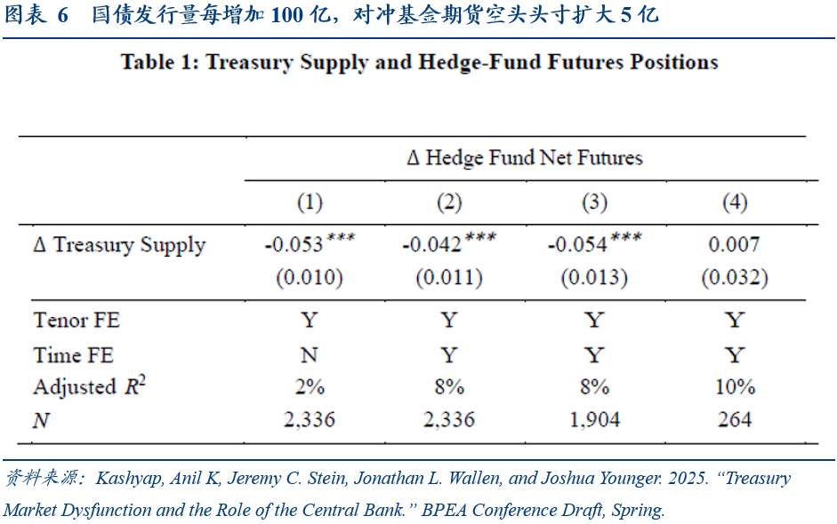

# 2025年4月美债基差交易风险讨论

## 国债与股票一起跌：风险框架与当日归因

2025年4月9日，华尔街见闻编者按称隔夜十年期美债收益率上升11个基点至4.3%，把基差交易列为股债同跌的重要原因之一。文章由李笑寅署名，正文删减转述华创证券张瑜4月1日研报：供给扩大后，更多现券可能由基金融资持有，交易商又提供融资与承接，外部冲击因而可能穿过现券、期货和回购市场。[来源与核读范围](../../40_sources/S-WS-3744871.md)。

**4月1日研报解释的是条件性脆弱性，4月9日编者按提出的是当日行情归因。** 研报的主要历史图来自2020年3月及2016年以来的持仓，能说明放大渠道，却不能独立确认4月8—9日由谁平仓、多少规模或贡献多少基点。11个基点和4.3%保留转载归属，原逐时行情及该窗口逐基金账户资料未取得。

## 期货需求怎样接到现券融资

资产管理者以期货取得久期时，只需先交保证金；相对价值基金在另一侧卖期货，以回购借款支付现券购买款。交易商连接现券成交、回购资金与头寸承接。原图1把现金、证券及合约分开画出，使期货需求如何成为现券融资需求可见；通用的[三主体分工](../../20_mechanisms/基差交易.md#participants)与[两腿资金安排](../../20_mechanisms/基差交易.md#logic-1)在机制页维护。

这条联系让市场需要反复取得融资和中介服务，持仓的经济对冲也不让两边账户实时净额付款。原图2的基金净空头与资管净多头扩大，和上述分工相容；全部基金空头却混合多种策略，交易商较小的净期货余额也未涵盖现券库存及客户回购服务。[图2及读数说明](../../40_sources/S-WS-3744871.md#figure-notes)保留这些覆盖区别，[观察用途](../../20_mechanisms/基差交易.md#participant-observation)解释如何联合判断中介依赖。

## 2020年的经验：对冲两条腿，仍需按时支付现金

基金要在等待收敛期间持续取得[回购融资](../../10_concepts/回购与逆回购.md)，满足[抵押品折扣](../../10_concepts/抵押品与折扣率haircut.md)和[保证金](../../10_concepts/保证金与追加保证金.md)要求。期货上涨时，空头需要支付变动保证金，而现券升值未必能同刻提出现金；券价下降、折扣提高或贷款不续作也会形成付款需要。这些渠道的方向不同，原文未提供它们在4月8—9日实际触发的账户证据。

若现金缓冲不足，基金可能卖现券、买回期货，提前关闭收敛组合。集中卖券使中介需要接走更多库存，买回期货又改变相对价格，未退出者可能继续承压。[机制logic-2](../../20_mechanisms/基差交易.md#logic-2)解释现金需求和相对价格如何反馈。

转载称2020年3月3—17日基金期货空头减少620亿美元，回购融资也下降。图3左侧的净借款为正、期货净头寸为负，融资持券扩大可以同时表现为正负两线分开；图4蓝线上升则可以表示原有空头回补。这些是头寸及其变化，并非新增多头或投资回报。620亿美元仍为二手研究归纳，未以相同日期、样本逐笔复算，不能独立量化对整个国债抛售的贡献。

## 现券进入交易商库存，怎样挤占继续承接的能力

基金出售现券后，交易商若先接券，其库存、资金需求和价格风险增加；同时还要给其他客户融资及报价。当这些业务共享的资本、融资或内部风险限额趋紧，新增库存就会提高继续承接的成本。交易商可以压低买价、减少报价量，或收紧回购额度，使基金的成交和续作更困难。通用过程由[中介资源逻辑](../../20_mechanisms/基差交易.md#logic-3)主维护；[银行资本与杠杆约束](../../10_concepts/银行资本与杠杆率.md)须按实际实体、净额及内部限额使用。

原图5并列现券—期货、GCF—三方回购、SOFR掉期及国债买卖四类价差，显示压力涉及多项业务。转载另称交易商承接570亿美元现券、买卖价差“扩大2.7倍”；这两项未重取底层复算。多类价格共变与资源紧张相容，尚未分离库存承接、监管约束和共同冲击的各自贡献；具体基期及图读见[来源](../../40_sources/S-WS-3744871.md#figure-notes)。

## 供给扩大为何会增加中介需求

研报将供给增加接到最终投资者使用期货、基金与交易商融资持券的安排：若新增国债没有全部由最终买家直接持有，中介就要先承接更多现券和相应资金需求。发行期限、最终买方及现券/衍生品偏好，决定这一联系的强弱，可连接[国债供给的定价机制](../../20_mechanisms/国债供给的定价机制.md)。

前三列负系数与“供给增加、基金净空头增加”的解释相容，转载把量级概括为每100亿美元发行对应5亿美元期货空头。第四列却不支持相同估计，样本也不同；第二、第三列已经有时间固定效应，不能把第四列变化单归于加入Time FE。[来源逐列核读](../../40_sources/S-WS-3744871.md#regression)保留系数、标准误、样本及未取得的规格说明。这项历史估计不能直接当作每次发行的固定预测比例。

## 对冲式购债提案要接走哪一段压力

转载的Kashyap、Stein、Wallen与Younger提案，主张美联储买入受压国债，同时卖空期货抵消部分利率敏感度。官方资产负债表由此接走现券和中介负担，同时尽量减少单纯持有长债移走的久期。交易对手、对冲数量、保证金、结算和退出仍需实际安排，[政策逻辑](../../20_mechanisms/基差交易.md#logic-4)保存完整解释。

灵活退出、区分市场功能与货币政策、降低利率风险和缓解道德风险，是作者希望达到的效果。久期中性只约束一种敏感度，干预仍可改变相对价格与融资条件；清算和跨保证金也不能代替基金权益或赎回后的现金。本文保留政策争论，未将提案登记为已经实施的制度。

## 当时判断与随后数个结算日的检验

**华创证券张瑜，研报日期按转载为2025-04-01。** 高杠杆基差头寸、交易商有限缓冲和国债供给共同构成脆弱性，外部冲击可能触发更严重的流动性危机。作者未给出下一危机日期、概率或损失金额。

**华尔街见闻编者按，2025-04-09。** 把基差交易列为隔夜急跌的重要解释之一。验证此项归因，需要该窗口的实际成套减仓、付款和中介记录；收益率上升或期货净空头下降本身不够。

**本库2026-11-13整理的条件推演**保留短窗口：当时基金随后数个结算及融资日，若相对价格恶化、融资可得性下降、补款超出现金缓冲共同出现，被动卖现券买期货压力应更强；资金和承接者进入则可能缓和压力。

**本库2026-11-16后补的辨别安排**进一步问实际退出属于哪条策略、为何发生，未补入后来结果：

- 在相同基金或可比策略样本中，现券减少、期货空头回补、回购借款下降若能接上先发生的追保、续作拒绝或可用现金缺口，较支持被动关闭现金—期货组合的解释。只见三项头寸同减，仍可能是主动实现价差收益或降低风险。
- 若相同样本和时段的账户、成套成交记录显示现金—期货组合大体稳定，主要调整发生在利率掉期等其他对冲腿，应收缩现金—期货基差对当日抛售的归因；若三腿收缩，但付款和续作稳定、现金足够，且有主动降低风险预算的证据，则融资被迫退出解释较弱。赎回等其他现金需求仍须分别确认。
- 若交易商库存增加，同时客户融资收紧、报价深度下降，较支持库存与继续服务相互挤占；若其他买家及时接券且客户融资稳定，该放大过程应较弱。共同利率重估也可推动债价下降，不能靠价格方向代替上述账户和交易联系。

没有取得联合资料，意味着当日归因尚待检验；实际观察到组合稳定或付款充足，才构成削弱相应路径的证据。较晚的[2026年策略分解研究](../../20_mechanisms/基差交易.md#logic-2)仍按公开日期阅读，不能回填4月9日的信息集。

## 来源与关联

[来源记录 S-WS-3744871](../../40_sources/S-WS-3744871.md)保存原文、全部五份图像、详细图读与回归表。[基差 C-DERIV-15](../../10_concepts/基差.md)维护价差含义；[基差交易 R-DERIVATIVES-02](../../20_mechanisms/基差交易.md)维护一般交易、融资与政策过程。
