# 2026年1月黄金急涨回调与美元信用替代争议

华尔街见闻于2026-02-02转述中金刘刚、项心力等的研究，页面署名董静。作者试图解释黄金短期急涨急跌与长期储备替代为何能同时成立：价格关口可以迅速触及，信任、配置与制度调整则沿不同时间尺度发生。本记录保留文章的关键论证、相邻配图和当时条件判断；全部33张原图可从来源页定位；未补入2月之后的市场结果。[来源与核读范围](../../40_sources/S-WS-3764710.md)。

## 先看短期：涨价、波动与私人持有怎样共振

文章称2026年1月金价一度升破5500美元／盎司，月内最大涨幅约25%，随后单日跌幅超过10%；它将1月30日的急跌与沃什提名联系起来，视其为催化剂。这是作者对当时市场的报道归因。作者用图1展示2022年后金价与实际利率的偏离，用图2展示其美元、实际利率、不确定性和动量四因子拟合近期误差扩大。这些图片描述相关路径与作者的样本拟合，没有给出参数、估计窗口和可复算残差，本库不将其注册为通用金价模型。

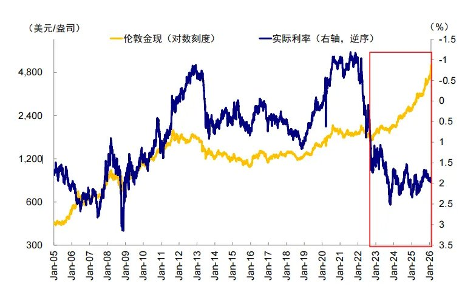

图3的14日RSI接近90，图4显示黄金隐含波动率指标相对2025年初显著抬升。图4比较各波动率指数相对2025年初的变化，不能直接用曲线高低排列资产的绝对风险。私人持有与价格是否相互强化，还须结合下文的数量资料。

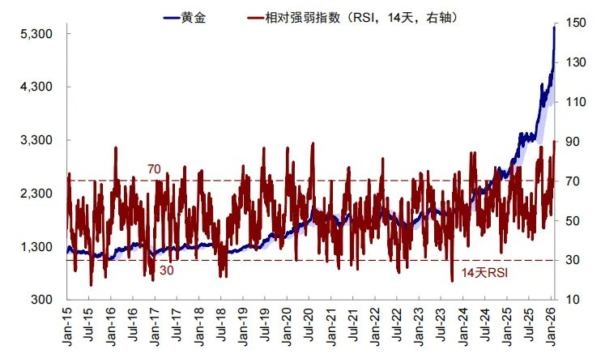

## 5500美元关口：比较两类存量值，仍要回到持有意愿

作者将存量黄金市值38.2万亿美元与美债存量38.5万亿美元并列，比值约0.99，称其为1980年代以来首次接近。这是一种名义规模比较：金价上升可在黄金数量变化很小时迅速推高分子，美债分母则受发行和统计范围影响。全球存量黄金包括首饰、官方与私人持有，不能当成央行可自由调配的黄金。图6—7没有在本地版本提供可复算的存量序列及债务估值细则。

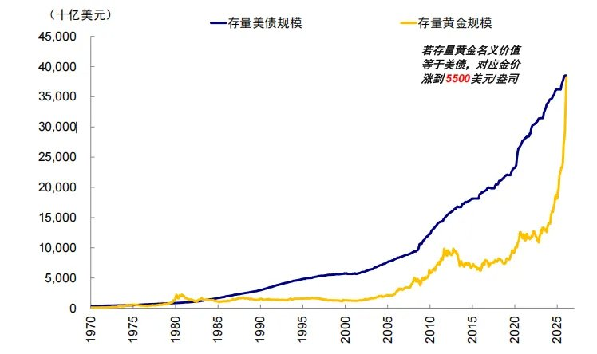

两类存量接近可以成为市场叙事和配置讨论的参照，没有使持有人必须交割、偿债或改配的合同约束。作者真正提出的条件是：若边际储备管理者因此更重视美元资产的集中与真实回报风险，新的配置意愿可能形成持续需求。这个过程需要具体数量与行为证据；“触及5500”本身不构成内在价值上限或下一步价格预测。

## 上涨解释：美元、机会成本、风险保护与买家结构

作者先逐条比较候选解释。按文章观察，2022年9月以来美元指数从114降至约96，黄金从1622美元／盎司上涨约239%；2022年以来金价与美元回归R²为0.2339，1970—1980年为0.5695。两个R²是特定样本的拟合指标，不等于美元造成了23%或57%的涨幅。

文章又列实际利率在2022年9月至2023年10月由约1%升至2.5%，2025年11月以后由1.7%升至1.97%，与金价同升。这个观察说明其他因素可能抵消[机会成本](../../20_mechanisms/黄金的机会成本机制.md)的作用，未把该机制永久取消。图11中的政策不确定性同样可反映风险保护需求，但双轴同向不能单独识别其价格贡献。

这里的“信任”要落实到持有资产的理由。文章关注美元资产未来购买力、财政约束及政治关系；本库据此展开的解释是：若持有人担心通胀侵蚀真实回报，或担心其美元资产在政治冲突中受限制，就可能提高不依赖另一方偿付承诺的黄金配置意愿。黄金仍有价格波动、保管与变现成本，持有人也仍需美元支付和流动性，所以这种意愿可以表现为边际分散，而无需退出整个美元体系。

意愿要通过减持、增持或新增储备分配成为实际需求，才可能影响成交与价格。官方配置涉及授权、流动性目标和分批执行，常在较长窗口披露；私人产品持有人能更快因价格上涨、波动或政策消息改变仓位。较慢的官方分散与较快的私人追随因此可以共存，也可以在私人撤出时出现急跌。原文的数量记录可帮助检查这条解释，尚不足以识别每一类买家的价格贡献。

买家结构提供另一条线索。中金图16列2022年以来中国、土耳其、印度黄金分别增加357.1、253.2、132.6吨；图12的新兴央行同比净增在2023年初附近较高，后续放缓。GLD则据文章从2024年3月约821吨回升到约1087吨。分主体看，官方购买放缓可以与某些私人渠道持有回升并存。

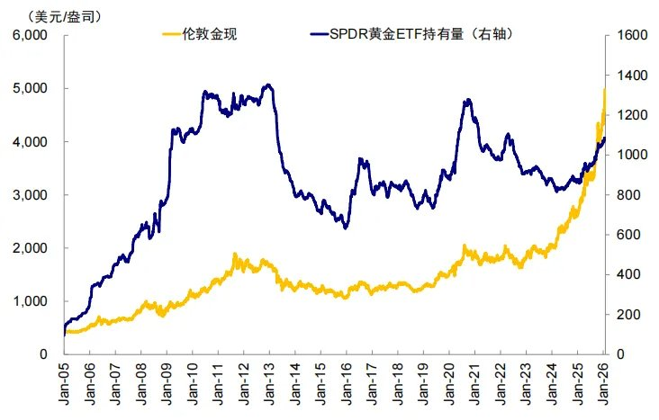

[SPDR黄金信托GLD](../../10_concepts/SPDR黄金信托GLD.md)让私人产品渠道具备一个持续观察位置。其产品页解释吨数、份额、费用耗金与AUM的区别。图5中持有量与金价过去两年滚动相关系数达到0.98，但买盘推动价格、价格吸引追随及共同消息都可能产生共振；相关性无法拆出各自贡献。本次没有复算GLD逐日序列。作者称其规模占黄金ETF约27%，该比例的精确产品集合与统计日未在转述中展开。

## 美债风险为何进入黄金讨论

中金把其担忧概括为偿债支出更刚性、外国持有占比下降与黄金相对市值上升。图14的“利息覆盖率”实际定义为利息支出／财政收入，较高意味着收入中用于付息的比例更高；该文图末标18.5%，图28的2025年均值则为19.8%，并非可以直接拼接的同一时点。原文提到评级机构15%“警戒线”，没有给出评级方法原件，本次不把这个值设为普遍评级触发规则。

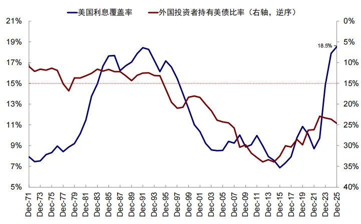

外国投资者持有比例由2014年约34%降至2022年约23%、其后约25%，还涉及美债总发行变化与私人、官方的构成。占比下降可以伴随持有美元金额上升，不能只凭份额指定全球储备管理者的动机。美债真实回报、价格和法律可动用性分别影响持有，本文没有依据原文“美债不可能违约”的表述将支付风险设为零。

## 国家配置比较：官方黄金与国家名下美债并不覆盖同一批持有人

图16是官方黄金数量，图17则按国家列美债累计持有变化：图题为2024年以来，正文另以2025年以来列英国1657亿美元、日本1411亿美元、比利时1064亿美元的增加。两个起点各自保留，不能用一组数字替代另一图的完整累计量。

图18按交易时段切分金价，文章列2025年以来亚洲、欧洲、美洲累计约33.5%、9.7%、11.2%，2026年初约11.4%、0.3%、2.0%，截止1月29日。时段不是最终买家的国籍，也没有识别谁持有何种资产。图19则按基金地区分ETF流量，单位百万美元，文中2026年初亚洲、北美、欧洲分别约49.5、48.9、33.6亿美元，截止1月23日；这些地区基金流量与交易时段收益不是同一统计维度。

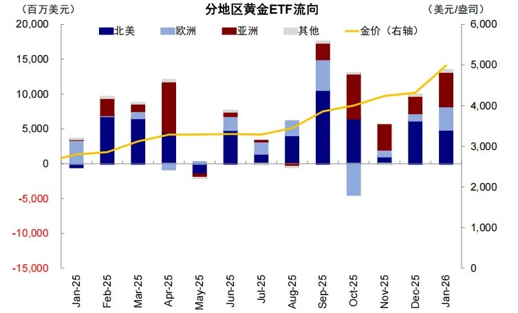

图20以黄金占外储15%和国家名下美债／外储50%划分象限，但美债含私人及官方、黄金为官方储备，不能直接将象限当作央行配置阵营。图21的占比变化还受黄金涨价和分母变动影响。作者由此提出各国不同的持有偏好，确认主动改配仍须数量与持有人证据。[一般主体、托管与分母辨析](../../20_mechanisms/美元信用与储备多元化.md#country-holder-scope)集中在机制页；图中越界点位及起点差异见来源核读。

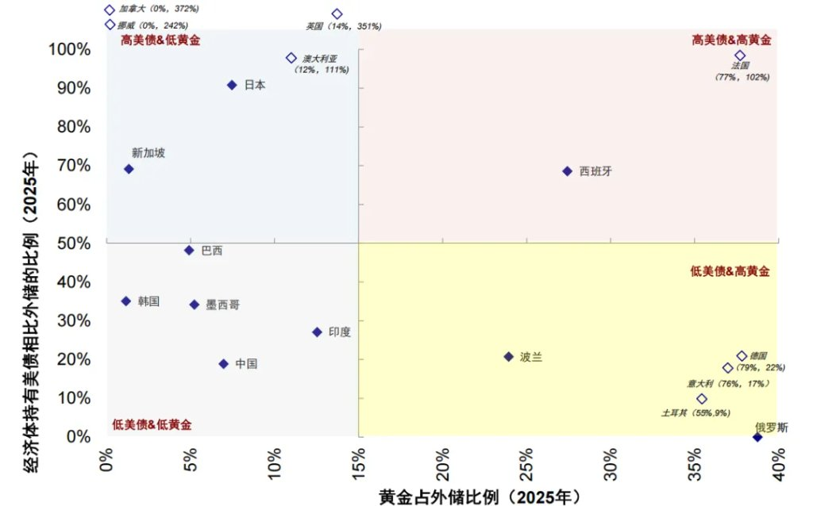

## 局部资产分散与美元体系继续运转可以并存

作者同时援引不同功能的量：2025年三季度美元在全球外汇储备份额约57%；含黄金总储备口径下黄金占28.6%、外国官方持有美债占21.3%，黄金按1月30日价格重估；2025年12月SWIFT支付份额美元50.5%、欧元21.9%，贸易融资份额美元79.5%、人民币8.3%。这些量的分母、覆盖与时期不同，不能拼成统一的“美元地位指数”。SWIFT资料还只覆盖其统计范围，并非全部全球支付。

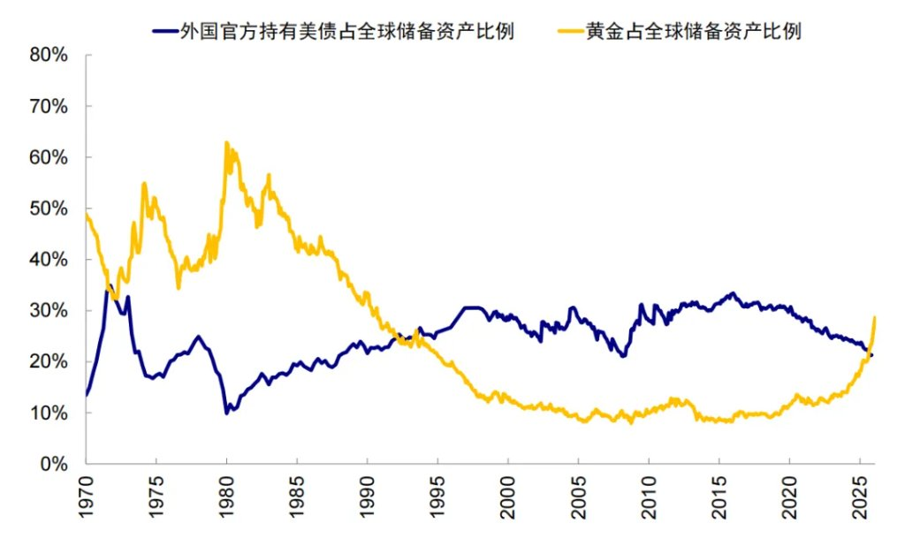

作者的推断是美元体系可能局部松动、储备逐步分散，同时交易网络、流动性、收益与容量继续支持美元使用。黄金对无发行人依赖的保护有价值，但日常美元支付仍需要可用货币及流动资产。比较新增黄金配置与支付使用，可以观察不同功能变化的快慢；单看黄金市值不能判定支付体系已切换。

## 1970—1980年代比较：相同规模关系没有给出相同后续路径

中金图26列两段黄金名义规模超过美债的窗口：1974年4月至1975年4月，持续13个月，距黄金高点8个月、涨幅约9%；1979年5月至1983年9月，持续53个月，距高点7个月、涨幅244%。这两段是作者按其存量序列划定的事后窗口，不构成当前金价必然再涨相同幅度的样本规律。

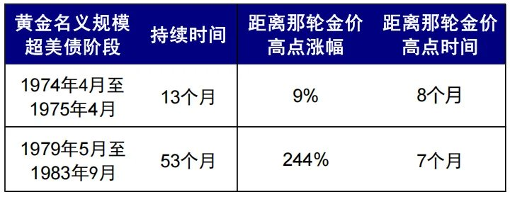

第一段的叙述连接美元浮动、第一次石油危机、通胀与政策反复；随后供给侧通胀放缓和美国政府拍卖黄金等变化进入回落解释。第二段连接伊朗革命、第二次石油危机及实际利率变化，继而讨论沃尔克1979年10月后紧缩与1980年代美元走强。文章所列有效联邦基金利率从11.4%升至19.1%、实际利率随后转正，属于历史回顾，并非当时投资者已知的完整路径。

图28为政策代价提供另一组背景：1979年5月债务／GDP为31.1%、利息支出／收入9.2%；2025年期内均值为121.5%、19.8%。较高债务和付息负担使提高利率更容易转化为财政压力，但制度、通胀及经济结构也不同，不能由这两个比率推算今天可承受的精确利率。[债务单位与文字差异](../../40_sources/S-WS-3764710.md#figure-checks)在来源页保存。

## 当时的政策判断：如何重塑信任，以及代价落在哪里

作者用低通胀、低利率和美元主导地位“三选二”描述政策张力。它是对当时通胀、债务与政治条件的判断，尚未给出这三个目标在任何状态下都无法同时改善的定理。图29汇总沃什自2025年以来主张降息、缩表和机构分工的发言；本文按文章转引保存，未另核其每次完整演说。

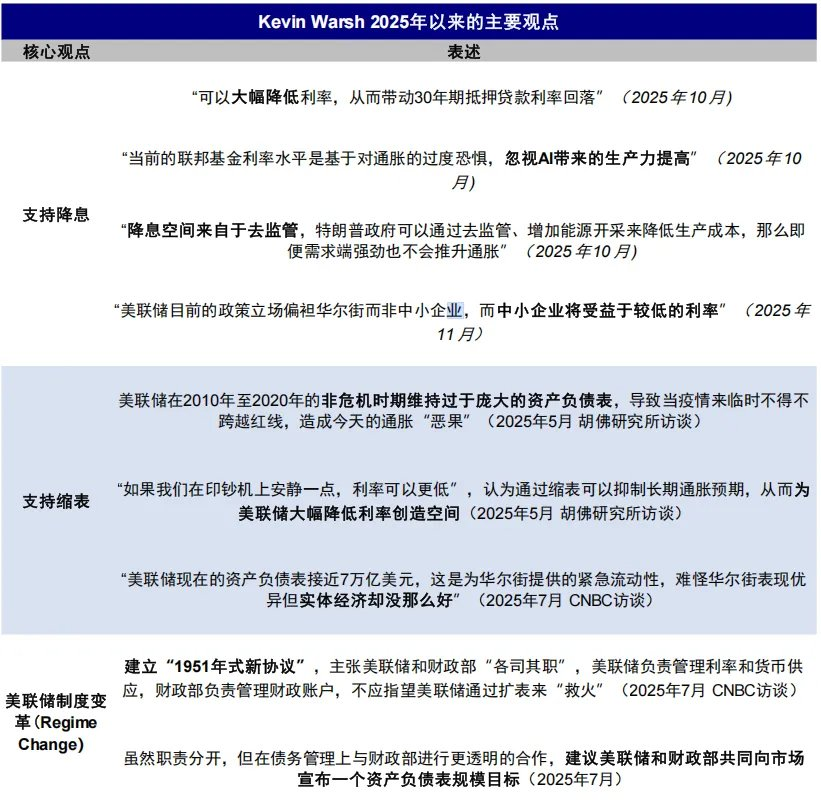

在作者的情景中，AI提高效率、放松监管和降低能源成本有望压低通胀，为下调短端利率创造空间；缩表则被赋予重塑货币纪律与机构边界的意义。这是对沃什主张及其可行性的转引，尚未成为已兑现的政策组合。

这套安排的代价可以沿持有人和付款链条理解：短端降息有助缓和短期融资与逐步再融资的利息负担；美联储缩减持券，则需要其他投资者相对于有联储承接时吸收更多债券。私人投资者承接多少，取决于预期通胀、期限风险、流动性和要求的回报。若他们要求更高长端收益率，政府新发与到期滚续债务的成本就可能抵消短端降息带来的部分缓解；资产出售或准备金收缩也可能收紧交易和融资条件。短端下调不能保证长端融资成本同步下降。

反向作用同样重要：若纪律承诺可信、生产率改善确实降低通胀，持有人对长期购买力的担忧和要求的风险补偿可能下降，从而减轻融资压力，并降低以黄金保护美元资产风险的需求；若政策损伤增长、财政付息继续挤压预算，或实际通胀未降，信任重建就可能受阻。这里是本库对作者情景的联系解释，并未从原图估计各项力量的净效应。图30—31展示公共持有美债及美联储持仓的期限结构，说明调整涉及大量中长期债券，也不能据此假定一项无成本的换仓空间。

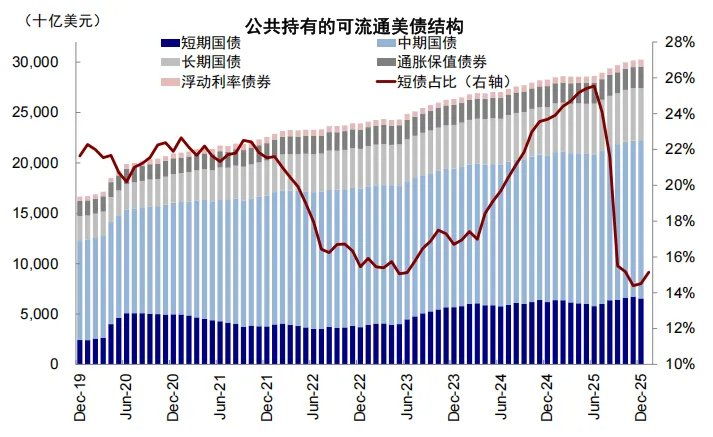

图32—33的两个QT窗口尤其说明，资产负债表收缩与黄金方向并非简单一一对应：作者表中2017年10月起缩表后1个月、3个月、全程金价为−0.4%、1.8%、12.9%；2022年6月起为−1.9%、−8.0%、129.2%。后一个全程在图中定义至2025年12月，前一个至2019年8月。窗口长度、共同消息与起止时点不同，这些总回报不能当作QT独立处理效应，也不据图中窗口确认所有制度安排的实际终止日。

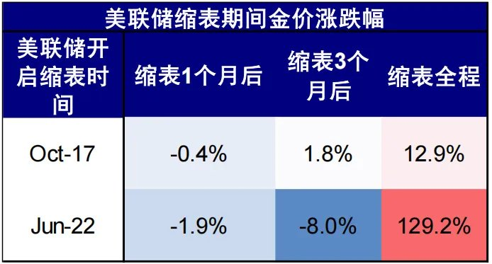

## 截至2026年2月2日的判断及其检验方向

中金判断，彻底终结黄金趋势需要看到美国在财政纪律、货币约束、盟友合作或真实资产回报方面重建信任；行政卖金或税收可能造成短期冲击，但未必解决长期配置动机。作者没有给出终极金价目标，也明确两段历史的后续涨幅相差很大。

作者还把美国是否重新与盟友合作的观察放到**中期选举后**。这是其政治信任路径的具体窗口；财政纪律、真实资产回报和官方储备调整未被给出相同的兑现日。其“定投”建议保留在原文。

以下检验办法由本库于**2026-11-16**整理；观察起点取文章的**2026-02-02信息集**，“随后”均相对此信息点，没有引入后来的结果：

- **随后数周，观察私人渠道与短期冲击。** 对照GLD和其他地区黄金产品的份额、黄金重量、申赎与波动。若持有量迅速回落、官方数量尚无相应变化，私人仓位调整的解释增强；价格与单一基金共同上涨仍不能决定谁先驱动谁。
- **随后月度、季度披露，观察官方配置。** 看多个管理者的吨数、估值调整后变化和公开授权。数量持续增加且对应分散风险理由，更支持局部替代；只有涨价造成的黄金份额上升，应降低对主动购买规模的判断。私人撤出而官方数量仍增，容纳短期承压与长期需求同时存在。
- **较长政策及政治窗口，观察信任能否重建。** 沿作者中期选举后的窗口看盟友合作和资产可动用性安排，同时看实际通胀、利率、财政付息与私人承接。若通胀回落、真实回报改善、制度承诺可信，美元资产吸引力增强的解释更有支撑；若仅有行政售金或一次价格冲击，尚不能判定长期保护动机消失。

## 关联

[黄金](../../10_concepts/黄金.md#stock-comparison-202601) · [SPDR黄金信托GLD](../../10_concepts/SPDR黄金信托GLD.md) · [央行购金与黄金需求结构](../../20_mechanisms/央行购金与黄金需求结构.md) · [美元信用与储备多元化](../../20_mechanisms/美元信用与储备多元化.md#country-holder-scope)。
