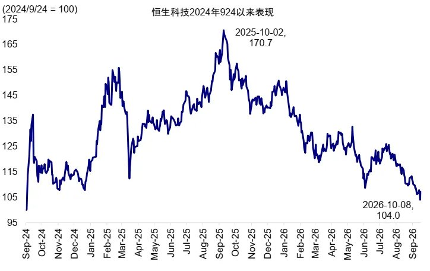
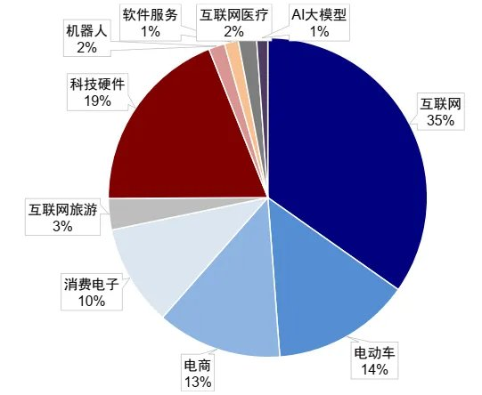
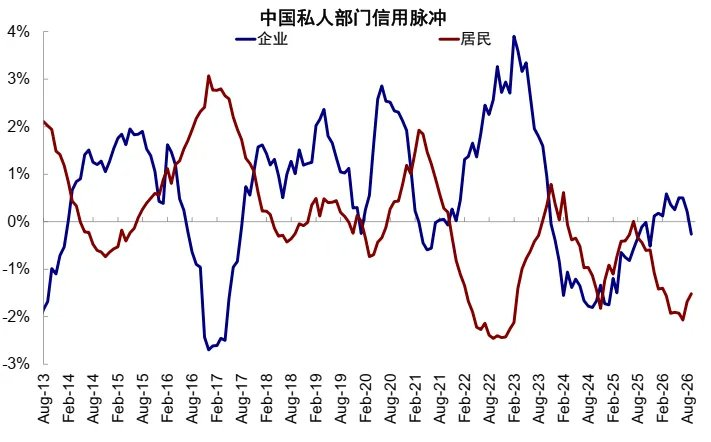
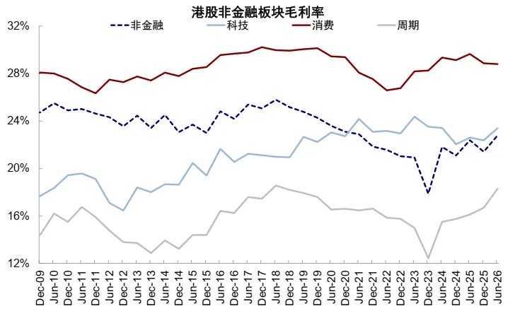
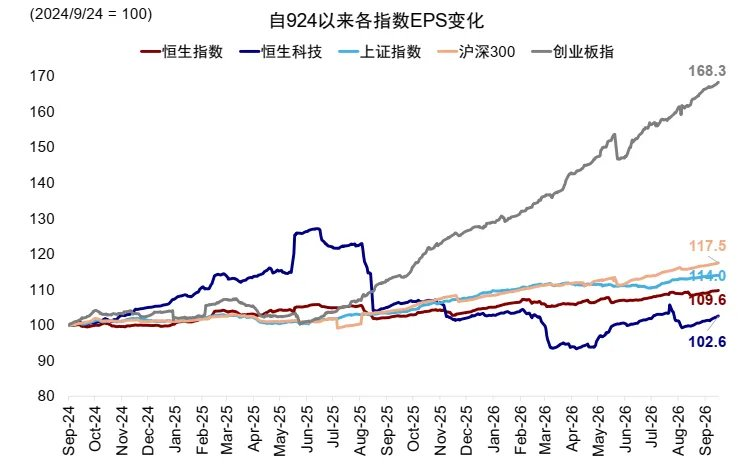
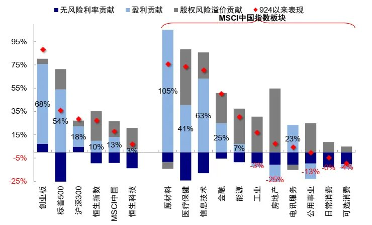
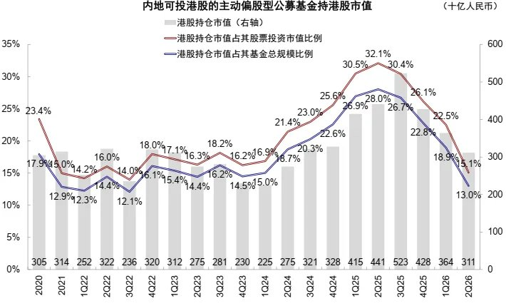
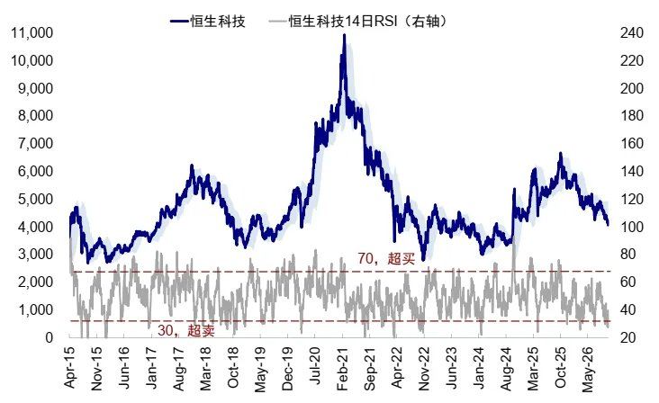

# 924两周年的恒科回撤：居民信用、盈利与资金分化

2026年10月13日，中金刘刚、张巍瀚借恒生科技接近2024年9月24日水平，追问：经济总量、出口与AI产业仍增长，为何指数回报与盈利如此弱？本文依次整理部门需求、成分经营、市场定价和修复条件。研究观点与数字归原作者；后补检验思路单列日期，不补入随后行情或政策结果。

[原材料](../../../materials/wallstreetcn/SourcePost/中金：924两年后有何变化？/article.md) · [全部24图及口径记录](../../40_sources/S-WS-3783497.md#figures) · [后续11月2日观察](港股价格底、信用周期与股权供求：2026年11月观察.md)

文章记恒科年初至10月9日跌23.9%，较2025年10月高点回撤接近40%。下图以924为100，在10月8日标104.0；作者回顾自己2025年末以来的谨慎立场，把此前上涨主要解释为政策脉冲与资金再平衡，持续上涨仍有赖盈利和需求。

## 部门分化怎样进入恒科成分的收入

中金把恒科称作“大号消费指数”：按其业务分组，互联网35%、电动车14%、电商13%、消费电子10%，合计72%。居民收入、购置能力和支出意愿可影响平台广告、交易额、汽车与设备销售，再进入盈利预测。恒指另有较多银行、本地金融、电信等业务，敏感性不同。这是作者的业务分组，并不代表这些公司全部收入来自内地居民；出海、企业客户及公司竞争地位仍需分别看。

作者认为，924后财政支持和居民端补贴曾带动信用修复；到2025年三季度后，居民信用脉冲回落，2026年3月低于924水平，企业信用却仍有科技和出口链条支撑。企业投资形成设备、研发和供应链收入，要继续传到家庭支出，还需工资就业、转移支付或资产负债表改善。因此企业融资扩张、出口景气与消费平台盈利承压可以并存。

在作者的政策解释中，收入与信心修复缓慢、地产拖累之外，2026年财政更多偏科技产业，居民支持相对减少。其广义赤字率估计为8.1%，2025年8.5%，属于作者口径。图8的以旧换新品类先强后弱支持需求节奏变化的观察；基数、提前购买和品类构成也会影响曲线。信用、政策与股价的共同变化没有独立识别各自因果贡献。信用脉冲、存量增速与官方贷款统计的区别见[来源口径](../../40_sources/S-WS-3783497.md#measurement)。

作者还用日本1990年代三轮反弹作类比：1992—93年约12.8个月涨54%，1995—96年约12.6个月涨44%，1998—2000年约16个月涨79%。其关注的是财政和金融支持消退后，资产负债表问题仍会限制行情持续性。这些时期还包含银行重整等变化，不能据三个样本认定财政单独决定转折，也不能为港股设定“一年左右”的反转时钟。[图9—10](../../40_sources/S-WS-3783497.md#figures)保留完整历史比较。

## 收入进入利润与资本回报，还要经过哪些环节

作者比较2025年名义GDP，美国约增5%、中国约增4%，尽管中国实际增速更高。实际产出数量须经价格进入名义收入；某家公司的销售又取决于地域、行业和份额。指数成分也没有覆盖整个经济，宏观总量无法代替组合的销售增长。

随后有两道经营传递：价格竞争、原材料和汇兑成本改变利润率；扩产、库存和应收款改变资产周转与现金占用。企业即使增加利润，新增资产和债务若增长更快，资本回报仍可能承压。分析ROE还需同时识别杠杆贡献、回款和负债，才能判断利润是否支持股东回报。

在文章的财务比较中，2026年上半年港股非金融企业毛利率22.8%、净利率6.4%，低于2018年上半年25.8%、8.3%。消费毛利率由2025上半年的29.6%降至28.8%，净利率9.4%降至7.3%；信息技术毛利率17.4%升至18.9%，半导体净利率3.8%升至9.0%。这说明同一市场的利润率也存在行业分化。图22“科技”曲线与正文“信息技术”样本口径未详述，精确值仍按正文作者比较记录。

作者列制造业应收账款回收周期超过70天、产成品库存周转21天，说明营运资本占用。这些是制造业观察，未覆盖所有恒科成分；用于提醒检查现金回收，不能直接拿来计算恒科ROE。

组合盈利也体现了分化：文章记924以来恒科动态EPS累计约增2.5%，恒指和MSCI中国约增10%，上证约增14%，创业板约增69%；原材料与硬件设备EPS约增83.3%、80%，消费若干行业预测EPS下修约5%—20%。动态EPS是未来盈利预期，须与已实现利润分开；正文、图注与端点的选点差异集中列于来源。

## 盈利之外，估值、资金承接与发行共同进入价格

中金将恒科在所选924以来窗口的7.2%回报分为盈利贡献2.8%、估值4.4%。同文恒指、MSCI中国约涨25%、17%，万得全A约50%，科创50、创业板约118%、88%。港股通信设备、半导体、电子设备约涨114%、113%、108%，酒店餐饮和个人用品跌逾30%；指数整体弱势没有覆盖每一种港股业务。

文章列恒科12个月动态PE14.2倍，接近作者所选924前14倍；无风险利率代理按南向成交比例动态加权中债和美债。作者记美债收益率3.7%升至5.2%，其分解给恒科估值−13.7%的贡献，风险溢价改善则为+18.1%。这些是研究者归因输出，完整算法和期限未列，成交权重也不能直接观测全部投资者的要求回报；不将这组输出登记为通用模型。图2、PE与EPS的不同选点详见[口径记录](../../40_sources/S-WS-3783497.md#measurement)。

资金方面，正文比较2025全年南向净流入1.4万亿港元和2026年前9个月4418亿港元；窗口不等长，不能据此给等长下降70%的结论。内地可投港股主动偏股公募的港股市值占股票投资市值，由2025年二季度32.1%降至2026年二季度15.1%；按基金总规模作分母则由28.0%降至13.0%。股价、申赎和主动配置都影响比例，它不等于净卖出量。

EPFR所覆盖全球、全球除美、亚洲除日和新兴市场基金样本，其主动基金中国股权重由2025年中约7.2%降至2026年8月约6.0%，并不代表所有外资。作者还称年内IPO和再融资7150亿港元，高于2025全年6138亿；图16柱图合计却分别为7240亿、6460亿，版本未能核齐，不能混填官方年度表。发行增加承接需求，但回购、分红、原股东出售和投资者现金配置也影响供求。[IPO、再融资与退市](../../10_concepts/IPO、再融资与退市.md)提供基础区别。

作者强调资金和行情互相强化：改善的回报与预期吸引买方，走弱又促使撤出。资金方向可以帮助观察边际承接，不能单独完成基本面归因。

## 当时的修复路径：居民需求、平台AI经营与组合变化

截至10月13日，中金用14.2倍动态PE、约2.9%股权风险溢价、14日RSI一度27.7和近期南向回流，判断短期反弹的潜在回报较有吸引力。价格、情绪与承接改善可以形成反弹，是否持续还须经营和需求支持。图24“胜率”“赔率”构造未披露，坐标不能当作校准后的真实上涨概率。

**居民需求路径。** 作者期待财政更多直接支持居民，修复家庭信用和消费，认为这可能使恒科受益。其当时预计5500亿元地方政府债务结存限额主要于11—12月投放，较去年同期多约500亿元，可能小幅提高四季度广义财政脉冲；同时判断仍需更多居民支持。额度、发行、拨付对象与消费支付是连续但不同的环节，文中没有提供已实现结果。

**平台AI经营路径。** 作者认为港股硬件覆盖不足，既有互联网平台的AI投资、模型研发和收入兑现未充分抵消消费走弱，期待新的“DeepSeek时刻”。从经营上解释，能力提升若带来企业客户的云/API付费、用户订阅或现有广告交易效率改善，才可能形成新收入或节约成本；还要扣除计算、研发和资本投入带来的成本，检查利润及现金回收。这是本库对条件的展开，未认定任何公司当时已经兑现。在居民信用仍弱时，企业付费等收入也可能提供另一盈利来源。图11是产业链股价，图12是特定模型测试与调用价格，都不能直接替代平台商业化证据。

**组合变化。** 原文另预计年底指数调整有望小幅改善结构。换入公司及其权重变化，会改变投资者持有的业务组合；这种暴露变化与既有平台盈利改善应分别检验。调仓后若新增硬件或其他业务权重仍小，影响也可能有限。编制规则基础定位[指数页](../../10_concepts/恒生指数与恒生科技指数.md)，本文保留10月13日的预期，不以其后方法或名单倒填当时已知情况。

### 原文的具体窗口与后补检验

下表左列保存10月13日作者提出的待观察事项；右列为本库2026-11-16整理的检验思路，仅据当时信息，不填后来结果。

| 当时待观察窗口 | 用什么变化区分解释 |
|---|---|
| 近期回调后的承接与反弹 | 对照南向买盘、价格和盈利修订；若只有仓位/情绪修复，仍不足以确认居民需求或盈利趋势逆转 |
| 三季度业绩，以及文中所提Anthropic上市产业催化 | 核既有平台AI相关付费收入、成本、利润率与现金回收；产业热度变化先影响估值，也须辨别是否进入所持公司的经营。本文没有核实该上市计划或之后进展 |
| CPI与10月底FOMC | 观察通胀与政策信息是否缓解作者所称加息担忧，及无风险回报/折现条件如何变化；会议结果不预设，也不直接验证平台收入增长 |
| 11—12月5500亿元投放 | 依次核额度、发行、实际拨付与用途，再追踪家庭收入、居民融资和消费；额度或发行完成不能单独证明居民信用改善 |
| 年底经济工作会议 | 观察是否提出更直接的居民支持及其可执行安排；后续仍需支付与需求证据 |
| 年底指数调整与生效 | 核实际成分、权重和业务暴露变化；区分新组合变化与原平台公司的盈利改善 |

作者的配置判断是等待科技催化、利率担忧缓解和更强财政信号，未出现时倾向红利对冲，并列能源、交运、保险等相对位置。这里保存其当时立场。[11月2日分析](港股价格底、信用周期与股权供求：2026年11月观察.md)作为之后的研究判断独立维护，不能反向改写10月13日预期。
