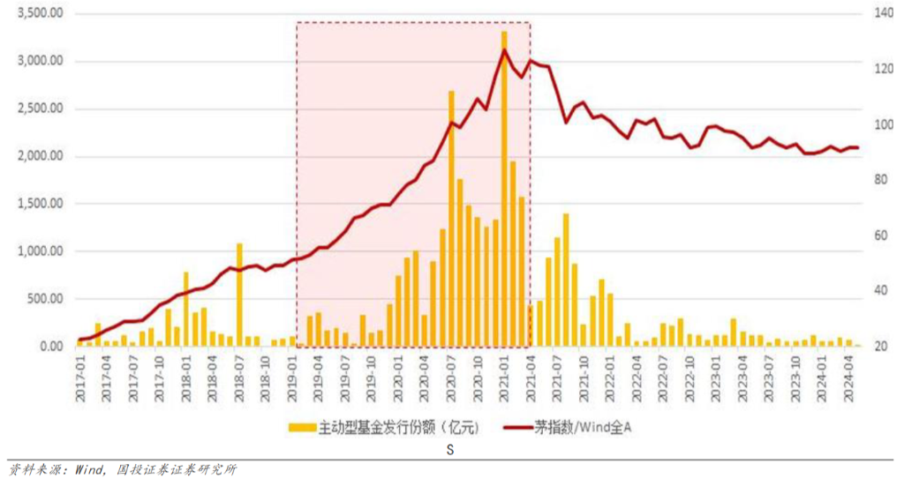
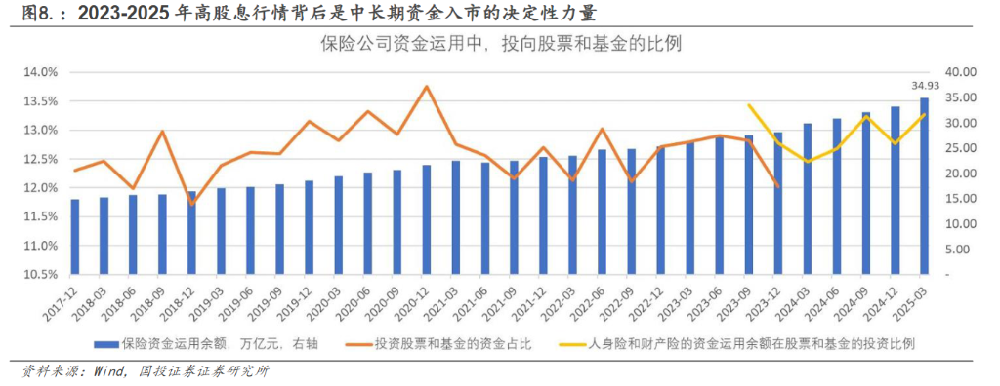
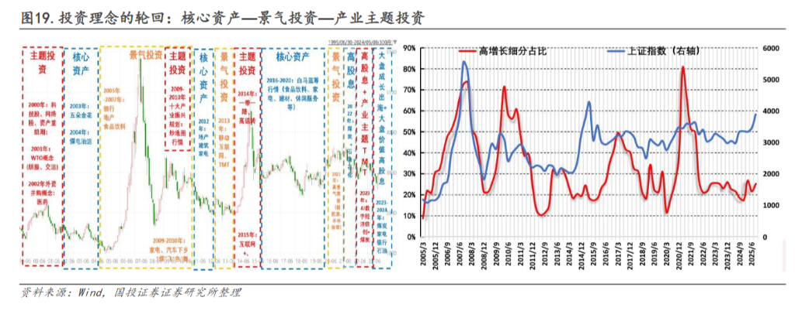
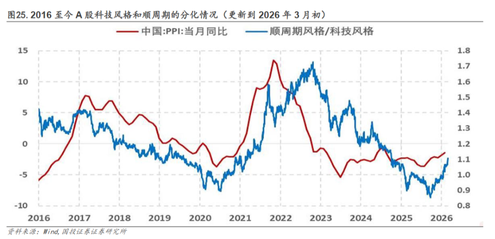
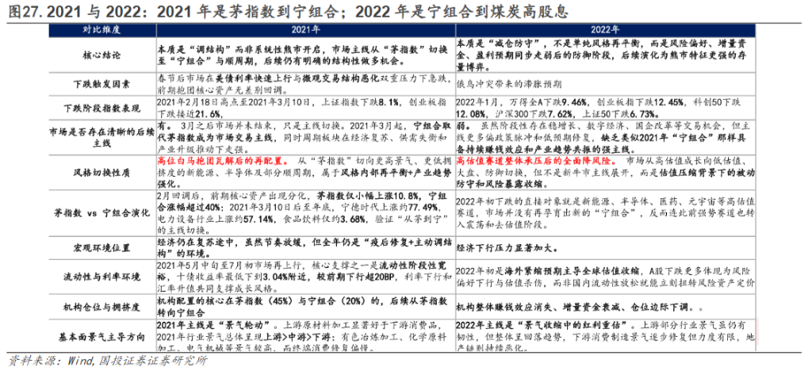
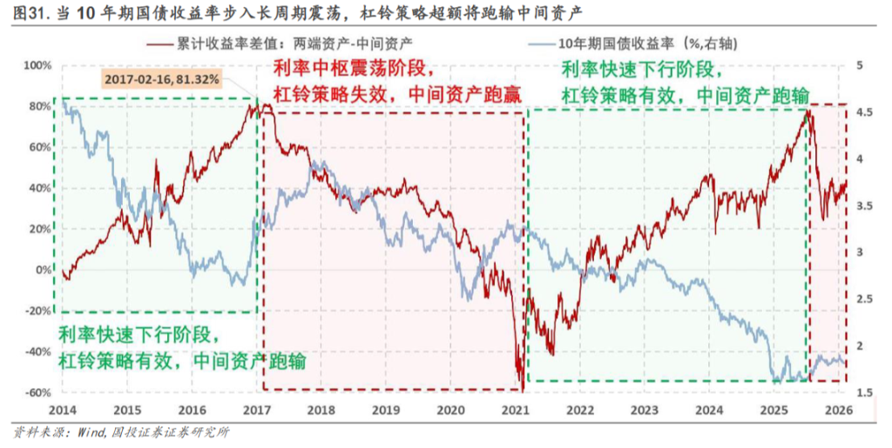

# A股主线、资金偏好与风格切换：国投2026年5月方法讨论

2026年5月10日，华尔街见闻鲍奕龙转述国投证券策略团队5月7日研究，讨论A股阶段性领先方向如何形成和切换。最有解释力的问题是：谁在扩大风险承担，为什么偏好某组股票；原持仓面对新的经营或宏观信息时，又由谁承接？本文保存当时的方法与条件判断，没有加入后来行情结果。[来源记录](../../40_sources/S-WS-3771926.md#figures)逐张直达全部12张原图，正文选取支持论证的图就近展示。

## 1. 从“谁买什么”理解主线

作者把宏观叙事、产业趋势、增量资金、风格切换列为四种抓手，分别观察经济政策、企业需求与利润、资金主体及组合之间的重新配置。其“持续有效性”排序为宏观叙事、产业趋势、增量资金、风格切换，“辨别难度”排序为增量资金、宏观叙事、风格切换、产业趋势，并建议选一至两项使用。这些属于作者的方法选择。[图1导览](../../40_sources/S-WS-3771926.md#fig-01)保留完整框架；“一年约60%时间主线清晰”没有附识别规则和统计样本。

### 资金来源通过产品约束和订单进入价格

[市场价格](../../10_concepts/A股市场.md)由当时愿意成交的订单形成。新进入的基金或保险组合若集中购买同一组股票，原报价附近供给不足时，需要提高报价；上涨又可能改善产品净值和展示业绩，吸引申购及其他买家。赎回、配置目标变化则会削弱承接。每笔成交仍有买卖双方，“增量”要落实到具体主体、现金、授权和交易。

| 国投选取的阶段 | 作者所说的主导资金与偏好 | 图证据支持到哪里 |
|---|---|---|
| 2017—2021 | 外资偏好高ROE与自由现金流，随后公募扩张推动大盘成长 | 图2为基金发行与茅指数相对表现，未分别展示外资交易与基金净买股 |
| 2021—2023 | 量化私募扩张推动微盘风格 | [图3](../../40_sources/S-WS-3771926.md#fig-03)画私募其他基金成立只数，不能直接当作量化AUM或流入金额 |
| 2023—2025 | 沪深300ETF申购与银行表现相连，保险配置支持红利 | 图4支持保险余额和配置观察，没有画出银行与ETF的配对序列 |

同一银行板块的承接也可能来自不同途径。沪深300ETF配置广泛指数成分，银行只是其中一部分，风险暴露取决于成分及权重。现金申购通常由基金收到现金后安排购入组合证券，现金替代的购入责任和退补依产品规则；实物申购可由参与者先买篮子，也可交付已有库存，基金无需再买同一批股票。因而需沿[申赎清单与交付](../../10_concepts/ETF申赎与二级市场交易.md)确认谁在何时交易，不能把每元申购直接写成银行买单。二级市场买卖已有ETF份额也未必触发新增申购。

保险公司则可能直接选择能够持续派息、适合负债付款和考核的股票。符合条件的FVOCI列报下，股利与价差进入利润的方式不同，可能加强这种选择；通用解释在[保险资金页](../../10_concepts/保险资金与长期资金.md#oci-equity)。这是国投所称制度“通道”的一种经济连接，实际是否增配仍要看资金、资本余量和交易披露。

制度可以改变准入、成本和考核，使未来渠道较容易观察，但渠道打开之后仍需募集、授权和执行。原文的“存款搬家”用非银/居民存款比值作代理；[图5](../../40_sources/S-WS-3771926.md#fig-05)只到2024-11-27，无法逐户确认资金迁往哪些股票，股票换手本身也不会使体系存款等额消失。

### 发行热度与价格转折为何可能错时

国投归纳超额收益、估值分化、增量资金依次见顶，以2020年四季度公募行情为例，并援引2005—2007、2012—2014、2016—2017等阶段。其“A卖”指超额收益转弱时可减仓，“B卖”指三者均确认后结束主线配置，属于作者交易框架。

[主动公募页](../../10_concepts/主动权益公募基金.md#issuance-style-202605)解释募集响应过去业绩及建仓的时差。本篇据此提出观察问题，却没有展示三条完整同口径序列、峰值确认和滞后规则；无法核实“总是依次见顶”，也不能从过去峰值直接得到实时买卖点。图2截至2024年的发行与相对表现，仍不是该三峰框架的完整验证。

## 2. 经营改善与原有持仓怎样共同改变风格

资金愿意买什么，也取决于可取得增长的公司有多少。国投按中信三级行业利润增速超过30%的行业数量占比，划分高于50%、25%—50%、低于25%三档，分别偏好景气、核心资产和产业主题。该比例衡量高增长行业广度，并未按利润金额或市场权重加权；[策略轮回图6](../../40_sources/S-WS-3771926.md#fig-06)表达作者对状态的组织。

广度收窄可能使少数增长方向更稀缺，让资金集中到相似标的。作者把低于25%与“基本面分析失效”相连，并以当时AI行情为例；个股仍面对现金流、融资和竞争约束，这张图不足以否定全部基本面信息。阈值作为其具体方法保存。

国投当时认为，季度到半年内科技与周期可能“新旧共舞”，PPI回升是重要指引。PPI变化需要接到具体公司的售价、成本和销量：若售价改善且成本未同步上升，利润可能修复；若上游涨价反而挤压该企业毛利，同一PPI变化会给出另一条路径。图8并列PPI当月同比与顺周期/科技风格，更新到2026年3月初，相对指数的完整构造未附。

原持仓决定新信息要经过怎样的交易调整。高度相似的组合遇到盈利或政策判断变化，可能同时降低配置；买家承接有限时，卖方需让价。仅有高持仓，新增需求仍可能支持上涨；仅有冲击，原方向也可能因盈利前景和买家未变而恢复。国投以2021年茅指数到宁组合、2022年宁组合到煤炭高股息说明“仓位失衡＋宏观巨变”，表中解释保留研究归属，没有把各因素的价格贡献分别识别出来。

图9保存所选窗口跌幅：2021-02-18至03-10上证−8.1%、创业板−21.6%；2022年1月万得全A−9.46%，其他指数及政策、资金比较可在表内核读。“茅指数”“宁组合”在这里是历史组合标签，原文没有固定成分和权重。

## 3. 利率转为震荡后，哪条联系需要重新检查

本篇股票杠铃以高股息和小盘成长概括两端，以大盘成长概括中间。作者认为，国债收益率持续下降时，资金分别寻找现金分红与稀缺增长；利率转为震荡、中期预期改善时，资金可能回到中间方向。

具体组合要保持一致：[图10](../../40_sources/S-WS-3771926.md#fig-10)两端实际为“银行＋小微盘”，中间为“创业板＋沪深300”，与文字另举A500、中证500并不相同。图11将两端与中间累计收益差同十年国债利率并列，分出快降和震荡区间；不能把这组历史表现转给所有文字例子。

利率下降也可能反映通胀、流动性或债券供需，成长股较远现金流的现值又可能受益于折现率下降。利率横盘因而未必表示盈利已经改善，更不保证资金已经转配。反杠铃判断需要经营预测、原持仓及实际新买盘共同接续，作者没有给出实时“震荡”的判定或固定结束日。

对更短期轮动，国投另用高切低观察，给出约60、30的阈值，称一年约2—3次、周期约2—3个月。[图12](../../40_sources/S-WS-3771926.md#fig-12)保留红色行情跟踪指数与灰色行业收益分化度；缺少窗口、标准化与两线转换，无法由“收益率方差”复算阈值。这套方法与三峰均未成为本库的普遍实时规则。

## 4. 用随后披露分别检验这些判断

以下是本库于2026-11-16后补的检验设计，信息起点为5月7日研究、5月10日转载；没有纳入后来结果。科技/周期沿作者的其后季度至半年窗口观察，渠道及持仓则使用随后可比披露，不为作者补政策日期、反杠铃截止日或信号确认规则。

| 待检验的当时解释 | 支持它的新观察 | 会削弱它或指向另一解释的观察 |
|---|---|---|
| 渠道设计带来对应买盘 | 准入或考核变化后，出现实际授权、净募集/申购及相应持仓数量增加；ETF另核成分权重、清单和交付路径 | 只有额度与产品规模上升，交易数量未增加，或增长主要来自估值、已有库存转入；则渠道尚未转成所称市场买单 |
| PPI回升支持周期相对改善 | 同口径行业在随后季报中售价、毛利及利润预期改善，同构周期组合相对科技走强 | PPI上升主要增加投入成本，利润未修复；或相对表现变强但盈利预期未变，需要进一步检查贴现率和配置变化 |
| 原仓位与新冲击共同推动切换 | 冲击前存在共同重仓，随后同组管理人削减相同证券，原价承接减弱；能找到新的机构、产品或个人买方及其成本 | 共同持仓未减少，或新买家很快吸收出售；跌幅也可能主要来自现金流估值修正，不能据价格单独确认踩踏 |
| 利率震荡给中间组合创造条件 | 固定样本下，利率状态改变同时伴随中间组合盈利预期改善、可比披露中的增配与相对收益 | 只看到国债横盘，经营和配置未变，或不同组合定义给出相反结果；需下修作者所述衔接 |

三峰和高切低还缺完整构造与事前可得规则，目前只能继续核查作者方法。资金主体、经营变化、原仓位与价格各有证据位置，后续更新应逐条比较哪一联系成立，保留预测方向与解释是否成立的区别。
