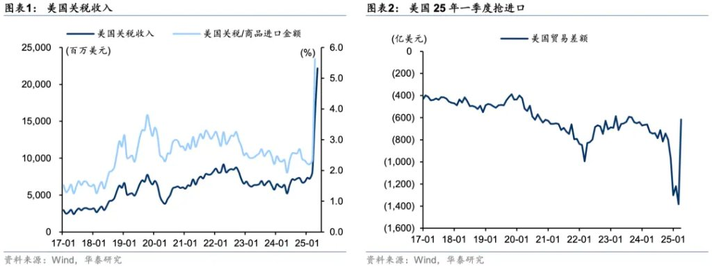
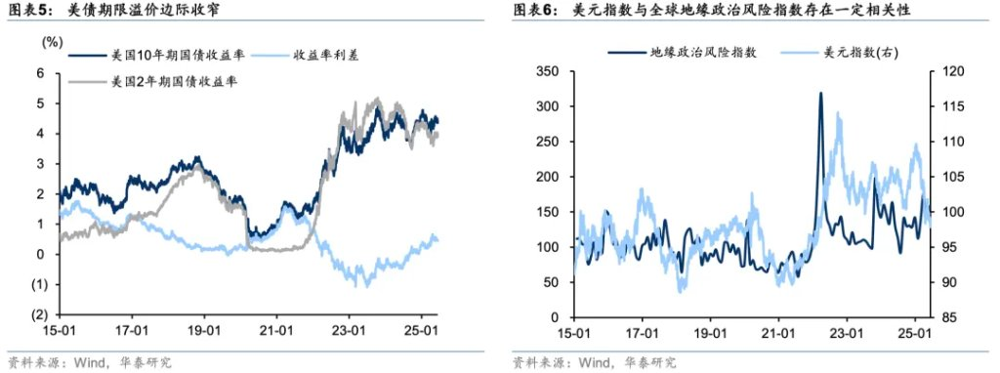
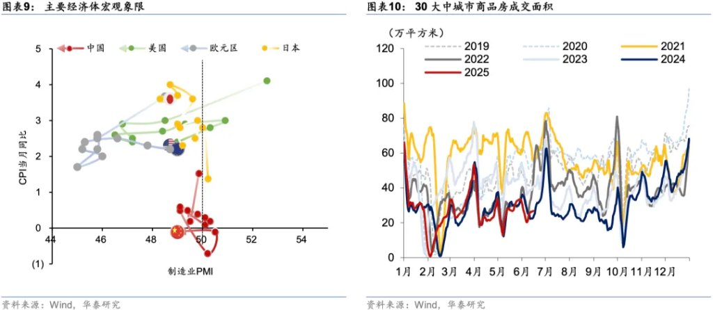
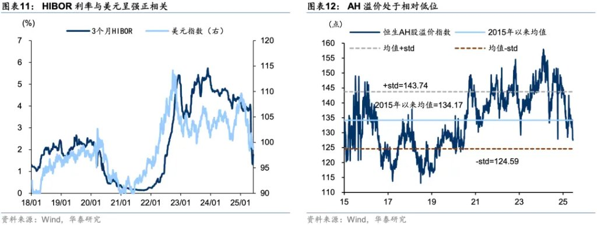
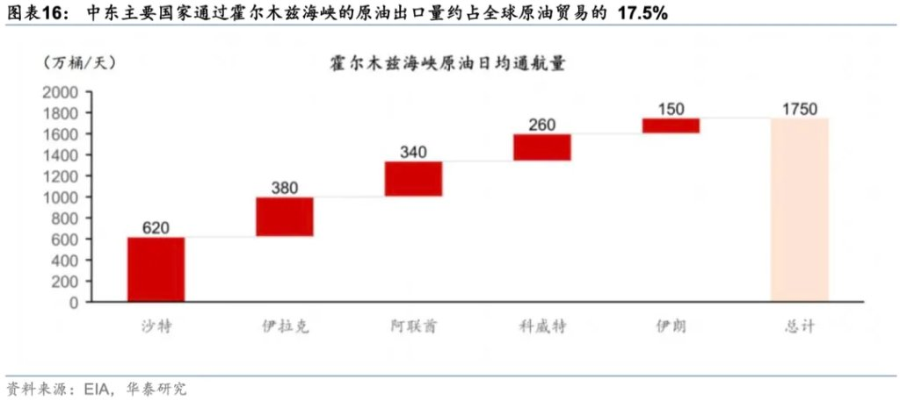

# 五组市场叙述与条件预期差：华泰2025年6月跨资产判断

2025年6月19日，华尔街见闻董静转述华泰证券张继强、陶冶、王建刚的资产配置研究：市场关注从关税消息转向经济数据和地缘局势，先前流行的判断可能在不同期限遇到反向信息。“五大共识”是团队归纳的市场叙述，未附统一调查或定价提取。

五个问题分别涉及企业成本、美债与美元、中国债市、两地股票和原油。以下保留华泰截至当日的判断；本库于2026年11月16日展开条件解释并提出检验安排，没有加入后来结果。[来源及全部9张原图](../../40_sources/S-WS-3749421.md#figures)集中保存详细校读。

## 1. 关税消息平静以后，经营影响如何逐步显露

华泰归纳的第一项叙述是：伦敦经贸会谈形成协议框架，短期摩擦升级风险下降，市场对关税消息的敏感度随之降低。团队认为，情绪修复可以早于企业消化税负。

美国一季度抢进口形成库存，作者估计超额进口可支持2—3个月。企业先出售较低成本库存，可以暂缓提高售价；库存耗用后，补货成本才更直接进入新订单。供应商让价、进口商压缩毛利、汇率变化和消费者减少购买，继续决定税负由谁承担。[关税的跨境成本分担](../../20_mechanisms/关税的跨境成本分担.md)维护一般过程。

高利率、关税和资产波动也可能先压低消费意愿。华泰将本轮“先关税紧缩、后减税扩张”与2018年的政策组合比较，认为时序错配使当时通胀传导较弱，后来减税落地仍可能增强需求和价格压力。这是团队对政策组合的解释。对中国，团队把一季度抢出口接到三、四季度外需及企业盈利，并按当时转载表述称新增30%关税将陆续显现；逐商品税率与豁免未在本轮核验。

图1显示贸易和征收变化；库存缓冲月数是作者估计，尚需企业存货与终端销售资料接续。经济意外指数则衡量数据相对预测的偏离，回落还可能来自预期提高；[原图2与口径](../../40_sources/S-WS-3749421.md#figures)保留软硬数据解释的证据范围。

## 2. 债务压力仍在，为什么美债与美元又可能阶段性走强

第二项叙述把美国债务、评级和政策不确定性接到长期收益率易上难下、美元长期走弱。华泰的反向判断是：长期问题短期可能已较充分反映在价格中；若需求降温推动降息预期，2025年下半年美债收益率仍有阶段性下降机会。以伊冲突若推高能源与通胀，又可能抵消这一路径。

长期收益率包含未来短率预期及承担期限风险的补偿，两者可以朝不同方向变化。[期限溢价](../../10_concepts/期限溢价.md)解释所需分解。图3标题虽写期限溢价，实际画的是十年、两年收益率及其利差，不能用10Y−2Y代替模型期限溢价。转载另称主权CDS近期回落，但未附相应序列或模型。

华泰还把财政部100亿美元国债回购视为需求支持。财政部回购可改善旧券流动性，但付款仍要融资，不能直接视为央行净扩表或债务负担消失；具体操作未在本轮取得公告核验。[国债供给机制](../../20_mechanisms/国债供给的定价机制.md)连接发行、久期与实际承接。

美元方面，团队认为美国基本面企稳、科技股吸引力恢复及外部地缘风险，可能使2025年下半年的美元跌势阶段性缓和。**本库的条件解释是：** 若美国企业相对盈利前景改善，外国投资者可能增加美元资产配置，其中以非美元资金支付的部分形成买入美元需求。已有美元现金也可直接投资；新增持仓若同时提高汇率套保，远期卖美元又会改变净敞口，因此美国股票买入与即期美元需求不会一比一对应。[同月财政研究中的配置与套保解释](众院财政提案、899税收争议与美元预期：2025年6月.md#dollar)提供另一方向的比较。

外部冲击还可能使企业和金融机构为美元债务、保证金或跨境付款筹集美元现金，[美元融资依赖](../../20_mechanisms/美元融资依赖的传导机制.md)解释这类需求。若不确定性主要来自美国政策或信用本身，投资者也可能减少美国资产、提高套保，方向便会改变。股价、资金流和[DXY](../../10_concepts/美元指数DXY与广义美元指数.md)的共现尚未识别上述哪条过程；图3的双轴比较亦未给固定的地缘风险—汇率反应。

## 3. 低票息为何仍可与国内债价机会并存

第三项叙述认为利率已低、主动取得超额更难，债券指数基金因而扩容。华泰的预期差在2025年三季度：外需受关税影响，消费和地产支撑仍弱，基本面若超预期放缓，债市仍有波段甚至小趋势机会。

低票息描述持有收入，收益率继续下降又可带来固定现金流的价格上涨。需求和价格走弱使市场下调未来政策与融资利率时，这一资本利得路径仍可能存在；能源通胀、供给和风险补偿则可能抵消它。原图4的债市历史回报比较没有单独识别主动管理人的alpha。债券ETF的持续组合、净值、交易价和申赎由[产品页](../../10_concepts/债券ETF.md)解释，原图中数量及规模上升也须与净申购分开。

华泰以5月制造业景气偏弱、PPI降幅扩大、住房交易及部分消费支持减弱作为依据。[PMI与景气调查](../../10_concepts/PMI与景气调查.md)说明扩散调查和价格同比所测量的对象。图5右侧的新房面积只是这组证据的一部分，二手房价格和消费判断还需各自数据，不能由一条住房曲线代替。

## 4. 港股活跃，是否仍意味着AH溢价继续下降

第四项叙述看好港股相对A股及创新药、新消费、稳定币等热点。华泰担心部分方向涨幅较大，提出短期调整、AI和机器人主线回归的可能；同时认为AH溢价短期或企稳，长期则可能随港股活跃度提高而系统性收窄。

[港股市场](../../10_concepts/港股市场.md)包括不同公司；[AH溢价](../../10_concepts/A／H溢价.md#outlook-20250619)则比较同一家公司两类股份经换汇后的价格。两地准入、融资、股份供给与要求回报不同，同一企业仍可有两个价格。外部风险若使H股投资者要求更高补偿，H股相对走弱便可推高AH比率，与长期参与者增加所带来的收窄方向并存。[市场分割机制](../../20_mechanisms/A／H溢价的市场分割机制.md#logic-3)展开这些条件。

图6帮助定位当时相对低位，历史均值和标准差不规定未来底部。热点判断还需另一套证据：原图7是TMT、广义医药指数及成交份额，提示交易重心，却未直接测到创新药持仓或退出约束。团队列微软、英伟达业绩作为AI回归线索；[稳定币](../../10_concepts/稳定币.md)在本文仅为热点标签，没有新产品合同。因而热点轮动、港股宽基和AH配对价差须分别核对。

## 5. 单国出口风险与共同航道受阻，怎样改变原油判断

第五项叙述偏好黄金、铜等稀缺资源，担忧商品总需求；华泰指出，长期排序之外，原油仍会因近期地缘风险明显反弹。文中称6月从低点反弹超过20%，原图8“6月以来”约15%使用另一比较起点，不能合并为同一回报。

作者称伊朗产量约300万桶／日、约一半出口，OPEC闲置超过400万桶／日，认为数量上可覆盖单国潜在出口缺口。更大风险是霍尔木兹受阻：多个国家共用航道，邻国产能未必能绕开同一运输限制。

图9合计1750万桶／日是列示运输敞口，尚非已损失供给；图题17.5%的全球贸易分母未核，[逐国值及分母核读](../../40_sources/S-WS-3749421.md#oil-figures)单独保存。纸面闲置产能要经过启动、油种适配、港口与运输，才能成为炼厂可用原料。[原油供给冲击logic-1](../../20_mechanisms/原油供给冲击的宏观传导.md#logic-1)维护一般约束。

华泰认为局势明朗后短期地缘溢价可能回落，中长期供给稀缺资源仍有配置意义，未给油价目标、中断时长或情景概率。所谓“赔率”要同时看所支付价格与不同情景的可能得失；需求替代、扩产和已有涨价仍会改变结果。

## 怎样根据新信息更新五组判断

以下是**本库于2026年11月16日依据6月19日材料提出的检验**，原文期限保留在左列，未补入实现结果，也未替作者补造目标价或概率。

| 华泰截至6月19日的判断与原期限 | 下一组能区分解释的观察 |
|---|---|
| 关税影响滞后；美国库存缓冲约2—3个月，中国外需重点为三、四季度 | 接续库存耗用、补货成本、终端销量与企业利润。进口回落而销售稳、库存下降，较符合抢进口后的正常消退；销量和利润同步转弱，则需求降温解释更强。库存耗尽后补货价涨、毛利降或售价上调，才更接近税负传递。 |
| 下半年美债有阶段性下行机会，美元跌势也可能缓和 | 美债须分开政策路径与同版期限溢价估计：未来短率下降、长率随之下行支持降息渠道，不能据此宣告财政风险消失。美元则对照美国相对盈利、跨境配置、套保及美元融资压力；科技股涨而新增配置弱或套保增加，会削弱“资产吸引力推高美元”的解释。 |
| 中国三季度基本面对债市偏多 | 分别看出口订单、消费、地产及政策利率定价。多项终端需求转弱且短率预期下修，支持原路径；若需求改善、利率仍因其他配置需求下降，应改写其解释；若油价抬高通胀补偿抵消降息预期，也不能只按弱增长判债价。 |
| AH短期企稳、长期可能收窄；热点有阶段性回调风险，未给确切截止日 | 短期逐对比较A/H股价、换汇与两地融资条件，辨明回升来自H股风险补偿还是A股变化。长期另跟踪准入、参与和股份供给，避免用短期反弹否定长期假设。热点同时核持仓、盈利与交易变化；单一成交份额下降尚不能确证拥挤解除。 |
| 原油短期地缘溢价可能回落，中长期关注稀缺供给，未给精确期限 | 随冲突后续消息核实际装船、到港、可交付增产与库存。消息缓和、油流未断且价格回落，较支持风险溢价消退；实际交付下降、库存持续消耗且替代增产受阻，则实物短缺解释增强。长期再看新增项目与需求替代，不能只凭短期油价检验资源稀缺性。 |
