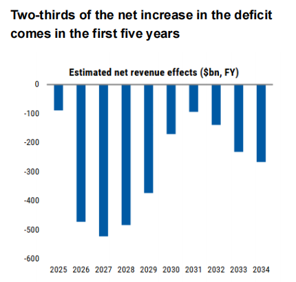
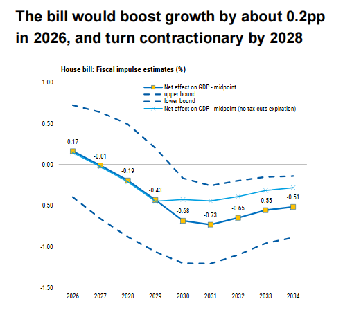
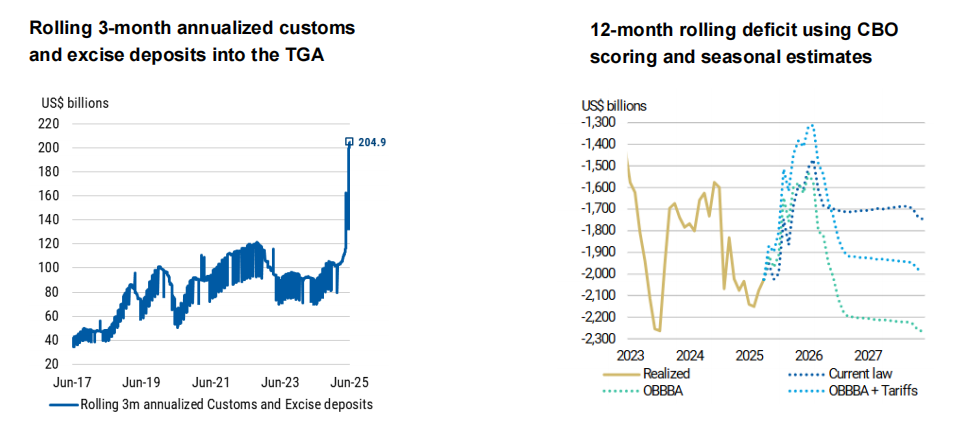
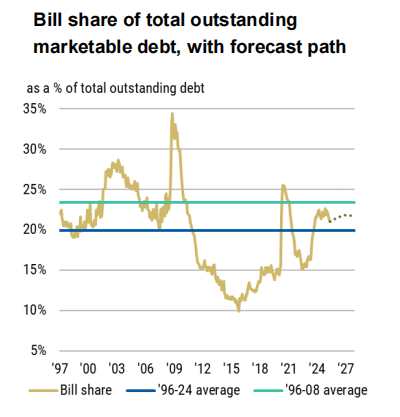
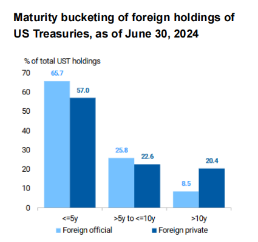
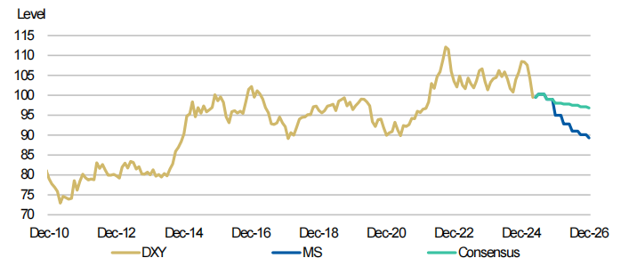
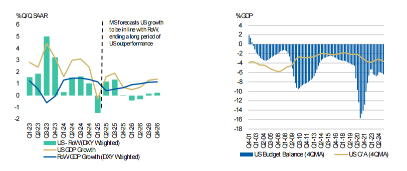

# 众院财政提案、899税收争议与美元预期：2025年6月

2025年6月10日，华尔街见闻鲍奕龙据追风交易台转述摩根士丹利6月9日研究：众院版H.R.1前置减税可能扩大赤字，增长提振却较小；拟议899税收条款可能降低特定外国投资者的税后收益；融资期限和美国相对增长又会改变美债与美元需求。研究当时看空美元，认为899很可能保留。

以下先保存6月10日的分析，再接续6月28日、7月4日的政策信息。关键原图放在相关解释旁；[来源的全部图表定位](../../40_sources/S-WS-3748815.md#figures)可直达10张分析图及1张推广图。2026年11月16日为本库整理日，本次没有加入后来行情。

## 前置赤字为何只带来有限增长提振

转载称众院提案在FY2025—2034十年新增赤字约2.8万亿美元，约三分之二集中于前五年。这是相对研究基线的累计政策影响，不代表某一年的美国赤字、已发行债务或新增GDP。原图3按财政年展示预计净收入影响；本轮没有底表重算十年合计。

*原图3：FY2025—2034净收入影响：前五年集中。*

额外税收优惠集中前期，并在2028年后明显缩小；支出削减自2027年起显现、整体峰值约在2031年（[原图4—5](../../40_sources/S-WS-3748815.md#figures)）。财政流量还要经过收款人的消费、投资及雇佣决策才进入产出：部分减税可能用于储蓄、偿债或原本就会发生的支出，削减转移支付则可能较快压低受影响家庭的需求。组成与落点不同，同一赤字金额对应的产出效应也不同。这里展开的是经济过程，未取得机构各条款乘数及完整宏观模型。

MS将2026年增长提振概括为约0.2个百分点，并预计到2028年呈收缩作用。原图1中点2026年+0.17、2027年−0.01、2028年−0.19，可读为2027年接近零、2028年收缩更明显。图内还给出不让减税到期的分支，说明以后法律安排会改变路径。图注对GDP净效应的增长率或水平定义未完整给出，不能据这些中点重建模型。

*原图1：众院提案的GDP净效应情景：2027年近零，2028年收缩更明显。*

## 总体赤字预测与融资期限，是两层问题

研究一面认为提案增加赤字，一面因关税收入和其他支出调整下修总体赤字预期。两种比较的基线不同：提案相对现行法增加缺口，仍可与其他变化使更新后的总预测低于旧预测同时发生。验证修订量，需要同一机构前后版本的收入、支出及利息表。

原图6右侧把现行法、OBBBA、OBBBA加关税三条赤字路径并列；左侧为海关及消费税缴存TGA的三个月滚动年化，末值2049亿美元。这一收入尺度与滚动十二个月赤字、十年提案增量的期间不同。

*原图6：海关及消费税缴存年化，与三种政策基线的滚动赤字预测。*

财政部还可以调整筹资期限。多用短期国库券，相对于等额长票息债会减少久期风险交付，给长端承接留出空间；更快到期也使政府更频繁地滚动融资，未来短率变化更快进入利息账。原图7画的是短券占可交易债务**存量**比例及至2027年的预测，历史均值约20%和23%仅为参照。它没有给当期短券总发行，不能独立核实正文“今年发行较低”。[国债供给机制](../../20_mechanisms/国债供给的定价机制.md#logic-1)维护这一期限取舍。

*原图7：短券占可交易债务存量的历史比例及预测。*

## 899先改变税后回报，再可能改变承接

6月10日面对的仍是众院提案。[5月22日众院文本SEC112028](https://www.congress.gov/bill/119th-congress/house-bill/1/text/eh)拟在国内税法加入899，对与特定外国税制相关的适用主体提高指定税率，并包含特定外国政府不再适用892(a)豁免的安排。“资本税”是新闻概括，不能理解为对全部外国持有资产本金统一征税。具体影响还取决于主体、所得类别、豁免与生效条件。

投资者比较税后、本币或对冲后回报。若原本预期可得的利息或经营收入面临较高税负，投资者可能要求更高税前收益、改变新投资或调整配置；规则不确定也可能推迟决策。证券交易通常较易调整，直接投资涉及控制、经营和退出成本，两者反应速度有差别。文章没有实际撤资量或逐类投资者税额来验证这种响应。

原图8截至2024年6月30日，外国官方美债持仓的≤5年、5—10年、>10年比例为65.7%、25.8%、8.5%，私人为57.0%、22.6%、20.4%。私人在长桶比重较高，其多数持仓仍在≤5年；该桶也包含中短期票息债，不能等同短期国库券。存量分布提示哪些期限的承接需要研究，尚未识别消息后的边际买家或卖出量。[供给机制的需求部分](../../20_mechanisms/国债供给的定价机制.md#logic-3)连接回报条件与风险承接。

*原图8：2024年6月底外国官方与私人美债持仓期限分布。*

## 相对增长怎样进入美元需求

摩根士丹利认为美国增长优势将消退，外国资金又可能面临税负不确定，因而预期到2025年底DXY下跌4%—5%、EUR/USD升至1.20美元/欧元、USD/JPY降至140日元/美元，2026年美元继续走弱。转载未明确4%—5%的比较起点，也未给实现概率；不能用原图2的粗略路径倒推出精确DXY目标。

*原图2：DXY历史及MS与共识的预测路径。*

原图9左侧比较美国与按DXY权重加权的其他地区实际GDP增速，单位季度环比年化，虚线后为MS预测。该比较对应特定货币篮子；右侧美国预算余额与经常账户余额采用占GDP的四季度移动平均，不能把两者相加成外国必须购买的美债金额。

*原图9：美国与DXY加权其他地区增长预测，以及预算/经常账户余额。*

**本库的条件解释：** 如果美国相对增长预期减弱，投资者可能下调美国企业相对盈利，或在通胀允许时预期美国短率相对其他地区更低，美国资产的预期税后回报便可能下降。外国投资者可能减少新增美国配置，已有持仓者也可能提高美元套保；前者减少为购入资产而买入美元的需求，后者增加远期卖美元需求，对手方如何管理敞口又会影响即期与融资市场。出售资产后是否换回本币，还取决于资金用途，不能把一笔减持直接当成同额即期卖汇。这条过程说明了原文美元偏弱判断可能怎样实现，没有补造MS的利率预测。

竞争渠道也需分别观察：美国若因通胀或财政风险而维持更高利率，可能吸引部分收益需求；其他地区更弱或降息更多，也可能保住美国相对优势；避险和偿还美元债务还可能增加美元现金需求。套保成本、估值及原有仓位会改变配置响应，因此单一增长差没有指定美元方向。

原文另称2024年投资组合流入为经常账户赤字的125%，附图却没有相应证券流量底表。图10展示FDI in the US和US FDI Abroad的地区存量、单位十亿美元，未注明统计日期。直接投资与证券投资、存量与年度流量各有口径，图中欧洲FDI规模不能证明其为美国证券的最大持有者。[原图10及读法](../../40_sources/S-WS-3748815.md#figures)保留核对入口。对美元储备吸引力的担忧也属于机构条件判断，本文没有储备占比下降的实现证据。

## 后来信息与三个检验窗口

**立法与税制消息。** 2025年6月28日，美国财政部[G7全球最低税声明](https://home.treasury.gov/news/press-releases/sb0181)明确提及参院版OBBBA移除899，削弱了6月10日判断中的特定税负渠道：原来因899而预期的新增负担不再能沿该版本直接推导。7月4日，[国会记录](https://www.congress.gov/bill/119th-congress/house-bill/1/all-actions)确认H.R.1成为Public Law119-21，此前7月1日参院修订通过、7月3日众院同意。最终法案的税收和支出时序、总体融资需求仍要另读最终文本及同基线测算；这些法律状态没有自动验证原来的2.8万亿美元、增长幅度或短券融资判断。

**2025年底目标。** EUR/USD1.20、USD/JPY140可用相同报价方向和明确年末观测时点比较，先看是否达到预测，再看当时增长、税负与配置解释是否仍成立。DXY下跌4%—5%因起点未披露，只能保存方向和幅度表述；补到原始预测基点前，不能自行选择一个有利的日期判成败。899撤出后若美元仍弱，也需辨认是增长、其他资产需求还是别的冲击；若美元走强，同样不能只归于899变化。

**2026延续判断。** 研究预期美元继续走弱；其解释是否持续，要看美国与同一比较篮子的增长差、盈利和利率预期，以及新配置、套保和美元融资需求。美国相对增长优势收窄、相对回报吸引力减弱且配置/套保行为相符，会支持原增长渠道；增长优势维持、外国需求仍强或美元现金需求上升，会削弱它。赤字与短券的分支另看最终预算路径、实际净融资和发行期限，不能用一次汇率涨跌包办检验。

以上为本库2026年11月16日补录的检验思路。本轮未加入后来汇率、资金流或最终法案财政成本的重新估计。[DXY历史入口](../../10_concepts/美元指数DXY与广义美元指数.md#outlook-202506)及[美元信用与储备多元化](../../20_mechanisms/美元信用与储备多元化.md)分别连接测量与制度背景。
