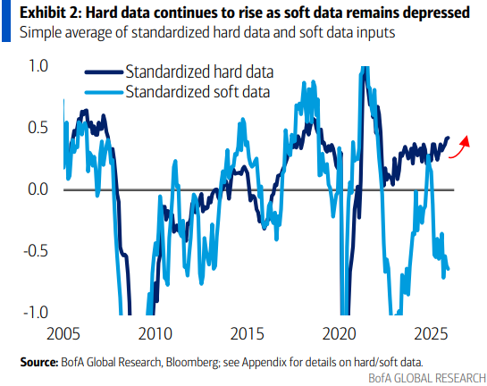
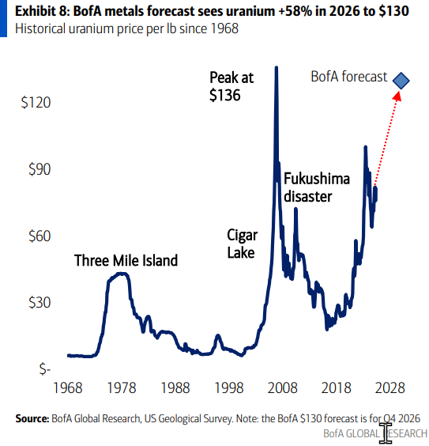
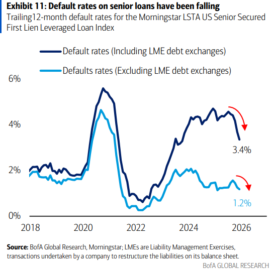
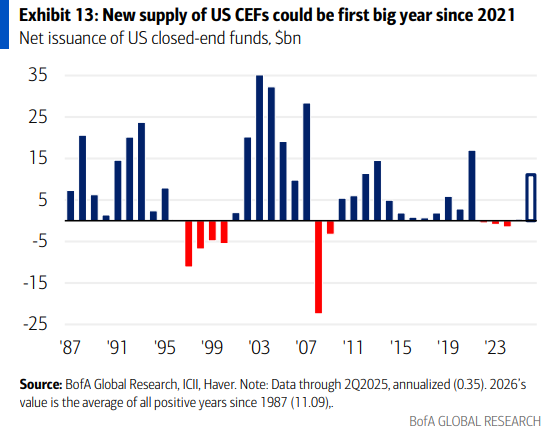
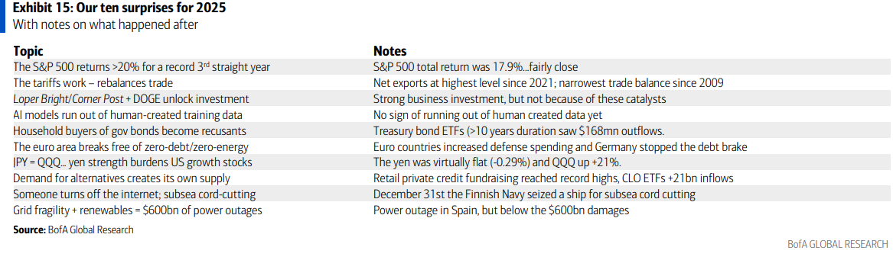

# 十项反共识情景与旧预测复盘：美银2026年1月展望

2026年1月16日，华尔街见闻赵颖据追风交易台转述美银Jared Woodard团队《2026年十大意外》：增长可能强于其所称市场共识，美元和股票回报分布可能改变，核燃料与信用工具可能出现新机会。清单混合了经济学家基准预测、策略情景、条件外推和一项体育判断；“灰天鹅”“反共识”是报道及团队的组织方式，原文没有为十项分别给出实现概率或市场隐含定价。

以下按增长与回报扩散、燃料与防务需求、信用和基金融资展开；2025自评另节保存。[来源](../../40_sources/S-WS-3763441.md)可直接查阅全部8张原图及口径说明。文末分期检验为2026-11-16后补研究设计，正文历史判断保持1月信息窗口。

## 增长较强与美元走弱，分别依赖什么

**情景一：2026年美国实际增长2.6%。** 美银经济学家预测高于其所称共识2.1%，可能动力包括监管放松更快、美联储进一步降息、关税返还支票与生产率改善下的投资。政策选项、支出意愿和实际支出并非同一步：企业需要对订单、利润及融资有足够把握，家庭也可能先储蓄或还债。报道没有逐项测算贡献或提供共识调查样本，因此不能把0.5个百分点差值归给其中某一项。

作者用贸易收支、企业成立与盈利修订支持实际活动较强的判断。图1展示硬数据与软数据的标准化均值分化；硬数据领先可以解释其乐观倾向，但进口减少也可能使逆差收窄，新企业数量还需转为订单和产出。标准差无法直接换成GDP增长贡献。

**情景二：美元走弱带来再平衡。** 团队把美国相对回报和全球商品、资本流动联系起来，外汇策略师预期2026年底USD/CNY为6.8，图中当时约7.0。报价下降表示人民币对美元走强。

汇率会改变进口购买力、出口收入换算与投资者的本币资产回报，企业和资金随后才可能调整订单、套保和配置。贸易量还受合同、需求和进口投入影响，[汇率后的贸易调整](../../20_mechanisms/汇率贬值后的贸易收支调整.md)并无即刻固定幅度。较强美国增长与较弱美元也不必同步：相对利率、其他地区回报及[美元融资需求](../../20_mechanisms/美元融资依赖的传导机制.md)可能改变方向。

## 股权表现扩散，需要经营和估值两条依据

**情景三：等权标普跑赢市值加权标普。** 美银认为其他公司EPS向七巨头靠拢、非科技资本开支扩大、税收贸易政策明朗与回流可能支持较广公司。等权指数在重平衡时降低大公司初始份额，提高其他公司的相对份额，因此较广盈利改善可以形成不同回报暴露；这不自动消除行业、规模与资金条件差异。[标普500与等权指数](../../10_concepts/标普500与等权指数.md#outlook-202601)保存本次较早预期。

报道列ChatGPT推出以来市值加权约78%、等权约40%，又称等权相对估值低于历史超过一个标准差、估值隐含长期年化回报约+6%对−1%。这些比较混合不同期间和估值推算，原文没有完整指数收益版本、起止点及预测年限。过去落后、估值较低可以成为研究理由，尚未构成2026跑赢的确定条件或可兑现赔率。

## 电力安全与防务支出，怎样到达具体标的

**情景四：[铀](../../10_concepts/铀.md)在2026年第四季度到130美元/磅。** 金属策略师另给2027年135美元，称相较当时约有58%上行，并将供需失衡、潜在供给中断、数据中心需求与电力公司下半年补库相连。采购是否推高价格，取决于电力公司的换料计划、库存和供应商交付。数据中心用电需求要经过发电及燃料采购环节，才形成原料需求；浓缩服务扩张则要经过建设和合同，不能直接充作当期天然铀增产。[铀页](../../10_concepts/铀.md)解释燃料工序及DOE浓缩服务订单。

图3将旧峰标为136美元，预测点130并未超过这一图示峰值。故新闻标题“历史新高”不能据该图成立，预测仍按美银的2026Q4情景保存。

**情景五：无人军事系统推动防务升级。** 团队以约210万美元导弹对约2万美元无人机的成本差，解释传统系统面对低成本攻击的压力，并举多国新投资及美国战略表述。这是扩大采购与升级的理由，不能把两种武器单价直接当作同一任务的成本或利润比较：识别、拦截成功率、部署和维护都会改变实际成本。预算意向又须转为订单、产能、交付和回款，才进入供应商盈利。

## 新兴市场与CLO：收益来源和违约口径要对齐

**情景六：新兴市场本币债提供较高风险调整回报。** 美银给出2026年预期回报约11%、短期利率下调约70bp及各地区降息的判断。持有本币固定利率债，可以取得票息及收益率变化的价格回报；若投资者用美元计账，还须加上本币汇率变化：`美元回报=(1+本币债券回报)×(1+本币对美元升值率)−1`。降息支持债价的同时，汇率与信用变化也可能抵销收益。原文未给具体指数、币种、费用、久期或对冲，因此11%不能成为任意新兴市场债组合的目标回报。

报道另列新兴市场企业违约率2.1%、历史平均3.5%、拉美EPS修正较强，以及美国家庭配置0—3%对全球外债份额逾20%。企业信用、股票盈利、本币政府债和全球外债不是同一个资产池，家庭分母也未披露；这些线索保留为机构论据，不能直接推导本币债损失率或资金必然回补的规模。

**情景七：[CLO ETF](<../../10_concepts/CLO ETF.md>)可能优于长期美债。** 团队以降息减轻借款人负担、经济保持韧性及违约率下降支持信用收益，称AAA档产品收益率超过5%、久期为零，并预计美国及日本银行持续需求。降息也会降低浮息证券未来票息；长期固定利率国债则可能因避险及降息取得资本利得。两种产品的结果取决于实际利率、信用利差及损失路径，不由“降息”单独确定。

图4是Morningstar LSTA美国高级担保第一留置权杠杆贷款指数的过去十二月违约率：含LME债务交换的线从约4.7%降至3.4%，不含交换的线末值1.2%。这反映贷款池信用变化，不能直接当作CLO AAA档或ETF份额的损失率。[CLO ETF页](<../../10_concepts/CLO ETF.md>)解释分层保护、浮息和基金风险。原文2025年流入120亿美元与复盘表210亿美元的覆盖范围未明，不能合并为同一已核流量。

## ETF规模和CEF发行，如何表达不同资金行为

**情景八：全球ETF资产超过美国以外G7国家的当时股市市值。** 报道给出2025年ETF AUM约18.4万亿美元、增长32%，前一年增长29%；若再增32%，静态计算约为24.3万亿美元，略高于其所比的24万亿。它把另一年度ETF增长情景与当时股市市值比较，并未同时预测后者变化。

AUM可以随底层价格和净发行增长，不等于同额新现金。全球ETF又持股票、债券和其他资产，基金份额与底层证券也有包装与持有关系，不能把两种市值相加为新增经济资产。原文主动股票ETF净流入增长48%还缺产品样本和金额基数，不能与总AUM增长率互换。[ETF一般页](../../10_concepts/ETF申赎与二级市场交易.md)保存份额、净资产与交易的区别。

**情景九：[上市封闭式基金CEF](../../10_concepts/上市封闭式基金CEF.md)迎来发行复苏。** 团队把充裕流动性、金融条件放松、估值和另类信贷需求相连，提出110亿美元以上的新供应情景。上市基金通常不需按持有人要求随时赎回份额，因此二级买卖和折价变化，与基金重新募集资本有不同含义；基金若使用杠杆，还需承担融资约束。

图5的2026空心柱为110.9亿美元，取自1987年以来**净发行正值年份的均值**，不是包含所有年份的无条件期望；是否会进入正发行状态尚无概率。2025数据仅到Q2并年化为3.5亿美元，不能当完整全年实现。即使发行改善，也应继续看底层投资、费用、折价与分配来源，才能辨认投资者承担了何种风险。

## 第十项：世界杯判断

团队选择英格兰夺冠作为趣味意外，并记录Kalshi当时的报价：西班牙16.1%、英格兰13%、法国与巴西各10%、阿根廷9.9%。这保留其市场报价归属；图6日期与合约范围见[来源](../../40_sources/S-WS-3763441.md)。

## 2025年自评：结果方向与原来解释分别保存

原图7保存团队对十项2025年判断的完整自评。值得延续的是几个不同层次的检验：标普17.9%尚未达到原定20%阈值；企业投资较强，但团队承认原列政策催化剂不符；日元约−0.29%、QQQ约+21%，未出现预想的联动；西班牙发生停电，也不代表命中6000亿美元损失规模。价格方向、发生与否、幅度和因果解释应分别评价。

这些是团队自评，图中没有统一计分规则或基准比较，不能由十条回顾推出2026清单的准确率。

## 分期检验：把资产结果与原来解释对照

以下是**本库2026-11-16依据1月材料后补的研究设计**，未加入后来的结果，也不属于美银新增的预测承诺。后续记录应注明观察日，并保留原先预期；原文未给产品与统计定义的项目，须先建立可比样本。

**2026年季度经营与全年增长、等权回报。** 跟踪美国非科技企业投资、订单、就业，以及标普七巨头以外公司的利润和EPS修订。若实际投资及盈利改善扩散，再与全年实际GDP的2.6%目标、等权相对市值加权回报对照，能支持“经营扩散带动回报扩散”的解释。逆差改善若主要来自进口压缩，会削弱投资旺盛的论据；等权上涨若仅由估值重估推动，也不足以支持盈利趋近。两指数须统一全年、美元总回报、分红及成分口径，不能拿10月局部表现代替全年结果。

**2026年末人民币6.8与全球再平衡。** 对照年末USD/CNY目标，同时观察广义美元、相对利率与资产回报、跨境证券配置，以及出口商结汇、进口商付款和套保安排。若美元广泛走弱、境外资产相对回报改善并伴随配置变化，可支持全球再平衡链条；若主要是人民币特有政策或局部资金流，年末点位即使命中也不足以验证该解释。贸易订单和数量调整可能落后于汇率，应按合同及结算窗口跟踪。

**2026年下半年采购，连接Q4及2027年铀价。** 跟踪电力公司燃料采购合同、交付与库存，以及转化、浓缩排期。下半年采购增加并伴随库存消耗、可交付供应紧张，会支持补库推动价格的解释；只有政策公告或相关股票上涨、缺少实物采购，则削弱这条解释。分别对照原定2026Q4的130美元/磅、2027年的135美元/磅；原文没有说明Q4目标是季均还是季末，也未给2027具体时点，须先确认目标定义和报价系列，不能事后挑峰值判定兑现。

**2026年季度信用路径及全年产品总回报。** 对同一贷款指数分别跟踪含／不含LME的违约率与信用利差，再观察固定AAA档CLO ETF样本的票息、净值、费用和流动性；与长期美债按同一2026窗口、币种及再投资假设比较总回报。贷款偿付改善、利差收入覆盖价格波动且产品相对收益占优，会支持原解释；浮息收入下降或长债资本利得占优，则说明降息未必带来预期的相对优势。原文未列产品，须先确认原研究范围；后选产品须标为研究样本。新兴市场本币债的11%也需先确认指数，分开本币债券回报与美元汇兑回报；企业违约率2.1%不能代替本币政府债信用结果。

**2026年末ETF规模与CEF净发行。** 把全球ETF AUM变化拆为底层价格、汇率与净发行，检验从18.4万亿再增32%的外推；与24万亿美元的比较仍保留其静态基准日期。若只由资产上涨推动，不能据此认定新增资金同幅增长。对美国CEF先用同一ICI净发行定义判断2026是否进入正值，再比较规模与110.9亿美元的条件均值；继续观察募集用途、净值折价、杠杆和分配来源。净发行恢复支持融资需求回暖，但不能单独证明底层资产质量改善。
