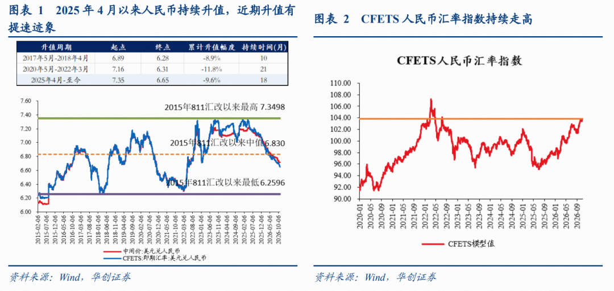
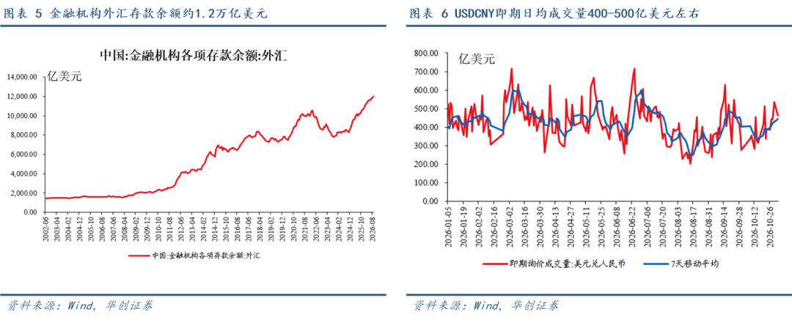
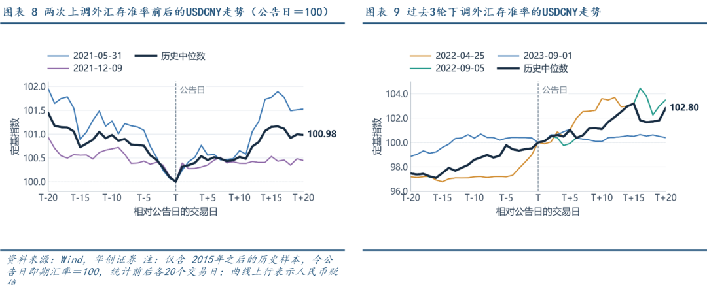
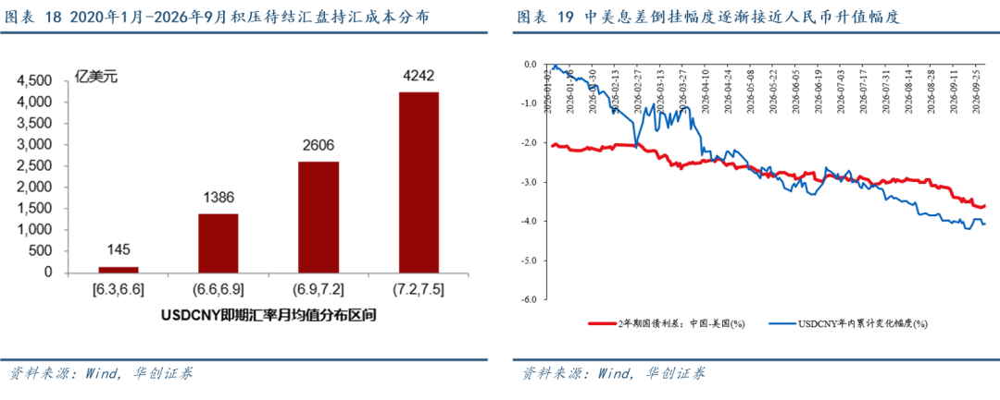
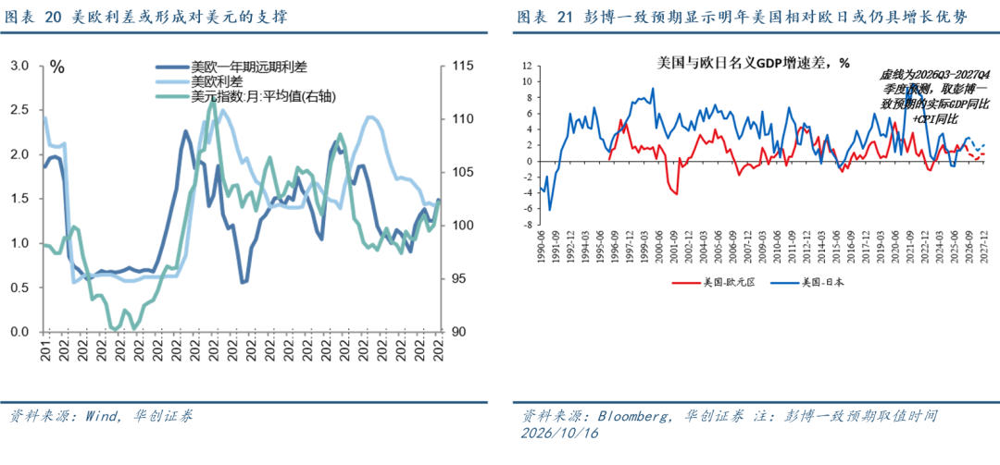

# 外汇存准上调与人民币升值边界：2026年11月华创判断

2026年11月3日，人民银行宣布外汇存款准备金率由4%升至6%，计划自11月15日起实施。华尔街见闻11月4日转载华创证券张瑜的分析：外币资金占用和政策信号会缓和人民币单边升值，但出口收入与既有结汇惯性仍可提供短期支撑；到2027年，这些支撑可能减弱。要理解这几个方向如何并存，需要接上银行筹资、企业卖汇时机和后来外汇收入的变化。

以下按11月4日信息集保存华创判断。2026-11-16为整理日，末节检验安排由本库后补，没有加入实施后的反应或2027年结果。[原文、制度补核及全部12张原图](../../40_sources/S-WS-3785129.md)可直接定位。

转载称自2025年4月以来，USD/CNY由7.3498降至6.65以下、持续约18个月；CFETS篮子指数由2025年7月95.09升至约103.83。USD/CNY下降代表人民币对美元走强，篮子指数上升则表示相对一篮子货币走强。原文“升值约9.6%”沿用美元报价降幅口径，[分母复算](../../40_sources/S-WS-3785129.md#quote-check)在来源维护。

## 1. 银行先调整外币资金，再影响客户报价和结汇选择

本次动作增加银行对既有外汇存款的法定交存。[子概念页](../../10_concepts/外汇存款准备金率.md)解释账户关系和基础算例。华创按2026年9月约1.2万亿美元外汇存款，静态估算多占用240亿美元；银行需要从可用外币资产中调拨、补充外币融资或调整贷款投放。若资金约束转成较高的美元融资报价，“借美元、卖美元换人民币”的成本就会上升，相关卖汇需求可以减少。

实际响应依银行原有资金和客户用途而变。可从境外补资的银行可能主要调整融资来源；贷款需求弱时，交存也可能由闲置外币资产承担。银行还可能调整存款报价，因此不能预设所有美元利率同步提高。企业最终会将银行报价与进口付款、偿债和预期汇兑损益一起比较，决定手中的美元现在结汇还是继续保留。

华创把240亿美元与即期日均400—500亿美元成交额比较，判断实质影响可能有限、信号意义较强。这里的尺度不同：**240亿美元是额外交存的存量估算，日成交额是可由同一资金多次周转形成的交易总量。** 这一比较尚未识别银行缺口、价格弹性或信号贡献；也不能把240亿美元全部记作已经减少的客户卖汇。

## 2. 公告改变的是对单边升值能否延续的判断

官方短公告给出的目的是加强金融机构外汇流动性管理。“抑制单边预期”和“升值空间有限”由华创在当时背景下解释：研究者把本次动作接到9月24日、10月8日、10月19日的沟通，认为政策会防范升值预期与提前结汇互相强化。企业若相信继续等待未必获得同样快的人民币升值，便可能减少为避免未来汇兑损失而提前卖汇的需要。

[原图3—4](../../40_sources/S-WS-3785129.md#figure-002)保存官方沟通选编及华创逆周期因子影子变量；后者从约300bp升到500bp以上，是机构模型估计，并非央行公布的交易量。华创还据[估值拟合](../../40_sources/S-WS-3785129.md#model-check)认为人民币相对历史拟合值偏贵。两类估计是作者形成判断的参考，其样本与样本外误差不足以支持确定的回归幅度。

### 历史动作提供参照，没有规定本轮终点

华创回看2021年5月31日与12月9日的上调，均处于2020—2022同一升值周期。其记录两日USD/CNY为6.3607、6.3457，公告后分别出现约四日0.8%、七日0.5%的人民币回调，随后升值仍有延续。用2022年3月事后低点6.3107比较，两次公告后的USD/CNY剩余下行约0.8%、0.6%，团队据此推测本轮进一步升值空间有限。

两个动作处于同一周期，后来的低点也在公告当天不可知；当局又会在升值已较明显时采取行动。因此，剩余空间相近可以作为研究线索，不能直接变成本轮的未来概率或把全部反转归于工具。完整比例沿革由[外汇存准子页](../../10_concepts/外汇存款准备金率.md)维护，日期与长周期路径见[原图7](../../40_sources/S-WS-3785129.md#figure-004)。

上图把公告日归一为100。上调两样本T+20的中位路径约100.98；下调三样本约102.80，人民币在放松工具后仍可继续走弱。政策方向与最终趋势之间保留了其他驱动。20日路径与截至2022年3月低点的剩余距离，也不能相互替代。

华创认为6%低于2021年的9%，仍可关注再次上调及其他工具。过去峰值没有形成法定上限或下一次动作承诺；其工具箱各自改变的约束如下，[原图10](../../40_sources/S-WS-3785129.md#figure-006)保存原清单。

| 工具 | 作用对象及本篇状态 |
|---|---|
| 外汇存款准备金率 | 外币存款对应的法定交存，本次公告4%到6% |
| 远期售汇风险准备金率 | 银行远期售汇业务的额外准备金成本；作者称2月27日下调，本轮未另核参数 |
| 跨境融资宏观审慎参数 | 跨境融资风险加权余额上限，作者将下调列为潜在选项 |
| 逆周期因子 | 中间价政策调节，文中数值为影子估计 |
| 离岸央票 | 发行和到期改变离岸人民币资金条件，图中未给一项待实施的新操作 |

这组清单并不表示所有工具同时启用。中间价、收盘价及隐含中间价的研究分解见[原图11](../../40_sources/S-WS-3785129.md#figure-007)，各项偏离也不自动对应一笔官方外汇买卖。

## 3. 政策减慢提前结汇，既有卖汇仍可能延续

企业不必在收到出口款当天全部换成人民币。人民币升值预期会促使一些企业提前结汇；增加的即期美元供给又可能推动人民币走强。即使公告降低了继续抢跑的意愿，前期订单收款、工资和税费支出、年末资金安排仍可使卖汇延续。因此，华创的短期判断是温和升值仍有支持，同时进一步加速的空间有限。

团队从国内景气、存量结汇释放和持汇收益三方面预期这股支持以后会减弱。

**景气。** 原文报10月制造业PMI49.3%，并将企业与居民存款增速差处近六年高位视为未来景气减弱的线索。[PMI与景气调查](../../10_concepts/PMI与景气调查.md)提供口径基础。[原图16—17](../../40_sources/S-WS-3785129.md#figure-010)中的“净结汇率”实际等于出口结汇率减进口付汇率，分母分别是出口额、进口额；它既非净结汇金额，也不是贸易顺差中已经结汇的统一比例。将它与PMI并列，并未识别企业景气对结汇的独立贡献。

**存量释放。** 华创把2020年1月—2026年9月估算的积压结汇，按对应时期USD/CNY均值分为四桶：145、1386、2606、4242亿美元。较高报价区间占多数，作者认为此前升值已触发较多释放，再升值所带来的新增集中结汇可能减小。这里的“持汇成本”以历史即期均值作代理，未取得逐企留存、对冲和境外用途，四桶不等于随时可出售的美元存款。

**持汇收益。** 作者预期美元利率优势会更能补偿人民币升值带来的汇兑损失，使继续保留美元相对更有吸引力。具体企业要比较同期限的可得存贷款报价、预期汇率与实际付款需求；图中两年国债息差和年初累计汇率变化不能直接相减成企业收益。

## 4. 2027年要看新增外汇收入和美元条件是否一起改变

华创预期工业周期和AI需求短期仍支持出口，但全球工业扩张和AI链增速回落后，2027年出口的增量支撑会减弱。这里要同时辨认“出口仍强”与“比此前多带来多少新支持”：较高出口水平可以继续带来美元收入，增速下行仍可能使新增卖汇支持减小。作者用于比较的全球领先指标和前移方法见[原图14—15及口径](../../40_sources/S-WS-3785129.md#figure-009)。

美元方面，团队认为美欧利差预期仍有利于美元，并以美国能源净出口、AI硬件暴露解释相对增长条件。转载给出2024年法、德能源净进口占GDP约1.6%、2.4%，2025年美国AI硬件净贸易绝对值占GDP约0.6%、德法各约0.1%；本轮未另核底表，净贸易暴露也不直接等于产业盈利或整个经济净受益。

图21来自10月16日取得的彭博一致预期，虚线覆盖2026Q3—2027Q4，预计美国相对欧日的名义增长仍有优势。它为作者提供方向依据，尚未给出美元必然走强的因果估计。团队最终判断是：若出口与集中结汇增量减弱、美元保持偏强，2027年人民币双向弹性和阶段性调整压力可能增加。没有给目标点位、概率或确定转折日。

## 5. 用不同时间窗口分辨哪些解释获得支持

**下表由本库于2026-11-16后补，用于检验11月4日的历史判断。** 它没有补入后来结果，也不表示华创曾指定这些观察日期。

| 观察窗口 | 应分开收集的变化 | 对解释的辨别作用 |
|---|---|---|
| 11月3日公告后至计划11月15日生效前 | 相近时点的CNY/CNH与中间价偏离、银行外币报价、企业结汇/远期选择和预期表述 | 交存比例尚未生效时，预期与交易若已改变，符合公告信号或提前应对；银行可提前筹资，不能把这一段全部视为纯信号 |
| 计划实施后数周，以及随后可取得的月度披露 | 实际交存、银行外币融资来源与报价、外币贷款、代客收支和结售汇；各自记录统计期与公开日 | 若银行外币资金变贵并伴贷款或客户结汇调整，较支持资金约束传导；只有汇率变化仍无法确认数量渠道，需求与海外利率也需对照 |
| 2026年末 | 出口收款、企业外币留存及结汇、进口付款与远期交易的同期变化 | 收入未明显变而结汇时机改变，更接近企业选择；收入本身增减则须分出基本面及季节贡献，年末卖汇也可能暂时抵消政策作用 |
| 2027年月度与季度窗口 | 出口订单/收款、工业与AI需求、同期限持汇收益、美欧利差和相对增长预期 | 检查新增外汇收入减弱、保留外币更有吸引力、美元偏强这三条前提是否成立；出口更强、结汇继续加速或美元条件转弱，都要求分别修订原判断 |

本库的研究重点是同一笔出口收入如何在银行资金成本、政策预期和企业现金用途之间形成不同结汇时机。数量、预期与基本面可能共同变化；按上述窗口追踪有助于定位修正发生在哪一环，不凭一个生效日前后或一次汇率转向分摊各渠道贡献。
