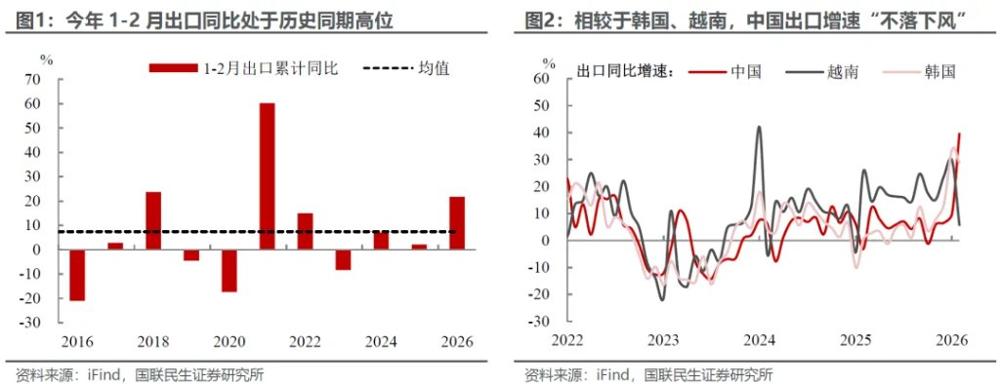
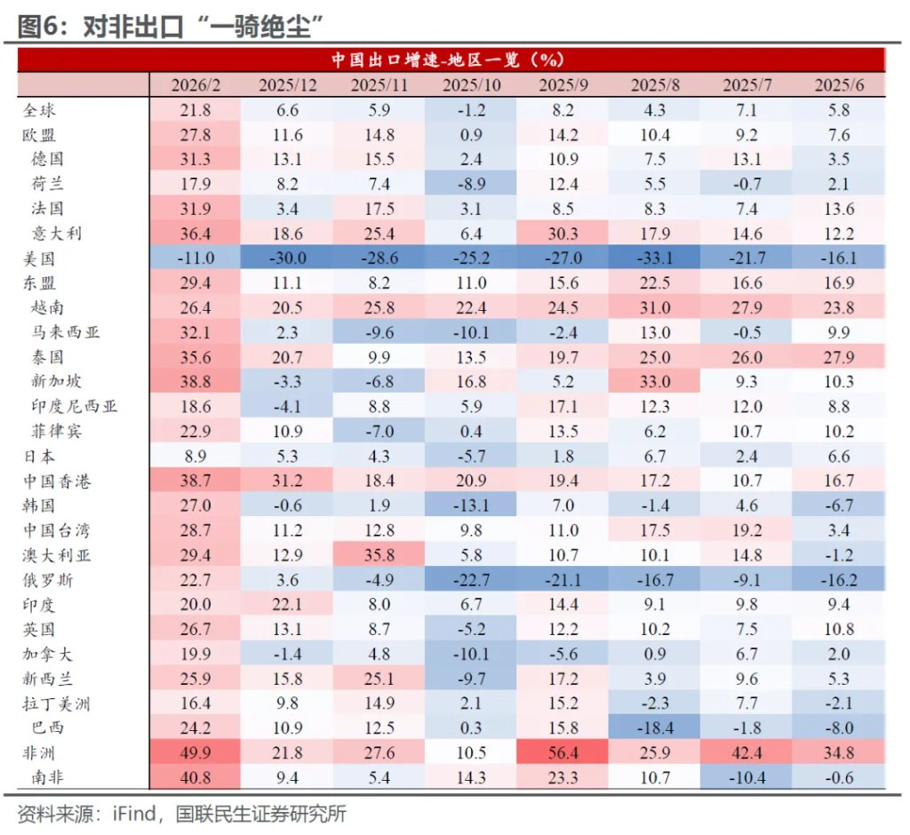

# 开年外贸的季节性、订单与结汇：2026年3月判断

2026年3月10日，国联民生陶川团队提出：1—2月出口强劲，除春节错位，还有海外资本开支回暖、新兴市场开拓和退税切换前抢出口三个支撑。问题在于，这些增长有多少来自持续的新订单，有多少只是把交付提前。华尔街见闻李佳转载了这份判断；下文保留当时依据，过程解释和检验设计由本库2026年11月16日补写，未加入3月10日后的实现结果。[来源、6图及核读差异](../../40_sources/S-WS-3767144.md)。

## 开年高增长留下的三个解释问题

文章采用1—2月美元口径出口同比21.8%，历史同期仅低于2018和2021。商务部统计摘要的人民币出口为4.62万亿元、同比19.2%，进口3.11万亿元、同比17.1%。两种币种的名义增速有别，实货数量还受到单价与产品组合影响。“超预期”是团队评价，本文未取得统一市场预测样本。[币种和窗口记录](../../40_sources/S-WS-3767144.md#measurement)。

## 外需采购：海外投资要经过订单和交付才进入中国出口

团队用全球制造业PMI升至51.9、主要经济体景气改善及韩国出口较强，支持海外资本开支回暖的解释。[PMI与景气调查](../../10_concepts/PMI与景气调查.md#comparison)衡量企业经营变化的广度，各国与机构依各自样本和编制方法比较；全球读数走强可以与中国等部分经济体低于50并存，也没有直接测出设备投资金额。

从海外投资到中国出口，中间需要具体采购：企业扩建或更新生产线时，形成设备、电子部件及配套材料需求；采购方选定中国供应商、签订订单，供应商排产、交货并报关，才进入中国出口统计。若客户未来经营和融资条件支持连续扩建，这一需求可以跨季度延续。若客户只补库存或集中交付已有项目，制造业调查改善与当期出口走强也可能同时出现，延续性却较弱。

图中集成电路、汽车和船舶等出口金额较强，与设备和科技需求解释相容；行业增长率仍混合数量、价格、产品结构和基数。文章尚未把海外客户投资、采购合同和对应中国货物逐笔接起，故“海外资本开支拉动”保留为团队的解释，不能把PMI直接换成已识别的拉动贡献。[PMI表与产品图](../../40_sources/S-WS-3767144.md#figures)。

## 新市场订单：销售来源扩大，还是货物流向改变

地区表显示，对非洲出口增速49.9%，欧盟27.8%、东盟29.4%、中国香港38.7%，对美国则为−11.0%。团队认为新兴市场拓展与欧洲需求共同支持出口。若中国企业取得新客户或同一客户扩大采购，销售渠道、售后和当地支付安排逐步稳定，订单来源便可能从少数市场扩散，降低单一市场走弱对总出口的冲击。

这条解释需要“新增订单来自哪里”与“货物最终用在哪里”接起来。发往东盟或香港的货物可能供当地生产消费，也可能继续转口；目的地变化也可能来自贸易改道。转口可以维持中国供应商订单，却未必意味着新的最终需求。对非洲的高增速同样要结合基期金额和新增额，看其是否足以抵消美国市场减少；增长率排名不能代替贡献排名。

## 前置交付：春节安排与退税切换都能移动出货时间

春节前停工、物流和客户备货安排，使企业倾向节前交货。作者认为2026年春节较晚，让更多交付进入1—2月，并可能压低3月。订单总量不变时，改变排产、报关和发运日期就能形成前强后弱；合并1—2月仍需与工作日和上年基数对齐。春节散点图存在标题与纵轴冲突，故这里只保存方向解释，[原样差异见来源](../../40_sources/S-WS-3767144.md#calendar)，不据拟合线分解贡献。

退税切换另有明确日期约束。财政部、税务总局公告规定，4月1日起取消清单内光伏等产品增值税出口退税，适用安排按报关单出口日期界定。对于同样的合同价格与成本，能在切换前申报的合格货物保留相应退税待遇，出口商因而可能加快生产、与客户协商提前接货；若客户不能提前接收、产能或运输受限，动机也未必成为实际出货。

这一过程可以增加切换前统计、减少切换后的待交订单。若新增订单和终端使用未增加，全年需求并不随之等额增长；净收益由出口商保留多少，还受合同定价和买方议价影响。电池清单产品是4—12月退税9%降至6%、2027年起取消，且增值税与消费税安排分别适用。实际政策范围须按附件税号确认，不能把所有汽车、塑料、玻璃出口都归因于光伏抢出口。[公告四条及未核附件范围](../../40_sources/S-WS-3767144.md#policy)。

## 进口修复会怎样改变顺差解释

团队把科技产品和部分资源品进口数量改善视为内需回暖。进口可以支持居民消费和境内生产，也可以成为库存，或用于随后加工出口。若进口设备投入国内生产、资源消耗随产出增加，内需解释更充分；若主要是备货或出口投入，进口走强也可能与出口链条同源。金额读数还包含价格变化，原量价图年份存在冲突，[核读和原图保留在来源](../../40_sources/S-WS-3767144.md#imports)。

## 当时展望与检验窗口

**团队截至3月10日的判断：** 出口强于进口，高贸易顺差有望延续，支持“十五五”开局增长与人民币升值；未给全年增速、目标汇率或概率。出口增速大于进口增速仍须结合基期金额，才能判断顺差金额；对经济增长的贡献要转为国民账户的实际净出口口径。

货物顺差只是经常账户的一部分。货物交付、出口收款、银行结汇也有各自时间：企业可以留存外币、偿还外币债或支付进口，实际结汇才形成对应卖汇需求。贸易收入为人民币提供潜在支持，还要看实际收付款及资本流动。[人民币历史入口](../../10_concepts/人民币与离岸人民币.md#trade-20260310)与[贸易收支调整](../../20_mechanisms/汇率贬值后的贸易收支调整.md)分别连接汇率市场和交付、计价的通用解释。

**以下是本库2026年11月16日依据3月10日信息后补的研究设计，未使用后发结果：**

- **3月发布及一季度合计：** 对齐春节、工作日和同长度窗口，看1—2月强、3月弱是否大体在季度内回摆。若季度累计仍强，且可比数量和订单延续，仅靠日历搬动解释就变弱；若主要变化随节前发运和节后恢复反转，季节性交付解释得到支持。同比基数、单价和产品组合仍可能产生相同的金额形态，需分开比较。
- **4月1日切换前后及二季度：** 按政策附件确认覆盖产品，对照切换前发运、随后交付和新接订单。覆盖产品前置集中、其后回落，而可比未覆盖产品没有相近变化，会支持退税前置解释；覆盖产品数量与新订单继续增长，则持续需求更值得重视。春节回摆、价格调整、客户库存和海外贸易政策也能造成切换附近波动，单看4月一个月不足以归因。本轮未核附件，这项比较需要后续按税号建立样本。
- **随后季度至全年：** 用同口径地区金额、份额和订单看非洲等市场是否形成持续新增销售，再结合客户资本品采购与实际交付检查海外投资链条；数量弱而金额强、一次项目交货或转口改道，会削弱广泛持续需求的解释。进口须接用途、库存与生产，判断顺差变化来自出口订单还是进口压缩。汇率端另看出口实际收款、净结汇及资本流动：出口收入增加却未转成净卖汇，削弱当期结汇支持这一步；结汇增强也不能独自排除相对利率、资本配置和政策对人民币的作用。顺差和人民币升值同时出现本身不足以判定原因。
