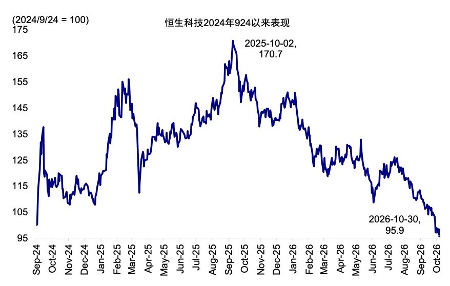
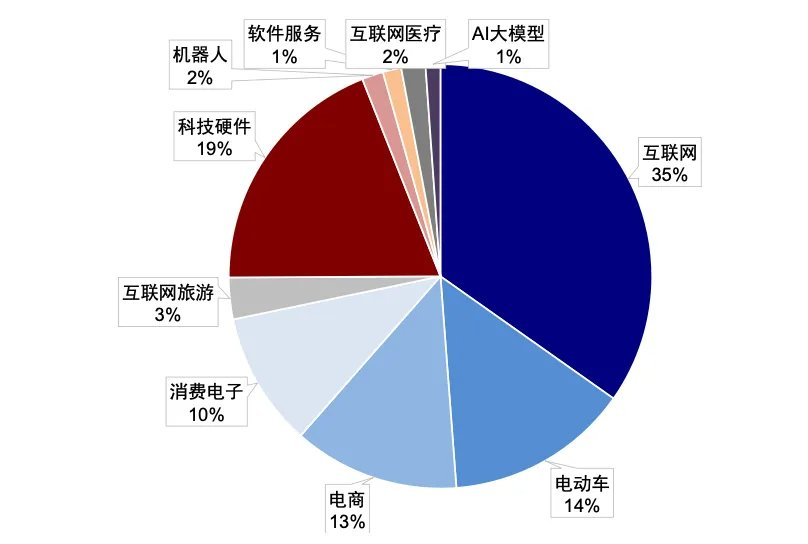
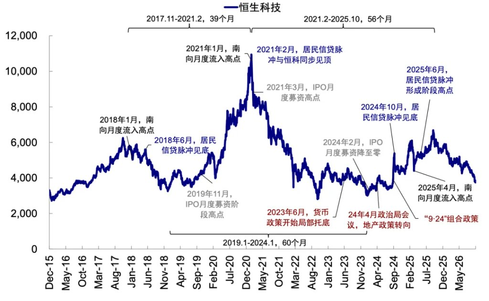
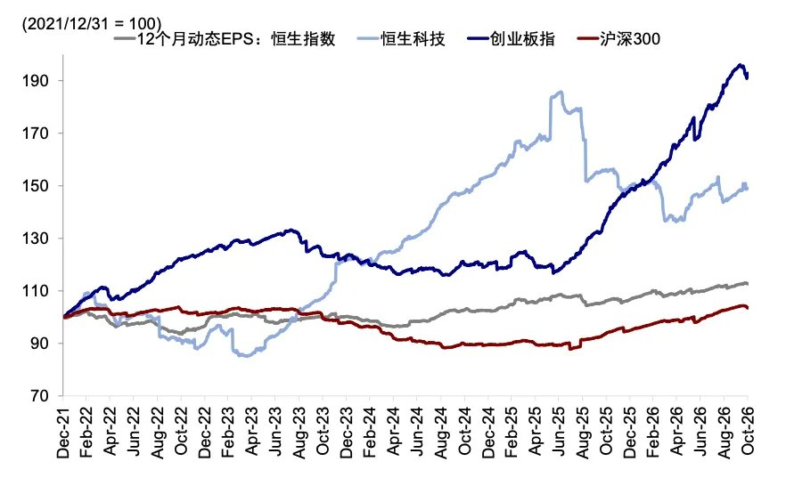
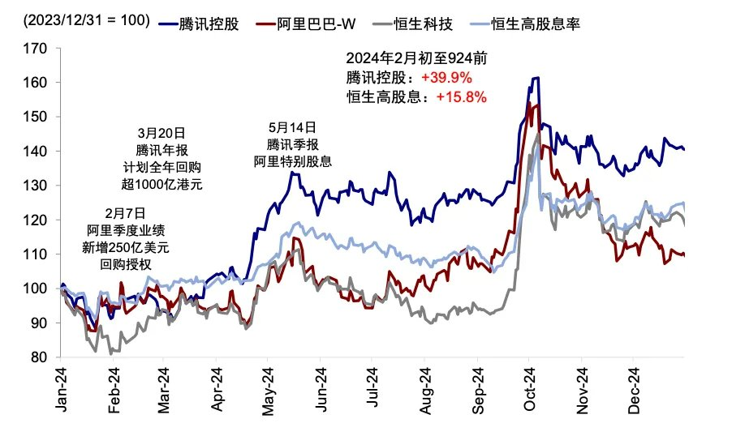
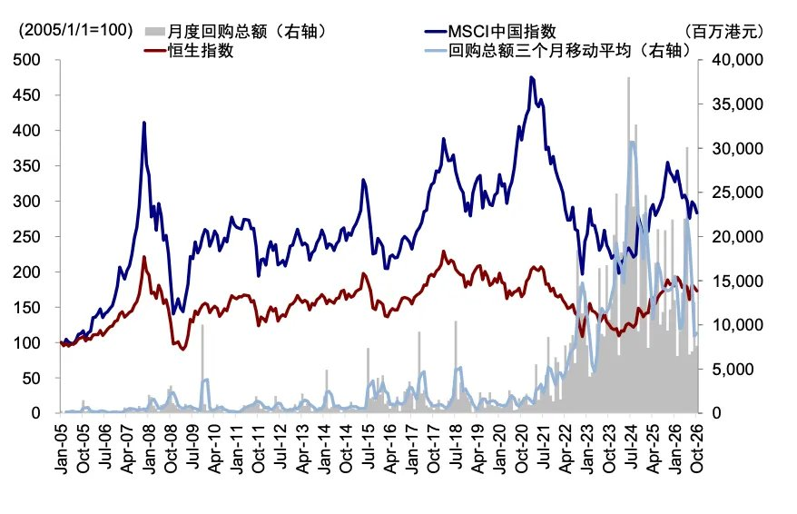
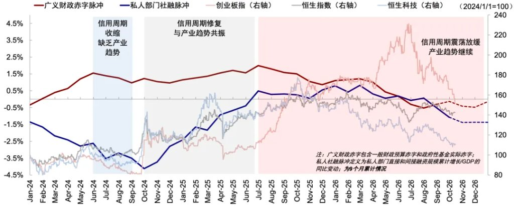
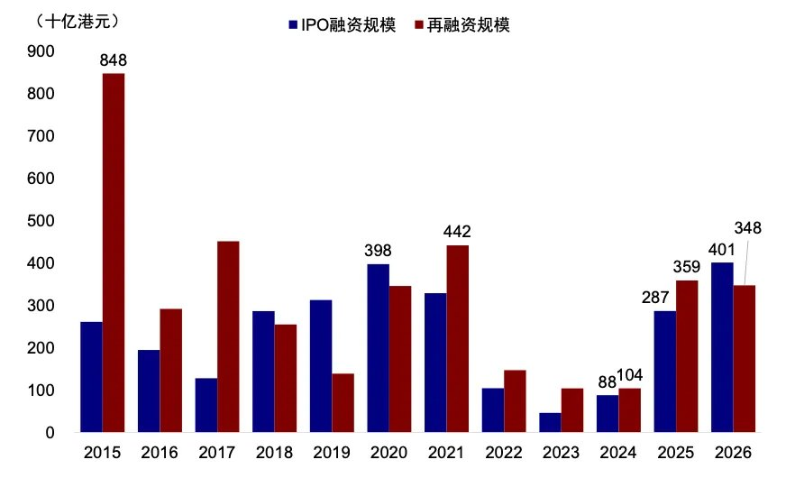
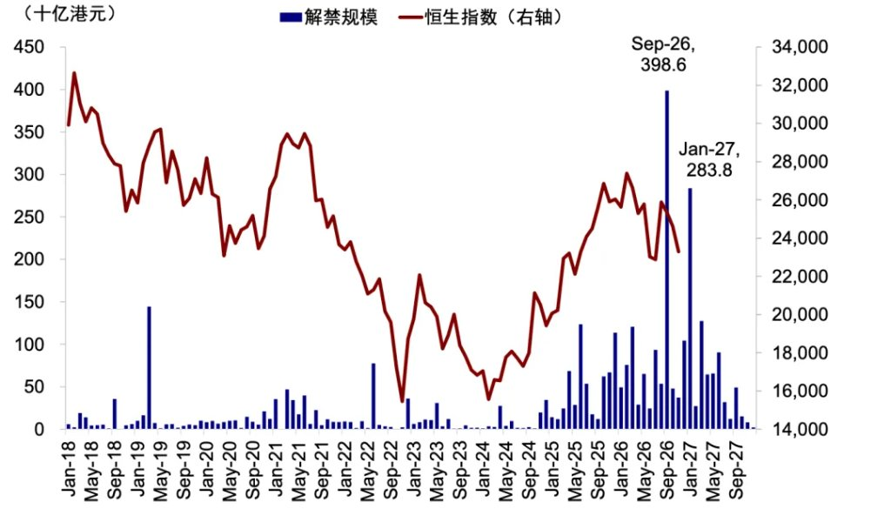

# 港股价格底、信用周期与股权供求：2026年11月观察

华尔街见闻2026年11月2日署名董静，转述中金刘刚、张巍瀚等《市场如何见底？》。市场截面主要截至10月30—31日，公募持仓截至三季度。中金认为低估值、低配置提供短期反弹的赔率，持续反转则需要居民信用实质改善；回购和发行条件尚不如2024年初。以下历史底部都是作者后来回看识别，2027年1月解禁是当时已列出的未来安排。

## 为何先跌：内需暴露与边际资金共同变化

恒科从2025年10月2日相对基期170.7降至2026年10月30日95.9，图1以2024年9月24日为100。作者把下跌联系到居民信用脉冲回落，以及资金条件收紧。这个联系需要从成分的经营收入与买家的选择两端理解。

### 哪些业务会受到影响

[恒科与恒指](../../10_concepts/恒生指数与恒生科技指数.md)的业务暴露不同。图5中作者把恒科互联网、电动车、电商、消费电子合计为约72%。居民新增借款若带来额外消费、购车或住房相关支出，可以增加相关企业销售和平台交易；支出放缓则影响收入增长、订单及利润预期。借新还旧、提前还贷或只在金融资产间转移，产生的新增实体需求会小得多，信用总额本身还不足以确认利润改善。各公司海外业务和竞争变化也会改变传导。

恒指还包含本地金融、银行、电信等，A股成长指数则有不同的产业权重。2021年港股受地产信用收缩和互联网监管影响时，新能源与半导体景气仍能支撑部分A股；作者用类似分化解释2025年底以后的港股与A股AI硬件、算力、出口链表现。[港股市场](../../10_concepts/港股市场.md)还要与全球资产竞争资金，当盈利预期下修、投资者要求的风险补偿提高或买盘收缩时，价格都可能承压。两轮恒科较创业板早见顶约8—9个月是历史现象，成分与资金条件才是需要逐次核对的原因。

### 信用、企业调整和政策为什么错时

[信用脉冲与实体需求](../../20_mechanisms/社融结构、信用脉冲与实体需求.md)提供一般传导；本篇增加的是几种调整速度交错的港股历史观察。销售转弱时，企业已有订单、产能项目和在途库存仍会延续，之后才减少采购、去库存、削减生产或投资。政策也要经过识别问题、选择工具、执行，再到居民愿意借款与支出。股票买卖却可以立即调整，价格反映的未来现金流与风险补偿，因而不必等商业调整完成才改变方向。

| 作者回看窗口 | 信用、实体与政策的次序 | 对价格解释的含义 |
|---|---|---|
| 2021年2月—2022年4月 | 居民信贷脉冲2021年2月见顶；产能利用率到2021年二季度才见顶，产成品存货同比到2022年4月见顶 | 信用先转弱，企业已有生产与库存安排仍可延续；不能等库存峰值才承认需求预期在变 |
| 2023年6月—2024年10月 | 2023年6月货币政策局部托底；2024年1月宣布降准、2月下调5年以上LPR；作者以9月24日为全面发力节点，居民信用脉冲10月触底 | 政策起步与信用触底相隔较久；局部支持是否足以改变居民支出意愿，需要后续数据辨认 |
| 2024年1月31日—2025年8月 | 恒科价格底早于2024年10月信用底；产成品存货同比底又到2025年8月出现 | 价格、融资需求和企业去库存分别改善，不能用一个“见底”覆盖三者 |
| 2025年6月—10月 | 作者居民信用脉冲阶段高点在6月，恒科高点在10月 | 本轮价格对信用转弱的反应有滞后，既有盈利与资金叙事仍能延续一段时间 |

库存、产能及政策日期沿原文转述，本轮没有重核其底表或政策公告。作者列举相邻低点间隔36、60个月、高点39、56个月；样本间隔本身变动很大。商业调整、政策传导和交易变化有重叠，不能把上述月份机械相加，得到下一次拐点的计时公式。

## 为何价格可以先企稳：现金回报与承接先改变

2024年1月底居民信用仍未触底、恒指和恒科前瞻盈利也未抬升，股价却可以因风险补偿已较高、公司回购和愿意持有分红的资金增加而稳定。派息提供可取得的现金，实际回购提供买单；对于不愿押注快速增长的投资者，持续现金回报可能成为持有理由。价格企稳后若没有收入和利润改善跟上，这种支持也可能只集中在少数可持续派现的公司。

中金列举腾讯2024年年度回购回报约2.9%，高于2023年的1.8%；阿里2024年2月7日增加250亿美元回购授权，腾讯3月20日提出当年不少于1000亿港元回购计划。授权、年度计划和已经完成的付款有区别。图16中2024年2月至9月24日腾讯股价上涨39.9%、恒生高股息指数上涨15.8%，支持作者所说现金回报受到重视的观察，不能把价格涨幅当成股息收入，也不能单凭它识别债券资金转入的规模。

同一时期MSCI中国信息技术、媒体分别涨20.5%、19.7%，保险涨16.1%、银行涨12.3%；必需消费跌15.9%、地产跌11.4%。这表明早期稳定有明显结构差异，尚未成为全面的需求复苏。这组行业收益属于MSCI中国，不是恒指收益贡献分解。一般现金分配过程见[高股息机制](../../20_mechanisms/高股息资产的债券替代效应.md#ws3784961-shareholder-return)。

## 2026年缺哪些条件

| 观察 | 2024年初及随后 | 2026年10月底截面 | 中金比较的含义 |
|---|---|---|---|
| 恒科动态PE与ERP | 1月底12.9倍、4.3%；9月16日12.6倍、4.8% | 13.1倍、3.9% | 估值已经下降，风险补偿仍未达到作者列的两个极端水平 |
| 主动外资中国配置 | 2024年1月约5.0%，2020年10月曾14.6% | 约5.7% | 仓位较低可降低进一步减仓空间，也可能反映持续谨慎，尚未形成新增买单 |
| 主动公募港股仓位 | 2023年四季度占股票投资市值16.2%，2024年一季度16.9% | 2026年三季度18.3%；占基金总规模为15.5%，港股市值约2970亿元人民币 | 比较时分母要相同，低配置不保证增配 |
| 港股实际回购 | 作者统计2024年2655亿港元，2023年1268亿，增约109% | 2026年至10月31日1282亿，较2024/2025同期分别少42%/12%；2025全年1798亿 | 企业承接现金比2024年弱，全年值与年内值分别使用 |
| 居民信用 | 2024年10月作者脉冲触底，随后修复 | 作者判断仍偏弱、尚未实质改善 | 价格修复能否扩展至经营盈利，仍缺需求端支持 |

PE/ERP采用正文原数并保留作者归属；图像不能精确还原末值。图23两种仓位分母与图24融资版本等详细核读放在[来源页](../../40_sources/S-WS-3784961.md)。

### 融资实施与解禁让供给延续

上涨使融资条件改善，公司启动IPO或上市后募资，但筹划、审核和发行会延后资金缴付与股票交付。股价开始下跌时，前期项目仍可继续落地，需要新的认购资金。作者列举2017年11月恒科高点后IPO募资高位到2019年11月才出现；2021年2月高点后，IPO与上市后募资阶段高位分别在3、4月。最近一轮2025年10月恒科高点后，IPO与上市后募资分别到2026年7、8月才形成阶段高点，当时仍待确认是否最终高点。

作者正文称2026年前10个月IPO约4014亿港元、上市后募资约3476亿，合计约7489亿；2025全年合计6138亿。图24及既有港交所年度统计另有版本差异，不能拼作同一连续序列。这里保留其“新发行供给较活跃”的原判断，数值差异与旧官方表在来源中并列。

发行后的限售期进一步延后潜在流通供给。图32列2026年9月解禁3986亿港元，2027年1月安排2838亿港元。解禁赋予原股东出售资格，实际是否卖出、发行与买家资金是否同一群体，以及新股融资是否为现金交易，都影响实际承接压力。市场供求因这些时差能继续转弱，也能因发行减少、回购或新买盘增多而先于信用修复改变。[IPO页](../../10_concepts/IPO、再融资与退市.md#ws3784961-equity-supply)维护一般过程。

## 原判断与后续可区分的检验

**中金在2026年11月2日的判断**：低估值、超卖及低机构配置提供短期反弹赔率；回购和一级市场供给条件仍弱于2024年初，向上持续反转需要居民信用实质改善，并主张财政进一步发力、向居民倾斜。这是作者当时的解释与政策判断，本文未补入其后的实际结果。

**本库11月16日依据同一信息集补写的跟踪办法**：把短期股份承接与后续经营修复分开检验，不设见底日期、价格阈值或概率。

| 后续窗口与具体主体 | 新观察 | 支持或削弱什么认识 |
|---|---|---|
| 2026年11—12月，港股发行人、回购公司与买家 | 实际回购付款和股数；IPO/再融资实际缴款与交付；南向、外资及机构持仓变化 | 供给减少或公司实际买单增强、且买盘愿意吸收出售，有利于短期稳定。只有新授权、低配置或股价反弹，尚不足以确认承接增强 |
| 2027年1月，已排期解禁公司的原股东及承接买家 | 对照2838亿港元计划逐项核实际解禁、减持披露、交易与持仓；同时记录新发行和回购 | 解禁后出售有限或有新增资金承接，削弱“排期必然压低市场”的推断；若实际出售增加、回购与新买盘不能跟上，短期供求压力仍在。解禁市值不能直接与募资现金相减 |
| 随后居民信用、消费/订单数据与成分公司财报、盈利预测更新窗口 | 新增信用用于额外消费和经营需求还是置换旧债；相关公司收入、订单与利润率；前瞻EPS上修的范围和持续性 | 信用改善进入支出并扩散到收入和盈利，才增强持续基本面修复解释；若价格上涨、实际买盘改善而信用与盈利仍弱，证据主要支持资金驱动反弹；若信用总量回升但用途和经营未变，传导仍待证实 |

信用与价格也可能被出口、产业景气或全球折现率变化共同影响。实际跟踪要按业务暴露比较公司，辨认盈利上修来自居民需求还是其他来源，避免把一次全市场反弹都归到居民信用。

## 来源与连接

[来源、全部32图入口与口径说明](../../40_sources/S-WS-3784961.md)。正文嵌入9张支持主线的图，其余原图保留在本地材料库；[ERP](../../10_concepts/股权风险溢价ERP.md)、[南北向资金](../../10_concepts/沪深港通与南北向资金.md)提供估值与跨境资金基础。
