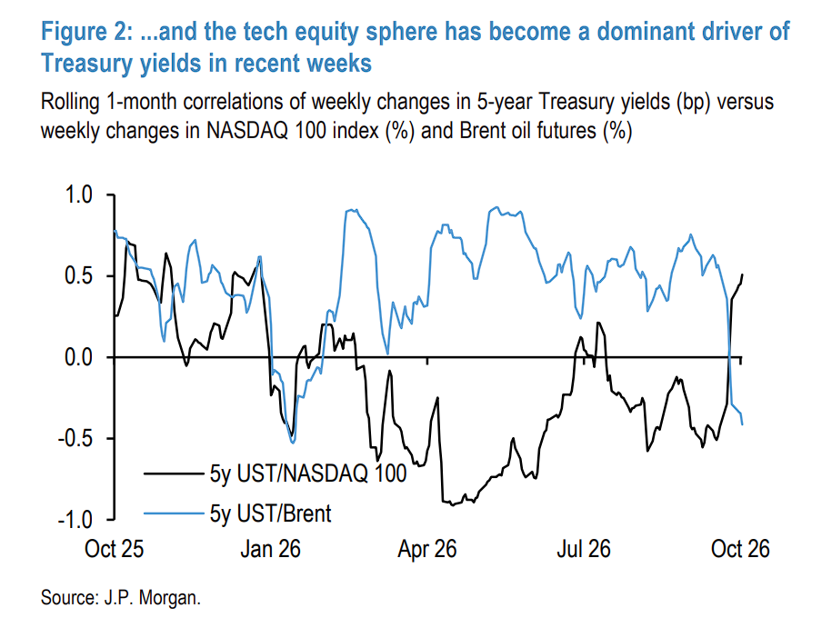
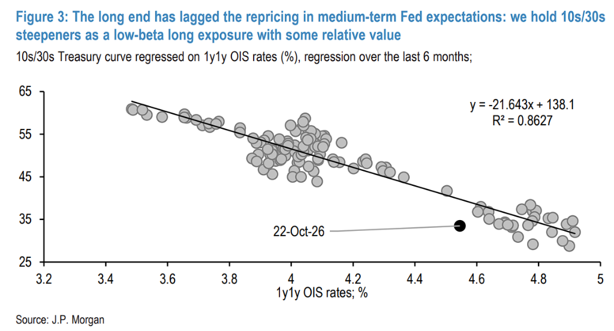
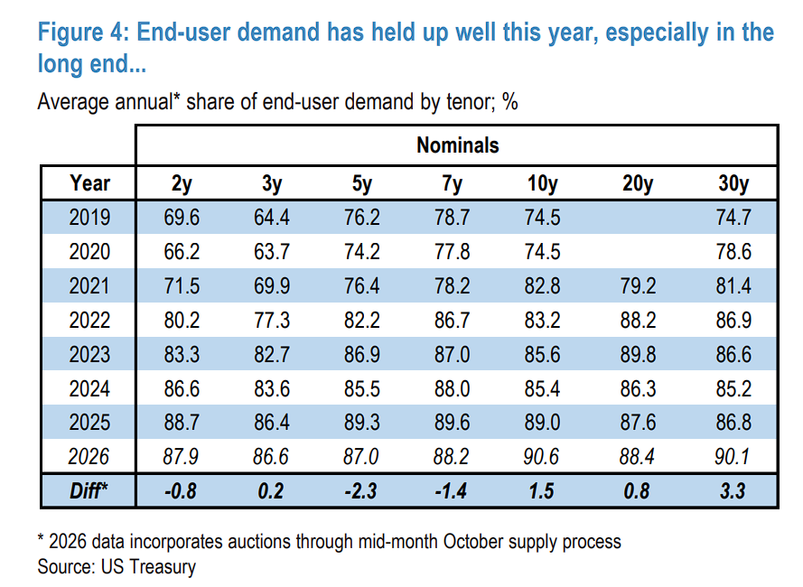
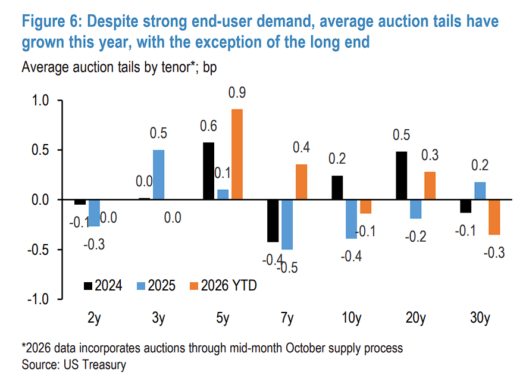

# 美债反弹、曲线与拍卖承接：摩根大通2026年10月判断

2026-10-23，华尔街见闻转述摩根大通10月22日研究：欧洲主权债压力与科技股疲弱推动美债上涨，在风险资产明确企稳前，不急于做空反弹。研究另外强调长端拍卖承接较强，并持有10s/30s陡峭化观点。理解这篇研究，需要分开债价上涨、两个期限谁表现更好，以及买家在什么价格承接新债。

## 价格反弹：什么力量使投资者愿意接受更低收益率

转载称10月22日各期限美债收益率下降15—21bp，十年收于约4.95%，是2023年3月地区银行危机以来的显著单日下降。收益率降低抬高固定现金流的现值，因而这里的反弹指债价上涨。JPM将其归于欧洲风险及科技股走弱：股票盈利担忧可以削弱风险承担、压低未来政策路径，也可能使资金转向有支付和交易用途的国债。这几条联系均能支持债价，但各自的持续条件不同。

报道还称法国OAT相对德国Bund利差当日扩大15bp。两者分别是法国、德国政府债务，同以欧元计价；相对利差反映该组债券的信用、流动性和承接差异。JPM承认当周法国利差扩大没有明确催化剂，同时认为法国政治财政改善或欧洲央行释放潜在干预信号，可能打破当地利差扩大的循环。“危机蔓延”在这里是机构解释，未被分解成美债价格中的可识别份额。

图2提供了近期联动的一项观察：**五年国债收益率周变化**与纳斯达克100周回报的一个月滚动相关在末端转正。股票走弱时收益率也倾向下降，对应债价可能上涨；这与国债发挥股票保护作用相符，仍不足以判断谁单向驱动谁。[纳指100](../../10_concepts/纳斯达克100指数.md)说明具体权益对象，[股债状态机制](../../20_mechanisms/股债相关性与通胀／增长主导状态.md)解释联动为何随冲击变化。

油价则同时作用于通胀、实际需求和避险。图2的Brent线到10月末端才转负，3月仍明显为正，因此不能用它确认转载所说“3月油价破110美元后即转负”的时点。JPM据此观察近期风险驱动变化，不能把某一阶段的油债符号当作长期固定关系。

## 相对曲线：看多债券并不自动使陡峭化获利

10s/30s指三十年收益率减十年收益率。JPM认为中期政策预期重估对十年端的影响尚未充分体现，主张陡峭化；该表达要求十年相对三十年受益。即使两种债价都上涨，若三十年收益率降得更多，利差仍会缩小，陡峭化可能受损。多十年、空三十年的一般组合及DV01配比，集中由[曲线机制logic-1](../../20_mechanisms/收益率曲线陡峭化与平坦化.md#logic-1)维护。

这次相对价值判断来自图3：以过去六个月10s/30s斜率对1y1y OIS利率回归，10月22日黑点低于拟合线约6bp。1y1y是[一年后开始、持续一年的隔夜指数互换](../../10_concepts/隔夜指数掉期OIS.md)期限，提供中期隔夜利率风险的市场价格。机构将残差解释为曲线对政策重估反应滞后，并称其持仓为低贝塔多头。这个解释依赖样本关系继续适用；长期风险补偿或期限需求改变时，6bp未必收敛。

JPM没有给出实际合约、两腿配比或固定退出日。因而，“低贝塔”保留为机构对本次表达的描述，不能据图还原其全部风险；回归统计和计算单位见[来源校核](../../40_sources/S-WS-3784306.md#figure-notes)。

## 数量与边际价格：接走很多债，仍可要求更多让价

图4显示，2026年至10月中旬，十年与三十年拍卖年均end-user占比分别为90.6%、90.1%，均为所列2019年以来最高。它支持这些期限在数量上得到较强承接。研究没有交代end-user与官方投资者类别的完整映射，不能将其直接当作外资占比或最终长期持仓。

数量强也可以与价格敏感并存。投资者愿意接走较高份额，不等于愿意按拍卖前WI报价接走：需要更高截止收益率才能完成发行时，尾差就会变大。图6正好提供相反方向的期限表现。相较2025年，三年尾差从+0.5bp降至0.0bp，三十年从+0.2bp降至−0.3bp；二十年却从−0.2bp升至+0.3bp。因此“长端例外”不足以概括所有长券，持续承接的判断须落到同期限的数量与价格。

外国买家身份是另一项判断。原图5显示截至9月的外国需求占比三个月均值在长端增加，JPM又援引8月TIC净买入，认为私人需求较强。外国官方同样可以买中长债，拍卖中的Foreign and International也汇集多种主体；需要对应TIC或更细分类，才能识别私人贡献。[原图5与分类说明](../../40_sources/S-WS-3784306.md#allotments)保留这一依据，拍卖获配不能与二级持仓、跨境净交易直接相加。

JPM把尾差扩大解释为私人买家更关注价格、以及利率波动增加。现有图没有把两种作用分离；它们仍是竞争解释。基于融资缺口和长端承接，机构认为削减长端发行无必要，这是对发行选择的评价。若强承接总要依靠更大让价，未来融资的价格条件仍会变化。[拍卖页](../../10_concepts/拍卖、投标倍数与尾差.md#end-user-202610)维护一般认识，[国债供给logic-3](../../20_mechanisms/国债供给的定价机制.md#logic-3)连接承接与定价。

## 把三个判断放到各自的后续窗口

JPM当时认为十年收益率到达4.94%—5.02%的债券反弹阻力区，可能整固；反弹延续的下一关注区为4.75%—4.81%。债价继续上涨对应收益率向更低区域移动。机构要求先看到多个风险市场明确企稳，再考虑反向判断，没有指定结束日。[原图8及完整技术位](../../40_sources/S-WS-3784306.md#technical)保存其当时参考。

以下窗口由本库于2026-11-16后补安排，用于对照10月22日判断；没有补入后来结果，也不替JPM设定退出日。

- **近期数个交易日至风险资产企稳：检验反弹的驱动。** 科技盈利和股价继续转弱、法国利差仍扩大，同时美债收益率下降，会加强避险解释。若科技与欧洲风险都已缓和，收益率仍继续下行，就需重新检查政策路径或其他配置需求，降低把反弹单归于原冲击的解释力度。
- **随后政策路径重估期间：检验相对曲线。** OIS路径下移时，十年收益率下降多于三十年、10s/30s扩大，会支持其相对判断；三十年下降更多则会伤及陡峭化，即使债券整体仍上涨。同步比较残差和两腿变化，才能区分关系延续与回归失效。
- **随后一至两轮可比期限拍卖及对应TIC更新：检验承接的条件。** 连续高终端份额仍伴较大正尾差，支持“买家愿买但要求让价”的解释；份额稳定且尾差回到接近零或stop-through，才更支持价格承接改善。拍卖观察随新发行接续，私人主体判断则待相应月份TIC公布后另核；若私人净买入没有延续，应缩小“私人需求持续强劲”的解释。
