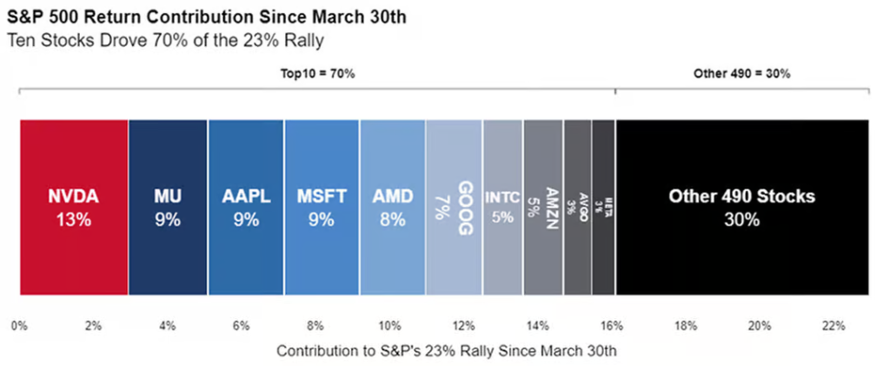
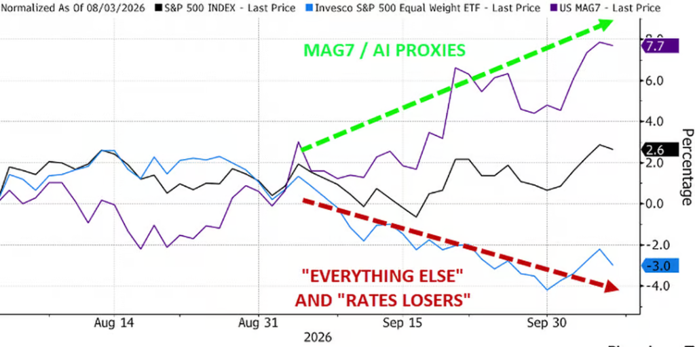
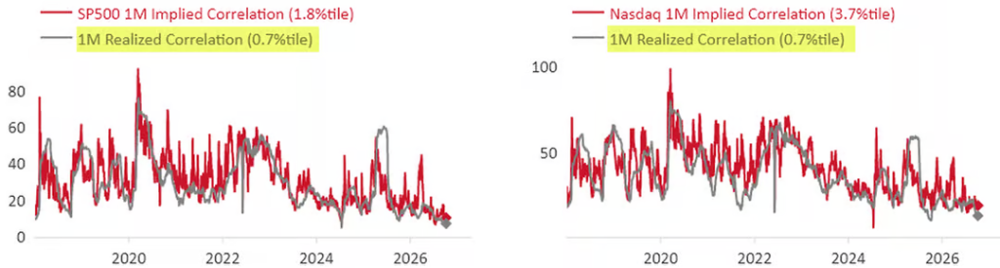
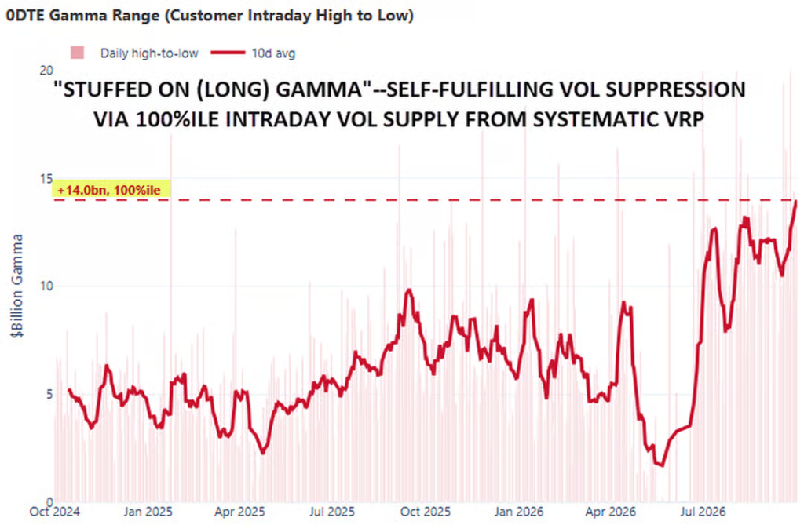
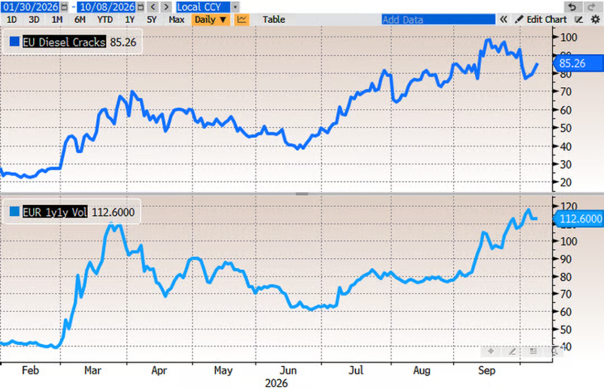
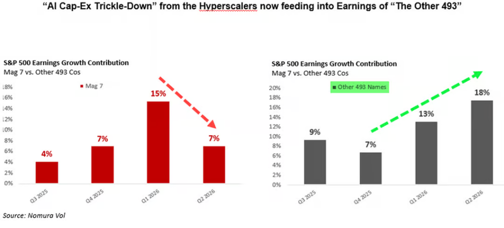
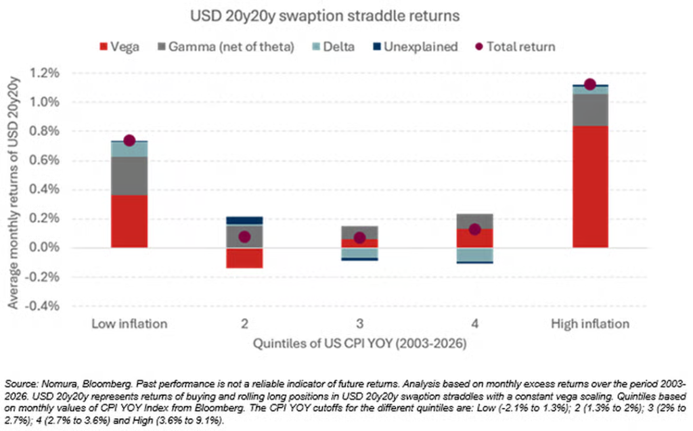

# 美股集中、波动供给与柴油风险：野村2026年10月跨资产分析

2026-10-10，华尔街见闻董静转述野村Charlie McElligott的10月8日分析：美股大盘指数变化很小，大量个股却已经调整；指数期权卖方、系统化风险目标与AI集中上涨共同形成平静表象。团队把柴油短缺引起的利率路径不确定性列为重要冲击，同时保留AI财报推动右尾上涨的情景。

市场数字及野村判断来自截至10月8—10日的转载，核读日为2026-11-16；本轮未纳入之后的行情。[来源](../../40_sources/S-WS-3783332.md)逐张定位16图及图文差异；[标普500](../../10_concepts/标普500与等权指数.md)、[IV/RV](../../10_concepts/隐含波动率与实现波动率.md#index-components)和[Swaption](../../10_concepts/利率互换期权Swaption.md)维护通用解释。

## 集中上涨与成分股抵销怎样形成指数平静

图2比较一个月**绝对收益**：指数绝对变动0.8%，个股平均绝对变动8.9%，差8.1个百分点，处过去30年第95百分位。它测量不同股票终点表现的离散，既没有保留每只股票方向，也没有使用日收益路径计算波动率。图中AMD、Intel上涨而Netflix下跌，说明个股机会和损失可以在指数汇总中相抵。

成分广度提供另一面：图3总计显示84%的股票距各自高点回撤至少10%、57%至少20%、17%至少50%。正文的前两档为85%、59%，差异留在[逐图记录](../../40_sources/S-WS-3783332.md#figure-3)。各股高点日期不同，这类分布描述横截面损伤，无法还原共同买入日组合的损益。

指数回报取决于权重和个股回报。图4称自3月30日起SPX上涨23%，十只股票贡献其中70%；NVDA贡献13%，MU、AAPL、MSFT各约9%。13%是指数涨幅份额，按23%换算约2.99个百分点；它没有表示NVDA自身涨13%或权重为13%。其余490只股票仍合计贡献30%，因此正文“少数赢家承担全部上涨”属于修辞概括。

图5从8月3日归一：Mag7上涨7.7%、SPX上涨2.6%、Invesco S&P 500 Equal Weight ETF价格下降3.0%。等权线使用ETF，图内未给ticker或分红口径；比较可揭示该窗口大公司与其他成分表现分化，不能直接作为官方等权总回报数据。

### 低相关性是当前缓冲，未来取决于冲击是否共同化

图6报SPX一个月隐含相关性第1.8百分位、实现相关性第0.7百分位；右侧Nasdaq隐含为第3.7百分位、实现为第0.7百分位。低相关性使一部分股票的变动在组合中互相抵销，指数风险可以低于个股风险的简单汇总。若公司基本面差异仍大，这种分化可以延续；共同冲击若令许多股票一起下跌，抵销作用便可能缩小。

原文用2007年危机前夕和2018年Volmageddon作低相关性的先例，但未给统一阈值或完整25年统计。它提供作者追问共同风险的历史参照，不能直接转成危机概率。相关性的测量口径见[IV/RV页](../../10_concepts/隐含波动率与实现波动率.md#index-components)；原图1M序列与后补Cboe 3M示例分别保存。

## 客户卖方、中介对冲与风险目标资金如何接上

文中QIS指按规则实施的量化投资策略，其中VRP类通过出售波动风险取得权利金或风险补偿。0DTE/1DTE指当天到期/距离到期一天的期权。若客户净卖出普通期权，中介接到相应多头且未由其他头寸抵销，中介通常取得正Gamma；为维持Delta中性，会在上涨时卖标的、下跌时买标的。持续承接这些对冲订单的其他交易者又会改变净价格影响。[Gamma反馈](../../20_mechanisms/做市商Gamma对冲的价格反馈.md#logic-1)给出该条件过程。

图7标题是“0DTE Gamma Range (Customer Intraday High to Low)”，浅线为日内高低范围、红线为十日均值，末值+140亿美元、历史100%分位。范围是高值减低值，正数本身不识别客户净Gamma方向；也不能把它当作做市商已确认的全天净多头。图上关于“long Gamma压波”的大字是野村解释，本轮缺逐主体持仓和对冲成交来重建它。该风险敏感度金额也没有表示140亿美元现金流入。

卖方收到权利金，同时承担跳跃、波动重估和融资风险。图8中卖25-delta put、卖strangle的十日夏普为13.9、14.2，一年值却为2.3、1.3；短窗口高夏普不代表未来稳定回报。图9的基金资产和Vega供给估计还说明供给不限于日内QIS，读数及单位见[图8—9](../../40_sources/S-WS-3783332.md#figure-8)。[卖波收益风险](../../20_mechanisms/波动率风险溢价与卖波收益风险.md)解释这种风险承担。

图10将波动控制、CTA、风险平价的美股系统化敞口估计合并，处第86.4百分位。低风险估计可使部分[波动率目标资金](../../20_mechanisms/波动率目标策略的顺周期反馈.md)提高可承受仓位；CTA还看趋势，风险平价还看其他资产与相关性。图中聚合数并不证明每类基金由同一规则驱动，更没有给未来触发点或强制卖出金额。

期权价格也反映参与者的选择：低put skew与高call skew被野村解释为“更担心踏空”，但供给同样会改变价格。图11的call skew历史分位为100%，其隐波比值仍低于1，不能据此断言所有机构没有下行保护。[图1及11的口径](../../40_sources/S-WS-3783332.md#figure-11)及[偏斜机制](../../20_mechanisms/偏斜与尾部保险需求.md)分别保存测量与通用过程。

这些环节使当前平静有一定自我维持的条件：成分股不同向，指数风险被抵销；中介若持正Gamma并反向对冲，局部价格冲击获得承接；较低的风险估计又允许部分资金持有较大仓位。共同冲击可以同时改变它们：成分股转向同跌会减少抵销，波动估计更新可能触发风险目标减仓。中介若仍为正Gamma，其逆向交易仍可缓冲跌势；新客户保护需求、到期和其他头寸若改变净Gamma，这种承接也会变化。后两步需要实际净持仓、对冲执行和市场深度，不能从现有图直接推定已经发生强制抛售。

## 能源成本与盈利失望，怎样成为共同冲击

野村把欧洲柴油短缺列为关键共同风险。柴油可以因炼化和交付受限而相对原油变贵，释放库存先缓解当前缺口，持续供给仍要看炼厂与运输恢复。[柴油页](../../10_concepts/柴油.md)维护产品、裂解价差与交付基础；这里仅复用一般解释，10月19日另一篇分析的行情和预测未进入本篇信息集。

报道以法国释放1000万桶储备、约能支持一个月说明库存缓冲有限，但没有附放储公告、需求分母或产能表，本轮未独立确认。

图12将EU Diesel Cracks（末值85.26）与EUR 1y1y Vol（112.6）并列，自2月至10月8日多次同向。两者分别是价差与利率期权波动报价，单位不同；截图没有完整合约代码和单位。“柴油价差=利率波动率”保存为作者的跨资产判断，不能当作等式、固定换算率或单向因果估计。

把这组观察接到利率，需要解释成本和政策：柴油变贵提高运输、农业及工业的投入成本，企业能否提价、居民能否承担，决定它扩散到消费价格的程度与持续时间；增长受压又可能抑制其他需求。央行如果担心持续通胀，对未来政策利率的判断可能上修或分歧扩大，期权保险价格随之变化。能源价格与利率波动也可能共同受冲突等第三因素驱动。这是本库按材料展开的条件解释，没有据两条曲线确认传导强度。

### 报道当时的新消息，分别检验哪一环

报道写特朗普宣布中期选举前不攻击伊朗、油价随后回落。[图15](../../40_sources/S-WS-3783332.md#figure-15)是标注Oct 9 2026的zerohedge转述帖；本轮未取得特朗普原声明、精确行情时点与事件窗口，因而保存报道的情景对应，不把先后叙述视为已完成因果验证。

同篇转述《金融时报》：OpenAI年化营收约200亿美元，低于此前传递的约700亿美元预期，消息后Nasdaq当日跌逾1%。原文未提供FT文章链接、投资者文件、两项营收的统计期间或定义。本轮未取得原件；无法据此确认两者是同日同口径的实际/预期差，也不能把单家公司转述直接等同整个AI需求失真。

图16是野村“AI资本开支向其他493家盈利扩散”的论证：Q3/Q4 2025及Q1/Q2 2026，Mag7柱分别为4/7/15/7%，其他493家为9/7/13/18%。图题称earnings growth contribution，但没有给计算底表，不能擅自确定这些数字是对SPX总体利润增速的贡献百分点，还是各组自身增速。两组利润变化也可能受到其他行业因素影响，未单独识别AI资本开支贡献。

## 作者的交易分支与利率期权回测

McElligott在财报季提出三条分支：AI盈利再支持大型科技股时，以认购价差参与未来一个月的上涨，并讨论SPX向8000点的情景；若伊朗谈判降低能源风险溢价，则考虑黄金及IWM上行期权；同时持有美元/欧元利率Vega，防范通胀与政策路径重新定价。认购价差通常以买入较低执行价call并卖出较高执行价call限制成本与上端收益，仍需实际执行价、期限和权利金才能评价赔率。IWM是跟踪Russell 2000的ETF，不能把基金代码与指数本身混用。[发行人目标说明](https://www.ishares.com/us/products/239710/ishares-russell-2000-etf)。

第三条分支将政策路径不确定性转成期权风险。多头Vega在利率隐波上升时可能取得估值收益；整个[Swaption头寸](../../10_concepts/利率互换期权Swaption.md#volatility-position)的损益还受底层利率变动、Gamma与对冲路径、时间损耗和交易成本共同影响。保险是否有效，要看同一窗口总损益怎样抵销待对冲的风险；柴油风险下降、隐波回落也可能带来成本。

图14标题为“USD 20y20y swaption **straddle** returns”，脚注为2003—2026月度超额收益、买入并滚动美元20y20y跨式、维持恒定Vega规模，按当月美国CPI同比划五分组。最高通胀组CPI同比3.6%—9.1%，平均月度超额收益约1.1%，Vega贡献最大；低通胀组−2.1%—1.3%也有约0.7%的正平均值，中间组较低。

图与脚注的straddle为同执行价跨式，正文却写“宽跨式”，因此本图不提供宽跨策略绩效。恒定Vega意味着名义规模随风险敏感度调整，图注没有说明百分比收益的资金分母、完整滚动/对冲及成本；约1.1%不能直接当作权利金、名义本金或保证金的回报率。通胀分组是对历史月份的条件统计，是否用当时可见发布值、是否提前知道组别均未交代，无法据此登记一条可执行的未来月收益规则。

## 按原判断的期限分别检验

以下是本库2026-11-16依据10月8—10日材料补充的检验思路，未纳入窗口内后来结果，也没有增加交易建议。

- **接下来约一个月的财报窗口：** 按英伟达、微软、美光等具名公司的披露先后，比较订单交付、收入和盈利修订，再看其他成分公司的经营改善及涨幅贡献、行业广度。若价格扩散而盈利没有扩散，“AI投入惠及其他公司”的解释仍需证据；图16的两组利润变化不足以单独识别这条因果。
- **文章给出的11月3日选举前谈判窗口：** 将谈判消息同原油、柴油裂解价差、可交付库存和炼厂恢复分开记录，再比较利率隐波。原油风险溢价回落而柴油供给仍紧，较支持炼化瓶颈延续；若可交付供给也恢复、裂解价差回落，能源持续通胀的解释应随之调整。价格与利率隐波同向还可能受共同消息驱动。
- **随后的政策路径与期权重估窗口：** 先明确币种、执行利率、两段期限和对冲安排，再按同窗记录权利金、期权市值、对冲损益及成本，比较它与权益风险的实际抵销。只依赖Vega渠道时，才需要观察受损情景中的隐波上升；总头寸也可能经利率变动和Gamma取得收益。历史CPI组均值无法替代这个判断。
