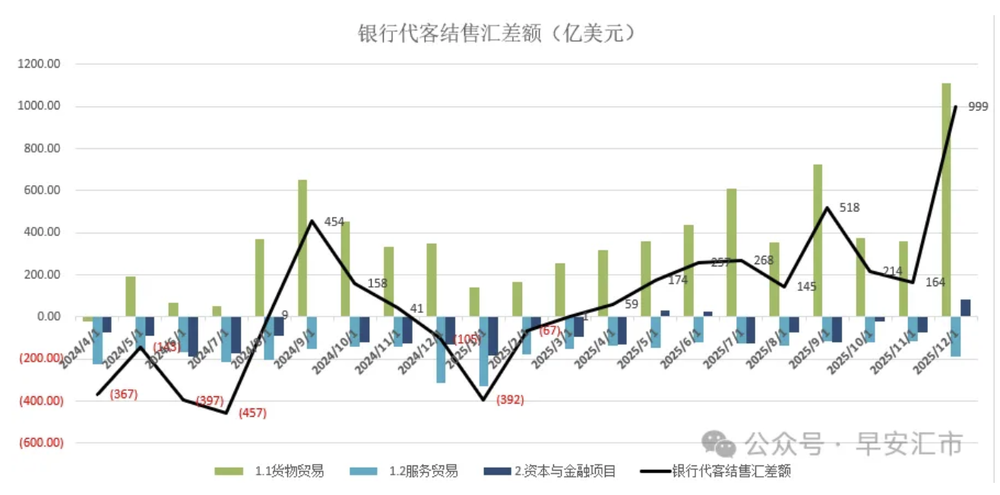
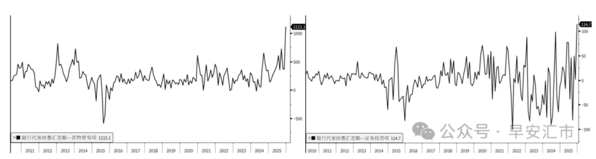
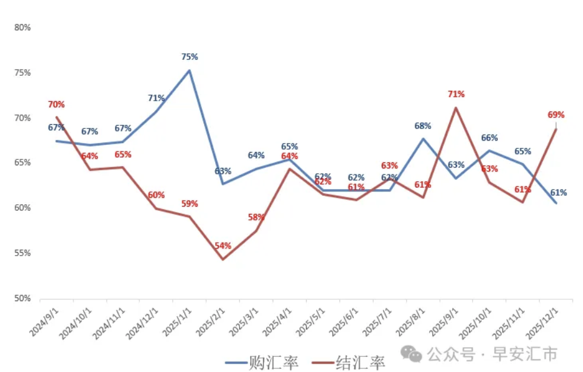
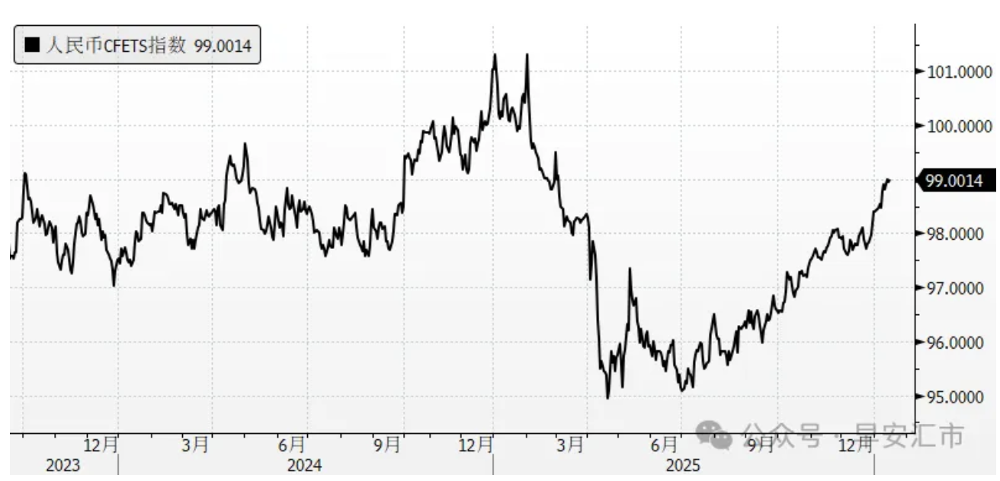
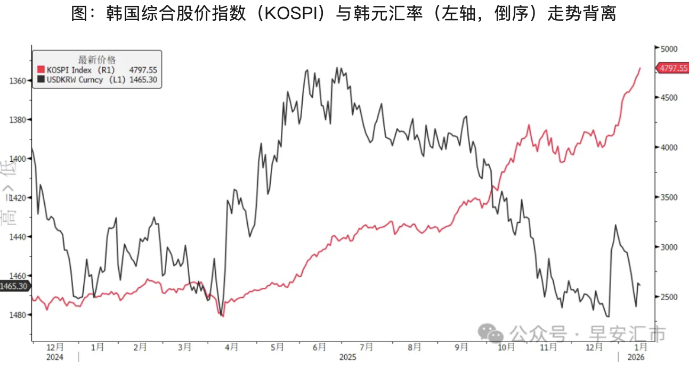

# 12月结汇数据分析

- 页面显示时间：2026-01-16T08:37:32+08:00
- 页面署名：杨宸
- 标注来源：早安汇市
- 原文：[华尔街见闻](https://wallstreetcn.com/articles/3763424)
- 取得时间：2026-11-04T16:03:25+08:00
- [HTML阅读版](article.html) · [来源记录](metadata.json)

## 导语

中国12月结售汇顺差999亿美元，达历史最高水平。与日元和韩元由资本外流导致的本币贬值相反，中国出口旺盛，叠加A股向好带来的海外资本流入，推动人民币逆势走强，CFETS指数突破99关口。

---

外管局在周四公布了最新的12月结售汇数据，炸裂了。 **12月银行代客结售汇顺差达到999亿美元，这是有数据以来的历史最高水平。**

## 一、如何解读12月结售汇数据

从分项来看：

1、货物贸易净结汇1113亿，超过了2013年1月的818亿的纪录，达到了有数据以来的最高水平，与周二刚公布的海关口径下1141亿美元的贸易顺差数据基本吻合。

2、服务贸易保持一直以来的净购汇，逆差略扩大至190亿。

3、资本项下净结汇83亿，扭转了7月以来的逆差局面，其中直接投资逆差18亿，证券投资顺差高达114亿，也是创下有数据以来的单月历史新高。2025年证券投资项下净结汇累计共计272亿美元。

12月结汇率上升7个百分点69%，购汇率下降4个百分点至61%。从结汇率和购汇率的劈叉，可以看出市场对于人民币转向升值情绪。

## 二、人民币CFETS指数走高

有如此亮眼的结汇数据，不难理解为何在目前在美元指数走高的环境下，人民币却逆势走强。 **人民币CFETS指数已经突破了99关口。** 指数中权重最大的三大非美货币(EUR、KRW、JPY）开年以来都表现拉垮，欧元受地缘政治拖累，韩元和日元这两个难兄难弟亚洲货币更是弱得没法看。

（注：外汇交易中心在2026年最新公布的CFETS篮子中，按照2024年度贸易数据作为权重进行调整，调升了韩元的比重，调低了日元的比重，因此韩元超越日元成为了人民币CFETS篮子中的第三大货币）

比较难以理解的是韩元的贬值，今年以来，虽然韩国股票表现强劲，但是韩元却一路走弱，韩元兑美元在周三跌破1480关口，是2009年以来的最弱水平。

**和日元相似，韩元贬值的主要原因也是资本外流。** 韩国的股市主要是本土投资机构在买入，而外资买家持续净卖出。一方面，韩国散户投资大量买入美国AI股。另一方面，国民年金NPS通常在一季度加大海外投资，对韩元构成季节性贬值压力。难怪连美国财政部长贝森特也坐不住了，在周三晚间发布“口头干预”，称韩元的贬值已脱离基本面。

## 三、总结

**总结来看，对于12月创历史新高的结汇，背后主要是三点原因：** 第一，出口旺盛；第二，做多A股情绪带来海外资金流入；第三，在USDCNY破7后，市场对于人民币的升值情绪强烈，放大了年底的季节性结汇力量。

往后看，在如此强劲的出口和资本流入趋势下，预计人民币升值趋势会持续。不过，人民币汇率指数已经来到高位，预计人民币升值的速度也会相对可控。

本文来源：[早安汇市](https://mp.weixin.qq.com/s/BdM-8igOzGuezGL8i4VQRw)

风险提示及免责条款

市场有风险，投资需谨慎。本文不构成个人投资建议，也未考虑到个别用户特殊的投资目标、财务状况或需要。用户应考虑本文中的任何意见、观点或结论是否符合其特定状况。据此投资，责任自负。
