# 1930年贸易战之殇

- 页面显示时间：2025-04-16T09:37:26+08:00
- 页面署名：鲍奕龙
- 标注来源：广发证券刘晨明郑恺等
- 原文：[华尔街见闻](https://wallstreetcn.com/articles/3745300)
- 取得时间：2026-11-04T16:03:49+08:00
- [HTML阅读版](article.html) · [来源记录](metadata.json)

## 导语

广发证券复盘1930年《斯穆特-霍利关税法》，当时引发的贸易战加剧大萧条。期间，美国经济全面崩盘，大类资产表现分化：黄金上涨27.6%，美元涨14.6%，美债涨12.9%，而原油、铜、美股大幅下跌，其中标普500跌80.4%，道指跌85.2%。

---

## 报告摘要

**（一）1930年的《斯穆特-霍利关税法》**

《斯穆特-霍利关税法》以“保护本土产业”为名，将20000多种商品的关税平均提高了20%，美国关税由1929年的13.5%升至1933年的19.8%；应税商品（占34%）平均关税从1929年的40%提高到1932年的59%。同时也引发多国报复，致使美国和全球贸易规模均萎缩约三分之二，大幅加剧了全球大萧条。直到1934年6月，罗斯福签署了《互惠贸易协定法》，这段混乱的历史才彻底得到终结。

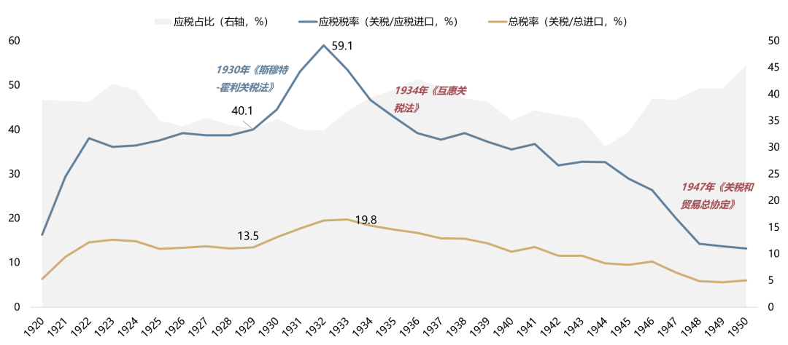

**（二）关税战与大萧条**

事实上，法案正式落地时（1930年6月），“大萧条”已进行了一段时间（始于1929年8月）。大萧条的原因：（1）1929年10月股市崩盘，道指半个月下跌39%；（2）挤兑导致银行体系崩溃及货币供应减少；（3）金本位的束缚，美联储未及时向市场注入流动性，反而被动收缩货币；（4）关税法加剧了本来可能相对“普通”的衰退。

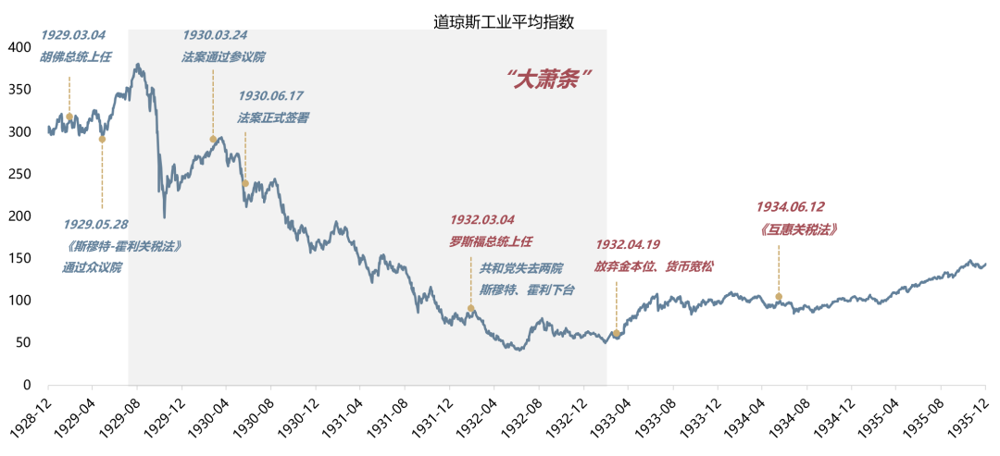

**（三）大萧条期间的经济表现**

大萧条期间美国经济崩盘，出口只是其一。大萧条期间（1929年8月至1933年3月），美国名义GDP下降45%，其中，个人消费下降41%、私人投资下降87%、出口额下降67%；CPI指数下降24%、实际利率超过12%；失业率由1929年的3.2%升至1933年的24.9%。

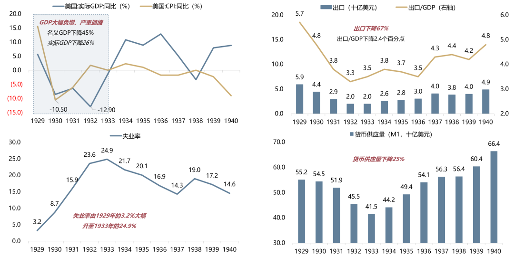

**（四）大萧条期间的资本市场表现**

（1）大类资产：黄金（+27.6%）\>美元（+14.6%）\>美债（+12.9%）\>住房（-24.3%）\>物价（-26.6%）\>白银（-34.0%）\>原油（-47.2%）\>铜（-60.5%）\>标普500（-80.4%）\>道指（-85.2%）。（2）股市下跌转折点：胡佛上台、法案通过众议院、法案通过参议院、法案正式生效。（3）股市见底转折点：罗斯福上台、放弃金本位、货币宽松。（4）行业表现：相对避险的品种是烟草，跌幅-27.6%；跌幅在80%以上的行业超过一半。

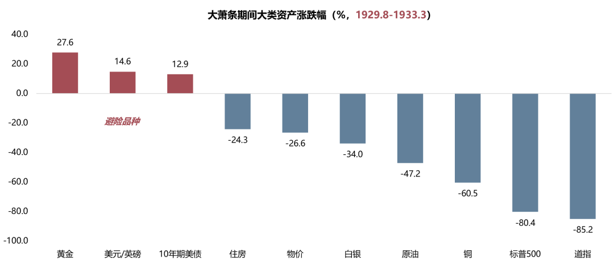

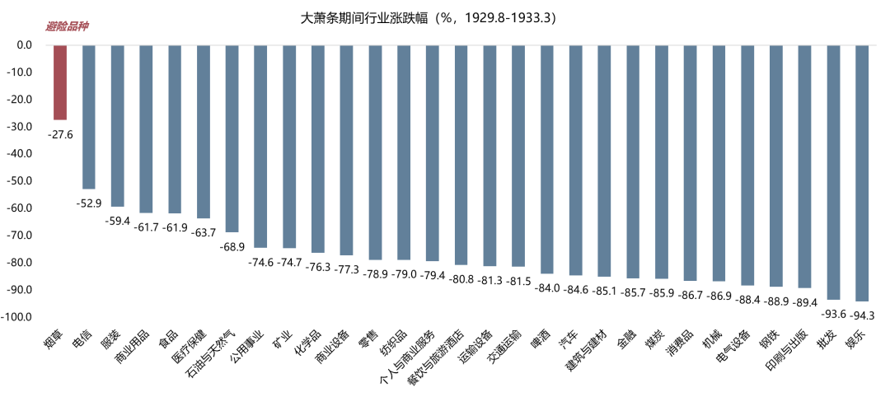

**（五）当前贸易战有什么不同？**

（1）政令落地效率不同。《斯穆特-霍利关税法》立法经历一年多；当前特朗普政府只需发行政命令。（2）经济周期位置不同。1929年，美国处于“咆哮的二十年代”末期；当前经济过热问题没那么突出。（3）货币周期位置不同。1929年，美国处于加息末端，且奉行金本位制，货币宽松空间受限；当前美国处于降息途中。（4）贸易依赖度不同。1930年代，美国对全球贸易依赖度相对较低；当前美国对全球贸易依赖度明显提高。

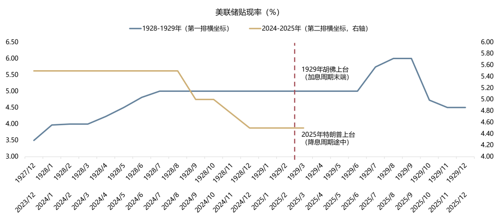

**（六）总结**

（1）相对1930年代，当前美国贸易保护主义盛行，但当前世界贸易以国际价值链为特征，贸易壁垒真实落地的难度更大；（2）对美国本身经济来说，当前冲击也会远小于1930年代，原因：一是当前过热程度不如1920年代末期，二是美联储有更灵活的货币政策空间，以应付可能产生的衰退或通缩。

## 报告正文

今年3月，特朗普正式任职之后，随即开打“贸易战2.0”，当前已宣布的政策有可能使得美国的关税升至百年新高。这使得市场对于美国乃至全球经济衰退的担忧大幅升温，百年前的关税战与大萧条成为可能再现的极端风险之一。

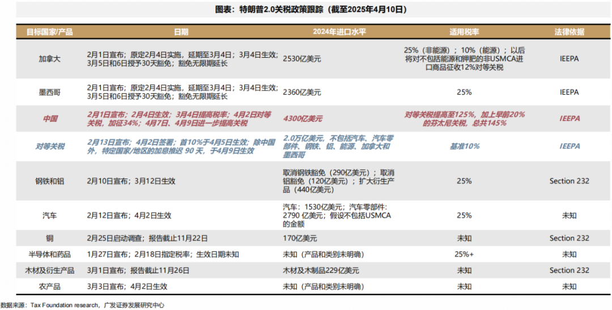

据Tax Foundation测算，若特朗普政府实施当前关税政策（截至2025年4月10日，不包括缓和90天的关税），美国进口关税税率将从2024年的2.5%提升至2025年的11.5%，为1943年以来的最高水平；另外，据耶鲁大学预算实验室测算，若考虑2025年生效的全部关税政策，美国进口关税将升至22.4%，这已经超出了上个世纪30年代《斯穆特-霍利关税法》之下的关税水平。

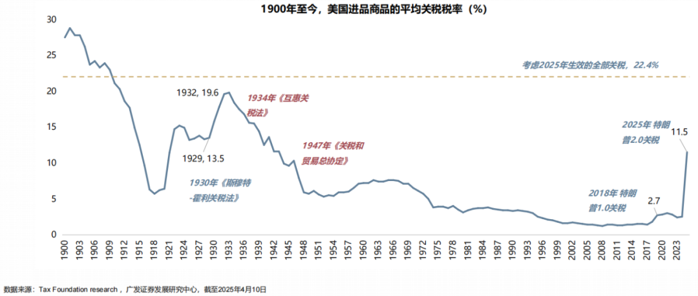

## 一、梦回19世纪30年代贸易战

**（一）事与愿违的《斯穆特-霍利关税法》**

1930年的《斯穆特-霍利关税法》（Smoot-Hawley Act）是美国历史上最臭名昭著的立法之一。这一法案虽以“保护本土产业”为名，却引发全球几十个国家的报复性贸易壁垒，致使1929-1932年间国际贸易规模萎缩约三分之二，不仅加剧了全球大萧条，甚至为二战的爆发埋下伏笔。 

法案经过：《斯穆特-霍利关税法》源于胡佛在1928年总统选举期间的竞选承诺：通过提高农产品进口关税来帮助农民，解决农产品过剩问题。

- 1929年3月4日，胡佛总统于上任；

&nbsp;

- 1929年5月28日，法案在美国众议院获得通过；

- 1930年3月24日，该法案在参议院获得通过；

- 1930年6月17日，胡佛总统签署法案。

- 直到1934年6月，罗斯福总统签署了《互惠贸易协定法》，降低了关税水平并促进了贸易自由化和与外国政府的合作，这段混乱的历史才彻底得到终结。

**法案影响：**

该法案将20000多种商品的关税平均提高了20%。美国的总关税由1929年的13.5%，升至1933年的19.8%，增加了6.3个百分点。同时也引发了外国政府报复，在两年内，大约二十多个国家采取了类似的“以邻为壑”关税，进一步减少了全球贸易。1929年至1932年间，美国和国际贸易规模均萎缩约三分之二。

**贸易战与大萧条：**

事实上，在该法案签署之际，美国经济已陷入衰退阶段。按NBER的划分，大萧条由1929年8月延续至1933年3月。而《斯穆特-霍利关税法》的出现，导致华尔街失去信心，并发出美国孤立主义的信号，许多海外银行开始倒闭，这就使得经济衰退更加严重。

**关税水平：**

《斯穆特-霍利关税法》以及通货紧缩的影响之下，美国的总关税由1929年的13.5%，升至1933年的19.8%，增加了6.3个百分点。若只针对34%的应税商品来看，应税进口商品的平均关税从1929年的40%提高到1932年的59%，增加了19个百分点。

 

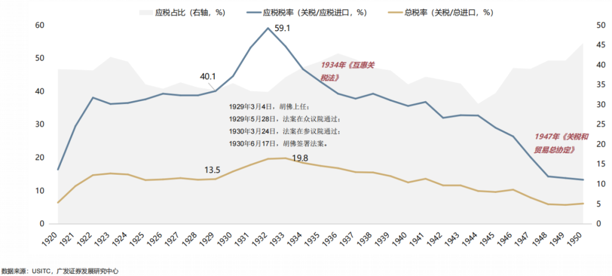

**（二）《斯穆特-霍利关税法》与“大萧条”**

《斯穆特-霍利关税法》落地实施的时候（1930年6月），“大萧条”已进行了一段时间（1929年8月）。大萧条之前是一段被称为“ 咆哮的二十年代 ”的工业增长和社会发展时期。关于大萧条原因的解释一般有几种：

**（1）1929年10月股市崩盘：**

保证金交易盛行（10-20%保证金），10月24日（黑色星期四）-11月14日，仅14个交易日，道指下跌39%；

**（2）银行体系崩溃：**

银行因贷款违约和股市崩盘破产，发生挤兑，银行为应对挤兑，大幅收缩贷款，导致货币乘数崩溃、货币供应减少；

**（3）金本位的束缚：**

美联储未及时向市场注入流动性，反而因维持金本位而被动收缩货币（防止黄金外流），实际利率上升（因通缩预期）抑制了投资和消费，各国为维持黄金储备与货币的固定比率，被迫紧缩财政，加剧全球通缩；

**（4）《斯穆特-霍利关税法》：**

关税法加剧了本来可能相对“标准”的衰退，关税战导致贸易量下降三分之二，各国货币贬值、资本外逃，最终加速了经济全球化倒退和政治极端化。

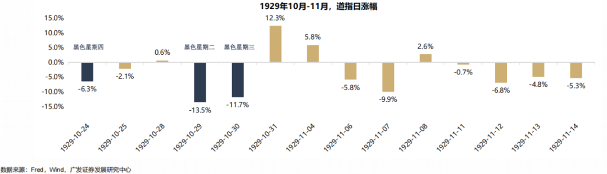

**（三）经济的崩盘，出口只是其一**

美国大萧条期间（1929-1933年），美国的经济数据全面崩盘：

（1）名义GDP下降45%，其中，个人消费支出下降41%、私人投资下降87%、出口额下降67%，关税战导致贸易量下降三分之二，同时，大萧条对个人消费和私人投资的抑制也非常明显

（2）CPI指数下降24%、实际利率超过12%，期间发生了严重通缩，通缩带来了很严重的恶性循环，包括实际利率上行、投资和消费减少、货币供应量减少（下降25%）、进口关税被动上行（从量商品）等

（3）失业率由1929年的3.2%大幅升至1933年的24.9%，创下历史新高，此后美国的失业率很少超过10%，即使在70年代的滞胀期

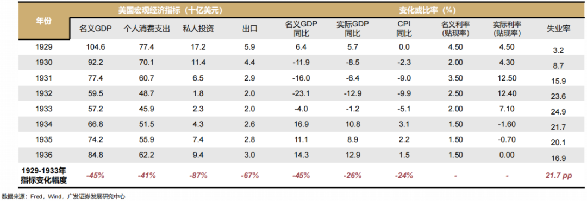

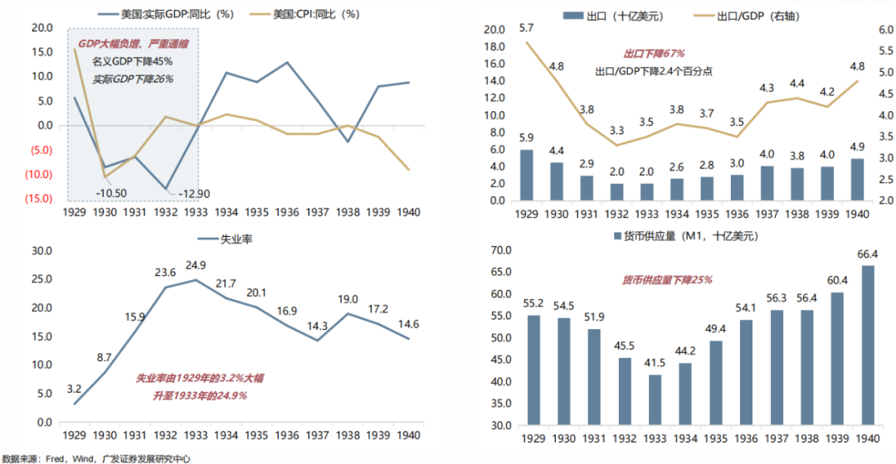

**（四）金本位对货币宽松的束缚**

1929年危机初期，美联储为吸引国际资本流入（防止黄金外流）和抑制股市投机，反而多次提高利率，1929年9月贴现率升至6.0%，10月股市崩盘，资产泡沫破灭。

美联储从1930年开始连续降低贴现率，至1931年贴现率降到1.5%；但受金本位制度约束，美联储的宽松货币政策出现反复；一直到1933年罗斯福政府放弃金本位，货币才得以进一步宽松，1934年贴现率再度降至1.5%，并于1937年降至1.0%，持续至1947年。

1942年，美国为了应对二战政府开支，开始实施YCC政策，将短期国库券收益率定为0.375%，长期国债收益率为2.5%。

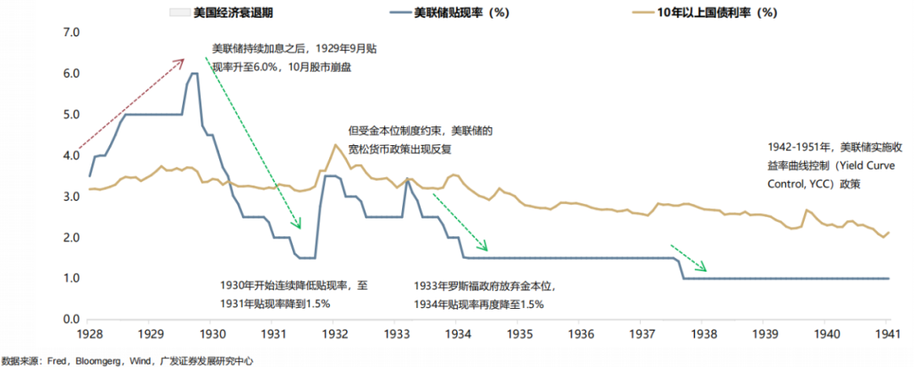

## 二、贸易战期间，大类资产的表现

**（一）《斯穆特-霍利关税法》时间线与股市走势复盘**

大萧条期间，美股指数下跌的转折点：（1）胡佛上台，法案通过众议院；（2）法案通过参议院；（3）法案正式生效。

大萧条期间，美股指数见底的转折点：（1）罗斯福上台；（2）放弃金本位、货币宽松。

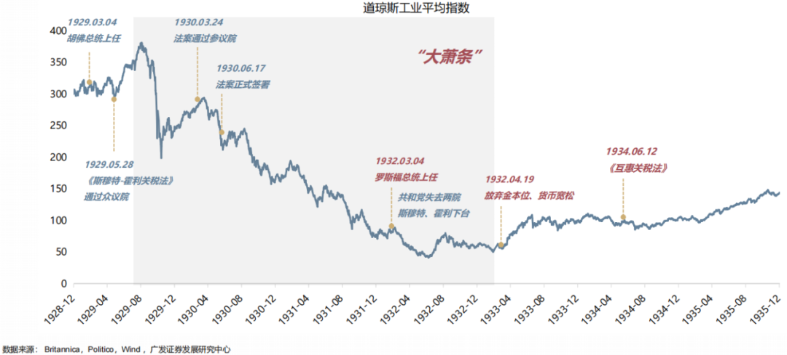

**（二）大萧条期间的大类资产表现**

按NBER的划分，大萧条由1929年8月延续至1933年3月。

大萧条期间，大类资产来看：黄金（+27.6%）\>美元（+14.6%）\>美债（+12.9%）\>住房（-24.3%）\>物价（-26.6%）\>白银（-34.0%）\>原油（-47.2%）\>铜（-60.5%）\>标普500（-80.4%）\>道指（-85.2%）。

其中，黄金上涨出于避险属性，美元上涨出于英国更早放弃金本位、更早宽松。

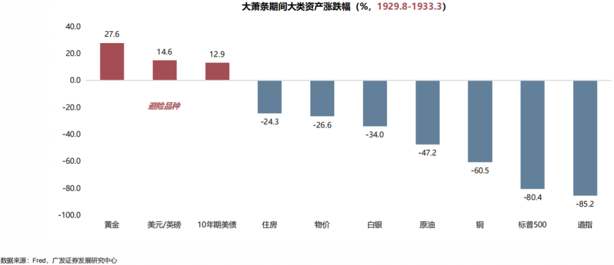

**（三）大萧条期间的行业表现**

行业层面来看，所有行业均下跌，无一幸免；相对避险的品种是烟草，跌幅-27.6%；跌幅在80%以上的行业超过一半；跌幅超过90%的行业有两个：批发（-93.6%）、娱乐（-94.3%）。

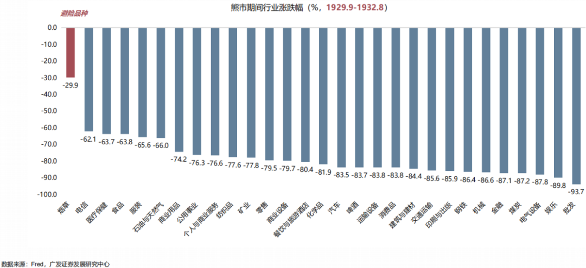

**（四）熊市期间的大类资产表现**

以大萧条期间的熊市阶段（1929-09-03至1932-07-08）作为统计时间窗

熊市期间，大类资产来看：美元（+38.5%） \>美债（+10.8%） \>黄金（+0.3%）\>住房（-21.3%）\>物价（-21.4%） \>原油（-31.5%） \>白银（-47.2%）\>铜（-68.4%）\>标普500（-86.1%）\>道指（-89.2%）

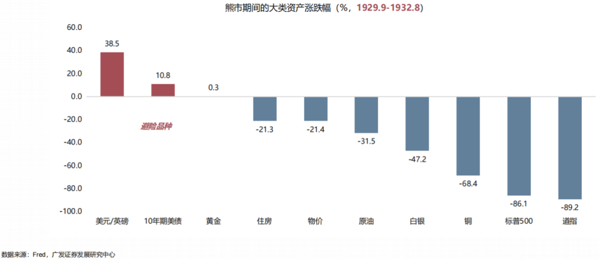

**（五）熊市期间的行业表现**

行业层面来看，熊市期间，相对避险的品种是烟草，跌幅-29.9%；跌幅较大的行业有：批发、娱乐、电气设备、煤炭、金融等

## 三、当前的贸易战有什么不同？

**（一）政策落地效率不同**

1929年，胡佛上任之后，经历了一年多时间的立法程序，《斯穆特-霍利关税法》才正式签署。

2025年，特朗普上任之后，主要援引《国际紧急经济权力法》（IEEPA）、《国家紧急法》（NEA）、《1974年贸易法》第301条款、《美国贸易扩展法》（Trade Expansion Act）第232条款，通过行政命令推动贸易战快速落地，可绕过了国会立法的漫长程序。

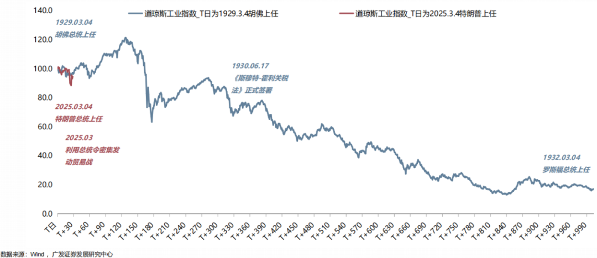

**（二）经济周期位置不同**

1929年，美国经济周期处于“ 咆哮的二十年代 ”的高速增长和快速扩张的末期，社会积累的债务和产能过剩问题较严重

2025年，美国经济周期处于疫情之后正常化的年份，经济过热的问题没那么突出

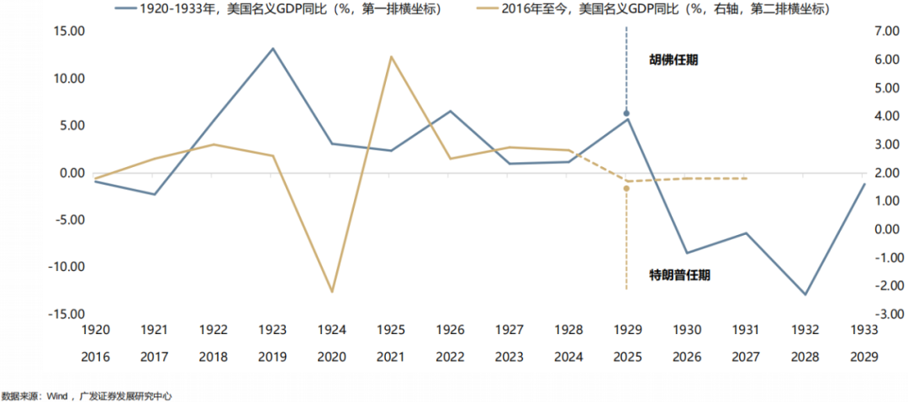

**（三）货币周期位置不同**

1929年，美国货币周期处于加息周期末端，且奉行金本位制，货币宽松空间受限

2025年，美国货币周期处于降息周期途中，当前全年仍有3次左右的降息预期（75bp）

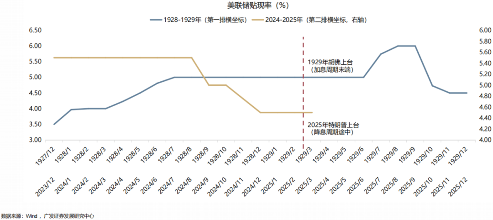

**（四）贸易依赖度不同**

1930年代，美国对全球的贸易依赖度相对较低，且有较大的贸易顺差

2020年代，美国对全球的贸易依赖度明显提高，且有较大的贸易逆差

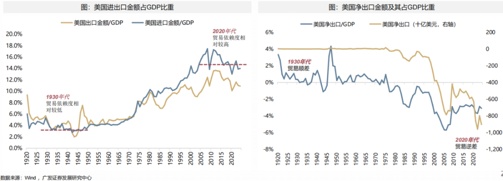

**整体上看：**

（1）相对1930年代，当前美国贸易保护主义有过之而无不及，且总统推出贸易壁垒政策的速度更快，但是，当前世界贸易以国际价值链为特征，强行推进贸易壁垒会使得供应链紊乱甚至断裂，真实落地的难度更大；

（2）对美国本身经济来说，当前贸易战的冲击也会远小于1930年代，原因在于：一是当前经济过热程度不如1920年代末期，二是美联储有更灵活的货币政策空间，以应付可能产生的衰退或通缩。

本文作者：刘晨明、郑恺等，来源：[晨明的策略深度思考](https://mp.weixin.qq.com/s?__biz=MzAxNjAwNTMwNQ==&mid=2652381502&idx=1&sn=f50ff22f927df72746f03fd072549d36&chksm=814594a8053266b3cfadc3a7cc813931cce2663313a11744e62a4a048cb381820569ca41eb68&mpshare=1&scene=23&srcid=0415M6PiXCnrraH98kSYWOLj&sharer_shareinfo=2867c37b427ed3f4e644c97a8e03c7e5&sharer_shareinfo_first=2867c37b427ed3f4e644c97a8e03c7e5#rd)，原文标题：《【广发策略】1930年贸易战之殇》

风险提示及免责条款

市场有风险，投资需谨慎。本文不构成个人投资建议，也未考虑到个别用户特殊的投资目标、财务状况或需要。用户应考虑本文中的任何意见、观点或结论是否符合其特定状况。据此投资，责任自负。
