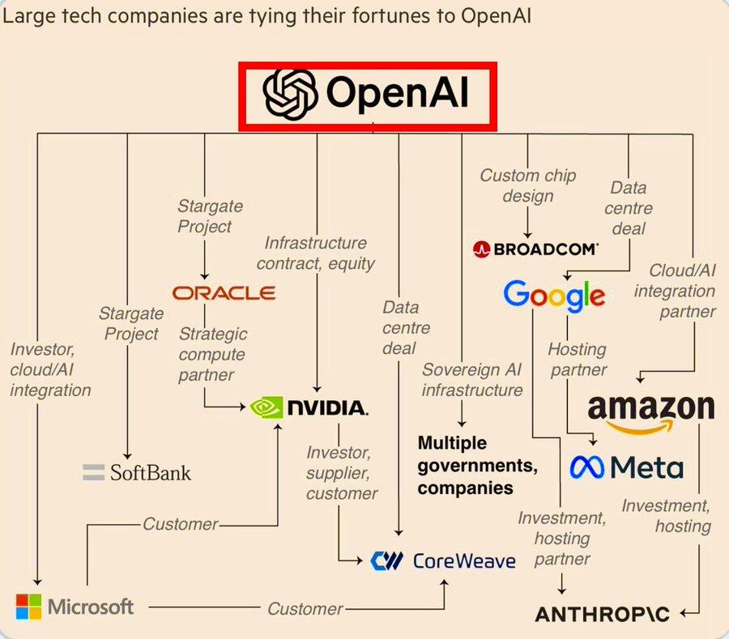

# 1万亿订单再加3500-5000亿美元！OpenAI“停不下来”，“当你欠每家数千亿美元，钱的问题自己会解决”？

- 页面显示时间：2025-10-14T08:29:42+08:00
- 页面署名：龙玥
- 标注来源：未单列，见正文
- 原文：[华尔街见闻](https://wallstreetcn.com/articles/3757125)
- 取得时间：2026-11-04T16:03:19+08:00
- [HTML阅读版](article.html) · [来源记录](metadata.json)

## 导语

“如果你欠银行100美元，那是你的问题。如果你欠博通5000亿美元，那是博通的问题。如果你欠每家大型科技公司数千亿美元，那是他们的问题。他们肯定会找到解决办法的！或者你会。钱的问题会自己解决的。”

---

人工智能的浪潮席卷全球，而身处风暴中心的OpenAI，正以前所未有的姿态，用一系列巨额采购订单震动着科技与金融界。

最新动态是，[OpenAI再签重磅协议](https://wallstreetcn.com/articles/3757107?keyword=%E5%8D%9A%E9%80%9A)，计划未来四年与博通合作部署10千兆瓦定制化芯片和网络设备。

英国《金融时报》援引知情人士消息称， **这笔交易可能意味着OpenAI在近几个月已签署的约1万亿美元芯片和数据中心采购协议之上，可能还需要额外支出3500亿至5000亿美元** ，以满足其构建AI基础设施的庞大需求。

这一系列操作将市场的目光再次聚焦于一个核心问题： **OpenAI的钱从哪儿来？** 这家预计今年亏损约100亿美元的AI初创公司，如何支撑其看似无尽的资本支出。

10月14日，前高盛银行家、彭博专栏作家Matt Levine形象地指出，OpenAI的融资策略是“世界级的金融工程”，其精髓在于“金融的时间旅行”。

Levine解释道，传统的金融模式是基于工厂和产品清晰的商业计划来借贷，但科技初创企业则是一种极端版本——它们依赖于一个“疯狂的雄心勃勃的愿景”和“让人相信愿景的能力”来吸引投资。Levine将其比喻为创业者 **“把手搭在投资者肩上，指着远方，轻声说：‘全知（AI）机器人’”，投资者便会“开悟”。**

比如博通，昨晚的消息后博通股价飙升11%，投资者押注这笔联盟将为芯片制造商带来数千亿美元的新收入。然而，OpenAI将如何支付这些设备费用，细节并未明确。

> **如果你欠银行100美元，那是你的问题。如果你欠博通5000亿美元，那是博通的问题。如果你欠每家大型科技公司数千亿美元，那是他们的问题。他们肯定会找到解决办法的！或者你会。钱的问题会自己解决的。**

Levine犀利的暗示，OpenAI正在通过巨额订单将供应商的命运与自身深度绑定，促使他们共同寻找解决方案。“钱的问题会自己解决的。”

此外，Levine还引用了Altman最近向员工透露的计划：OpenAI希望到2033年建成250吉瓦的新计算能力，这按当前标准将耗资超过10万亿美元。Altman曾表示需要创造新的融资工具来资助这一巨大建设，Levine对此评论说：“不！错了！他已经分享了大量关于他的新融资工具的细节！他每天都在分享更多！”

DA Davidson分析师Gil Luria对OpenAI的财务能力持怀疑态度，他直言“OpenAI根本没有能力做出任何这些承诺”，并预测该公司今年可能亏损约100亿美元。他认为，这是硅谷 **“假戏真做，直到成功”** 理念的体现，旨在让“很多人都对OpenAI投入了大量精力”。

## 万亿订单背后的“金融炼金术”

OpenAI的算力采购并非简单的现金交易，而是一套精心设计的“金融炼金术”。据“小熊快跑”公众号相关计算，到2029年，OpenAI与英伟达、AMD和博通这三大芯片厂商的芯片采购支出合计已高达2850亿美元。

其中，与英伟达的合作估值约1000亿美元，与AMD的协议涉及6GW算力，估算约750亿美元（约300万颗MI450芯片），而与博通的10GW AI服务器合作则对应约1100亿美元的投资（约550万颗定制TPU芯片）。

[华尔街见闻](https://wallstreetcn.com/articles/3756788)写道，针对这些巨额采购，关于钱从哪来，高盛等机构分析指出，OpenAI主要采用了两种创新模式。

**一种是“股权换采购”模式** ，以OpenAI与AMD的协议为例。表面上，OpenAI计划采购价值900亿美元的AMD Instinct系列GPU，但协议核心是AMD向OpenAI发行认股权证。如果未来AMD股价因OpenAI的大规模采用而上涨，OpenAI持有的潜在股份价值将与硬件采购成本相近，使其几乎可以“免费”获得这批算力。这本质上将硬件销售转化为股权配置，将AMD的长期估值与OpenAI的基础设施增长直接挂钩，形成共生关系。

**另一种是“循环收入”模式** ，以与英伟达的合作为代表。英伟达计划向OpenAI投资高达1000亿美元，这笔资金反过来可供OpenAI购买英伟达的芯片。高盛将其定义为“循环收入”，即供应商的资金注入最终以收入形式回流。

## 巨大的资金缺口与未来的不确定性

尽管这些金融工具设计精巧，但OpenAI真实的资金缺口依然巨大。

高盛从两个角度剖析了OpenAI的财务状况。从运营现金流看，OpenAI在2026年的年度运营基础设施成本约为350亿美元，自身收入、供应商融资和外部股权/债务融资贡献相对均衡。

然而，一旦将与英伟达合作自建数据中心以及为“星际之门”（Stargate）项目投入的资金等未来的重大资本承诺纳入考量，OpenAI在2026年一年的总资金需求将飙升至约 **1140亿美元** 。

在这种情况下，其资金结构将彻底失衡，对外部股权和债务融资的依赖度将激增至压倒性的75%，而自身收入的贡献则被稀释至仅17%。

正如一位OpenAI高管所言，“大多数人宁愿拥有一块更大蛋糕中较小的一部分”。OpenAI的豪赌，正试图以其颠覆性的AI愿景作为杠杆，撬动整个科技生态系统为之投入。未来四年内，其高达2850亿美元的芯片支出远超其目前每年约130亿美元的收入。

这表明，除非OpenAI能找到新的业务实现暴力变现，或者芯片大厂通过股权入股，否则其对外部资本的持续、大规模融资将是其宏伟“星际之门”计划能否成功的关键。

风险提示及免责条款

市场有风险，投资需谨慎。本文不构成个人投资建议，也未考虑到个别用户特殊的投资目标、财务状况或需要。用户应考虑本文中的任何意见、观点或结论是否符合其特定状况。据此投资，责任自负。
