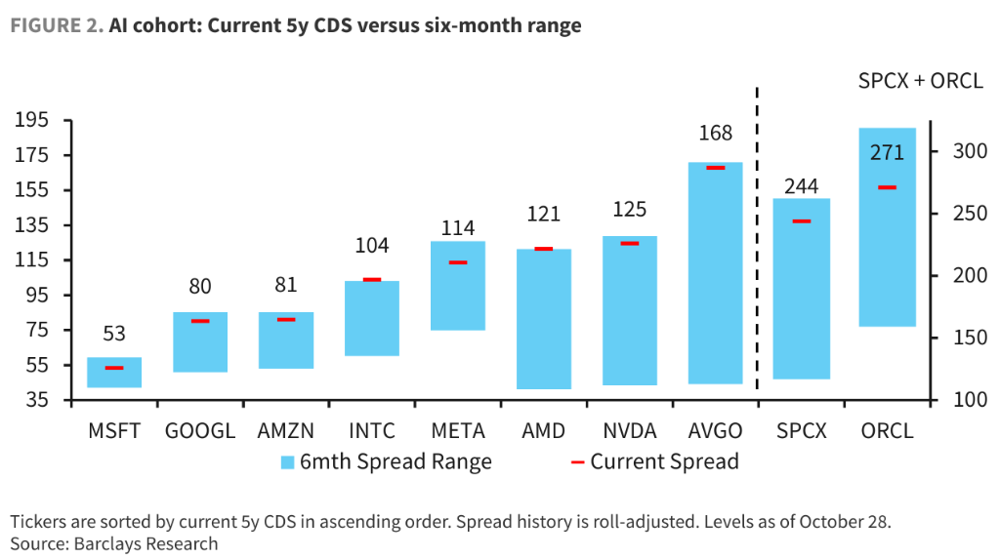
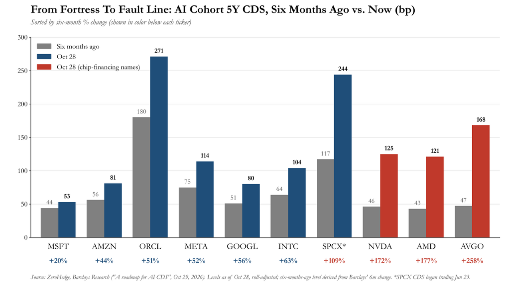
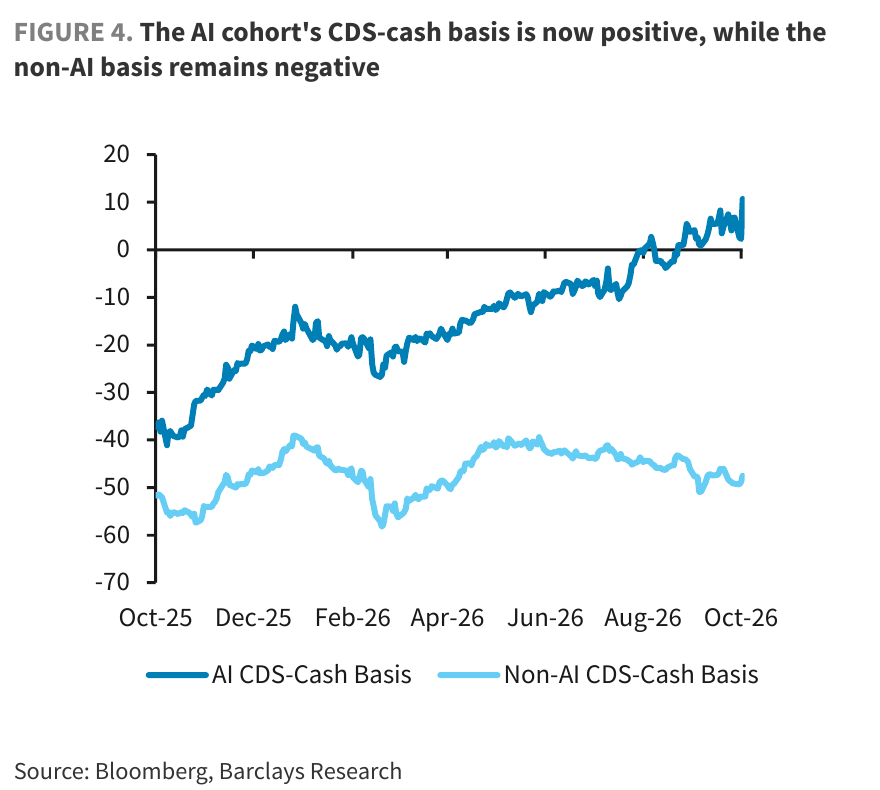
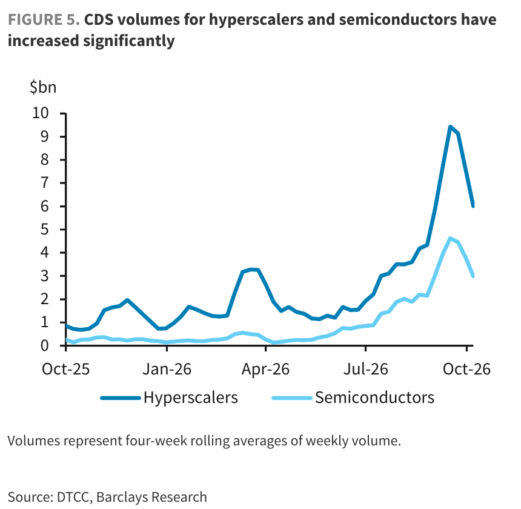
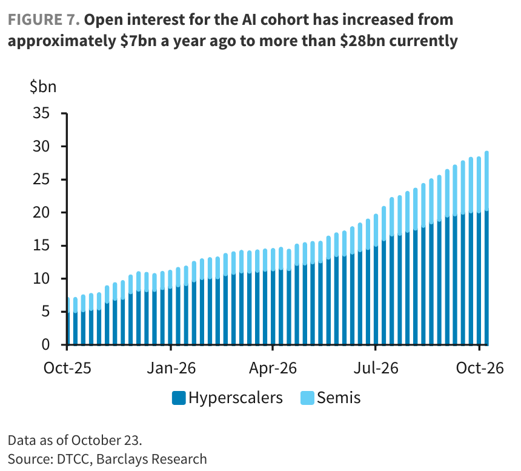
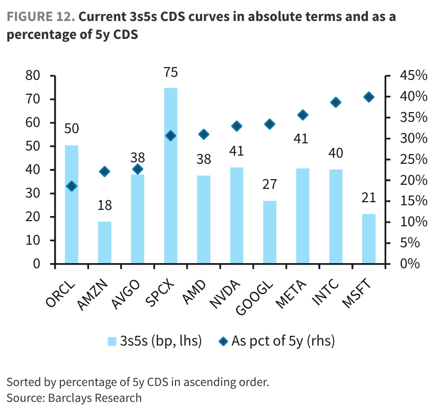
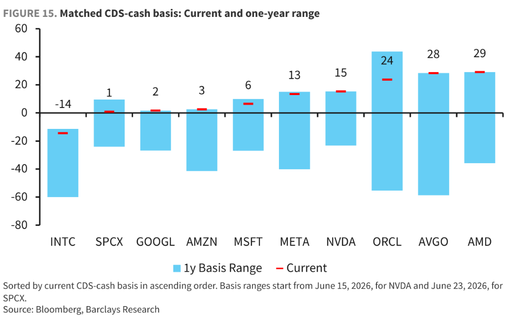
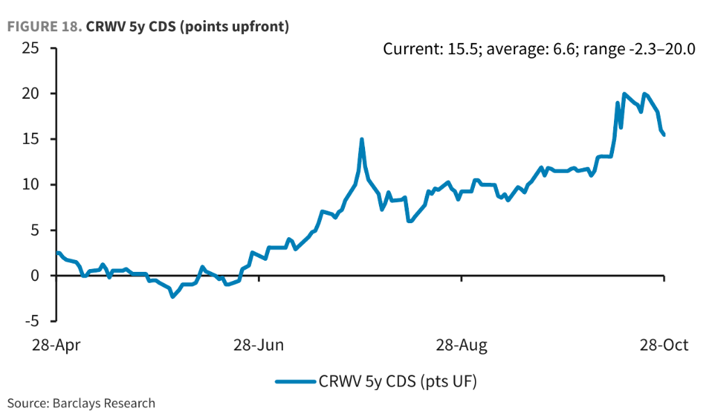
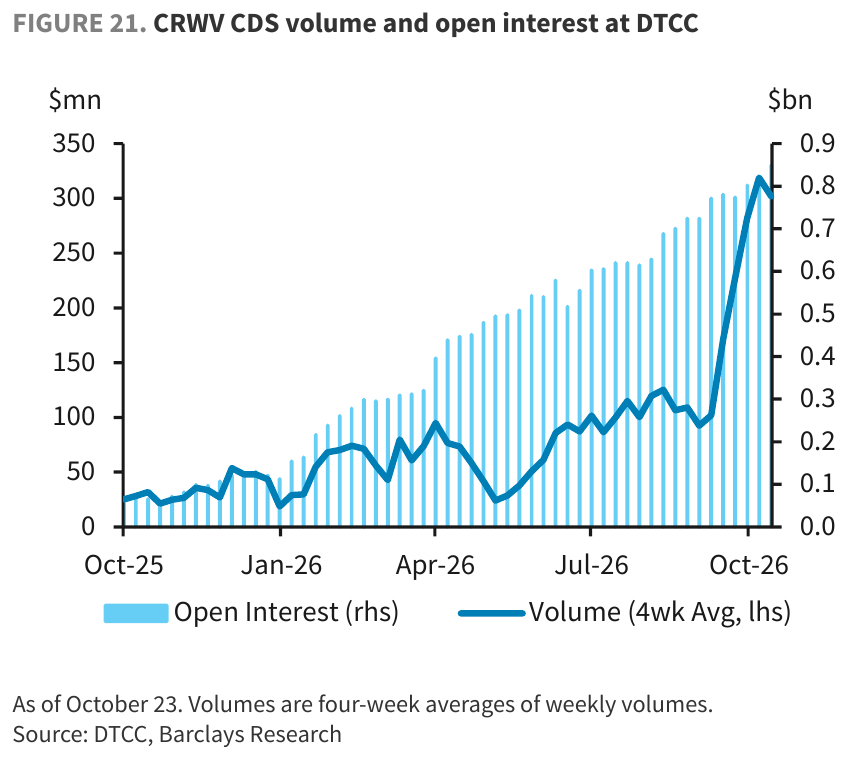

# 2008再现！一文读懂华尔街最热门交易：AI CDS

- 页面显示时间：2026-10-31T13:41:38+08:00
- 页面署名：鲍奕龙
- 标注来源：未单列，见正文
- 原文：[华尔街见闻](https://wallstreetcn.com/articles/3784900)
- 取得时间：2026-11-04T16:02:16+08:00
- [HTML阅读版](article.html) · [来源记录](metadata.json)

## 导语

当AI巨头们疯狂烧钱扩张之际，信贷市场已拉响警报。博通、英伟达等芯片商CDS利差半年内暴涨逾170%，谷歌、亚马逊等10家核心AI企业虽仅占投资级指数成分8%，却承载了16%的隐含信贷风险。芯片制造商正从科技公司异变为"集中贷款机构"，CDS交易量同比激增逾1900%。

---

巴克莱银行（Barclays）发布了一份针对人工智能相关企业信用违约互换（CDS）市场的综合报告，指出 **随着资本支出的大幅扩张，AI相关企业的信贷风险已出现显著的重新定价，其CDS交易量及利差均呈现急剧上升趋势。**

10月29日，巴克莱银行报告指出，包括谷歌、亚马逊、Meta、微软、甲骨文等超大规模云计算服务商，以及AMD、博通、英伟达等芯片制造商在内的 **10家核心AI企业，目前仅占CDX投资级指数成分的8%，但已占到该指数隐含信贷风险的16%** 。

巴克莱强调，过去六个月，这十家公司的信用风险均有所扩大，目前均处于其六个月波动区间的上限附近。

（AI 群体：当前5年期CDS的六个月区间对比）

这意味着持有该投资级指数的投资者已被动承担了大量AI领域的波动风险。此外，这些核心AI企业的CDS与现金债券的基差已转为正值， **即购买违约保护的成本已超过持有这些企业债券所带来的额外收益** 。

据彭博报道， **这一反常现象主要由于大量未持有相关债券的机构（如进行对冲的股票基金和银行）正大举买入CDS，以对冲巨大的AI资本支出及相关贷款风险。**

**此番技术性异动在信贷对冲与基差扭曲的逻辑上，与2008年当年极其相似。** 当年大量未持有次级房贷债券的机构（如对冲基金、投资银行），出于宏观看空或风险规避，通过买入CDS保护来下注违约风险。这种密集的“裸对冲”衍生品买盘将CDS利差极度推高，甚至超过了现货债券本身的信用利差，直接推升CDS-现金债券基差转正。

在巴克莱发布该报告之际，头部科技企业的融资需求正持续向市场施压。近期，微软启动了逾250亿美元的债券发行，亚马逊单季度新增超480亿美元长期债务，博通也计划于明年初筹集高达210亿美元资金。

这些巨额融资进一步推高了市场的对冲需求，导致相关企业CDS成本触及历史新高。

## 芯片制造商信贷特征转变，利差大幅走阔

在这波信贷重新定价中， **芯片制造商的CDS利差走阔最为显著** 。

六个月前，博通、AMD和英伟达的CDS利差尚处于同类别的最低水平，在40个基点左右徘徊。

（AI群体5年期CDS，六个月前vs.现在，按六个月变化幅度排序）

然而，如今这三家公司的CDS利差已跃居前列，其中博通的5年期CDS在六个月内飙升258%，AMD上涨177%，英伟达上涨172%。相比之下，评级为AAA的微软仅上涨了20%。

巴克莱在报告中指出，随着芯片供应商开始向客户提供贷款以购买其芯片（即供应商融资）， **信贷市场已开始将这些公司视为拥有高度集中贷款账本的贷款机构** 。

例如，在银行对Anthropic的630亿美元芯片交易产生疑虑后，博通出面提供了担保。 **基于此，巴克莱建议买入博通的5年期CDS保护，作为对冲更广泛AI融资压力的宏观策略。**

## 基差转正与对冲需求驱动交易量激增

**CDS与现金债券的基差转正，是当前AI信贷市场最显著的技术特征。**

过去一年，CDX投资级指数中非AI企业的基差基本保持负值，即CDS利差低于债券利差，但AI群体的基差已上升约50个基点并转为正值。在芯片制造商和甲骨文中，这一正基差尤为明显。

（AI 群体的CDS-现金债券基差现已转为正值，而非 AI 群体的基差仍为负值）

**这种结构性变化伴随着交易量的爆炸性增长。** 截至10月23日，超大规模云服务商的4周平均周交易量达到约60亿美元，同比猛增约740%；芯片制造商的周交易量达到30亿美元，同比激增1900%。

（超大规模云服务商与半导体企业的 CDS 交易量已显著增加）

**未平仓合约（Open interest）数据同样印证了资金的持续流入。** 超大规模云服务商的净未平仓合约名义价值已从一年前的约50亿美元翻倍至200亿美元，芯片制造商则从约19亿美元增至86亿美元。

（AI 群体的未平仓合约已从一年前的约70亿美元增至目前的280亿美元以上）

这10家AI企业目前占美洲企业单一名称CDS所有未平仓合约的近14%，远高于一年前的4%。

## 曲线形态分化，交易策略凸显个股差异

通过对CDS曲线 **3年期与5年期利差对比** 的分析，巴克莱指出了个别企业的定价异常。

例如，亚马逊与谷歌的5年期CDS水平相当（80-81基点），但亚马逊的3s5s曲线（3年与5年利差）仅为18基点，显得过于平坦。

（当前 3s5s CDS 曲线的绝对值，以及占 5 年期 CDS 的百分比）

**巴克莱认为这可能与亚马逊 6月份的一笔定期贷款造成的买盘压力有关，并建议买入亚马逊5年期保护或构建陡峭化交易组合** 。

财报数据随后印证了对冲的必要性，亚马逊公布第三季度自由现金流消耗达335亿美元，资本支出高达773亿美元。

**作为市场上最具流动性的CDS标的，甲骨文的基差在样本中处于高位** 。

（当前CDS-现金债券基差在一年区间内所处位置对比图）

**巴克莱建议卖出甲骨文的5年期基差，即卖出2032年到期债券同时卖出CDS保护，以博弈基差的收敛** 。此前，甲骨文宣布将未来几年的额外融资上限设定为200亿美元。

此外，英特尔是样本中唯一基差仍为负值（-14基点）且曲线相对陡峭的企业，这主要由于其并未深度参与同行的供应商融资模式。但在疲软的业绩指引公布后，其股价创下了自1982年以来的最大单日跌幅。

## 高收益市场缩影：CoreWeave违约保护成本高企

**在投资级之外，CoreWeave作为CDX高收益指数中唯一直接相关的AI企业CDS，成为了观察数据中心和新型云服务商信贷风险的独特窗口。**

目前，CoreWeave的5年期CDS已采用“预付点数”（points upfront）的定价方式，达到15.5点，这一通常用于受困债务的定价模式凸显了市场对其风险的高度警惕。

（CoreWeave 5年期CDS，以预付点数报价）

**数据显示，CoreWeave的CDS周交易量已从一年前的3200万美元升至3.02亿美元，未平仓合约增至8.5亿美元** 。

（CoreWeave周交易量已从一年前的3200万美元升至 3.02 亿美元，未平仓合约增至8.5亿美元）

尽管有分析师维持对CoreWeave债券的“超配”评级，但其高达15.5点的违约保护前期成本表明，CDS市场正在对其业务模式的潜在违约风险进行更为严苛的定价。

风险提示及免责条款

市场有风险，投资需谨慎。本文不构成个人投资建议，也未考虑到个别用户特殊的投资目标、财务状况或需要。用户应考虑本文中的任何意见、观点或结论是否符合其特定状况。据此投资，责任自负。
