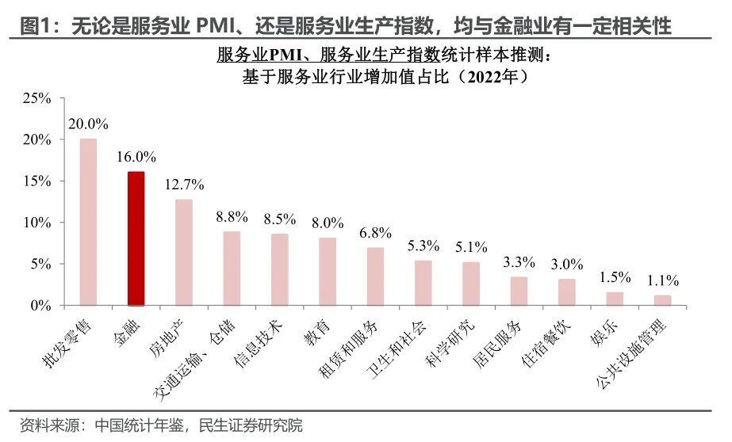
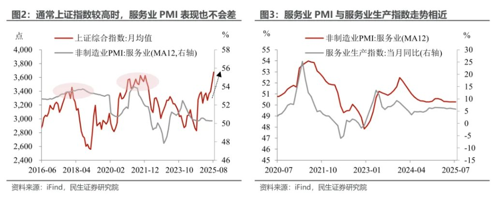
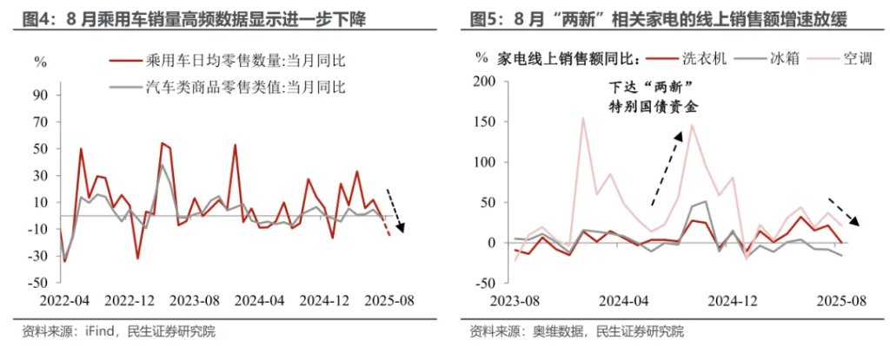
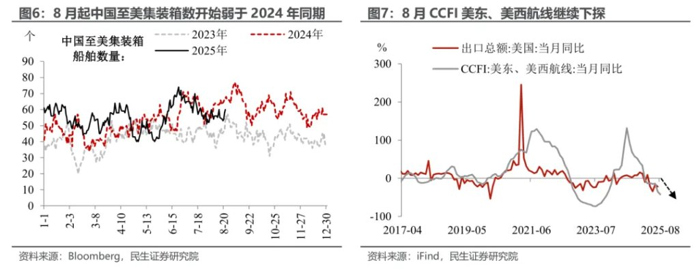
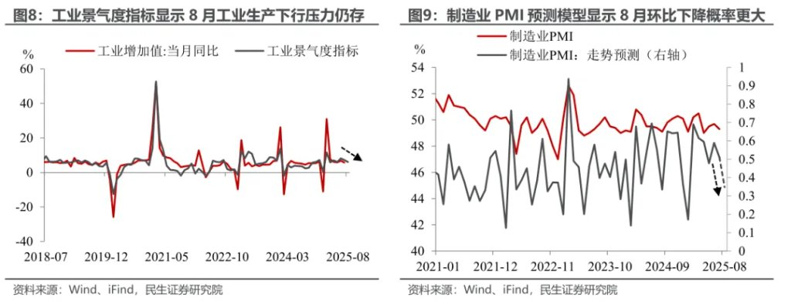
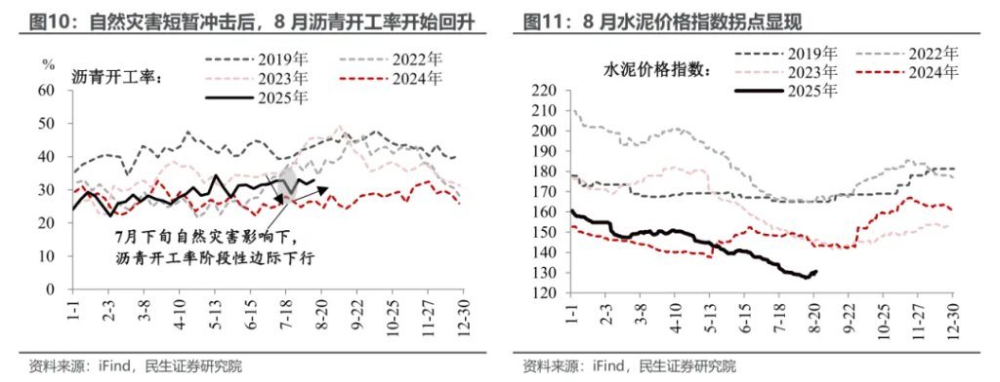
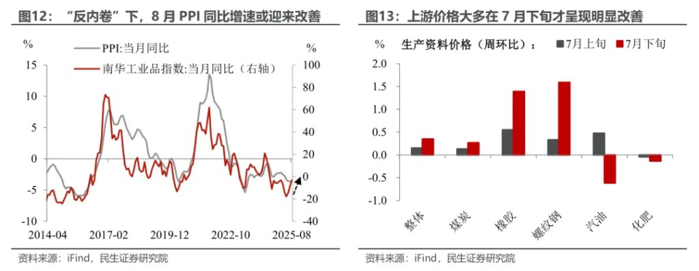
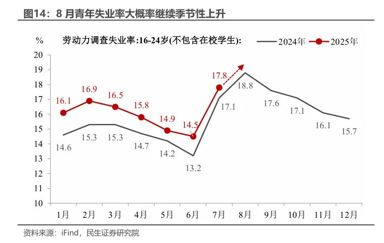
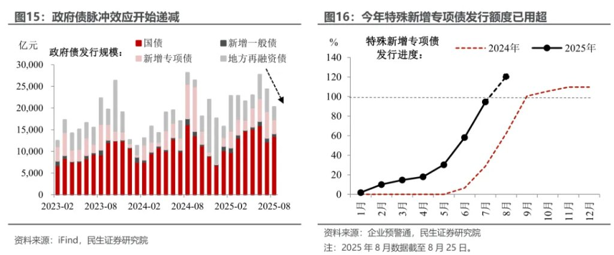

# 8月经济：股市涨能否带动实体反弹？

- 页面显示时间：2025-08-27T07:57:47+08:00
- 页面署名：龙玥
- 标注来源：民生证券陶川等
- 原文：[华尔街见闻](https://wallstreetcn.com/articles/3754228)
- 取得时间：2026-11-04T16:03:27+08:00
- [HTML阅读版](article.html) · [来源记录](metadata.json)

## 导语

民生证券陶川认为，股市高涨最直接的映射是服务业PMI和服务业生产指数的反弹，经济下行的压力也将有所缓解。不过，投资者信心已呈现企稳迹象，但消费者信心的回归略显滞后。“稳外贸”与“反内卷”对企业形成双重考验，企业预期修复之路漫漫。

---

**在经济经历了7月的放缓后，8月股市的高涨能否通过预期的改善向实体经济传导？我们认为最直接的映射是服务业PMI和服务业生产指数的反弹，经济下行的压力也将有所缓解。**

然而，随着“两新”政策拉动效应渐趋退坡，外部需求放缓与“反内卷”调整持续施压，经济结构性分化依然明显。8月股市的“升温”若要打破经济的“降温”，仍要等待再通胀的进一步信号。

**8月资本市场的“盛夏”热度，将对服务业指标形成有效拉动。** 从统计构成上来看，服务业PMI、服务业生产指数均锚定《国民经济行业分类》的服务业行业门类增加值进行核算，其中金融业占有较高权重。

历史趋势表明，上证指数与服务业PMI、服务业生产指数常常“同频共振”，尤其是股指强势上扬之际。因此我们预计，此番A股创十年新高，8月服务业PMI、服务业生产指数也将“水涨船高”。

**投资者信心已呈现企稳迹象，而消费者信心的回归略显滞后。** 尽管第三批国补资金已于7月底“驰援”到位，但政策拉动逐步进入平台期，加之补贴规范优化调整，8月汽车和家电销售额增速均出现进一步下降。我们预计在“两新”政策提振效应有所“褪色”的背景下，8月社零增速可能稳中趋缓，整体消费市场进入结构性优化的新阶段。

**与此同时，外需“退潮”的风险隐约可见。** 随着8月7日新一轮关税措施的落地（特朗普政府新一轮关税正式生效），美方“抢进口”行为也渐行渐远。高频数据显示，8月以来中国发往美国的集装箱船运量已明显弱于2024年同期，CCFI美东、美西航线运价指数也跌势未止。整体来看，8月出口面临一定的放缓压力，“稳外贸”挑战犹存。

**“稳外贸”与“反内卷”对企业形成双重考验，企业预期修复之路漫漫。** 除了出口承压之外，“反内卷”政策在推动供给侧结构优化的同时，短期内仍将在一定程度上继续制约工业企业的生产扩张意愿。我们构建的工业景气度指标显示，8月工业增加值进一步趋缓的可能性较大。在企业多持观望情绪的驱动下，预计制造业投资、制造业PMI的改善空间也将受限。我们的PMI预测模型也显示，8月制造业PMI环比下降的概率偏大。

**相较之下，基建投资与私营企业关联度更低，其修复弹性也相对更足。** 随着自然灾害等短期扰动因素的消退，8月基建投资增速有望回温。从高频数据来看，沥青开工率在经历极端天气导致的阶段性回落后，8月起开始呈现回升态势；同时，水泥价格指数也在8月初现“拐点之光”。这些迹象可能均指向基建领域正在释放边际改善的积极信号。

另 **一值得关注的“彩蛋”来自价格端：“反内卷”对工业品价格的提振或快于预期。** 当前高频的南华工业品指数同比增速已率先反弹，预示与之密切相关的PPI也有望“接棒回升”。此外，多项上游原料价格其实自7月下旬起方才逐步企稳，但因PPI调查采价集中于每月5日与20日，7月数据或未充分捕捉回稳迹象。这一滞后效应有望在8月PPI数据中得到更清晰的体现，进一步印证工业端价格环境的边际改善。

**除了上述指标之外，8月还有两大看点不容忽视。一是青年失业率表现** ，该指标已在7月呈现季节性攀升、且高于去年同期水平，若8月进一步突破去年高点，则需求侧政策（尤其是稳就业措施）加码的必要性与紧迫性将显著上升。

**二是政府债发行情况** ，当前政府债发行的步伐已放缓，财政脉冲趋于减弱，这或将制约年内财政对基建等领域的支撑力度（包括1-8月特殊新增专项债已超过全年额度），也可能倒逼宏观政策更加积极发力。

本文作者：作者：陶川 钟渝梅，来源：[川阅全球宏观](https://mp.weixin.qq.com/s?__biz=MzUzMzEyODIyMA==&mid=2247513813&idx=1&sn=994ede015eab62c9c0130d7ca4948d44&chksm=fb1587b0345e2f432f19463ab3ad1796798e6c66845d0dad7b1f1c88956603eaf23f12036825&mpshare=1&scene=23&srcid=0827GkEY2DI1G2meVU5RMJGk&sharer_shareinfo=fa0a35c670ff8cfd2bc7e835d9a9808d&sharer_shareinfo_first=fa0a35c670ff8cfd2bc7e835d9a9808d#rd)，原文标题：《8月经济：股市涨能否带动实体反弹？（民生宏观陶川团队）》

风险提示及免责条款

市场有风险，投资需谨慎。本文不构成个人投资建议，也未考虑到个别用户特殊的投资目标、财务状况或需要。用户应考虑本文中的任何意见、观点或结论是否符合其特定状况。据此投资，责任自负。
