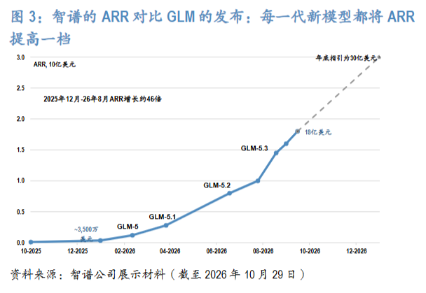
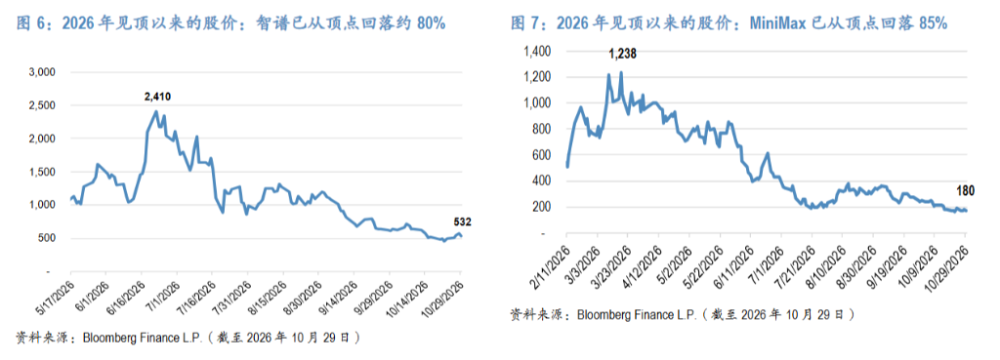
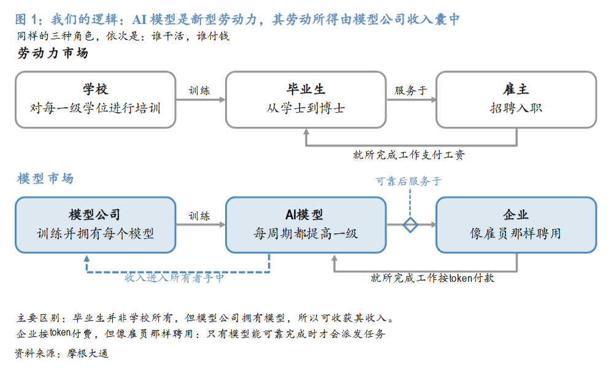
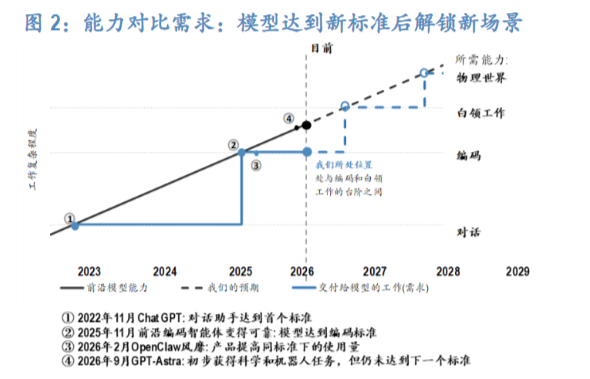
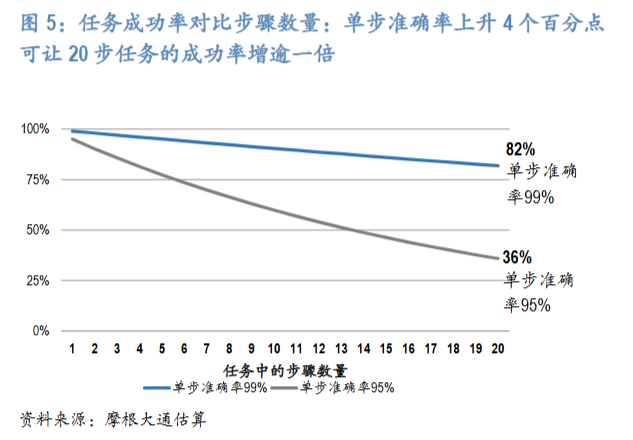
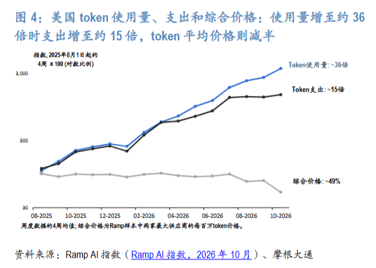
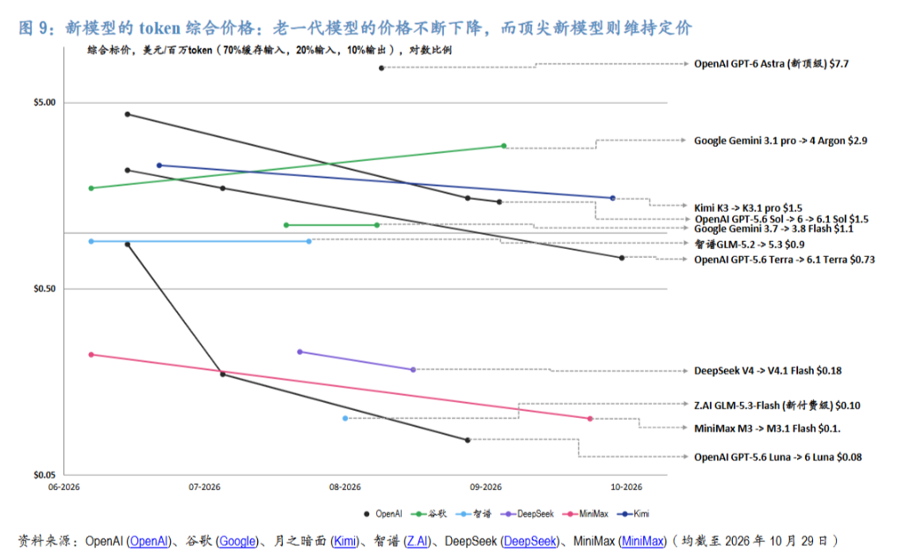

# AI编程之后下一个爆发点需等待---摩根大通双双下调智谱和MiniMax

- 页面显示时间：2026-11-04T14:39:44+08:00
- 页面署名：鲍奕龙
- 标注来源：未单列，见正文
- 原文：[华尔街见闻](https://wallstreetcn.com/articles/3785125)
- 取得时间：2026-11-04T16:03:56+08:00
- [HTML阅读版](article.html) · [来源记录](metadata.json)

## 导语

摩根大通下调智谱目标价至1200港元、维持增持，MiniMax下调至200港元、维持中性，估值倍数由20倍压缩至12倍2030年预期市盈率，主要反映下一波企业AI需求拐点晚于预期。但摩根大通认为市场反应过度，当前市场处于编码与更广泛白领工作需求之间的"空档期"，下一个需求台阶是时间问题。

---

摩根大通下调智谱和MiniMax目标价，认为 **AI编码需求之后的下一波企业需求拐点到来时间晚于预期，但判断市场反应过度，仍维持对中国AI模型行业的整体看涨立场。**

11月3日，摩根大通徐文韬团队将智谱目标价从2,000港元下调至1,200港元，评级维持"增持"；将MiniMax目标价从300港元下调至200港元，评级维持"中性"。

**两只股票的估值基准均由20倍2030年预期市盈率下调至12倍** ，主要反映下一个需求场景拐点时间的不确定性，不过 **智谱仍是摩根大通的首选股。**

两只股票均已从2026年峰值大幅回调，智谱跌约78%、MiniMax跌约85%。

但摩根大通认为， **token使用量持续攀升、算力约束而非需求疲软制约中国市场、以及智谱毛利率持续改善等多重信号表明，当前市场对行业的悲观推断存在偏差。**

## 编码之后的"空档期"：需求分步迈进

摩根大通将AI模型企业市场类比为劳动力市场：模型是劳动力，企业是雇主，模型公司则是兼营人事业务的培训学校。

在这一框架下，企业对AI模型的需求是以"台阶式"跳升， **只有当模型能够可靠完成一类新工作时，企业才会大规模"录用"，此后任务量可能急剧增加。**

**据摩根大通，目前市场正处于编码与更广泛白领工作两个台阶之间的空档期** 。编码需求已验证这一模式。

Cursor年化收入从2025年11月约10亿美元增至2026年6月逾40亿美元（据Dealroom），触发点正是编码智能体变得可靠的时间节点。法律科技公司Harvey的ARR在不到两年内增长约8倍，显示同样的路径正在其他垂直行业复制。

摩根大通指出，今天其他白领工作的状态，类似于2024年的编码工作， **需求初露端倪但尚未爆发** 。

**独立测评机构METR的数据显示，当前最优模型在约80%的情况下能完成3小时工作量的任务，而模型可独立完成的任务时长大约每105天翻一番。摩根大通据此判断，下一个需求台阶"是时间问题"。**

与此同时，摩根大通强调算力供应约束是压制中国AI收入的主要因素。

## 商品化与定价权并存，价格下跌不等于利润率受损

**市场另一大担忧是token价格持续下跌是否代表实验室丧失定价权。摩根大通认为两者可以并存，并以智谱和美国市场数据加以佐证。**

据Ramp AI指数，自2025年8月以来，美国样本中最大供应商的每百万token综合价格已减半，但企业token支出增至约15倍，原因是token消耗量增至约36倍。

中国方面，2024年价格战令API标价下跌90%以上，此后日均token调用量增加逾千倍，从2024年初约1,000亿增至2026年6月超过500万亿。

**摩根大通将模型分层定价的逻辑与学历市场类比** ：老一代模型等同于低学历，遭遇降薪（降价）以换取使用量；而率先达到新能力标准的顶尖模型享有溢价窗口期。

过去两个月，中美七家头部实验室发布逾十款新模型，逾半数定价低于前代，但OpenAI的GPT-6 Astra和谷歌的Gemini 4 Argon两款顶尖新品均实现提价， **摩根大通认为这印证了定价权依然存在于前沿模型层面。**

**在长智能体任务中，质量的重要性尤为突出** ：单步准确率从95%提升至99%，20步任务的成功率可从36%跳升至82%，使得顶尖模型的替代品无法仅凭低价取胜。智谱的GLM-5.3 API价格较前代提高一倍，同时推出低价版GLM-5.3-Flash留住价格敏感用户，以"双杆并拉"的方式兼顾份额与定价权。

智谱开放平台及API业务毛利率在2026年上半年从一年前的-0.4%升至24.6%， **摩根大通认为随着芯片、基础设施和模型硬件协同设计持续改善，毛利率还有进一步提升空间。**

## 智谱：前沿地位稳固，GLM-5.5/6为近期催化剂

**摩根大通将智谱定位为"中国少数仍在培养前沿毕业生的学校之一"，认为在需求价值持续向前沿企业集聚的格局下，智谱具备持续捕获最大机会的条件。**

智谱ARR增长轨迹印证了上述判断：从2025年12月约3,500万美元增至2026年8月18亿美元，约8个月内增长约46倍；管理层随后将年末指引从24亿美元上调至30亿美元。公司9月通过增发及可转债筹集50亿美元，用于支持下一代模型训练和算力投入。

**摩根大通将2026年收入预测从61亿元人民币下调至57亿元人民币，同时将2027年收入预测从178亿元上调至239亿元** 。目标价下调主要源于估值倍数压缩—— **新目标价基于12倍2030年预期市盈率，剔除了此前给予公司相对于国内一线互联网企业的大部分溢价。**

下一个近期观察点是预计11月发布的GLM-5.5/GLM-6，模型参数预计达2.5万亿至3.5万亿。 **摩根大通将关注新模型是否缩小与美国前沿模型的差距，以及企业是否开始将其用于更长的多步骤智能体工作。**

## MiniMax：性价比策略受认可，但前沿地位尚待证明

相较智谱，摩根大通对MiniMax态度审慎，评级维持"中性"。

MiniMax今年主要在性价比层面竞争，M3和M3.1 Flash均以领先实验室中最低区间的价格提供有实力的模型，但公司全年未上调ARR指引， **摩根大通认为这表明其性价比策略尚未转化为企业需求的实质升级。**

**摩根大通同样将2030年预期市盈率倍数从20倍下调至12倍，对应目标价从300港元下调至200港元** 。

近期关键观察点是预计11月发布的M3 Pro——摩根大通将关注它能否在多步骤智能体工作方面缩小与中美领先模型的差距，并按前沿模型定价，而非延续性价比路线。研报指出：

> 如果做到，我们的看法可能变得更乐观。

**摩根大通列出的主要下行风险包括** ：追随者能力追赶速度加快导致溢价窗口期缩短、拥有云业务的平台巨头长期亏本供应模型、编码之后迟迟无新工作类型完成"晋升"、算力供应持续受限，以及融资摊薄股东价值。

风险提示及免责条款

市场有风险，投资需谨慎。本文不构成个人投资建议，也未考虑到个别用户特殊的投资目标、财务状况或需要。用户应考虑本文中的任何意见、观点或结论是否符合其特定状况。据此投资，责任自负。
