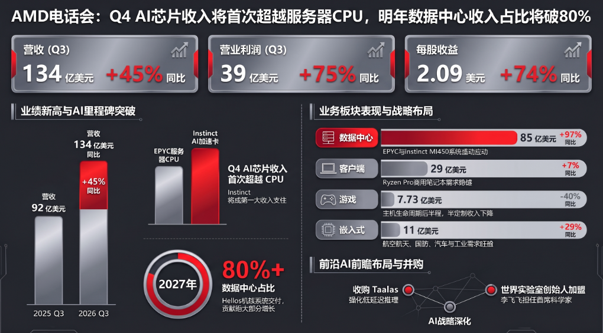

# AMD电话会：Q4 AI芯片收入将首次超越服务器CPU，明年数据中心收入占比将破80%

- 页面显示时间：2026-11-04T07:45:52+08:00
- 页面署名：鲍奕龙
- 标注来源：未单列，见正文
- 原文：[华尔街见闻](https://wallstreetcn.com/articles/3785116)
- 取得时间：2026-11-04T16:04:03+08:00
- [HTML阅读版](article.html) · [来源记录](metadata.json)

## 导语

AMD CEO苏姿丰指出AI代理正成为云端CPU的“下一个杀手级应用”，且Q4数据中心AI芯片收入将历史性地首次超越传统服务器CPU。尽管预计明年PC市场将出现两位数下滑，但凭借AI算力基础设施的爆发式需求，AMD正迎来盈利能力和利润率的全面扩张。

---

数据中心业务爆发式增长推动AMD业绩全面超预期，公司上调明年展望，预计服务器收入翻番、AI芯片收入增速更快。

[华尔街见闻提及](https://wallstreetcn.com/articles/3785112)，美东时间3日周二美股盘后，AMD公布，2026年第三季度营收同比增长45%至133.77亿美元，又创单季新高，较分析师预期高约2.3%。非GAAP口径下，每股收益同比增长74%至2.09美元，较分析师预期高逾6%。

随后电话会上，AMD首席执行官苏姿丰（Lisa Su）表示， **数据中心需求正在加速，预计2027年数据中心营收将超过此前预期，服务器营收届时将实现翻倍，占总营收比例最高可达80%** 。

她表示， **公司"对未来数年保持卓越营收增长的能力抱有强烈信心，且盈利增速将超过营收增速"** 。苏姿丰在回应分析师提问时坦言，当前需求确实高于供给，公司正与晶圆、基板、先进封装、存储及其他关键元器件供应商深度合作以提升产能，并表示公司"有信心"凭借与生态系统的深厚合作关系进一步扩大供给。

在产品战略层面，AMD正同步推进CPU与AI加速芯片两条产品线的更新换代。苏姿丰透露，EPYC Venice处理器已于三季度开始出货，首批OEM系统预计四季度正式上市。

在AI加速器方面，AMD已启动MI455X的批量出货，Anthropic、Meta、Microsoft、OpenAI和Oracle等头部客户在三季度完成了首批Helios机架的部署。苏姿丰称，客户正在Helios上运行最新模型，整体性能表现令人满意， **四季度Helios的部署规模将大幅增加** 。

此外苏姿丰明确警示， **预计2027年PC市场将出现两位数百分比的降幅** 。

彭博援引Emarketer分析师Jacob Bourne的观点称，此次业绩结果"将给投资者带来鼓励，因为投资者近期正越来越严格地审视AI支出及其回报"，尤其是在科技股和半导体板块经历持续调整的背景下。

## Q3业绩创纪录，2027年总营收预期激增超80%

AMD在今年第三季度交出了一份堪称完美的答卷。当季总营收达到134亿美元，同比增长45%；非公认会计准则下（Non-GAAP）每股收益（EPS）增幅更为惊人，同比大增74%至2.09美元。毛利率也扩大至56%，同比提升了190个基点。

真正引爆市场情绪的是管理层给出的远期指引。AMD预计第四季度营收将达到约170亿美元（同比增长约66%）。更重要的是，公司对2027年给出了极其乐观的预期。

苏姿丰在会上表示：

> 基于目前的可见度，我们现在 **预计2027年的营收将增长超过80%** ，这是我们去年11月在财务分析师日上预期的长期财务模型的两倍多。

她明确指出， **2027年数据中心业务将占到公司总营收的80%以上，成为驱动收入和盈利增长的绝对主力。此外，服务器收入预计在2027年将实现同比翻倍** 。

在谈及市场最关心的供需问题时，苏姿丰直言：

> 需求确实高于供应，因此我们继续与供应链合作伙伴合作以增加供应。鉴于我们在整个生态系统中拥有的强大关系，我相信我们有很好的机会做到这一点。

## 历史性交叉：Q4 AI芯片收入将超越服务器CPU

数据中心业务是AMD本季度的核心引擎，Q3收入同比暴涨97%至创纪录的85亿美元，占总营收的比例从一年前的47%跃升至64%。

这一增长背后，是新一代产品的全面铺开。MI455X在三季度开始批量出货，包括Anthropic、Meta、微软、OpenAI和甲骨文在内的领先客户已经迅速上线了首批Helios机架。

对于接下来的第四季度，CFO胡锦透露了一个关键的里程碑数据：

> **第四季度数据中心业务环比将实现约50%的激增。实际上，这将是数据中心AI业务（GPU等）收入超越服务器业务（CPU）的第一个季度** 。相较于服务器端，数据中心AI业务在Q4将出现一个非常显著的阶跃式上升。

为了进一步加码AI军备竞赛，AMD在三季度宣布了两项关键收购（Taalas和World Labs）。其中，World Labs的联合创始人兼CEO李飞飞将作为首席科学家加入AMD，领导模型研究并帮助塑造未来的软硬件系统路线图。

## “AI代理正成为云端CPU的下一个杀手级应用”

在深度长篇的电话会中，苏姿丰多次提及一个核心词汇——Agentic Workloads（AI代理工作负载），并将其视为重塑计算基础设施的核心力量。

苏姿丰在分享行业洞察时指出：

> 云提供商在本季度增加了大量EPYC（霄龙）容量，用于个人和企业代理，这些代理正迅速成为云端CPU的下一个杀手级应用。这些代理在应用程序和企业系统中连续并行地工作，在增加加速器需求的同时，创造了对CPU需求的急剧增加。 **采用才刚刚开始，我们预计随着代理被更广泛地部署并承担更复杂的工作，需求将急剧增长。**

凭借在性能和总拥有成本（TCO）上的优势，EPYC处理器正在疯狂抢占市场份额。苏姿丰特别提及：

> OpenAI选择了Turin EPYC处理器作为其首个定制加速器平台的主机CPU。

此外，AMD最近推出的Helion获得了前所未有的早期需求，OEM和ODM合作伙伴承诺提供的Venice平台数量比上一代多出20%。

## 隐忧与对策：PC市场明年面临两位数衰退

在AI业务一路高歌猛进的同时，AMD的客户端和游戏业务则面临着宏观环境的逆风。

第三季度，客户端收入同比增长7%至2.9亿美元，但环比下降了4%。苏姿丰对PC市场给出了直白的预警：

> 本季度末PC终端售出放缓，因为较高的内存和组件成本给需求带来了压力。 **我们在2027年的规划假设是，PC市场的单位出货量将出现两位数百分比的下降。**

**面对PC市场的寒冬，AMD选择避开低端市场的价格战。** 苏姿丰表示：

> 我们将专注于能够增加最大价值的细分市场，如企业级、高端消费级和台式机渠道。我们认识到低端市场存在大量波动，坦率地说，这也是我们敞口最小的部分。

不过，PC市场的疲软并未影响公司的整体盈利扩张逻辑。CFO胡锦强调， **随着营收在2027年激增超80%，公司的运营支出增速将不到营收增速的一半，这将带来“非常显著的营业利润率扩张和盈利能力提升”。**

**AMD Q3业绩电话全文（AI辅助翻译）：**

> **主持人** ： 欢迎参加AMD 2026年第三季度业绩电话会议。目前所有参会者处于仅收听模式，正式演示结束后将进行问答环节。请注意，本次会议正在录音。
>
> 现在，我将把会议移交给财务战略与投资者关系副总裁Matt Ramsey。Matt，请开始。
>
> **Matt Ramsay，企业副总裁，财务战略与投资者关系：**
>
> 感谢主持人，欢迎参加AMD 2026年第三季度财务业绩电话会议。
>
> 相信各位已有机会查阅我们的业绩新闻稿及随附幻灯片。如尚未查阅，可在AMD.com的投资者关系页面获取相关材料。
>
> 今天的电话会议中，我们将主要参考非GAAP财务指标。完整的非GAAP与GAAP对账表已包含在今天发布的新闻稿及网站上发布的幻灯片中。
>
> 今天的与会嘉宾包括：董事长兼首席执行官Lisa Su博士，以及执行副总裁、首席财务官兼财务主管Jean Hu。
>
> 本次为实时直播，并将通过网络研讨会在我们的网站上进行回放。在正式开始之前，请允许我说明，AMD本季度将参与以下金融界活动：12月1日（周二）的美国科技与AI会议，以及12月9日（周三）的巴克莱第24届全球科技年会。
>
> 今天讨论中包含的前瞻性陈述，是基于我们当前的信念、假设和预期作出的，包括有关财务预测、业务和行业趋势的前瞻性陈述，仅代表截至今日的判断，并涉及风险和不确定性，可能导致实际结果与当前预期存在重大差异。
>
> 请参阅新闻稿中的免责声明，以获取可能导致实际结果产生重大差异的相关因素说明。
>
> 现在，我将把发言权交给Lisa。
>
> **Lisa Su，董事长兼首席执行官：**
>
> 感谢Matt，也向今天收听的各位致以问候。第三季度是我们有史以来规模最大、盈利最强的季度，这得益于我们开始推进下一代数据中心产品的量产。营收同比增长45%，达到134亿美元，创下纪录，主要驱动因素来自EPYC和Instinct的创纪录销售以及嵌入式业务的强劲增长。每股收益增速更快，增长74%，达到2.09美元。
>
> 本季度我们执行表现出色：Helios量产按计划推进，EPYC在云端、企业及超级智能工作负载中的采用持续扩大。数据中心业务收入的环比增速在今年每个季度均持续加快，该业务板块在第三季度贡献了总营收的64%，而一年前这一比例仅为47%。
>
> 我们预计这一加速态势将在第四季度延续，主要驱动力来自推理及智能体工作负载需求的增加，以及最新产品的加速量产。
>
> **数据中心业务**
>
> 数据中心业务收入同比增长97%，达到创纪录的85亿美元。在服务器领域，云端和企业销售均实现同比翻番以上。我们大幅超越了此前"增长逾80%"的业绩预期，实现了显著的收入份额提升。
>
> 客户将EPYC部署到更多应用场景，智能体工作负载贡献了显著增长。在云端，超大规模云厂商在本季度部署了大量EPYC服务器，用于运行更多内部服务并扩展其公有云产品。Turin目前是公有云中部署最广泛的EPYC代际产品，来自各大主要厂商的500余个实例类型已面向全球开放。云厂商在本季度还新增了大量EPYC容量，用于支持个人和企业智能体——这正迅速成为云端CPU的下一个"杀手级应用"。
>
> Meta的Muse和OpenAI的Dots展示了个人智能体的快速增长势头——Muse智能体在上线前六周内激活用户已超1000万。企业客户同样行动迅速，正在软件开发、供应链和IT运营等领域积极部署智能体。这些智能体持续并行运行于各类应用和企业系统之中，在推动加速芯片需求增长的同时，也显著带动了CPU需求的提升。目前相关部署仍处于起步阶段，随着智能体的更广泛部署和承担更复杂任务，我们预期需求将大幅增长。
>
> 在头节点领域，我们在本季度赢得了多家顶尖模型开发商和云服务商的重要部署合同，这些合同将在未来几个季度陆续落地。EPYC领先的性能表现和成熟的生态系统，已经在大规模生产环境中得到充分验证，使其成为定制加速平台首选的主机CPU。以OpenAI为例，其首批自研加速器平台即选用了Turin EPYC处理器作为主机CPU。
>
> 在企业市场，EPYC服务器渠道销量创下历史纪录，来自新老客户的需求均十分强劲。本季度，我们新增了数十家首次采用EPYC的客户，涵盖大型金融服务、通信、零售和医疗健康企业。现有客户同样在将EPYC确立为其主要计算平台，从特定工作负载的部署拓展至更大比例的整体基础设施覆盖。
>
> 在第三季度，我们已开始向客户发货EPYC Venice处理器，首批OEM系统也将于本季度正式上市。从初期需求来看，Venice是迄今为止我们在新一代EPYC上看到的最强劲反响。OEM和ODM合作伙伴已确认超过240个Venice平台，比Turin多出20%；云厂商也已于本季度开始部署Venice，相关实例计划于2027年初正式推出。
>
> 我们近期发布了Helion——一套基于Venice的参考设计，可为智能体基础设施提供交钥匙式EPYC机架级系统。客户可针对各自工作负载对Helion进行定制：从为超大规模云厂商提供全CPU机架，到企业级的Venice与Instinct GPU混合系统——后者可同时运行智能体和模型。在全CPU配置下，单台Helion机架可搭载多达144颗Venice处理器，拥有近74,000个线程，实现业界最高的智能体计算密度。各大主要服务器OEM和ODM均计划提供Helion产品，首批系统将于本季度出货。
>
> 放眼更宏观的市场，服务器计算需求正在云端、企业、智能体及超级智能基础设施领域全面加速。EPYC覆盖所有这些市场，拥有业界最宽泛的产品组合——针对云端和智能体的单路性能领先，针对企业和头节点的单核性能领先，以及针对不同工作负载优化的内存与IO配置选项。
>
> EPYC在此基础上进一步以显著更优的性能功耗比、性能核心比和性能价格比领跑所有其他x86及ARM服务器CPU。随着TAM（总可寻址市场）预计到2030年增长至约2200亿美元，这将使我们有能力持续扩大市场份额并显著壮大服务器业务。
>
> **数据中心AI业务**
>
> 前沿实验室、超大规模云厂商和云服务商扩大了Instinct在推理和训练领域的部署，推动营收创历史新高。
>
> 本季度我们开始大批量出货MI455X，包括Anthropic、Meta、微软、OpenAI和Oracle在内的核心客户已迅速完成了首批Helios机架的上线部署。客户目前正在Helios上运行其最新模型和工作负载，初期部署表现出色。
>
> 随着产能持续提升，以及HPE、戴尔、联想、超微等OEM伙伴陆续开始出货系统，我们预计Helios的部署量将在第四季度大幅增加。MI455X在计算算力、内存容量和横向扩展带宽方面均处于行业领先地位，而Helios上市后，其在内存带宽和纵向扩展带宽方面相较竞争对手的优势将进一步拉大。
>
> 我们正与制造和OEM合作伙伴密切协作，随客户扩大部署规模同步扩充产能。
>
> 在超级计算领域，EuroHPC选择Instinct MI430X GPU和第六代EPYC处理器为LUMI-AI提供算力支持——LUMI-AI是欧洲计划于2027年下半年上线的下一代旗舰超算。MI430X的双精度计算性能接近竞品的九倍，这对科学模拟至关重要。MI430X目前已被选用于全球多台新建超算系统，随着各国政府和科研机构规划新一轮重大投资，我们也处于有利位置赢取更多订单。
>
> 在软件方面，我们发布了ROCm 10，针对大规模生产部署带来重大升级，包括大型GPU集群的加速启动以及针对长时间运行工作负载的更高韧性。ROCm 10还新增了ROCm.ai智能体性能调优功能，可对工作负载进行分析，识别瓶颈，并自动应用和验证优化方案，将以往需要数周的工程优化压缩至数小时。客户也在利用自己的AI智能体在我们的开放软件栈上对模型进行优化。例如，Anthropic曾分享过一个案例：一名工程师利用Claude，在单个周末内即完成了最新模型在Instinct MI355X机架上的部署，并取得了优异性能。
>
> 我们与前沿实验室的合作，已实现了让其模型协助处理Instinct的复杂软件开发与性能调优工作，随着这些能力持续提升，所带来的收益将惠及整个AMD生态的所有参与者。
>
> 本季度，我们宣布了两项收购，以强化超级智能产品组合。Taalas拥有经验丰富的工程团队和专为低延迟高效推理设计的专用芯片，我们计划将其技术整合至我们的解决方案组合，以满足低延迟超级智能应用日益增长的需求。World Labs由联合创始人兼首席执行官李飞飞博士领衔，拥有世界一流的研究团队，专注于空间智能及对物理世界建立认知的模型研究，将帮助我们深入洞察前沿模型和工作负载的演进方向。李飞飞将以首席科学家身份加入AMD，负责领导我们的模型研究工作，并参与塑造未来的硬件、软件和系统路线图。预计两项收购均将于年底前完成。
>
> **展望与前瞻**
>
> 放眼未来，我们的核心任务是大规模落地执行。Venice、MI450系列和Helios的量产均处于早期阶段，三条产品线均有望继续大幅增长。
>
> 目前，我们预计数据中心业务收入增速将在第四季度进一步加快，全年业务收入将较2025年实现翻番以上。我们对2027年的前景判断也在持续增强。
>
> 上季度，我们曾表示预计年度服务器收入增长超过70%，数据中心业务全年收入实现翻番。此后，客户扩大了EPYC和Instinct的部署计划，我们也进一步落实了更多供货资源以支撑增长。目前，我们预计2027年服务器收入将实现同比翻番，数据中心AI收入的增速也将超过90天前的预期。因此，我们预计数据中心业务在2027年将占到总营收的80%以上，并成为营收和盈利增长的主要驱动力。
>
> 放眼更长远，MI500的客户接洽持续进展顺利，市场兴趣极为浓厚，因为这又是一次性能上的重大跨越。我们正与多家前沿实验室开展深度合作，针对其工作负载对MI500进行优化，这些客户正在规划多吉瓦规模的部署方案。
>
> **客户与游戏业务**
>
> 客户与游戏业务收入同比下降8%，至37亿美元。其中客户业务收入同比增长7%，至29亿美元，主要受Ryzen移动处理器强劲销售拉动。商用PC正成为我们客户业务中越来越重要的组成部分，大型企业正在全体员工中推广部署Ryzen Pro商用PC。全球十大银行中有8家、全球十大医疗健康和汽车企业中有7家，目前均已采用Ryzen Pro商用PC。OEM厂商持续扩展基于AMD芯片的商用产品线，从日常商务PC到高端工作站，惠普、联想等厂商已推出搭载最新Ryzen AI Max Pro 400系列处理器的商用笔记本电脑和小尺寸台式机，这些系统可实现工作站级性能，并能在本地运行参数量高达3000亿的超级智能模型。
>
> 从市场整体来看，受内存和组件成本上升拖累需求，PC销售在季末有所放缓。我们正在相应调整业务节奏，使进货量与销售量保持一致，以保持客户和渠道库存的健康水平。在2027年的规划中，我们预计PC市场出货量将出现两位数百分比的下滑。在此环境下，我们将凭借持续迭代的产品路线图和不断扩大的商用市场份额来跑赢大盘。
>
> 游戏业务收入同比下降40%，至7.73亿美元，主要受控制台周期当前阶段半定制芯片销售下滑影响，符合预期。游戏显卡收入同比下滑，但Radeon GPU渠道销量环比有所增长。在游戏业务以外，Radeon AI Pro收入较上季度大幅增长，越来越多的开发者选择AMD在本地运行和微调模型。受单位性能价格比领先优势及针对最新开源模型优化的开放软件栈驱动，我们预计Radeon AI Pro将延续强劲增长势头。
>
> **嵌入式业务**
>
> 嵌入式业务收入同比增长29%，至11亿美元，实现连续第四个季度的加速增长。各终端市场需求十分强劲，以航空航天与国防、汽车、通信和工业客户的增长最为突出。数据中心建设的持续推进也在控制平面和光学网络应用中拉动了对嵌入式CPU和自适应SoC的更多需求。
>
> 我们继续推进2026年超过180亿美元设计订单的落地目标，这将是我们连续第三个创纪录年。自收购赛灵思以来，自适应设计订单每年均实现增长，嵌入式x86和半定制订单的增速更快。随着这些订单在未来几年陆续量产，我们预计嵌入式业务将实现强劲的两位数年增长，并持续跑赢市场。
>
> **总结与展望**
>
> 综上所述，我们交出了一份优异的第三季度成绩单，并预计随着数据中心和嵌入式业务增长对低迷客户CPU销售的充分对冲，第四季度将更为强劲。
>
> 我们以有史以来最强的产品组合和显著的客户动能进入2027年。我们已联动整个供应链，锁定了支撑明年更高增长所需的晶圆、基板、先进封装、内存及其他关键组件资源。
>
> 基于当前的业务可见度，我们预计2027年营收增长将超过80%，这是我们去年11月分析师日上所披露的长期财务模型目标值的两倍以上。数据中心业务将是最大贡献者，驱动力来自Helios部署的持续扩大以及EPYC市场份额的持续提升。我们同样预计嵌入式业务明年将加速增长，受益于自适应架构及x86解决方案的广泛采用。
>
> 展望2027年以后，我们正在加大硅、软件和系统路线图的研发投入，并与最大客户紧密协作，共同支撑他们未来三至五年的宏观基础设施规划。我们也在深化与供应链合作伙伴的战略协作，并与他们共同投资，以锁定支撑我们长期增长所需的产能。
>
> 综合来看，这一切让我们对未来数年持续实现卓越营收增长、盈利增速更快的目标充满信心。
>
> **下面，我将把发言权交给Jean，请她就第三季度财务数据进行更详细的说明。**
>
> **Jean Hu，执行副总裁、首席财务官兼财务主管：**
>
> 感谢Lisa，也向各位致以问候。
>
> 下面我将先回顾本季度财务业绩，再为各位提供2026财年第四季度的业绩展望。
>
> **第三季度财务业绩回顾**
>
> 第三季度业绩表现出色，营收达到创纪录的134亿美元，超出指引区间上限，主要受数据中心业务板块驱动——该板块收入同比近乎翻番。
>
> 营收环比增长16%，主要受数据中心和嵌入式业务板块强劲增长拉动，但被客户和游戏业务板块的下滑部分抵消。数据中心业务板块约占总营收的64%，较上季度的58%进一步提升，彰显了我们业务结构的持续优化及其对AMD增长贡献的不断增强。
>
> 毛利率为56%，同比提升190个基点，反映出更优化的产品结构。运营支出为36亿美元，同比增长29%，主要因我们持续加大研发投入，以扩展数据中心硅、系统及软件能力。运营利润同比增长75%，达到创纪录的39亿美元，增速大幅超越营收增速。运营利润率为29%，同比提升逾5个百分点，彰显了业务规模扩大带来的运营杠杆效应。
>
> 第三季度，我们开始按会计规则确认此前公告的客户协议项下所发行认股权证的相关会计影响——该影响于我们开始出货MI450系列GPU时产生。我们的GAAP摊薄每股收益为1.46美元，其中包含约11亿美元的非现金支出（计入其他收入与支出项），主要反映公司股价上涨及认股权证触发条件满足概率估算值变化的影响。
>
> 未来，随着我们和客户在该协议下持续推进，这一季度性非现金公允价值调整预计将有所增加，每季度的具体金额将因AMD股价及其他估值假设的变化而有所不同。这些非现金调整不影响非GAAP业绩及自由现金流。
>
> 我们的非GAAP摊薄每股收益为2.09美元。
>
> **各业务板块情况**
>
> 数据中心板块： 收入达到创纪录的85亿美元，同比增长97%，主要受第五代EPYC处理器强劲需求拉动服务器收入创纪录，以及AMD Instinct MI450系列GPU发布带动数据中心AI收入创纪录。环比来看，数据中心收入增长27%，主要由MI450系列初期销售及强劲的服务器收入增长驱动。数据中心板块运营利润为29亿美元，同比增长168%，运营利润率由一年前的25%提升至34%，彰显出数据中心业务的强大运营杠杆效应。
>
> 客户与游戏板块： 收入为37亿美元，同比下降8%，主因半定制及显卡销售下滑，部分被最新一代Ryzen移动处理器需求增长所抵消。其中客户业务收入29亿美元，同比增长7%，受Ryzen移动处理器销量提升驱动；环比来看，受内存成本上升拖累PC出货量，客户业务收入下降4%，但高端处理器产品结构改善形成了一定对冲。游戏业务收入7.73亿美元，同比下降40%，主因半定制收入下降及显卡需求疲软；环比来看，游戏收入基本持平。客户与游戏板块运营利润为5.73亿美元，占板块收入的15%；去年同期为8.67亿美元，占比21%。
>
> 嵌入式板块： 收入为11亿美元，同比增长29%，环比增长14%，多个终端市场需求增强，航空航天与国防、汽车、通信及工业终端市场增长最为突出。嵌入式板块运营利润4.53亿美元，占板块收入的41%；去年同期为2.83亿美元，占比33%。
>
> **资产负债表与现金流**
>
> 本季度，库存环比增加约30亿美元至115亿美元，以满足强劲的数据中心需求。经营活动产生的现金流量为12亿美元，自由现金流为5.54亿美元，反映出营运资本投入增加，以及为支撑数据中心业务快速增长而进行的持续资本支出，包括专门服务数据中心需求的后端产能投资。我们预计将继续加大库存和产能投入，以支撑2027年的强劲增长。季末现金及现金等价物和短期投资合计158亿美元，总债务71亿美元，其中包括今年8月完成的47.5亿美元优先票据发行。
>
> **2026年第四季度业绩展望**
>
> 预计营收约为170亿美元，上下浮动3%。指引中值代表同比营收增速约为66%，主要由数据中心业务板块的加速增长驱动。环比来看，预计营收将增长约27%，其中数据中心业务板块将实现约50%的大幅环比增长，客户与游戏业务板块预计环比下降逾20%，嵌入式业务板块预计实现两位数增长。
>
> 此外，第四季度非GAAP毛利率预计约为55%，非GAAP运营支出预计约为37.5亿美元，非GAAP净利息及其他支出预计为约400万美元的净收益，非GAAP有效税率预计为13%，摊薄股份数预计约为16.7亿股（已包含Taalas和World Labs收购预计于第四季度完成的估算影响），第四季度股份数量预计不受客户认股权证的影响。
>
> **结语**
>
> 第三季度是AMD的卓越季度，营收创历史纪录，运营利润率显著提升，盈利实现大幅增长，彰显了公司整体的严谨执行力。随着数据中心业务规模持续扩大，我们的盈利能力和长期股东价值将得到充分提升。
>
> 现在，我将发言权交还给Matt，进入问答环节。
>
> **主持人： 感谢各位。现在进入问答环节，请在座各位提问。**
>
> **第一问：Tom O'Malley（巴克莱）**
>
> **Tom O'Malley： 晚上好，感谢接受提问，恭喜取得优异成绩。Lisa，我想从您刚才对2027年的前瞻指引说起。营收增速为80%，但数据中心业务增速更快，明年数据中心将占到总营收的80%以上。能否请您就供给侧情况进行说明——包括晶圆、封装、基板、内存等——以及从需求侧来看，如果能获得更多供给，需求是否会超过供给？**
>
> **Lisa Su，董事长兼首席执行官** ： 当然，Tom，感谢你的问题。进入第四季度和2027年，我们拥有很强的增长动能，整体需求旺盛，涵盖数据中心CPU业务和数据中心AI业务。为应对这一增长速度，我们已为此规划了数年。我们与客户进行了大量深入沟通，充分了解其部署需求和计划节奏；同时也与供应链合作伙伴密切协作，确保晶圆、基板、先进封装、内存等所有关键组件到位。
>
> 需求确实高于供给，因此我们仍在持续推进与供应链合作伙伴的扩产工作，凭借整个生态圈中我们所具有的深厚合作关系，我认为这是完全可以实现的。从目前的位置来看，能够对外表示整个公司增长超过80%、尤其是服务器业务将在2026年已较高基数上实现翻番、而数据中心AI业务可见度和需求依然强劲，这令我们对于2027年数据中心业务的发展感到十分乐观。
>
> **Tom O'Malley** ： 非常有帮助。再问一个关于客户业务的后续问题： **您提到第四季度将环比下降逾20%，这与市场上其他厂商的反馈基本一致。但2027年的情况值得关注——通常第一季度具有季节性下行规律，复苏往往要等到第二、三季度。请问这轮调整预计持续多久？为什么AMD此前能够有所超越？以及2027年如何走出低谷？**
>
> **Lisa Su，董事长兼首席执行官** ： PC市场对我们来说依然是一个重要市场。我们在过去几次财报电话会议上一直在提示，预计下半年将呈现淡季表现，实际情况确实如此。当零部件价格上涨时，整机定价也随之提升，消费端市场对此自然更为敏感，销量因此有所放缓。我们正审慎管理业务，将进货量与终端销量保持一致，确保渠道和客户库存保持健康。
>
> 我们对2027年的规划假设是PC市场出货量将出现两位数百分比下滑。我们会重点聚焦于能发挥最大价值的细分市场——如企业市场（我们目前仍有提升空间）、高端消费、桌面渠道，这些都是我们的优势阵地。
>
> 好在我们的供应链在PC业务和数据中心业务之间具有较强的灵活调配能力，这使我们能够根据市场信号灵活调整供应。整体而言，我们目前依然处于需求大于供给的状态，因此会继续努力在未来几个季度增加供给。
>
> **第二问：Vivek Arya（美国银行证券）**
>
> **Vivek Arya： 感谢接受提问。Lisa，市场上有很多关于数据中心融资、土地、电力、园区供给等问题的讨论。我想问两点：一是AMD的核心客户在资金和物理基础设施方面，对于支撑2027年约3GW的AMD计划部署，你们的信心有多高？二是许多竞争对手正在通过生态投资、剩余价值保证等方式声称其产品具有更强的通用性，这是否会形成竞争压力？**
>
> **Lisa Su，董事长兼首席执行官** ： Vivek，感谢你的问题。正如此前所述，我们来自核心数据中心AI客户的需求非常旺盛。从Venice、MI455到Helios，我们对自身竞争力感到十分自信，并一直与客户联合规划这次产能爬坡。对于土地、电力、园区等数据中心基础设施，我们具有较好的可见度，知道GPU将落地于哪些数据中心及具体位置。
>
> 在2028年及以后，我的核心观点是：我们正处于强劲的整体增长轨道之中，拥有坚实的业务基础和强健的资产负债表。在此基础上，我们首要任务是投入增长，包括研发、供应链和产能建设，以及与合作伙伴协同投入，确保我们在新产品上市时有充分的基础设施保障。同时，我们也会选择性地与核心合作伙伴开展前瞻性的数据中心基础设施布局，提前数年进行识别与锁定。我们的出发点是：在投资增长的这一首要原则指导下，有策略地、有选择性地推进此类合作。
>
> **Vivek Arya** ： 好的。另外追问一下竞争格局： **您的许多前沿实验室客户同时在研发自研加速器，他们在选择使用EPYC还是AMD产品时，是如何进行取舍的？决策的关键因素是每token成本、能耗效率、软件灵活性，还是部署周期？有没有哪些特定工作负载，AMD GPU的表现优于其他替代方案？**
>
> **Lisa Su，董事长兼首席执行官** ： 我们对Helios在性能和总拥有成本方面的竞争力感到十分满意，这是在规模化部署中最为核心的考量因素。第三季度是我们首次向客户交付MI455和Helios机架并确认收入，这是一个重大里程碑。第四季度我们将实现大幅提升，并贯穿整个2027年持续放量。
>
> 关键在于持续证明我们跨工作负载的TCO优势。作为通用GPU，我们在处理各类工作负载时本身具备较强的通用性。与此同时，协同设计工作也在深入推进——除MI450系列外，我们正在研发MI500和MI600，以确保技术进一步贴合前沿实验室的需求。这些是影响部署决策的核心因素。
>
> **第三问：Joshua Buchalter（TD Cowen）**
>
> **Joshua Buchalter： 你们好，感谢接受提问，也恭喜取得进展。想请您谈谈HBM成本对模型的影响——随着Instinct业务规模扩大，投资者一直关注每GW的收入贡献，过去一年您给出的155亿至200亿美元每GW的预测相当稳定，这是否是因为早期产品的采购和定价是长期合同锁定的？展望未来，贵公司是否有能力将更高的原材料成本转嫁给三大核心客户？**
>
> **Lisa Su，董事长兼首席执行官** ： Josh，简而言之，在产能爬坡过程中，我们与部分供应商和客户均签有长期协议。考虑到内存市场以及其他元器件成本的通胀压力——因为随着更多资本支出投入整个供应链，各类成本均有所上升——我们也在与客户沟通，共同分担这部分成本增加。
>
> 归根结底，这一切都指向总拥有成本和每美元token数，我们要确保AMD Instinct和Helios系统能够持续为客户提供强大的价值优势。即便面对一定的通胀压力，我们依然坚信在AI工作负载方面能够提供业界领先的TCO。
>
> **Joshua Buchalter** ： 感谢Lisa。再问Jean一个后续问题： **第三、四季度运营支出均有所好转，这是投资者关注的一个焦点。但鉴于2027年收入增速如此之快，我们在超出目标模型两倍多的情况下，对运营支出的能见度有限。请问应该如何看待2027年运营支出的增速？以及毛利率方面，随着Helios持续放量，55%这一下限能否维持？**
>
> **Jean Hu，执行副总裁、首席财务官兼财务主管** ： Josh，感谢提问。在运营支出方面，正如你所说，我们一直在积极投入。目前来看，这些投入正在转化为加速增长的收入。2026年运营杠杆表现令我们相当满意——收入增速大幅超越运营支出增速，推动运营利润率提升。从第四季度指引来看，收入增速也显著高于运营支出增速，这一趋势我们认为将延续到2027年。
>
> Lisa提到，我们预计整个公司增长超过80%，运营支出的增速应低于营收增速，且应不超过营收增速的一半，这将推动2027年运营利润率实现大幅提升。
>
> 毛利率方面，我们对整体情况相当满意。第三季度，我们正在推进MI450的产能爬坡，数据中心AI业务的表现实际上超出了我们进入季度时的预期。第四季度，数据中心业务将环比增长50%，而这正是数据中心AI业务超越服务器业务的季度——众所周知，AI业务对公司整体毛利率有一定的稀释效应，但毛利润总额正在大幅增长。
>
> 展望2027年，数据中心业务将占到公司总收入的80%以上，业务结构的变化将对公司毛利率产生重大影响。数据中心AI业务将在全年持续放量，服务器业务预计实现翻番，不同季度之间的业务结构差异会导致毛利率出现一定波动。嵌入式业务在2027年的增强，也将有助于提升整体毛利率。
>
> 综合来看，我们的目标是实现强劲的营收增长和毛利润增长，同时在运营支出增速低于营收增速的驱动下，显著扩大运营利润率和整体盈利能力。
>
> **第四问：Timothy Arcuri（瑞银）**
>
> **Timothy Arcuri： 感谢。Lisa，能否对明年数据中心的业务结构做进一步拆解？服务器CPU的预期从增长70%上调至增长逾100%，但对数据中心AI并未给出具体数字。正确的理解方式是否为：GPU业务以美元计将仍大于服务器CPU业务，但差距不大？另外全年的节奏应如何把握，GPU业务是否会相对均匀地分布在全年？**
>
> **Lisa Su，董事长兼首席执行官** ： Tim，让我来拆解几个维度。首先，我们认为2027年对于CPU业务和数据中心AI业务来说都将是强劲动能年。对于我们给出的几个参考数字，请将其理解为标志性指标：整个公司增长超过80%；数据中心CPU业务约实现翻番；数据中心AI业务增速则将远超翻番。正如Jean所说，第四季度数据中心AI业务规模将首次超过CPU业务，2027年全年两个业务板块预计均将实现稳健增长。希望这能给大家对全年节奏有个基本的参考。
>
> **Timothy Arcuri** ： 感谢。再问Jean一个问题： **关于认股权证，能否给我们一些在全年及2027年建模的参考框架？**
>
> **Jean Hu，执行副总裁、首席财务官兼财务主管** ： 感谢提问。简单来说，认股权证包含三个部分。
>
> 第一部分是净收入影响。我们报告的Q3实际营收、Q4指引及此后一切收入，均已是净收入，已按授予日公允价值相应扣除了认股权证的收入减免部分，大家无需单独处理。
>
> 第二部分是股份数量稀释。认股权证股份只有在所有归属和行权条件均由客户满足后，才会计入摊薄股份数——即需要完成指定出货量并满足若干商业条件。待进入2027年后，我们将就预计达到归属和行权条件的时间节点提供明确指引，届时会有充分的透明度。
>
> 第三部分是季度性非现金公允价值重估支出，不影响非GAAP业绩及自由现金流。股份数量方面，请等待我们进入2027年后的明确指引。
>
> **第五问：CJ Muse（Cantor Fitzgerald）**
>
> **CJ Muse： 下午好，感谢接受提问。在服务器CPU方面，前景预期明显上调，想了解100%的增长中，出货量提升与产品结构（包括更高核心数）以及Venice带来的ASP提升，各自的贡献大约如何？**
>
> **Lisa Su，董事长兼首席执行官** ： CJ，服务器CPU实现100%增长，出货量的显著提升是主要驱动力，其中部分单元随Venice切换带来更高核心数。我想说的是，收入增长主要来自出货量和核心数增加，ASP提升的贡献相对较小——尽管随着核心数提升确实有一定的ASP上涨。
>
> **CJ Muse** ： 好的，感谢。再问一个问题， **关于Q1季节性：基于您今晚的表述，我的理解是，Q1客户和游戏业务正常季节性下行，数据中心大致均匀分布，高于12月的水平。嵌入式方面如何预期？**
>
> **Jean Hu，执行副总裁、首席财务官兼财务主管** ： 嵌入式业务通常有季节性规律，Q1确实存在一定季节性下行。但从2027年全年来看，嵌入式业务将实现显著增长，并在全年呈现逐渐增强的态势。
>
> **第六问：Stacy Rasgon（Bernstein Research）**
>
> **Stacy Rasgon： 你们好，感谢接受提问。您提到第四季度GPU将在50%的指引背景下超过CPU，请问这一超越的量级如何——是微微超过，还是大幅领先？我想对明年的入口数量级有个基本判断。**
>
> **Jean Hu，执行副总裁、首席财务官兼财务主管** ： Stacy，我来给大家一些参考。MI450的量产爬坡是一个从Q3到Q4的大幅跃升，服务器业务也增长得非常强劲；但数据中心AI业务超过服务器，是一次十分显著的台阶式提升。第四季度，数据中心AI的收入（以美元计）将远高于服务器业务。
>
> **Stacy Rasgon** ： 是按美元计算的吗？
>
> **Jean Hu，执行副总裁、首席财务官兼财务主管** ： 是的，按美元计算。
>
> **Stacy Rasgon** ： 好的。再问一个后续问题，Jean： **关于明年毛利率，我不太确定如何解读您之前的回答。能否给一个2027年毛利率相对Q4水平的大致走向指引——包括年初和年末的合理参考范围？**
>
> **Jean Hu，执行副总裁、首席财务官兼财务主管** ： Stacy，我们暂时无法提供逐季度的指引，主要原因是2027年毛利率的走势将由数据中心业务的内部结构所主导——服务器将翻番，AI业务增速更快，两者的业务占比差异将在不同季度间形成一定的毛利率波动。
>
> 目前来看，Q4是一个较好的参考基准——届时数据中心AI收入将远高于CPU收入。进入2027年后，不同季度的业务结构可能各有差异。我们同样受限于目前的供给可见度，正努力与供应商一起争取更多供给。两个业务板块都将实现出色增长，这一点是确定的，但具体的季度结构分布目前尚不清晰。
>
> **第七问：Joseph Moore（摩根士丹利）**
>
> **Joseph Moore： 感谢。我们听到了很多关于Helion机架的积极反馈。在全CPU配置下，这一产品针对智能体工作负载与传统机架有何不同？以及您预计GPU刀片的附加部署比例有多高？**
>
> **Lisa Su，董事长兼首席执行官** ： Joe，Helion机架确实引发了相当热烈的积极反响。核心出发点在于，这类智能体机架需要根据所在环境进行深度优化。在超大规模云场景下，全CPU配置、高密度部署是主流，Venice作为单路性能最优的处理器，在满配全CPU的情况下可实现极高的智能体计算密度。在企业场景下，则会出现CPU与GPU混合部署的需求，让用户能够真正根据工作负载灵活优化配置。Helion已向开放计算项目（OCP）贡献了全套开放规范，完全开放的机架设计也赢得了市场的积极评价。来自OEM、ODM和最终客户的反馈均非常正面。
>
> **Joseph Moore** ： 好的，感谢。再问一个问题： **服务器实现100%增长的情况下，贵公司是否认为基本满足了市场需求，还是2027年全年都会持续存在供不应求的情况？**
>
> **Lisa Su，董事长兼首席执行官** ： Joe，实现这样的增长本身意味着我们已满足了大量需求。服务器TAM未来三四年的年均增速大约在50%左右，增长来源于三个领域：传统云端和企业、智能体CPU工作负载和头节点。我们相信，在给出的约100%增长预测中，每个细分市场都在实现份额提升。
>
> 我确实认为市场上还有更多需求尚待满足，我们正积极与供应链合作伙伴共同解决这一问题，同时也要确保套片、DDR5等配套组件准备就绪。需求来源高度多元化，几乎覆盖了每一个正在扩大AMD部署规模的客户，这是令人振奋的积极信号。我们会持续努力增加供给，满足这些不断落实的增量需求。
>
> **第八问：Harsh Kumar（BMO资本）**
>
> **Harsh Kumar： Lisa，我想问一个关于Helios的问题。贵公司是全球仅有的两家出货完整机架系统的厂商之一。请问您对市场份额的目标是什么？您在服务器市场与强劲竞争对手的份额争夺上取得了出色成绩，请问在数据中心GPU及整机架领域有何雄心？另外，贵公司是否有意进入企业市场？**
>
> **Lisa Su，董事长兼首席执行官** ： Harsh，我们对Helios的进展非常满意。整机架级解决方案是重大的研发投入，Helios的产能爬坡非常顺利：第三季度是良好的初始季度，第四季度和2027年持续放量。我们的目标是成为最大客户——无论是前沿实验室还是超大规模云厂商——最为重要的算力供应商之一。在MI450的量产爬坡上，我们在第四季度和2027年全年都高度专注；同时我们也正与最大客户就MI500和MI600进行深度对话，着眼于赢得其更大比例的算力需求。从我们所看到的一切来看，需求依然在持续上升。
>
> 关于企业市场，尽管企业客户的部署节奏确实比大型前沿实验室和超大规模云厂商慢一些，但我们认为企业市场非常重要。我们在企业CPU方面已取得了很大进展，许多企业客户正在主动咨询我们关于AI部署效率的建议，包括本地部署和云端部署两个维度。我们正在扩展面向企业的产品组合，推出了部分企业专属GPU，并希望在这一领域持续扩大份额，成为大型企业客户的战略性核心供应商。
>
> **Harsh Kuma** r： 好的，明白了。最后一个问题， **关于客户业务：历史上您们在类似情况下管理这一业务的能力有目共睹。如果主要竞争对手选择降价，贵公司的应对策略是什么？会跟进，还是视情况而定？**
>
> **Lisa Su，董事长兼首席执行官** ： Harsh，PC市场对我们来说是一个重要市场——我始终相信端到端AI部署的价值，从云端到边缘到客户端，我们拥有在这一维度上独特的完整产品组合。在此基础上，我们在PC业务上的策略始终是高度聚焦于最高价值、最高盈利的细分市场——企业、高端消费、桌面渠道，这些都是我们的优势赛道。我们清醒地认识到低端市场存在较大波动，坦率地说，那也是我们在PC市场中敞口最小的部分。
>
> **主持人结语**
>
> **Matt Ramsay，企业副总裁，财务战略与投资者关系** ： 非常感谢John组织本次问答，也感谢各位参与我们的电话会议，感谢大家的提问和关注，就由John来关闭本次会议。谢谢大家。
>
> **主持人** ： 感谢各位的参与。今天的电话会议到此结束，请各位挂断电话，祝大家有美好的一天。

风险提示及免责条款

市场有风险，投资需谨慎。本文不构成个人投资建议，也未考虑到个别用户特殊的投资目标、财务状况或需要。用户应考虑本文中的任何意见、观点或结论是否符合其特定状况。据此投资，责任自负。
