# A股5轮牛市的回撤经验

- 页面显示时间：2025-08-18T10:04:35+08:00
- 页面署名：龙玥
- 标注来源：华创证券姚佩等
- 原文：[华尔街见闻](https://wallstreetcn.com/articles/3753513)
- 取得时间：2026-11-04T16:03:38+08:00
- [HTML阅读版](article.html) · [来源记录](metadata.json)

## 导语

华创证券并不认为市场当下会出现回撤，但其复盘了牛市的回撤经验称，流动性收紧是历轮牛市回撤的主要促发因素，指数一般在突破新高后发生的回撤。对于后续潜在回调促发因素：宏观层面观测本轮宽松是否会不及预期，微观层面关注两融开户检查、量化交易监管、IPO减持放开、ETF大额流出，以及关注地缘政治冲突。

---

## **报告要点**

鉴于当前指数已录得较大涨幅，部分投资者忧虑市场可能出现回撤。我们梳理过往5轮牛市中的回撤经验并做出体系性的复盘，以及对本轮做出前瞻性的判断。需要说明的是，我们并不认为市场当下就会出现回撤，而是旨在针对后续可能出现的各类风险因素，提前做好应对筹备。

1、流动性收紧是历轮牛市回撤的主要促发因素。

（1）宏观流动性收紧引发的回撤由于触及估值体系和通胀水平通常影响较为深远。

（2）微观流动性收紧引发的回撤影响较为可控，回调通常即布局时机。

（3）产业政策收紧影响投资者风偏，导致的回撤通常更为剧烈。

（4）地缘政治/突发事件引致的回撤因其不可预测性冲击较快，短期不必过分担忧。

（5）基本面下行的影响由于市场普遍带有预期反应，回撤表现较为温和。

2、指数在突破新高后发生的回撤，微观流动性因素占据主导地位，且回撤幅度显著低于整体水平和突破新高前样本的回撤幅度。在各因素对应的回撤幅度3/4中位数位置上参与市场，胜率基本都大于50%。

3、后续潜在的回调促发因素：

（1）宏观流动性层面的核心点在于观测本轮宽松是否会不及预期。

（2）微观流动性层面关注两融开户检查、量化交易监管、IPO减持放开、ETF大额流出。

（3）地缘政治/突发事件方面，关键跟踪事件线为俄乌冲突及中美贸易谈判。

4、再通胀牛市观点重申：牛市上下半场切换：金融再通胀→实物再通胀。反内卷助推通胀，是牛市上下半场拐点。重视基金回本的再配置效应。

## 报告正文

**前言：** 上证指数本周成功站上3700点，符合我们去年11月份在《再通胀牛市——2025年度投资策略》中对上半场金融再通胀的判断。股市成为剩余流动性承载器，现金类产品收益率骤降，股市以流动性与估值优势成为超额储蓄搬家的承载体。我们认为往后看牛市的下半场将是实物再通胀，最重要的跟踪指标为M1领先PPI 6-9个月，MI&PPI转正即是EPS回归之时。

鉴于当前指数已录得较大涨幅，部分投资者忧虑市场可能出现回撤。在本次周报中，我们将梳理过往5轮牛市中的回撤经验并做出体系性的复盘，以及对本轮做出前瞻性的判断。需要说明的是，我们并不认为市场当下就会出现回撤，而是旨在针对后续可能出现的各类风险因素，提前做好应对筹备。

**一、历轮牛市中的回撤经验**

**流动性收紧是历轮牛市回撤的主要促发因素。** 我们测算并统计05-07、08-10、13-15、16-18、19-21过往五轮两年牛市区间内，回撤前期涨幅（计算方式为：（回撤前最高价-回撤区间最低价）/（回撤前最高价-上轮回撤区间最低价））及回撤时间跨度较明显的回调区间，共计得到37个区间样本。我们对全样本的回撤原因归纳为五大类，按出现频次分别为：宏观流动性收紧、微观流动性收紧、产业政策收紧、地缘政治或突发事件及基本面下行，且部分区间内的下调可能不止一个原因引起，其中：

**（1）宏观流动性收紧引发的回撤由于触及估值体系和通胀水平通常影响较为深远。** 宏观流动性因素是导致回调最为频发的驱动因素，共计16样本，其对前期涨势的回吐幅度（后续简称为回撤幅度）较大、中位数达85%，持续27个交易日也较长，这主要是因为宏观流动性收紧对估值定价体系和通胀水平这两方面产生了深远影响：①对估值定价体系产生冲击，利率水平的改变直接影响估值分母段的折溢价，从而使得估值水平的上限受到抑制；②由于宏观流动性的收紧产生对于通胀水平的抑制，进而影响企业基本面上的盈利能力及毛利率水平。宏观流动性收紧的表征主要集中于央行货币政策转向信号、海外流动性环境突变造成的国内资金面预期逆转，典型如06/07央行年内二次上调存款准备金率引发市场对流动性收紧的担忧、10/04希腊主权评级降至垃圾级引致欧债危机对全球的冲击、13/12由银行间利率大幅回升引发“钱荒2.0”、20/03疫情冲击下美股四次熔断及全球暂时的流动性危机。

**（2）微观流动性收紧引发的回撤影响较为可控，回调通常即布局时机。** 由微观流动性收紧引发的回调出现频次同样较高共计14样本，回撤幅度中位数仅52%最低，且回调周期13个交易日也相对较短。微观流动性因素带来的影响相对可控主要因为牛市本身资金面的环境就是增量资金不断入市推动指数新高，而微观流动性形成的冲击反而给予增量资金布局时机，往往体现为市场的修复速度较快。微观流动性收紧的主要表现通常集中在股市监管层的流动性关注或市场主要资金方的大幅买卖动作，具体形式包括通过监管手段调控市场热度，如07/05财政部意外上调印花税税率、15/01证监会对券商两融业务违规进行处罚以规范杠杆资金；重要IPO造成的资金虹吸，如10/08农业银行上市破发拖累银行板块、20/08蚂蚁集团IPO冻结大量资金。

**（3）产业政策收紧影响投资者风偏，导致的回撤通常更为剧烈。** 产业政策收紧引发的回调样本较少，但是一旦出现其带来的回撤幅度也较大、中位数可达108%，且持续的回调时长也最长，这背后更多是对投资者风险偏好的影响。因为诸如10/04地产的新“国十条”、21/06互联网反垄断升级等，都是在中长期视角之下的稳增长和调结构之间的矛盾，以及更深层的发展和安全间的相互平衡，产业政策收紧会让市场认为政策重心从稳增长转向调结构，从而导致投资者风偏的降低。

**（4）地缘政治/突发事件引致的回撤因其不可预测性冲击较快，短期不必过分担忧。** 地缘政治或突发事件带来的回撤共计3样本较少，回撤幅度中位数55%，回撤区间交易日最少、中位数仅11日。对于地缘政治/突发事件带来的回调，我们认为投资者不必过于担忧。从短期来看相关事件的发生很难做提前预测和埋伏，因此会在短时间内快速形成较大的回撤幅度，但后续往往会在系统性风险上通过宏观财政和货币政策形成对冲，此背景下资产价格反而会容易出现V型反弹。类似事件的中长期影响通常较为深远，但在牛市过程中出现大幅回撤后，反而对宏观政策的对冲是较好的介入时机。该因素下的回撤样本集中于19-21牛市区间，包括19/05中美贸易摩擦的再次升级、20/01的疫情冲击、20/05美国制裁华为芯片。

**（5）基本面下行的影响由于市场普遍带有预期反应，回撤表现较为温和。** 基本面下行导致的回调共3样本，回撤幅度中位数66%，区间内约17交易日表现相对缓和，主要由于市场对基本面跟踪通常更紧密、普遍带有预期反应，难以出现影响较大的回调。样本主要集中于09年初的经济数据的走弱等。

**指数在突破新高后发生的回撤，微观流动性因素占据主导地位，且回撤幅度显著低于整体水平和突破新高前样本的回撤幅度。** 根据我们在7/7《冲击新高的权重旗手——策略周聚焦》中统计的2005年以来上证指数突破1-5年内（滚动）新高的15个样本，测算新高后一个季度内存在回调的样本区间共11个，其余皆归为突破新高前的样本。经测算，突破新高后的回撤在幅度58%（中位数，下同）上显著低于整体水平的69%和突破新高前的回撤幅度70%，背后的逻辑在于当市场成功突破一至五年新高的关键阻力位，往往标志着增量资金成为推动市场的主要力量。而微观流动性是控制增量资金过热的直接手段，此阶段内市场对基本面波动的看法或不及对资金成本、监管态度的敏感度，且由新高后的流动性因素，如06/06中行IPO冻结资金、14/10沪港通开通延期、20/07银保监会严禁资金违规入市，基本不影响牛市趋势和逻辑，市场通常表现为快速消化并恢复上行。

**在各因素对应的回撤幅度3/4中位数位置上参与市场，胜率基本都大于50%。** 若投资者想在牛市回撤区间中做提早参与，一般可在回撤幅度达历史各因素回撤幅度中位数的3/4处介入（此时点为T），即可在T+5开始收获正向收益，大部分情况下的胜率都过半。整体来看，在此标准下介入参与，投资者在T+5、T+10、T+30、T+60的胜率或分别为62%、59%、81%、76%，收益中位数分别为0.7%、2.2%、3.1%、8.4%。

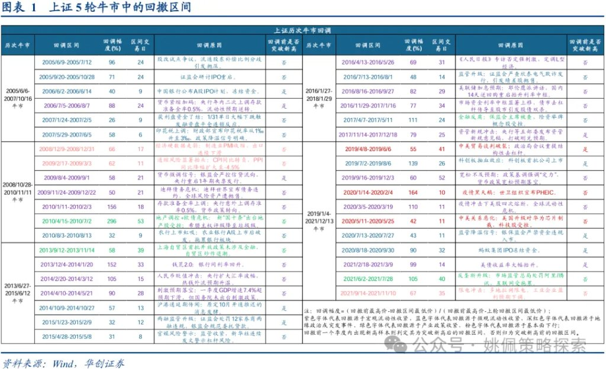

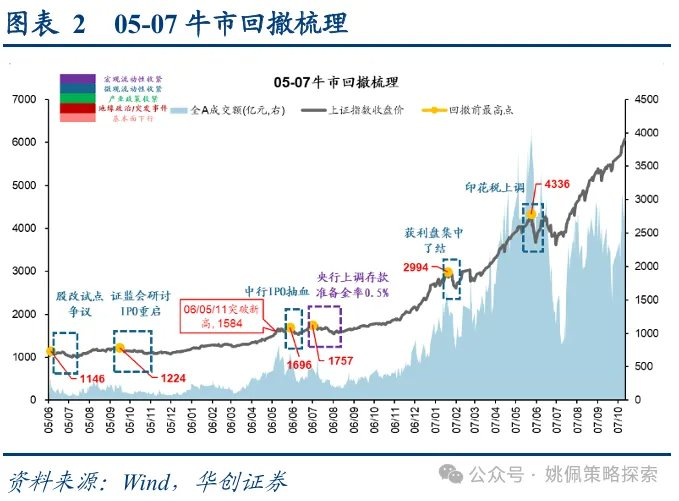

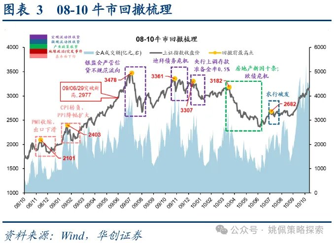

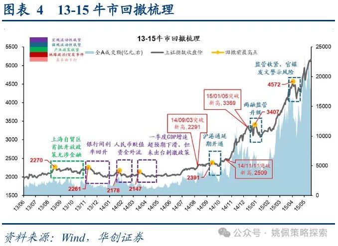

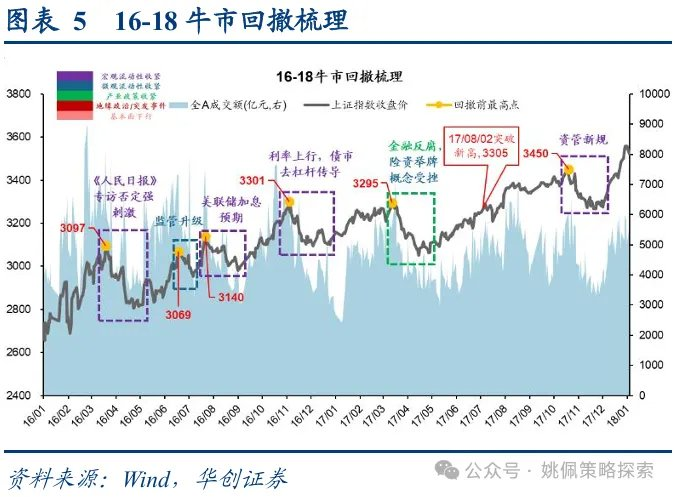

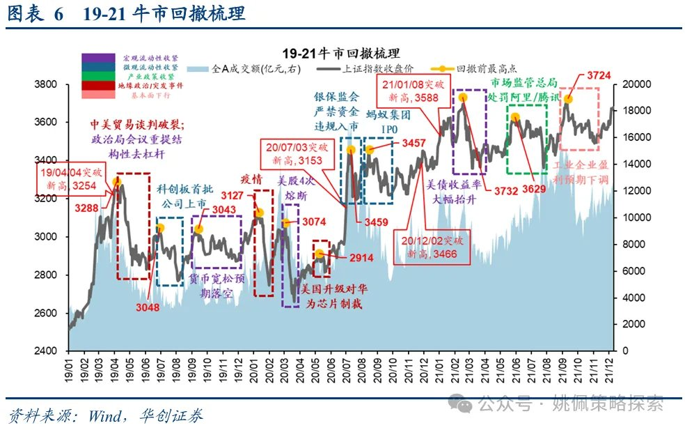

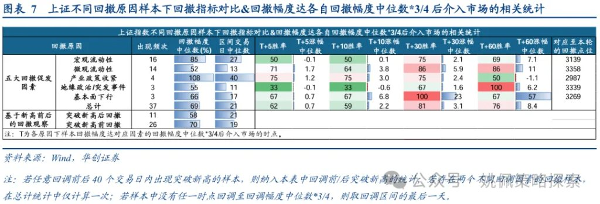

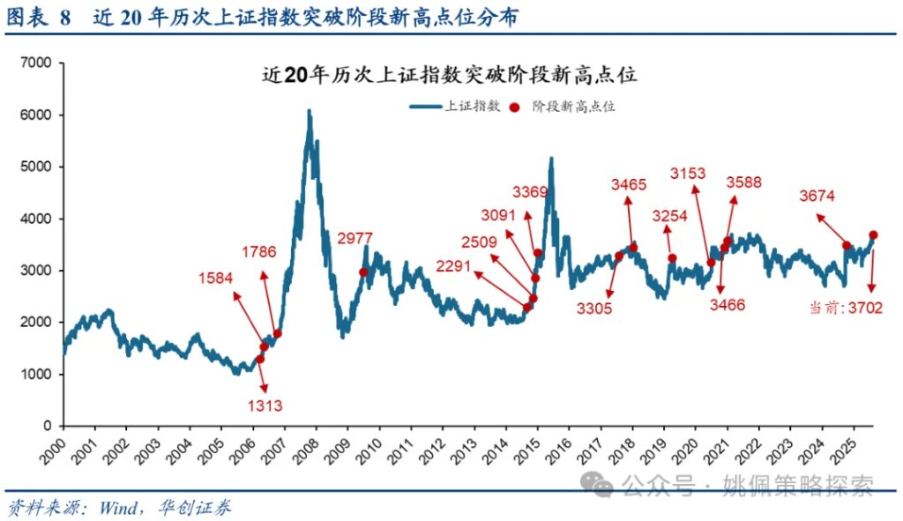

 

**二、后续潜在的回调促发因素**

**前期经验对应至本轮行情：** 站在当前指数突破3700的关键时点，基于前述历史经验，我们对本轮行情可能发生的回撤情况进行测算。以04/07的最低点3041作为上轮回撤区间最低价、以08/14的最高点3705作为本轮回撤前最高价计算（均考虑回撤幅度和回撤区间交易日的中位数），中性假设下上证或于21个交易日后回撤至3269-3358区间；但若出现产业政策或宏观流动性收紧可能会出现更大的回撤幅度。

**后续潜在的回调促发因素：**

**（1）宏观流动性层面的核心点在于观测本轮宽松是否会不及预期。** 从近期时点来看，最快发生的变量是美联储的降息动作。目前市场普遍预期美国新一轮降息周期大概率从9月重启，并预期美联储将在未来一年将持续降息约125bp，且往后看10月降息的概率将升至97%、12月降息的概率将超过99%。对于国内央行来说，一方面要观测央行是否会跟进联储实施宽松；另一方面需要关注到7月政治局会议后，国内的货币政策基调从过去一年总量层面的降息降准转化为目前通过结构性货币宽松加力支持科技创新、提振消费、小微企业、稳定外贸等。往后看还需要进一步跟踪增量的投放力度是否会减弱，即边际流动性的宽松不及先前（如逆回购的缩量）同样是作为宏观流动性层面收紧的重要观测点。

**（2）微观流动性层面关注两融开户检查、量化交易监管、IPO减持放开、ETF大额流出。** 微观流动性层面，对于本轮来说我们重点跟踪以下潜在的四个变化：①两融开户检查。过去一个月两融余额呈现大幅抬升，时隔10年重返2万亿，不过两融余额占流通市值比例由于过去市场的扩容并不处于高位，当前达2.3%处于过去三年的60%分位，两融整体的风险不大。但需要关注两融开户检查的情况，是否会严控不合规杠杆资金入场为两融增量降温；②关注是否加强量化交易监管以规范高频与算法交易；③观测IPO减持放开的情况，可能会加快限售股解禁后原始股东减持节奏以分流市场资金；④过去一个月ETF大幅净流出，赎回行为直接抽离市场流动性或形成抛压。

**（3）地缘政治/突发事件方面，关键跟踪事件线为俄乌冲突及中美贸易谈判。** 地缘政治事件从过往经验来看不用做太多提前的防备，但是需关注重要的事件线，当前的重点是俄乌冲突及中美贸易谈判。①从俄乌来看，08/15的美俄会谈时间仅两个多小时且双方没有达成协议，因此当下俄罗斯和乌克兰之间的谈判仍旧是重点的跟踪方向，若后续俄乌冲突得到比较妥善的处置，再往后的一年重心或将转向对亚太地缘政治的跟踪。②对于中美会晤的关键时间点，目前可观测的重要窗口节点为10/31的APEC领导人会议及11/05的中国国际进口博览会，均可能出现美方高级官员的对话或访华窗口；以及11/22的G20领导人峰会是各国领导人的直接沟通窗口，且同样是协调俄乌关系的核心场。

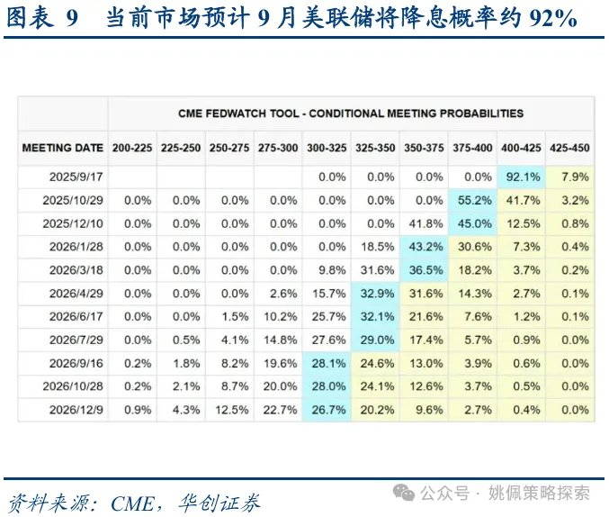

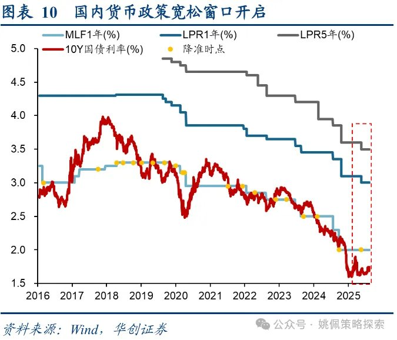

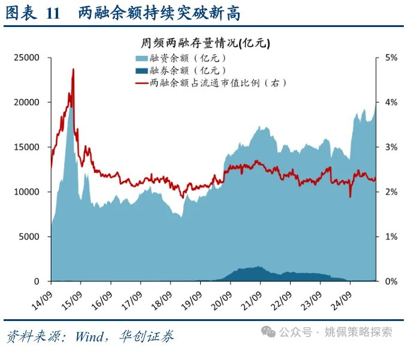

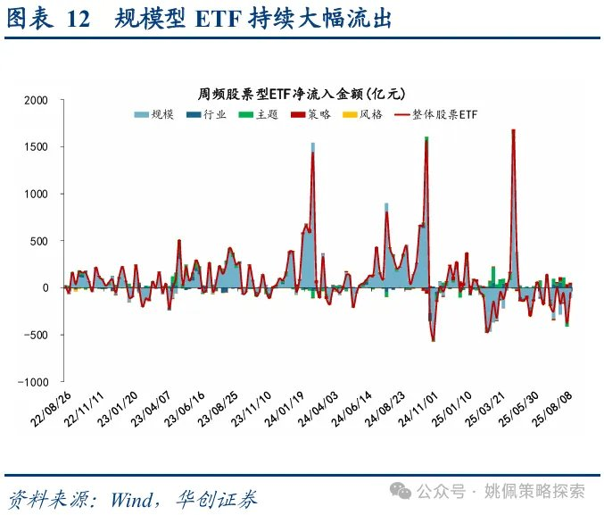

 

**三、再通胀牛市观点重申**

**牛市上半场，金融再通胀。** 3700点符合我们在《再通胀牛市——2025年度投资策略》中对上半场-金融再通胀的判断。在实物通胀带动借贷意愿回升之前，股市成为剩余流动性承载器，现金类产品收益率骤降，股市以流动性与估值优势成为超额储蓄搬家的承载体，赚钱效应吸纳增量资金入市，形成正循环。国家队托底+投融资格局逆转使得股市易涨难跌。股票供需紧平衡提高夏普比，股市定位从9/24提振信心升至财产性收入促消费。只是本轮存款搬家是农村包围城市：自媒体算法+散户开户+ETF+私募量化为代表的散户及增量资金是主导，直到3400以上两融放量+公募发行回暖，机构才逐步认可水牛逻辑。

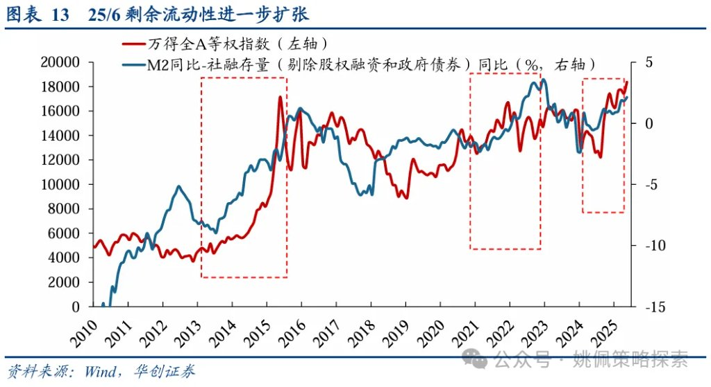

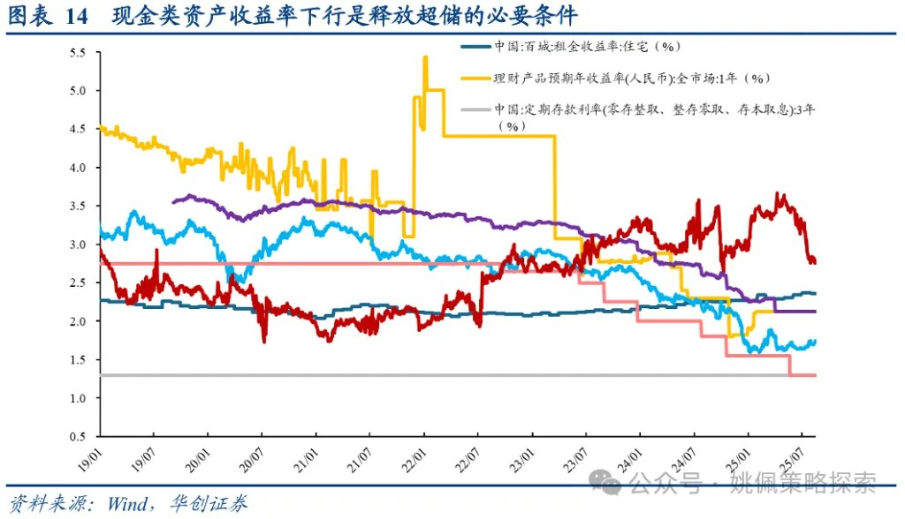

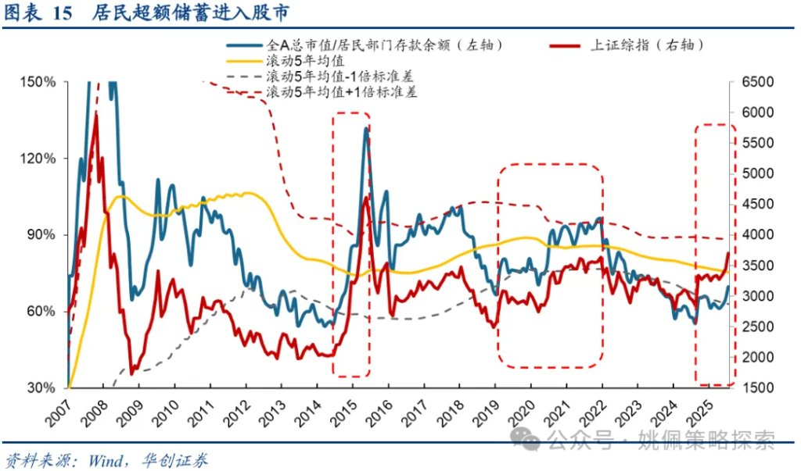

**反内卷助推通胀，是牛市上下半场拐点。** 7月政治局会议是政策拐点：从近一年需求加码转向供给出清为先，江西锂矿+四川光伏停产指向反内卷已从7月中央法治化控低价下沉至地方政府控产能，地方有财政底气，中央才有执行魄力。无需担忧滞胀，打开需求侧想象力：基建托底（雅下/农村公路升级/央企城市更新）+消费（生育补贴/消费贷贴息）+制造出海（赴欧投资建厂）。

**牛市下半场，实物再通胀。** M1领先PPI 6-9个月，MI&PPI转正即是EPS回归之时，通胀是资配核心，股牛主驱动转向业绩，大盘强于小盘，成长跑赢价值。短期继续看多周期资源品+券商保险，中期看多消费制造白马龙头，新漂亮50是存量低利率下，稳定自由现金流的复利长牛（详见。杠铃配置需调整，红利从低波转向周期，小盘业绩要求提升。

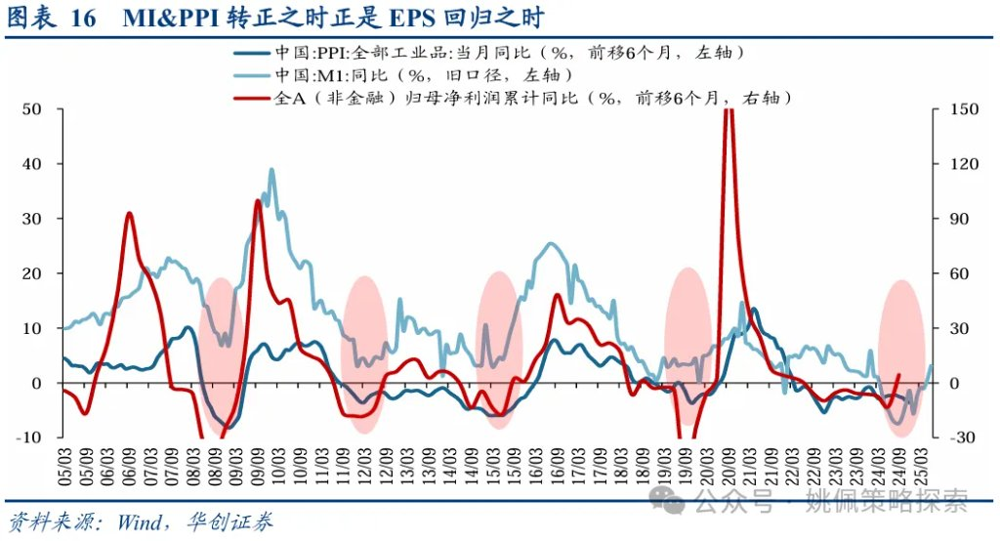

**重视基金回本的再配置效应。** 19-21年牛市新发三万亿基金收益均值已回本，历史经验表明基金回本后赎回压力往往增大。我们认为这并非意味着中长期的利空，当下现金类资产收益率下行叠加地产去库存背景下，赎回资金未来大概率仍将流回至金融资产。后续增量资金入市渠道将成市场再平衡风格主线的关键：①若剩余流动性继续充裕，水牛逻辑进一步加强，居民端资金直接通过ETF、两融入市，小盘成长风格或进一步抬升，两融交易占比超15%是重要标志（当前10%）；②若反内卷带动通胀回归，机构资金有望凸显其价值发现优势。此情景下若居民风偏较低，对应保险产品或为最优替代，大盘价值占优。若快牛延续，则对应公募基金或为最优替代，大盘成长占优。

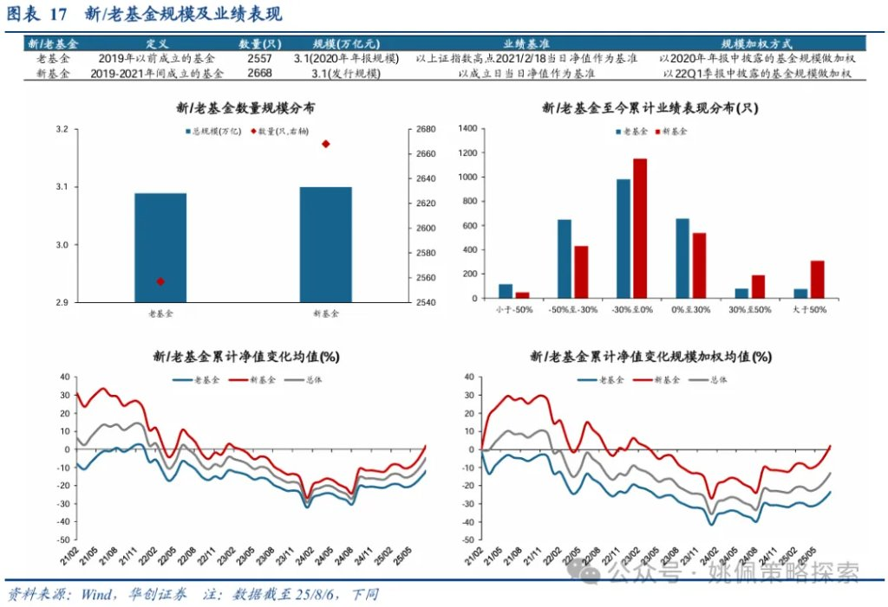

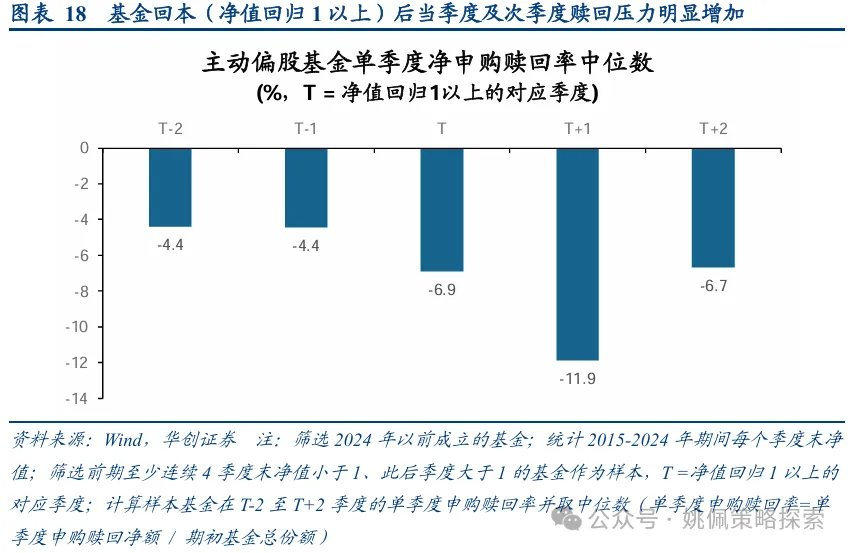

本文作者：姚佩、周名末，来源：[姚佩粗略探索](https://mp.weixin.qq.com/s?__biz=MzkwNTEyNjQ4Nw==&mid=2247509045&idx=1&sn=9ae4624ba274e0896d6888a734919f54&chksm=c1dbc5e9fc67b41d4209dc8509e3b8a5a9274769de49ce07505f45c2143676feb0bea08fa9b8&mpshare=1&scene=23&srcid=08185GGsaZtPgx68xBTpO1us&sharer_shareinfo=079223731966e98f774f2770a1cddbf4&sharer_shareinfo_first=079223731966e98f774f2770a1cddbf4#rd)，原文标题：《【华创策略姚佩】A股5轮牛市的回撤经验——策略周聚焦》，内容略有删减。

风险提示及免责条款

市场有风险，投资需谨慎。本文不构成个人投资建议，也未考虑到个别用户特殊的投资目标、财务状况或需要。用户应考虑本文中的任何意见、观点或结论是否符合其特定状况。据此投资，责任自负。
