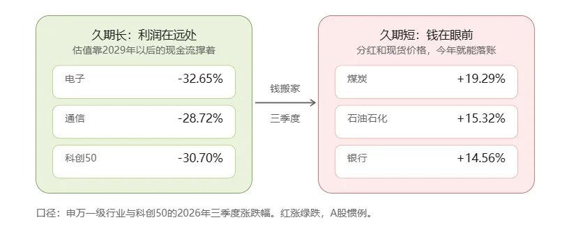
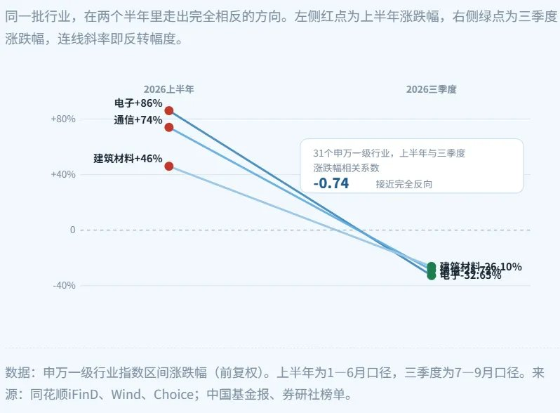
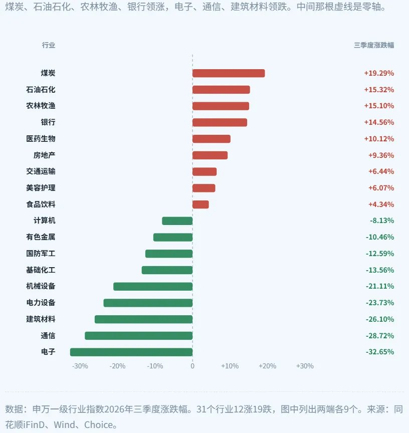
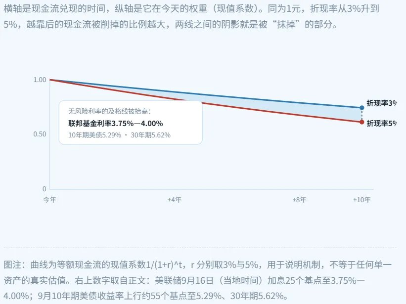
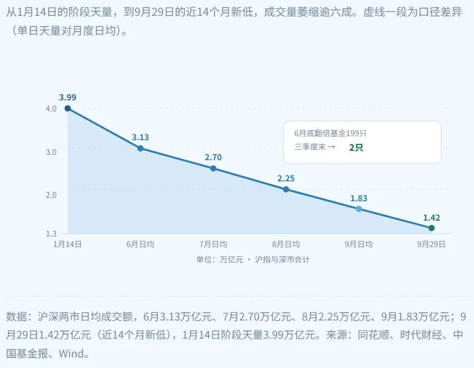
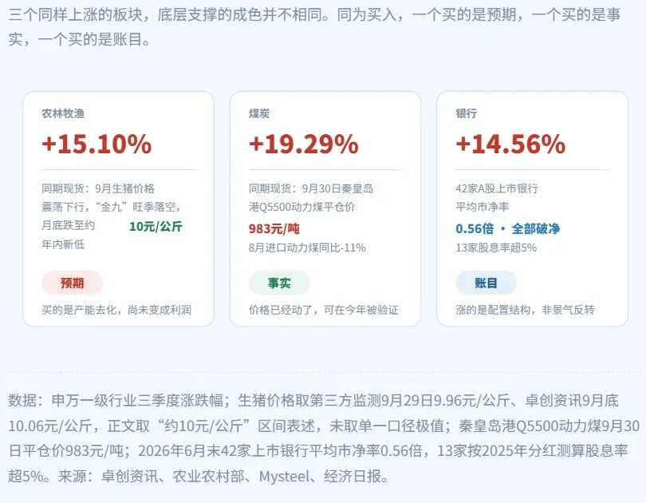

# A股三季度复盘：市场风格已悄然切换

- 页面显示时间：2026-10-08T11:14:24+08:00
- 页面署名：董静
- 标注来源：锦缎
- 原文：[华尔街见闻](https://wallstreetcn.com/articles/3783160)
- 取得时间：2026-11-04T16:03:44+08:00
- [HTML阅读版](article.html) · [来源记录](metadata.json)

## 导语

风格切换的本质是资金“集体缩短久期”。受无风险利率抬升影响，市场不再为远期的“想象空间”买单，转而追逐当期的“确定性”。上半年大涨的科技股重挫，资金大举涌入煤炭、银行等年内能算清账的红利资产。接下来，10月三季报将成为后市的核心定价锚。

---

9月30日，三季度最后一个交易日。

沪指收3842.19点，涨0.31%；深证成指跌0.11%，创业板指跌0.23%，科创50跌2.51%。两市成交1.45万亿元。

单看这一天，什么都没发生。放进整个季度，轮廓才清楚：创业板指三季度跌27.8%，科创50跌30.7%，双双创下各自历史上最大的单季跌幅。同期，煤炭涨19.29%，石油石化涨15.32%，农林牧渔涨15.10%，银行涨14.56%。31个申万一级行业，12个上涨，19个下跌。

**一句话来说，三季度的市场风格，本质是一次“集体缩短久期”。**

图：同一季度，两种久期，两种命运。注：“久期”的概念详见下文。

也就是说，同一份未来现金流，被按一个更高的利率重新算了一遍，仓位随之从"远"搬到了"近"。

## 01 上半年的赢家，几乎就是三季度的输家

最刺眼的对照在电子板块，上半年涨86%，三季度跌32.65%，落差超过118个百分点。通信上半年涨74%，三季度跌28.72%。建筑材料上半年涨46%，三季度跌26.10%，原因落在同一件事的两面：它是半导体上游材料涨价的受益者，涨价预期停下来，估值就跟着停下来。

跌幅榜前列：电子-32.65%、通信-28.72%、建筑材料-26.10%、电力设备-23.73%、机械设备-21.11%、基础化工-13.56%、国防军工-12.59%、有色金属-10.46%、计算机-8.13%。

涨幅榜前列：煤炭19.29%、石油石化15.32%、农林牧渔15.10%、银行14.56%、医药生物10.12%、房地产9.36%、交通运输6.44%、美容护理6.07%、食品饮料4.34%。

图：上半年的赢家，几乎就是三季度的输家

图：12涨19跌，两端隔着一整个景气周期

两份榜单几乎是彼此的镜像。

有机构统计，申万31个一级行业上半年与三季度的涨跌幅相关系数为-0.74。轮动不会这么整齐，这更像是反转。

这三个月，基本面并没有掉头。中报口径下，中证人工智能指数成分股的归母净利润（TTM）合计1128.58亿元，同比增长70.27%；中证全指半导体指数成分股合计942.92亿元，同比增长119.75%。

业绩还在，甚至称得上强劲。可见，变化动因不在于业绩，而是市场愿意为这些业绩付多少钱。

把时间拉长到前三季度，反差更大。

科创50累计上涨13.82%，是唯一收红的宽基指数；同期创业板指跌2.12%，深证成指跌4.71%，上证指数跌3.19%，北证50跌27.83%。同一个科技指数，年内还涨着13.82%，单个季度却跌掉30.70%。创业板指的年内涨幅在9月28日正式转负，而在6月25日，它一度达到36.49%。三个月，从+36.49%到负数。

## 02 贴现率一动，先跌的是现金流最靠后的那批公司

三季度的问题，债券市场早就给过定义。

债券里有个指标叫久期，衡量价格对利率的敏感度：期限越长、现金流越靠后，久期就越大，利率稍微一动，价格抖得越厉害。股票没有这个官方指标，但道理相通。一家公司的价值，是它未来所有现金流折算回今天的总和；折现用的那个利率一旦抬升，被削得最狠的，是最后那几年的权重。

2026年9月16日（当地时间），美联储把联邦基金利率目标区间上调25个基点，至3.75%—4.00%。这是2023年以来、也是两年降息之后的第一次转向。点阵图里，18名委员中有16人预计年底前至少还要加一次息，年底利率中值从3.8%上修至4.1%。

图：折现率一抬，被削得最狠的是最后那几年

反应最先出现在债市。9月，10年期美债收益率上行约55个基点至5.29%，创2007年以来最高；30年期升至5.62%，是2002年6月以来的新高。

作为全球资产定价的锚，无风险利率站到5%以上，所有资产的"及格线"都被抬高了。

一家2029年才可能兑现利润的公司，和一家今年就能分红的公司，在3%的利率环境里，估值可以很接近；但当无风险利率变成5%，前者必须拿出高得多的增长，才能证明自己值得被持有。

三季度，市场就是在做这道重新计算。

## 03 拥挤度到了极限，杠杆也到了极限

外部利率解释了"为什么是这个季度"，内部结构解释了"为什么跌得这么急"。

二季度，科创50单季涨75.74%，创业板指涨36.35%。6月，TMT板块成交额占全市场的比重触及43%的历史极值。有机构测得，截至6月30日，创业板指相对中证红利指数的阶段性超额收益达到48.6%；到9月初，这部分超额基本回吐完毕。

杠杆资金同步到位。

6月23日，A股两融余额首次突破3万亿元；上半年融资融券新开户96.06万户，同比增加56.96%。

跌的过程并不平缓。9月24日，沪指失守3900点，超4300只个股下跌；中秋休市后，9月28日沪指单日跌1.66%，创业板指跌4.53%，全市场超4500只个股下跌，深证成指与创业板指双双跌破7月前低，主要指数多数失守半年线。

然后是三季度的退潮。

两融余额从高点回落，成交额把这个过程记录得最完整：A股日均成交额从6月的3.13万亿元，降到7月的2.70万亿元、8月的2.25万亿元、9月的1.83万亿元；9月29日缩至1.42万亿元，为近14个月新低，较今年1月14日3.99万亿元的阶段天量萎缩逾六成。

图：退潮有刻度：日均成交额逐月下台阶

想买的人，6月里已经买完了。剩下的只有卖。

下跌也不均匀。9月，创业板指跌8.82%、科创50跌9.17%，微盘股指数上涨1.65%。杀估值集中在权重成长股身上。

6月底，全市场还有199只年内收益翻倍的主动权益基金；到三季度末，只剩下2只。同一时期，偏股混合基金前三季度的平均收益率为2.59%，仍为正，但基金之间的首尾业绩差距被拉开到163.56个百分点。

同一场回调里，有人守住了，有人没有。

## 04 钱搬去了"今年就能算清"的地方

从高处撤出来的钱，没有离场，它换了个位置站着。

政策先给了一条线。

"反内卷"从2025年底中央经济工作会议开始部署，2026年3月写进政府工作报告，明确要用产能调控、标准引领、价格执法、质量监管等手段整治内卷式竞争；5月13日，市场监管总局启动为期8个月的专项行动。

落到行业上：光伏发布5项强制性国家标准，其中3项能耗能效标准将于2027年1月1日实施；8家多晶硅龙头签署自律倡议，承诺销售价格不低于核算成本；汽车行业把60天账期从行业倡议升级为国家层面的规范；水泥在东北、西南、华东等区域连续发布涨价函，单次上调20元至50元/吨。

价格确实开始动了。9月30日，秦皇岛港Q5500动力煤平仓价983元/吨，鄂尔多斯坑口含税价760至830元/吨；8月我国进口动力煤2763万吨，同比下降11%。

政策的另一半落在需求端。9月29日，财政部、央行、金融监管总局联合发布通知，自2026年10月1日起实施居民购房贷款贴息，政策实施期暂定1年，可享受贴息的贷款规模最高100万元，财政按年化1个百分点贴息，贴息期限最长5年。房地产板块三季度上涨9.36%，涨的正是这条贴息政策的确定性。

资金这条线，主角是险资。

险资已连续第五个季度加仓A股。到2026年6月末，42家A股上市银行平均市净率0.56倍，全部处于破净状态，按2025年分红测算有13家股息率超过5%。华泰证券的测算显示，保险行业上半年已配置约2.1万亿元红利股，仍欠配1.9万亿元。

政策给的是价格下限，险资给的是买盘下限。这两样东西有一个共同点：都能在今年的账上被验证。

## 05 但"近处"也分真伪：农业涨15%，猪价跌到10元

涨幅榜第三的农林牧渔，最需要拆开看。

三季度涨15.10%，而它对应的现货价格，整个季度走得并不好。9月生猪价格震荡下行，"金九"旺季落空，9月底跌至约10元/公斤的年内新低。供给端集中出栏、大猪压栏释放，需求端节日备货偏弱，供需错配贯穿全月。

真正被买入的，是产能去化的预期。

二季度末，全国能繁母猪存栏调减至3780万头，回到产能调控的绿色合理区间；9月底前降至3750万头，被明确为硬指标，头部企业被要求带头压产、控体重。这属于政策承诺，还没有变成当期利润。

它的逻辑能否成立，要等四季度猪价（能否）真的抬起来。

银行涨的逻辑又是另一套。

新会计准则下，高股息股票可以被指定为其他综合收益（OCI）类资产，市值波动不进利润表，只有股息计入；低利率环境下，险资需要这样的现金流。这是资产负债表层面的再平衡。

图：“近处”也分真伪：预期、事实与账目

**一言以蔽之，在猪价上是预期，在煤价上是事实，在银行股息上是账目。**

三者被一起买入，但只有后两者能在今年的报表上被验证。

## 06 10月，闸门先落在三季报上

9月30日的盘面，托住沪指的是酿酒、金融和医药；同日，科创50跌2.51%，盘中刷新本轮调整新低。资金在同一个交易日里，把票投给了两种不同的时间。

接下来，估值的闸门将落到三季报上。

10月，上市公司将陆续披露三季报，这是四季度最重要的定价锚。

中报的强劲能否延续，此前70.27%的利润增速能否守住，直接决定科技行情是重建还是继续消化。申万宏源策略的判断是，年内最好的一波进攻性机会，可能出现在10月三季报消化估值之后。

外部变量同样绕不开。

美联储下一次议息会议在10月底，点阵图显示年内或再加息一次。10月大部分时间都在会议之前，海外利率的扰动至少摆在明处。

三季度的下跌，把一个问题摆得很清楚：当无风险利率站上5%，市场不再为"想象空间"付钱，只为"能收到的时间"付钱。至于这个偏好能持续多久，11月和12月的报表会说话。

收盘的那一刻，沪指停在3842.19点，涨0.31%。

这个涨法谈不上好看，但它很体面。

本文来源：[锦缎](https://mp.weixin.qq.com/s?__biz=MzkxOTAyNjAwOA==&mid=2247556928&idx=2&sn=2222a68422fe4e5e4ff1d3be441e5235&chksm=c0c533e5052fb820610d4457718b539a5206a4ab4d31c6b0db324b1606d28c8dc7728ad4b012&scene=126&sessionid=1791417085)

风险提示及免责条款

市场有风险，投资需谨慎。本文不构成个人投资建议，也未考虑到个别用户特殊的投资目标、财务状况或需要。用户应考虑本文中的任何意见、观点或结论是否符合其特定状况。据此投资，责任自负。
