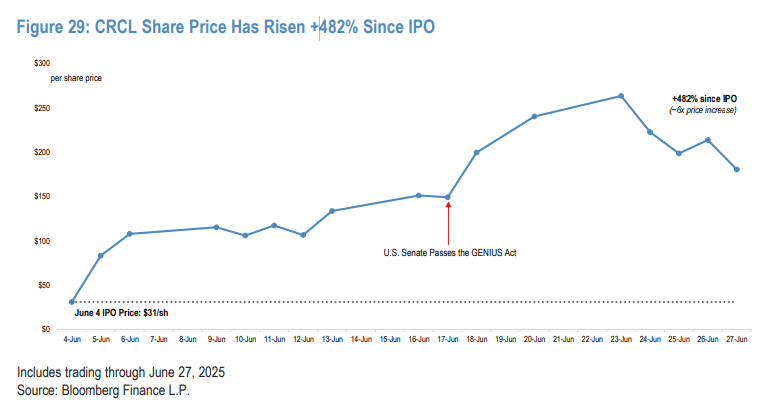
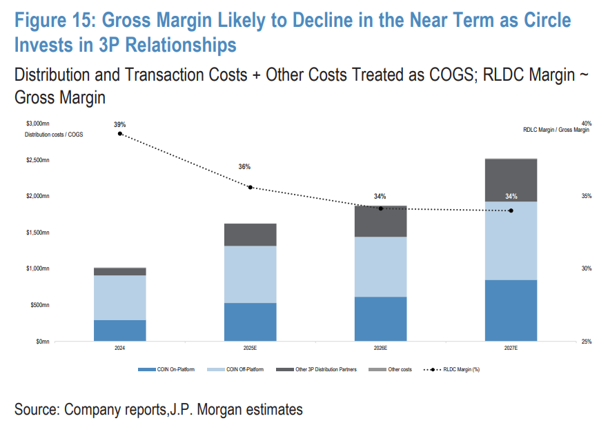
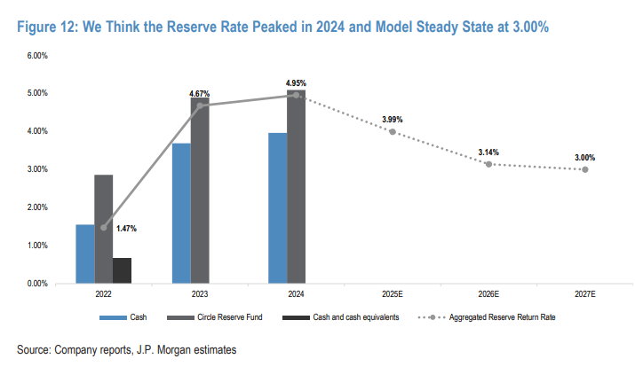
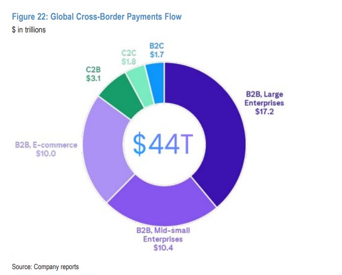

# Circle看空报告来了！摩根大通：盈利模式“剪刀差”吞噬利润，再给10%“情绪溢价”也只值80美元

- 页面显示时间：2025-06-30T20:09:12+08:00
- 页面署名：赵颖
- 标注来源：未单列，见正文
- 原文：[华尔街见闻](https://wallstreetcn.com/articles/3750108)
- 取得时间：2026-11-04T16:02:17+08:00
- [HTML阅读版](article.html) · [来源记录](metadata.json)

## 导语

摩根大通表示，利率下行和分销成本上行形成“剪刀差”吞噬利润，Circle的商业模式高度依赖利率变化，97%的收入来自储备金收益，这使得公司盈利能力极易受到货币政策波动影响。其次，分销成本持续上升，或使毛利率从39%下降至34%。但Circle如果能将稳定币功能整合进现有银行渠道，有望成为“稳定币版Swift”。

---

美国稳定币巨头Circle的股价狂欢或将戛然而止？

据追风交易台消息，摩根大通周一重磅发布Circle首次覆盖报告，警告其估值过高冲出舒适区并给予“减持”评级，目标价80美元，较当前180美元股价大幅下调56%。

报告指出， **Circle面临多重挑战，首先是估值高企，尽管看好Circle在稳定币市场的领先地位和USDC的增长前景，但公司当前估值已被推至"舒适区之外"，指出即便再给10%“情绪溢价”，也只有80美元。**

**同时，摩根大通警告，利率下行和分销成本上行形成“剪刀差”吞噬利润，Circle的商业模式高度依赖利率变化，97%的收入来自储备金收益，这使得公司盈利能力极易受到货币政策波动影响。其次，分销成本持续上升，或使毛利率从39%下降至34%。**

此外，Circle面临激烈竞争威胁，特别是新进入者可能通过提供收益率来争夺市场份额，而稳定币业务的转换成本相对较低。一旦"赢家通吃"的市场格局被打破，Circle的经济效益将显著受损。

## 估值泡沫显现：IPO迄今涨幅482%引发预警

自6月4日以31美元价格IPO以来，Circle股价已飙涨482%，市值达到400亿美元。

而摩根大通为Circle设定了80美元的目标价，较6月27日收盘价180美元大幅下调56%，显然反映了投资银行对当前估值的深度担忧。

摩根大通给出的80美元目标价，基于2027年调整后每股收益1.56美元的45倍市盈率，外加10美元的"投资者热情溢价"。

分析师表示，当前股价已充分反映了极为乐观的增长假设，包括稳定币市场2036年增长至1.8万亿美元、USDC市场份额提升至40%等。

## 商业模式：高昂分销成本+利率敏感性侵蚀利润率

摩根大通表示：

> Circle的盈利模式主要依赖储备金投资收益，但约三分之二收入需要支付给推广USDC的合作伙伴。 **随着公司与更多平台签署分销协议，这一比例还将上升至70%，导致毛利率从当前39%下降至34%。**
>
> 

其中，Coinbase是Circle最大的分销伙伴，2024年获得9.08亿美元分成，占Circle储备收入的55%。根据合作协议，Coinbase可获得其平台USDC余额对应储备收益的100%，以及其他平台剩余收益的50%。

分析师表示，这种高昂的分销成本结构使得Circle面临"逐底竞争"风险。如果市场竞争加剧，公司可能需要支付更高比例收益来维持合作关系，最终沦为类似货币市场基金的低利润率业务。

其次，Circle业务对利率变化极为敏感。摩根大通估算：

> **在当前约600亿美元USDC流通量下，利率每下降100个基点，将对储备收入和调整后EBITDA分别造成约6亿美元和2亿美元的年化冲击。**
>
> 

分析师预计，Circle的储备收益率已在2024年见顶，未来将逐步回落至3.00%的稳态水平。这意味着除非USDC流通量大幅增长，否则公司盈利能力将面临持续压力。

不过，利率下行也可能刺激稳定币需求增长。摩根大通指出，低利率环境下，开发者和建设者更愿意在区块链生态系统中进行创新，这可能推动USDC使用量增加。

## “赢家通吃”模式不会永远持续下去

Circle目前是全球第二大稳定币发行商，其USDC市值约617亿美元，在美元稳定币市场占据约25%份额，仅次于Tether的USDT。摩根大通指出，USDC是"监管合规程度最高"的稳定币，完全符合欧盟MiCA法规要求，并有望满足即将出台的美国稳定币法规。

摩根大通认为，Circle构建的网络效应和合规品牌是其核心竞争优势。公司通过与Coinbase、Binance等主要加密货币交易平台的分销协议，建立了强大的USDC流入流出渠道。同时，Circle将85%储备资金委托贝莱德管理，其余15%存放在全球系统重要性银行，确保了资金安全性。

然而，摩根大通强调：

> **稳定币市场的"赢家通吃"格局可能不会永远持续。新进入者正通过提供更高收益率来吸引用户，而代币化货币市场基金等产品也在蚕食传统稳定币的使用场景。**

尽管面临诸多挑战，摩根大通仍看好Circle的长期增长前景。美国参众两院有望在7月通过《GENIUS法案》，为稳定币行业提供明确监管框架。作为合规程度最高的稳定币发行商，Circle将从中受益。

国际化也为Circle提供广阔增长空间。在阿根廷、土耳其等高通胀国家，USDC正被越来越多地用作价值储存工具。摩根大通估计，全球9个最大高通胀国家的M2货币供应量总计1.4万亿美元，USDC渗透率每提升1个百分点，流通量就将增加约140亿美元。

## Circle能否成为“稳定币版Swift”是关键

Circle于2025年5月推出的Circle Payments Network（CPN）被视为公司战略转型的关键举措。CPN旨在整合稳定币功能到现有银行渠道， **首先关注B2B跨境支付和消费者汇款业务。**

摩根大通表示：

> 2023年B2B跨境支付量达到37万亿美元，为CPN提供了巨大的巨大潜在市场。CPN通过智能合约基础设施和模块化API，允许第三方开发者直接在其平台上构建高级模块和自动化金融工作流程。
>
> 然而，密切关注Circle能否在B2B电商和东南亚跨境支付领域获得足够的资源，并让Visa和万事达卡等传统支付的成功也依赖于USDC。
>
> **如果Circle能够实现这一目标，就有望成为“稳定币版Swift”；否则，可能沦为多边稳定币发行方中“业务最敏感、价格权最弱”的一环。**
>
> 

摩根大通指出，企业客户通常避免持有大量非收益资产，预计预计约50亿美元的美元余额就将支撑1万亿美元的年化交易量（约占全球跨境支付的3%）。目前Circle尚未从CPN获得收入，但计划随着规模扩大几个基点的交易费用。

风险提示及免责条款

市场有风险，投资需谨慎。本文不构成个人投资建议，也未考虑到个别用户特殊的投资目标、财务状况或需要。用户应考虑本文中的任何意见、观点或结论是否符合其特定状况。据此投资，责任自负。
