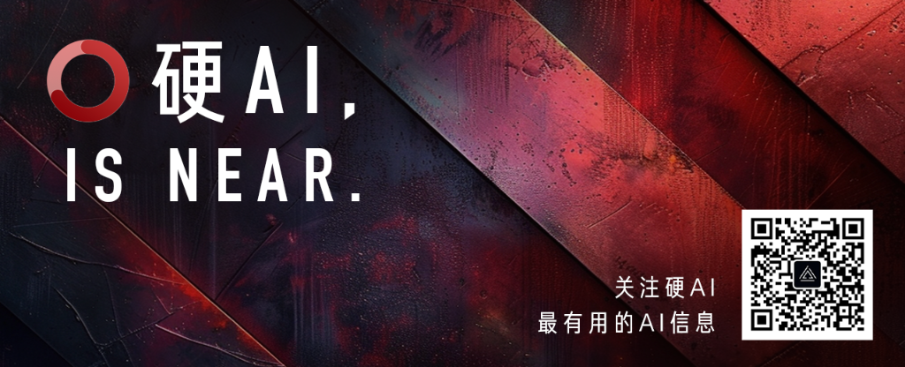

# CoreWeave投资者会议：AI需求“无法解决”，客户愿意签长约，且提前12个月签约

- 页面显示时间：2026-01-17T12:27:18+08:00
- 页面署名：鲍奕龙
- 标注来源：硬AI
- 原文：[华尔街见闻](https://wallstreetcn.com/articles/3763514)
- 取得时间：2026-11-04T16:03:52+08:00
- [HTML阅读版](article.html) · [来源记录](metadata.json)

## 导语

摩根大通认为CoreWeave身处AI算力需求爆发的中心，公司执行能力与融资创新使其成为市场领导者。然而，其增长由极高的客户集中度、巨额资本开支及宏观敏感度支撑。报告给予“中性”评级，认为其可能提供一段“崎岖不平、波动剧烈”的旅程，仅适用于特定风险偏好的投资者。

---

本文作者：鲍奕龙

来源：硬AI

1月16日，摩根大通Mark R Murphy研究团队发表研报指出， **CoreWeave正处于需求爆发式增长的风口浪尖，但投资者需要警惕其高杠杆商业模式和执行风险。**

研报总结了公司管理层在近期投资者会议上传递的关键信号：AI算力需求强劲，甚至到了已经"无法解决"（unsolvable），客户正在锁定更长期合同（5-6年），并愿意提前12个月或更长时间签约。

CoreWeave拥有约560亿美元的订单积压，2026年产能已基本分配完毕。然而，这种高增长伴随着巨额资本支出需求和复杂的融资结构，公司需要在2026年投入272.96亿美元资本开支。

**摩根大通维持CoreWeave中性评级，给出12月目标价110美元，基于2026年约33倍的调整后EBIT估值。这一倍数相比同行平均31倍的估值有所溢价。**

**报告承认，溢价反映了公司的高增长前景与差异化的市场定位，其能力已获得OpenAI、微软、英伟达等顶级客户的背书。然而，溢价部分被其高负债和为支撑巨额资本开支所必需的高执行风险所抵消。**

报告强调，对于风险偏好较低的投资者，这将是一段"颠簸的旅程"。

## AI算力荒：需求持续碾压供应

CoreWeave管理层在投资者会议上使用了一个极其强烈的词汇来描述当前市场状况：AI领域的算力需求是"unsolvable"（无法解决）。这一表述背后是AI相关计算能力相对客户购买意愿的严重受限。

研报指出客户行为的两大转变印证了这种供需失衡：

> **合同期限大幅延长** ：客户签署合同的期限正在从约3年延长至5-6年，这进一步支持了GPU采用6年折旧周期的合理性。
>
> **提前锁定产能** ：合同签署时间从基础设施上线前3个月，延长至12个月或更长时间。客户愿意为未来更远期的产能提前做出承诺。

值得注意的是，虽然合同提前签署的时间拉长，但这并不意味着CoreWeave会提前部署资本。

一旦从数据中心获得活跃电力，公司仍预计能在4-6周内将设施转化为产生收入的GPU计算能力，这一周转时间处于行业领先水平。

## 产能扩张：2025年目标在望，2027年成为关键

**摩根大通分析师认为，CoreWeave有望实现2025年底约850MW活跃电力的目标。**

更重要的是，2026年的可用产能已经基本分配完毕，要么已经体现在约560亿美元的订单积压中，要么正在与客户进行后期管道讨论。

**公司目前大部分未分配产能集中在2027年，而2027年产能的潜在订单也已明确。**

**鉴于客户愿意签署更长交付周期的合同，2027年产能的订单转化可能最早在2026年上半年就会开始。**

报告指出，这些动态强化了需求的强劲和长期性质，被视为改善CoreWeave业务可见性的积极因素。

## 融资策略：资产融资占据主导

**CoreWeave的资本密集型商业模式需要复杂的融资策略支撑。**

公司表示，其90%的资本支出通过资产融资而非母公司层面的债务融资来支持。这意味着母公司信用状况的变化对大部分融资能力影响较小。

报告指出，公司能够以更优的利率筹集债务，并预计这一趋势将持续。未来，部分合同甚至可能基于收入和现金流进行资产层面融资，贷款与成本比率可能从隐含的约90%提升至约120%。

**此外，公司三季度财报中提到的、因第三方开发商导致的数据中心建设延迟，目前进展符合更新后的指引。**

报告补充说明，CoreWeave的管理层会主动管理建设进度，包括在第三方合同的完工目标中预留缓冲时间，以应对可能出现的误差或延迟。

报告认为，市场可能低估了在极短时间内大规模建设AI数据中心的复杂性，而当前的主要制约因素是人力等供应链挑战，这是行业普遍问题。

## 无法忽视的风险清单

研报分析了CoreWeave潜在的风险。

**首先是** 高度集中的客户：大部分收入来自有限客户，且近年增长几乎全部来自现有客户的扩展。

**其次是** 供应商依赖：2024年所有GPU来自英伟达，三大供应商占了采购的大头。

**第三是** 持续的巨额资本开支和债务需求，融资能力若恶化将直接影响增长和现金流。

**最后是** 宏观经济波动。报告警告，任何持续的宏观经济逆风，都可能促使买家推迟采购。

**CoreWeave作为需要客户巨额投资的云服务商，可能受到不成比例的冲击。若出现经济波动，其股价可能因风险规避情绪而遭受重创。**

摩根大通强调CoreWeave身处AI浪潮最确定的基建环节，需求信号强劲到客户行为范式转移，执行能力和融资创新使其成为头部玩家。

然而，这种高增长是由极高的财务杠杆、客户集中度和宏观敏感度所支撑的。这是一个只有特定风险偏好的投资者才应参与的故事。

本文来自[微信公众号“硬AI”](https://mp.weixin.qq.com/s/2rfpVmedXuAVybneRhpkIg)，关注更多AI前沿资讯请[移步这里](https://mp.weixin.qq.com/s/2rfpVmedXuAVybneRhpkIg)

风险提示及免责条款

市场有风险，投资需谨慎。本文不构成个人投资建议，也未考虑到个别用户特殊的投资目标、财务状况或需要。用户应考虑本文中的任何意见、观点或结论是否符合其特定状况。据此投资，责任自负。
