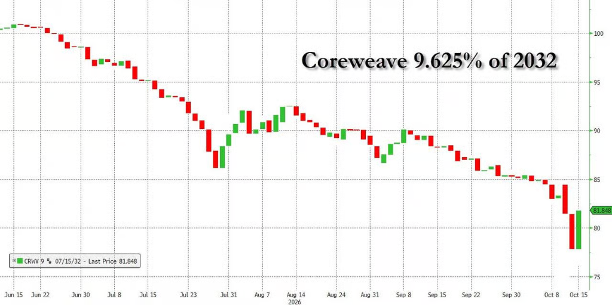
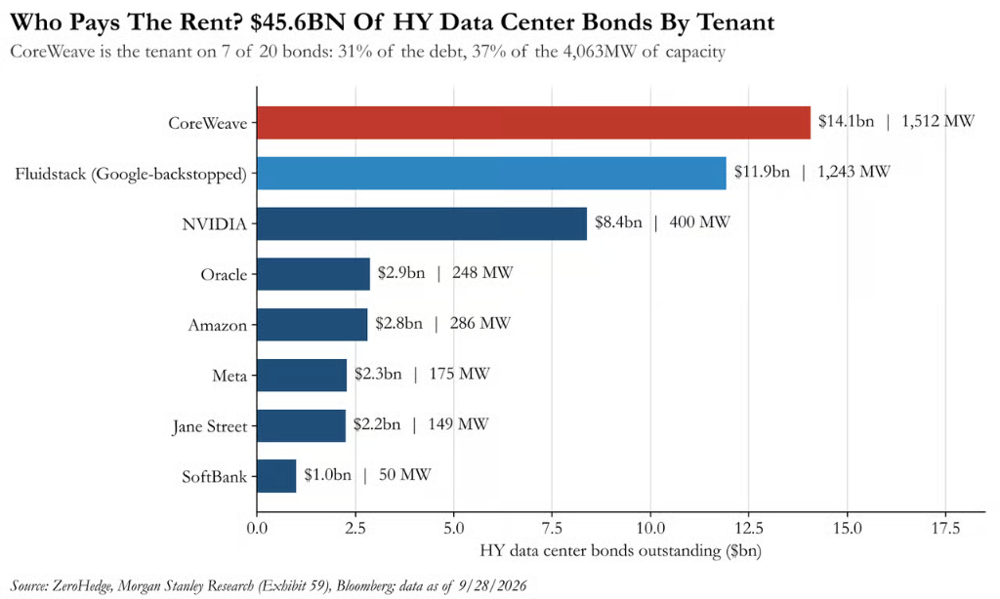
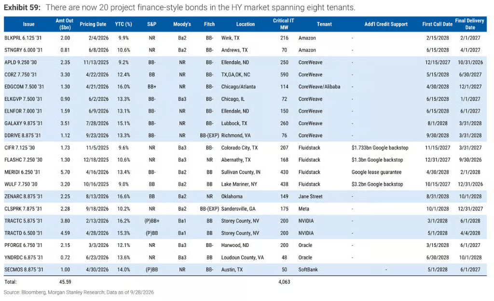
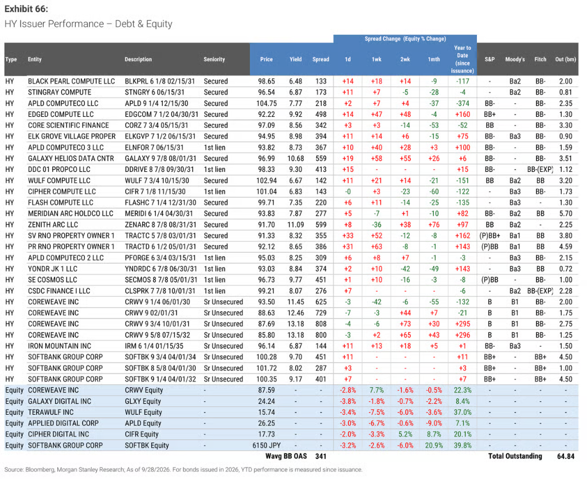
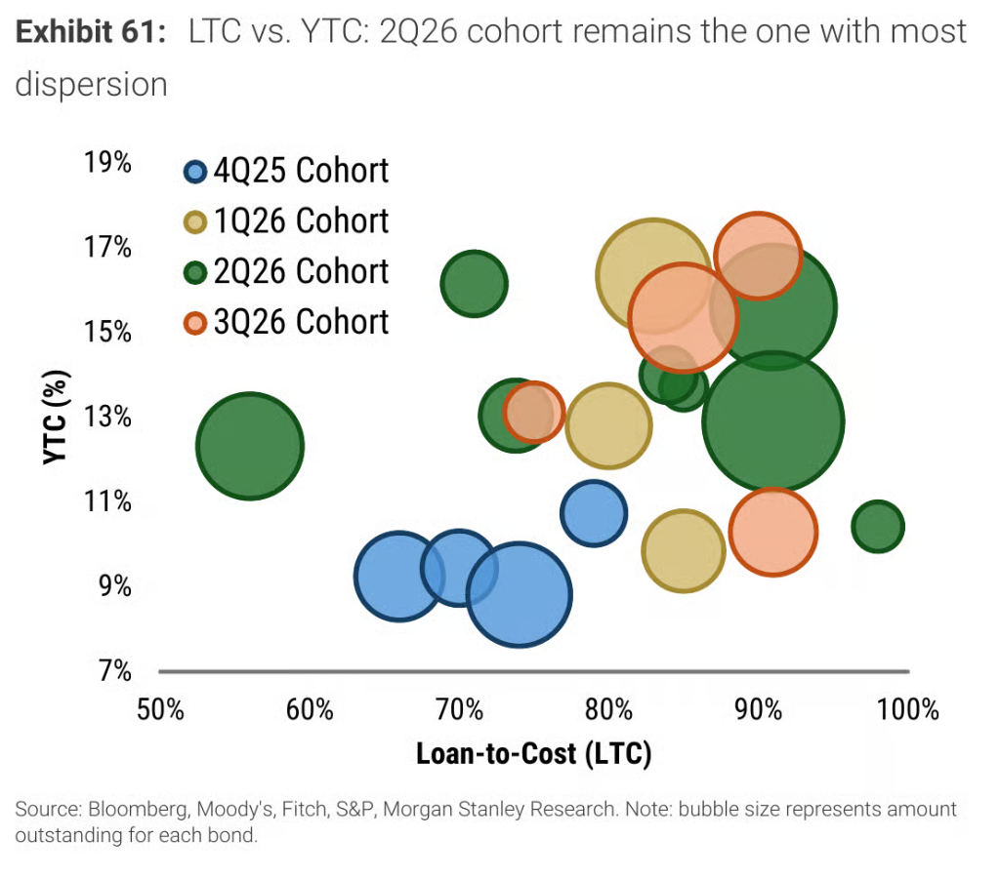
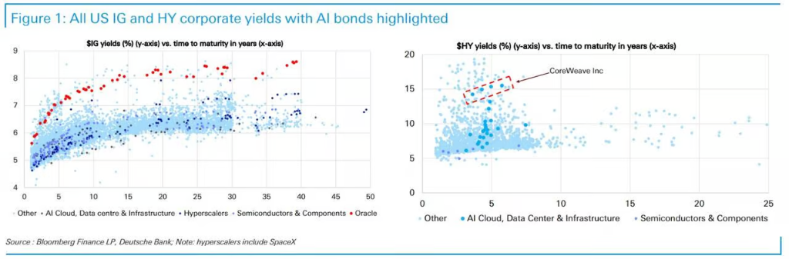
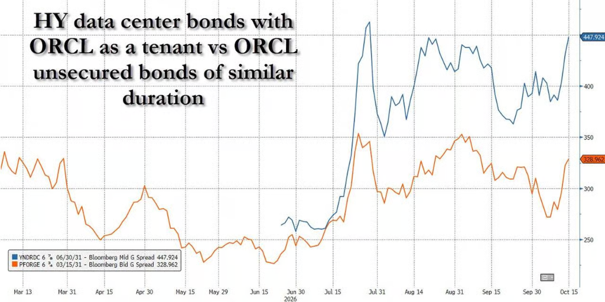

# Coreweave是否会引爆美国垃圾债市场？下一个是甲骨文？

- 页面显示时间：2026-10-16T10:47:05+08:00
- 页面署名：董静
- 标注来源：未单列，见正文
- 原文：[华尔街见闻](https://wallstreetcn.com/articles/3783754)
- 取得时间：2026-11-04T16:03:20+08:00
- [HTML阅读版](article.html) · [来源记录](metadata.json)

## 导语

CoreWeave债券收益率飙至16%，五年期CDS隐含违约概率达63%，与雷曼破产前水平相当，直接威胁由其租金支撑的141亿数据中心垃圾债。德银认为，更危险的是甲骨文——BBB评级悬于投资级末端，CDS两日暴涨36基点，一旦降级将触发机构强制抛售，危机将从垃圾债蔓延至投资级市场腹地。

---

AI基础设施融资链条的裂缝正在从边缘向中心蔓延。

CoreWeave债券已深陷困境，其作为租户支撑着高收益市场逾140亿美元数据中心债券的偿付能力，而德意志银行的全市场信用图谱显示，AI信用分化正在加速——AA级科技巨头依然享受准主权级融资成本，但处于 **投资级末端的甲骨文CDS已急剧走阔，一旦遭遇降级，将触发大规模强制抛售** ，将这场"边缘危机"推入市场腹地。

**CoreWeave的债券已连续三日在困境价位交易。** 其9.625%、2032年到期票据收益率收盘约14%，据路透报道，2031年票据收益率更超过16%——这一水平通常被视为困境信号。五年期CDS收于1117基点，隐含五年内违约概率约63%，与雷曼兄弟申请破产前数日的CDS水平相当。 **2032年票据自6月发行以来价格已跌破80美分，触及市场惯例定义的困境区间。**

**问题的核心不止于CoreWeave自身。** CoreWeave同时是高收益市场20只项目融资型数据中心债券中七只的唯一租户，涉及债务规模141亿美元，占该市场总量的31%。这意味着，CoreWeave的资本成本危机，直接传导至Applied Digital、Core Scientific、Galaxy Digital等发行人的债券偿付能力。

与此同时，德意志银行警告，甲骨文五年期CDS两日内飙升36基点至288基点，若其BBB评级遭下调，将迫使只能持有投资级资产的机构投资者强制抛售，引发系统性连锁反应。

## 垃圾债市场的AI敞口：141亿美元悬在CoreWeave一身

据摩根士丹利最新月报《AI融资现状：暂停，而非撤退》，高收益市场中至少存在20只项目融资型数据中心债券，合计债务规模456亿美元，为4063兆瓦关键IT容量提供融资，每只债券由单一特殊目的实体发行，偿债来源为单一租户的租金支付。

**CoreWeave是其中规模最大的租户，也是最脆弱的一环。** 在上述20只债券中，CoreWeave作为租户的债券共七只，涉及债务141亿美元、1512兆瓦容量，占总量的31%和37%，超过谷歌背书的Fluidstack系列（119亿美元）和英伟达（84亿美元），成为高收益数据中心市场最大的单一租金来源。

依赖CoreWeave租金的具体发行人包括：

- **Applied Digital（APLD）** ：两只债券合计39.4亿美元（23.5亿美元9.25% 2030年票据及15.9亿美元7% 2031年票据，均位于北达科他州Ellendale的Polaris Forge项目），另有21.5亿美元Polaris Forge 2债券以甲骨文为租户；

- **Core Scientific（CORZ）** ：33亿美元，为590兆瓦容量融资，分布于德克萨斯、佐治亚、俄克拉荷马和北卡罗来纳，是追踪名单中CoreWeave租赁容量最大的单一债券；

- **Galaxy Digital（GLXY）** ：35.1亿美元9.875%票据，用于德克萨斯州拉伯克的Helios园区，最终交付期至2028年3月；

- **Edged** （13亿美元，CoreWeave与阿里巴巴共同租赁）、 **Elk Grove Village** （9亿美元）及 **DDC 01 Propco** （11.2亿美元，弗吉尼亚州里士满），其中最后一只于9月23日定价，即市场剧烈动荡前三周。

**这是双重敞口，而非简单的循环融资。** 以Galaxy债券持有人为例，其同时承担拉伯克的建设风险，以及CoreWeave自2028年起能否持续支付租金的信用风险。

## 市场已按租户定价：利差分化一目了然

摩根士丹利的利差数据清晰呈现了市场的判断。截至9月28日，七只CoreWeave租户债券平均利差约400基点，是四只谷歌背书Fluidstack交易（Cipher、TeraWulf、Flash、Meridian，约195基点）的两倍，也远高于亚马逊租赁债券（约150基点）。 **同一资产类别、同一结构、相近评级，唯一的变量是租约上的名字，以及是否有超大规模云服务商联署担保。**

利差最宽的债券有共同特征：Zenith Arc（Jane Street租户，俄克拉荷马，2028年10月最终交付）利差599基点、收益率11.09%；Galaxy利差559基点/10.68%；Edged利差498基点/9.92%（自发行以来扩大160基点）；SoftBank租赁的SE Cosmos利差451基点。 **弱租户、漫长建设周期，或两者兼具，是共同的风险因子。**

值得注意的是，CoreWeave租户债券中表现最好的，是交付期最近的一只——Applied Digital原始9.25% 2030年票据，最终交付期为2026年10月31日，报价104.75、利差218基点。 **距离通电交付越近，市场对租户信用的敏感度越低；交付期越远，租户信用的权重越高。**

此外，摩根士丹利的贷款成本比（LTC）与到期收益率散点图显示，2026年二、三季度发行的债券（即热潮顶峰时期）集中在LTC 85%-95%、到期收益率13%-17%区间，即 **最新发行的债券股权缓冲最薄、要求回报率最高** ，风险敞口最为集中。

## 德意志银行绘制全市场图谱：AI信用已现三级分化

德意志银行研究院对美元投资级和高收益指数中每一只债券按收益率与久期作图，并标注AI相关名称，得出了迄今最为系统的AI信用全景图。

**结论是：AI融资成本整体尚未失控，但曲线远端的分化正在扩大。**

德银将AI信用划分为三个层级：

- **AA级AI名称** （Meta、Alphabet、英伟达、亚马逊）：短端融资成本约5%-5.5%，处于投资级分布底部，市场仍将其视为准主权级借款人；

- **BBB级AI名称** （甲骨文、SpaceX）：10-12年久期融资成本约8%-8.5%，处于投资级分布顶端， **较同久期债券高出约1.5-2个百分点** ，形成明显的"AI税"；

- **高收益AI名称** ：多为BB级，收益率7%-11%，大体处于高收益市场中游。

**CoreWeave是唯一的异类。** 在整个高收益指数中，收益率最高的债券（15%-19%）通常与AI无关，但CoreWeave是例外——其BB+评级的无担保2032年票据，自发行仅四个月便跌破80美分，五年期CDS收于1118基点。

德银指出，CoreWeave以四至六年"照付不议"合同出租算力，待履行订单超过1000亿美元，其中约三分之二来自微软、Meta、IBM、卡特彼勒等投资级客户。 **但债券市场显然更在意杠杆率，而非客户名单。**

德银还指出一个被市场忽视的结构性矛盾： **先进GPU芯片的折旧周期约为四至六年，与合同期限吻合，但为其融资的债务期限更长。**

这意味着抵押品在债务到期前已经贬值，这正是收益率曲线远端利差扩大的根本原因。叠加市场重新定价美联储加息预期，期限溢价将成为所有需要再融资的借款人的额外负担。

## 甲骨文：下一个多米诺骨牌？

**德意志银行明确将甲骨文列为下一个需要密切关注的风险节点。**

该行警告，"这种担忧可能成为自我实现的预言，并有引发其他AI相关名称更广泛问题的风险"，并将甲骨文列为"风向标"：其五年期CDS在两日内飙升36基点至288基点，高盛数据显示周三单日扩大31基点。

甲骨文的系统性风险在于其评级位置。 **甲骨文目前处于BBB评级，即投资级最低档。** 一旦遭遇降级，大量只能持有投资级资产的机构投资者将被迫强制抛售， **这不是有序的重新定价，而是一次强制性的流动性冲击。**

从债券市场来看，两只甲骨文租户债券（Applied Digital的Polaris Forge 2和Yondr的Loudoun County项目）的利差，已较同期限甲骨文自身无担保债券宽出185-220基点，Yondr利差一度在9月初扩大至近300基点。摩根士丹利上周警告，数据中心交付延迟可能严重冲击甲骨文的债务状况。

## 融资缺口与多空分歧

**CoreWeave的核心矛盾在于一个350亿美元的融资缺口。**

德意志银行分析师Brad Zelnick在题为"错位带来买入机会"的报告中重申对CoreWeave的买入评级和150美元目标价，指出公司二季度末可用流动性155亿美元，待履行订单中60%-65%来自投资级客户，新合同的无杠杆内部收益率已从约15%跳升至"约20%以上"。但他同时承认关键矛盾：

> **CoreWeave未来12-18个月内无疑需要额外资本以履行现有订单，未来12个月经营现金流约100亿美元，而所需资本支出约450亿美元，缺口约350亿美元。**

若这一缺口的哪怕一半需要以当前约16%的无担保债券利率融资，额外利息支出将约达28亿美元/年，超过分析师预期CoreWeave今年全年28亿美元亏损的总额。

高盛的Rich Privorotsky倾向于认为市场“在局部过度反应”，认为“存在合理的融资约束，但这并不否定底层需求逻辑”。摩根士丹利则认为“对于高质量高收益债券，当利率企稳时风险回报看起来不错”。

高盛和摩根士丹利 **的关键前提词均是"高质量"和"如果利率企稳"——而在10年期美债收益率仍高于5%、加息预期升温的背景下，这两个条件对于拉伯克一座唯一租户CDS已定价为违约的BB-级建筑外壳而言，均不成立。**

## 传导路径：从边缘到中心

综合摩根士丹利和德银的两份报告，当前AI信用风险的传导路径已相对清晰：

**第一层** 是CoreWeave自身——无担保债券收益率16%，CDS隐含违约概率超六成，融资缺口350亿美元；

**第二层** 是依赖CoreWeave租金的141亿美元高收益数据中心债券——Galaxy、Core Scientific、Applied Digital、Edged等发行人，其中建设周期越长、交付期越远的债券风险越高；

**第三层** 是甲骨文——BBB评级悬于投资级末端，CDS持续走阔，一旦降级将触发强制抛售，将危机从高收益市场蔓延至投资级市场腹地；

**第四层** 是购买这些债券的寿险公司等机构投资者——它们是这类项目融资债券的最大买家，正在重新审视超大规模云服务商名称出现在募集说明书中究竟意味着什么样的信用背书。

德意志银行的结论与高盛Privorotsky的判断高度一致：

> “随着资本支出周期从自由现金流转向债务融资，我们必须越来越尊重信用市场的价格信号。AI融资成本整体上并不极端，但边缘已出现令人担忧的主题。”

**信用危机总是从边缘开始。2007年，次贷也曾被认为是“可控的”。**

风险提示及免责条款

市场有风险，投资需谨慎。本文不构成个人投资建议，也未考虑到个别用户特殊的投资目标、财务状况或需要。用户应考虑本文中的任何意见、观点或结论是否符合其特定状况。据此投资，责任自负。
