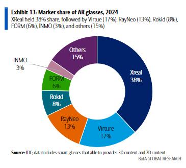
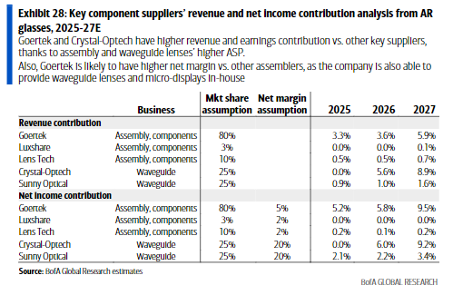
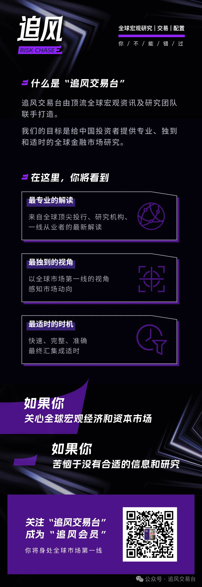

# Meta的AR眼镜要来了，供应链收益远高于AI眼镜

- 页面显示时间：2025-09-16T15:03:34+08:00
- 页面署名：李笑寅
- 标注来源：未单列，见正文
- 原文：[华尔街见闻](https://wallstreetcn.com/articles/3755665)
- 取得时间：2026-11-04T16:04:06+08:00
- [HTML阅读版](article.html) · [来源记录](metadata.json)

## 导语

美银估算，一副AI眼镜的物料清单（BOM）成本目前约为150美元，而一副双目AR眼镜的BOM成本则在400美元至1000美元以上，高成本主要源于光学波导和微显示器两项组件。预计到2030年智能眼镜组件的市场规模将从2024年的不足10亿美元飙升至140亿美元以上，核心光学组件供应商最有望受益。

---

继Ray-Ban联名智能眼镜系列后，Meta即将在9月17日至18日的Connect大会上推出其备受期待的首款消费级AR眼镜 ——Meta Celeste（内部代号Hypernova）。

据追风交易台消息，美银分析师Katherine Zhu及其团队近日发布研报称， **AR眼镜的物料清单（BOM）成本是AI眼镜的数倍，预计将从2027年左右开始为硬件供应链解锁一个规模远超以往的市场。**

美银预测，随着市场重心从AI设备转向AR体验，消费电子硬件的供应链格局将被重塑，预计智能眼镜组件的市场规模将从2024年的不足10亿美元，飙升至2030年的超过140亿美元。

具体而言，虽然组装厂在由AI眼镜驱动的第一波浪潮中率先受益，但长期且利润更丰厚的增长将由AR眼镜的核心组件供应商捕获， **尤其是那些在光学波导和微显示器等高价值领域占据技术优势的企业，这正为以中国厂商为主的供应链打开全新的、利润可观的收入来源。**

## **AI眼镜先行，Meta引领短期增长**

在AR眼镜技术成熟之前，市场将首先由AI眼镜驱动。

报告指出，AI眼镜凭借其时尚易戴的设计、便捷的第一人称视角（POV）内容创作以及AI辅助功能，正获得越来越多消费者的青睐。以Meta与雷朋合作的Ray-Ban Meta为例，该产品在2024年的出货量已超过200万副，并预计到2026年将超过1500万副。

目前市场上的AI眼镜通常不带显示功能，主要集成摄像头、音频、处理器和电池，设计更接近传统眼镜，重量普遍在40至50克之间。其核心应用在于听音乐、拍照录像和接收AI推送的音频信息。

报告预测， **在2025年至2027年间，AI眼镜将贡献整个智能眼镜市场90%以上的销量。** 除了Meta，根据报告核查，三星和苹果也计划在2026年推出类似Ray-Ban Meta的AI眼镜产品，进一步推动市场普及。

## **AR眼镜接棒，物料成本增至3倍以上**

**真正的市场变革将在2027年后到来，届时AR眼镜将逐步取代AI眼镜成为增长主动力。**

与AI眼镜不同，AR眼镜通过显示功能，可以实现导航、实时翻译、信息提示等更具互动性的应用，被视为智能眼镜的终极形态。

这种功能飞跃的代价是高昂的硬件成本。据报告估算， **一副AI眼镜的BOM成本目前约为150美元，而一副双目AR眼镜的BOM成本则在400美元至1000美元以上。**

报告指出，成本差异主要来自两大新增的核心组件：光学波导（Waveguide）和微显示器（Micro-display）。这两项组件分别占到AR眼镜BOM成本的35%-50%和30%-40%。

报告预测，随着技术瓶颈被突破、规模化生产提升良率 **，AR眼镜的平均BOM成本有望在2030年降至400美元左右，届时其市场出货量占比将超过50%** 。

Meta已在积极布局，除了计划于2025年下半年推出的单目全彩AR眼镜，还打算在2026年推出采用不同技术路径的双目AR眼镜。此外，亚马逊、字节跳动和阿里巴巴也正在开发相关产品。

## **中国供应链主导，核心组件厂商迎长期利好**

报告特别强调， **智能眼镜供应链中超过80%的供应商来自中国，预计到AR眼镜时代，这些厂商的收益将更为显著。**

报告表示，AI眼镜阶段，由于其硬件附加值相对较低，对供应链的收入贡献有限。组装厂如歌尔股份（Goertek）因其高市场份额（预计占全球AI眼镜组装份额的80%）和一站式服务能力，在短期内受益最为明显。

长期看，随着市场转向高价值的AR眼镜， **真正的长期赢家将是核心光学组件的供应商。**

- **歌尔股份** ：凭借其在波导、微显示器到整机组装的垂直整合能力，在AR眼镜时代仍将是核心受益者。报告预计，到2027年，AR眼镜业务有望为其贡献9.5%的净利润。

- **水晶光电** ：作为Meta几何波导方案的潜在供应商，其来自AR眼镜的收入和盈利贡献预计将从2025年的几乎为零，增长到2027年的9%左右。

- **舜宇光学** ：作为摄像头模组和衍射波导的领先供应商，其来自智能眼镜的收入贡献预计到2027年将增长至4%，盈利贡献则达到6%。

\~\~\~\~\~\~\~\~\~\~\~\~\~\~\~\~\~\~\~\~\~\~\~~

以上精彩内容来自[追风交易台](https://mp.weixin.qq.com/s/uua05g5qk-N2J7h91pyqxQ)。

更详细的解读，包括实时解读、一线研究等内容，请加入【 [**追风交易台▪年度会员**](https://wallstreetcn.com/shop/item/1000309) 】

风险提示及免责条款

市场有风险，投资需谨慎。本文不构成个人投资建议，也未考虑到个别用户特殊的投资目标、财务状况或需要。用户应考虑本文中的任何意见、观点或结论是否符合其特定状况。据此投资，责任自负。
