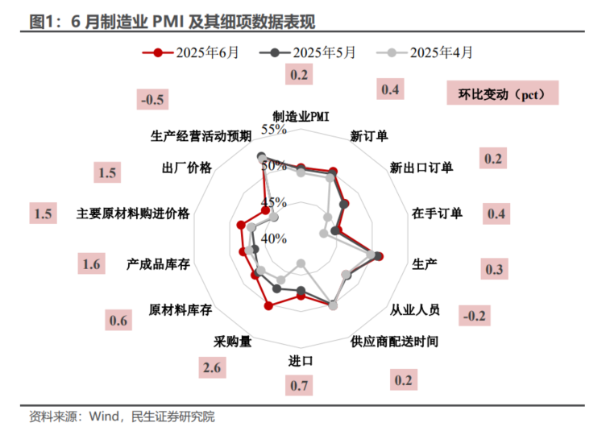
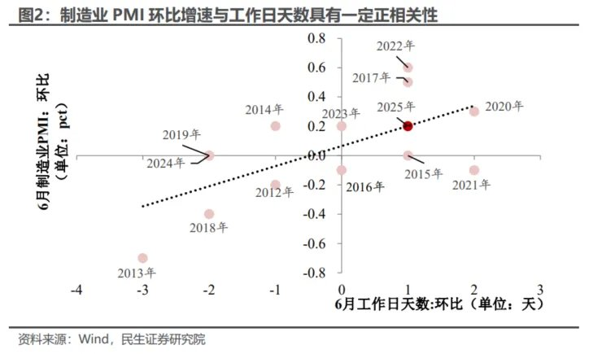
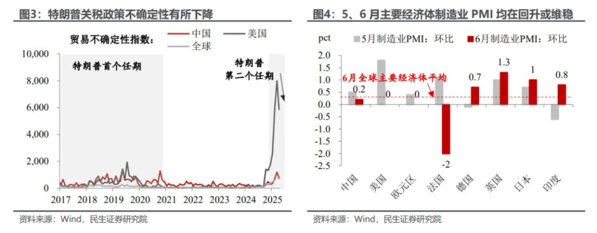
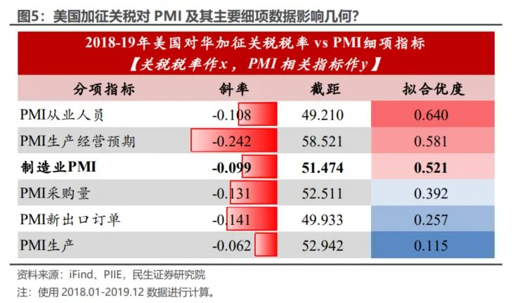
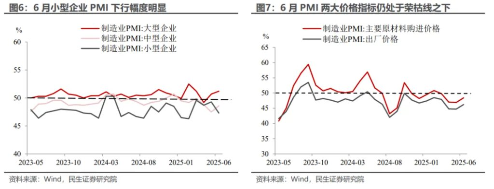
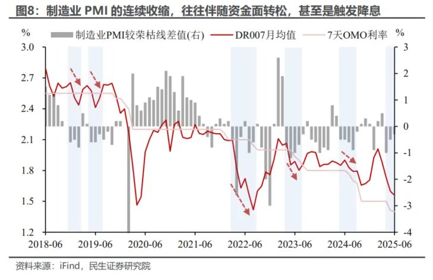
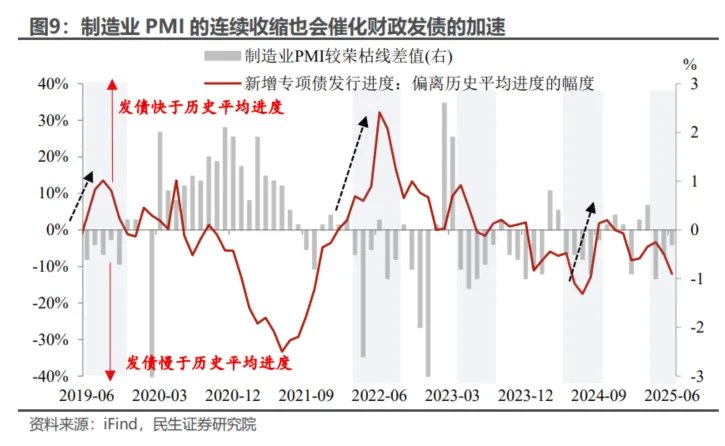
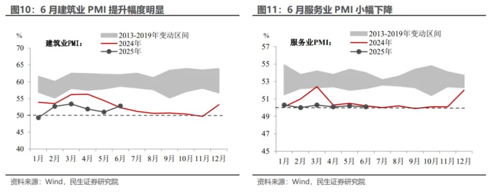

# PMI稳住了吗？

- 页面显示时间：2025-06-30T14:37:56+08:00
- 页面署名：龙玥
- 标注来源：民生证券陶川等
- 原文：[华尔街见闻](https://wallstreetcn.com/articles/3750088)
- 取得时间：2026-11-04T16:03:27+08:00
- [HTML阅读版](article.html) · [来源记录](metadata.json)

## 导语

民生证券认为，6月制造业PMI连续第二月回升，受益于工作日增多及全球贸易不确定性暂缓，产需及新出口订单均改善。鉴于PMI连续三个月处于荣枯线下，叠加服务业PMI微降，后续货币宽松与财政（专项债提速、基建发力）等增量政策呵护的必要性显著增强。

---

**在经历中美贸易风险的阶段性缓释后，制造业PMI成功迎来了“两连升”。** 6月制造业产需两端均在持续复苏，尤其是PMI生产指数与PMI新订单指数均在50%以上，同时PMI新出口订单指数也在小幅提升。然而这一趋势是否可持续？下半年制造业PMI是否能站回荣枯线以上，还是会重新挑战“关税风波”下的4月PMI低点？我们可以结合工作日天数、海外其他主要经济体PMI、我国自身PMI的细项数据表现这三个视角，对6月PMI进行剖析：

**以工作日天数来看，6月“工作量”更占优势。** 根据以往制造业PMI的运行规律，工作日天数增加将提高PMI环比上升的可能性，反之亦然。今年6月工作日天数比5月更多，自然也会抬高6月PMI的读数。根据历史趋势来看，今年6月工作日的增多对PMI的拉动影响，恰好符合工作日天数与制造业PMI之间的正相关性。

**以外部环境来看，外部不确定性减弱，缓释PMI下行压力。** 特朗普关税政策不确定性下降，对于全球PMI也是件“好事”——5、6月全球大部分主要经济体制造业PMI均在回升或维稳，中国PMI也同样处于“普涨”浪潮中。

**不过，仍处于荣枯线之下的6月PMI说明经济的结构性风险仍存：**

第一，6月工作日天数增多对PMI的拉动基本符合规律、对工作日天数与制造业PMI之间的正相关性相符，6月PMI的上升幅度并未超预期（即并未处于图2虚线以上）。

第二，对比其他国家6月PMI表现来看，中国制造业PMI的上升幅度其实谈不上强劲（图4）。

第三，从PMI自身来看，虽然6月PMI大多细项指数均在回升，但是PMI新出口订单指数水平依旧偏低，同时PMI从业人员指数及PMI生产经营活动预期指数不升反降，说明关税反复的不确定性正通过影响企业投资决策、向内需传导。参考2018年来看，美国加征关税对PMI从业人员指数以及PMI生产经营预期指数的负面影响，可能要更大、更久一些。

**在出口不确定性影响下，小型企业景气度扰动较大。** 从不同规模来看，6月大、中、小型企业PMI分别为51.2%、48.6%、47.3%（环比增速分别为+0.5pct、+1.1pct、-2.0pct），相较之下小型企业的景气度回升滞后。

**此外，PMI两大价格指标回升幅度受限，经济运行压力仍存。** 6月PMI两大价格指标虽然均在回升，但是其PMI数值都还低于荣枯线。在关税不确定性仍存的背景之下，企业定价能力还是受到一定影响，导致PPI增速的明显改善还面临一定压力。

**制造业PMI已连续三个月处于荣枯线之下，更易触发货币及财政的“呵护”。** 货币方面，我们在此前的报告《7月流动性会更松吗？》便提示过，当制造业PMI连续三个月（或以上）跌入收缩区间，资金面往往会转松，有时甚至会触发总量货币政策调整。

**财政方面，根据历史经验来看，PMI连续三个月（或以上）处于荣枯线之下，新增专项债发行进度也更易提速。**

**6月服务业PMI的表现也将为增量政策的推出“埋下伏笔”。** 对比之下，6月建筑业PMI景气度提升幅度更为明显，6月建筑业PMI录得52.8%（环比+1.8pct），结合发改委审批固投项目金额处于历史同期高点来看，建筑业PMI的好转预告着后续基建项目建设情况的改善。 **不过6月服务业PMI小幅下降，录得50.1%（环比增速-0.1pct），增量政策的适时推出必要性加强。**

本文来源于：川阅全球宏观，作者：陶川 钟渝梅，原文标题：《PMI稳住了吗？》

风险提示及免责条款

市场有风险，投资需谨慎。本文不构成个人投资建议，也未考虑到个别用户特殊的投资目标、财务状况或需要。用户应考虑本文中的任何意见、观点或结论是否符合其特定状况。据此投资，责任自负。
