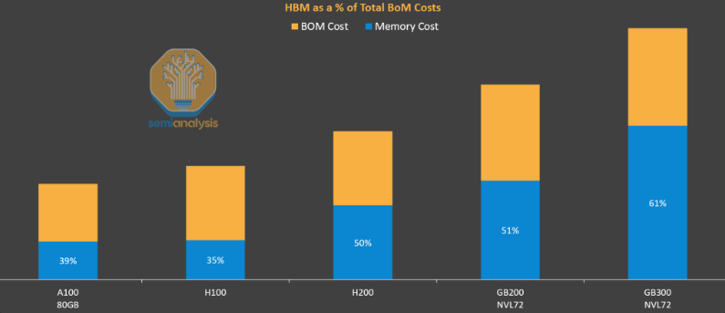
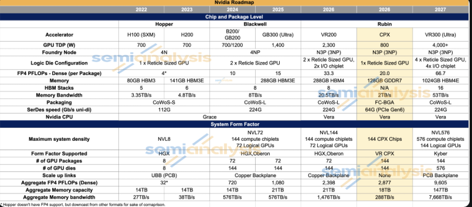
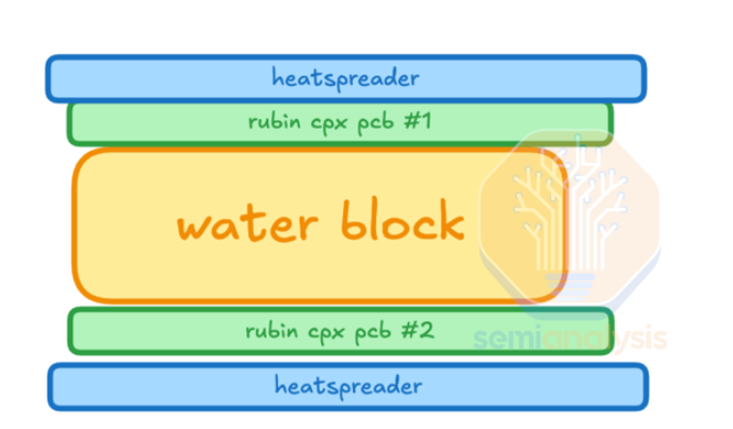
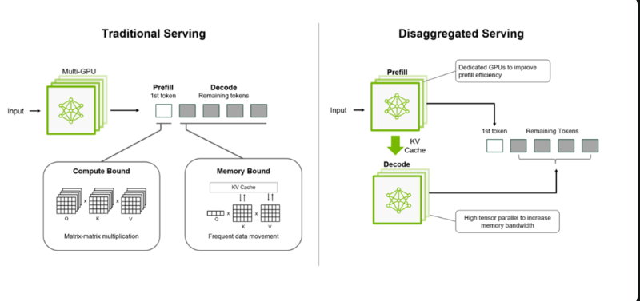
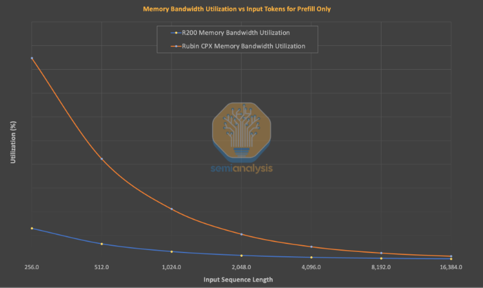
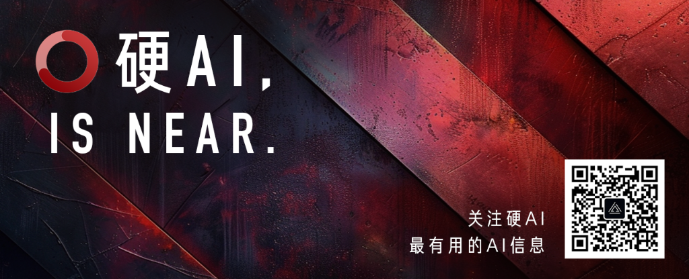

# SemiAnalysis详解英伟达新芯片“Rubin CPX”：彻底改变推理架构，重塑行业路线图

- 页面显示时间：2025-09-16T20:28:29+08:00
- 页面署名：赵颖
- 标注来源：硬AI
- 原文：[华尔街见闻](https://wallstreetcn.com/articles/3755680)
- 取得时间：2026-11-04T16:04:00+08:00
- [HTML阅读版](article.html) · [来源记录](metadata.json)

## 导语

SemiAnalysis报告指出，Rubin CPX的推出，其重要性仅次于2024年3月GB200 NVL72 Oberon机架级形态的。该芯片通过专门优化预填充阶段，强调计算FLOPS而非内存带宽。这可能导致HBM需求下降，GDDR7内存需求激增，三星成为最大受益者。此外，英伟达竞争对手或将不得不再次重新配置他们的整个路线图，就像Oberon架构改变了整个行业的路线图一样。

---

随着AI大模型“推理时代”的全面到来，英伟达最新推出Rubin CPX GPU，智库SemiAnalysis认为该GPU或将彻底改变推理领域，发布意义仅次于2024年3月GB200 NVL72机架。

[近期](https://wallstreetcn.com/articles/3755301)英伟达在AI基础设施峰会上重磅推出的Rubin CPX GPU，专为长语境推理设计，英伟达还承诺实现约50倍的惊人投资回报率，远超此前GB200 NVL72约10倍的回报率。

这一发布不仅仅是英伟达自身的进步，更是对整个行业路线图的重塑。 **正如SemiAnalysis报告所强调的，Rubin CPX的推出，其重要性仅次于2024年3月GB200 NVL72 Oberon机架级形态的。** 该芯片通过专门优化预填充阶段，强调计算FLOPS而非内存带宽，为分离式推理服务带来革命性变化。

**这一发布还将迫使英伟达所有竞争对手重新制定路线图。** AMD和ASIC供应商此前投入大量资源追赶英伟达的机架级解决方案，但现在必须再次加倍投资开发自己的预填充芯片，进一步延迟缩小与英伟达差距的时间。

SemiAnalysis的报告提供了对Rubin CPX的详尽洞察，揭示了这款芯片如何通过优化推理的不同阶段，重塑行业路线图。以下是报告要点：

## 突破内存墙限制：专用芯片架构设计

根据SemiAnalysis介绍，英伟达推出Rubin CPX的核心理念在于将推理过程解耦为“预填充（Prefill）”和“解码（Decode）”两个阶段，并为每个阶段设计了专业化的硬件。

报告指出，LLM请求的预填充阶段（生成第一个Token）通常是计算密集型（FLOPS）的，但对内存带宽的利用率较低。

**尽管HBM对训练和推理都极具价值，但在推理的具体执行过程中，其利用效率存在显著差异，HBM仅在解码步骤中发挥高价值作用。在这种情况下，使用配备昂贵HBM的芯片进行预填充是一种资源浪费。**

**而Rubin CPX正是为解决这一痛点而生，它“瘦身”了内存带宽，转而强调计算FLOPS。** Rubin CPX拥有20 PFLOPS的FP4密集计算能力，但仅配备了2TB/s的内存带宽和128GB的GDDR7内存。相比之下，双芯片R200提供33.3 PFLOPS的FP4密集计算能力和20.5TB/s的内存带宽以及288GB的HBM。

- 

这将带来成本效益的显著提升，SemiAnalysis报告指出，将HBM切换为更便宜的GDDR7内存，每GB成本可降低50%以上。这意味着，在预填充阶段，Rubin CPX能够以远低于R200的成本，提供高效的计算能力，从而大幅降低总体拥有成本（TCO）。

SemiAnalysis指出，该芯片设计类似于下一代RTX 5090或RTX PRO 6000 Blackwell，使用大型单片式芯片和512位宽GDDR7内存接口。但与基于消费者Blackwell GPU芯片仅有其HBM版本20% FLOPS不同，Rubin CPX的比例跃升至60%，因为它将是更接近R200计算芯片的独立流片设计。

## 全新机架级架构：三种部署方案

英伟达推出三种Vera Rubin机架配置：VR200 NVL144（仅Rubin）、VR200 NVL144 CPX（Rubin+Rubin CPX混合）、以及Vera Rubin CPX双机架方案，具体来看：

> - **NVL144 CPX机架：**  英伟达推出了VR NVL144 CPX（Vera Rubin NVL144 CPX）机架，将Rubin GPU与Rubin CPX GPU整合。每个计算托盘（Compute Tray）将包含4个R200 GPU（用于解码）和8个Rubin CPX GPU（用于预填充）。这种异构配置使得系统能同时高效处理推理的两个阶段。
> - **双机架解决方案：**  Vera Rubin CPX双机架方案提供了更大的灵活性，允许客户根据自身工作负载需求，单独部署VR NVL144（纯Rubin GPU）机架和VR CPX（纯Rubin CPX GPU）机架，以精确调整预填充与解码的比例（PD ratio）。

SemiAnalysis详细分析了无线缆设计的技术革新。由于高密度设计无法为线缆布线留出空间，英伟达采用PCB中板和Amphenol Paladin板对板连接器实现信号传输。CX-9网卡从机箱后半部分移至前半部分，使200G以太网/InfiniBand信号传输距离缩短，而较低速度的PCIe Gen6信号承担更长距离传输， **提高了可靠性和可维护性。**

液冷采用夹层式液冷设计，Rubin CPX和CX-9网卡采用夹层式设计，共享液冷冷板，最大化了1U托盘空间内的GPU密度和散热效率，这种设计在英伟达2009年的GTX 295上曾有类似实践。

## 预填充流水线并行：高效利用资源的关键

**Rubin CPX的另一个重要优势在于其对预填充流水线并行（Pipeline Parallelism）的优化。**

> - 降低网络成本： 预填充阶段的通信需求较低，因此Rubin CPX放弃了昂贵的快速横向扩展网络（如NVLink）。PCIe Gen6 x16的带宽（约1Tbit/s）足以满足现代MoE LLM的预填充需求。
> - 更高的吞吐量： 流水线并行在每个GPU上提供更高的Token吞吐量，因为它涉及简单的发送和接收操作，而不是专家并行（EP）中的所有到所有集体操作。
> - 显著的TCO节省： NVLink横向扩展的成本约为每GPU 8000美元，占集群总成本的10%以上。Rubin CPX通过避免使用这些昂贵的网络设备，为最终用户带来了巨大的成本节省。

## 分离式推理服务的技术突破

SemiAnalysis介绍，业界首先尝试将预填充和解码请求路由到不同计算单元，以解决两种工作负载间的相互干扰问题。这种方法能更好地管理服务级别协议(SLA)，但仍存在"错误配置"问题——纯预填充操作几乎总是严重浪费内存带宽资源。

SemiAnalysis强调，LLM请求处理包含两个阶段：预填充阶段影响首令牌时间（TTFT），通常受计算限制；解码阶段影响每输出令牌时间（TPOT），总是受内存限制。

**分析显示，当序列长度超过32k时，FLOPS利用率达到100%，而内存带宽利用率下降。使用R200进行纯预填充操作时，每小时总拥有成本浪费达0.90美元，而Rubin CPX通过使用成本更低的内存显著降低了这种浪费。**

在管道并行推理中，Rubin CPX的PCIe Gen6 x16接口提供约1Tbit/s单向带宽，足以处理现代MoE前沿LLM的预填充任务。Rubin CPX提供更大内存容量，但使用的是"较低质量"的GDDR7内存，每GB成本不到HBM的一半。从内存供应商角度看，GDDR7利润率较低，因为技术要求不高且竞争更激烈(如Samsung可以供应)。

## HBM需求可能下降？整体内存市场需求将增长？

CPX系统的使用降低了HBM在总系统成本中的占比。对于VR200 NVL144 CPX或VR CPX机架的每一美元支出，相比独立VR200 NVL144机架，分配给HBM的比例更低。 **在AI系统支出固定的假设下，每美元支出的HBM需求将下降。**

进一步来看，SemiAnalysis报告表示， **英伟达Rubin CPX架构虽然降低了内存使用率，但反而可能推动整体内存市场规模扩大，GDDR7供应链格局面临重塑。**

技术现实更为复杂。 Rubin CPX的作用机制是降低预填充和令牌的成本。当令牌成本降低时，需求随之增加，这意味着解码需求也会相应上升。与许多其他降低成本的技术创新类似，需求的增长通常会超过成本的下降，最终推动整体市场规模扩大。

Rubin CPX对GDDR7的需求激增，正在重塑内存供应链格局，其影响已经开始显现。值得关注的是，RTX Pro 6000同样使用GDDR7内存，但速度较低，为28Gbps。英伟达已经为RTX Pro SKU下达了大规模供应链订单。

**在这轮GDDR7需求激增中，三星成为最大受益者。** 由于能够满足英伟达突然涌现的大批量订单需求，这些订单主要流向了三星。相比之下，SK海力士和美光科技未能满足这一需求，主要原因是它们的晶圆产能被HBM订单等其他业务占用。

## 竞争对手被远远甩在身后

SemiAnalysis报告表示，Rubin CPX的引入，令英伟达的机架系统设计能力与竞争对手之间的差距达到了“峡谷”级别。

英伟达所有竞争对手或将不得不再次重新配置他们的整个路线图，就像Oberon架构改变了整个行业的路线图一样。他们需要再次加大投资，开发自己的预填充芯片，这将进一步延迟他们缩小与英伟达差距的时间。

SemiAnalysis认为，Google TPU凭借3D环形扩展网络优势，支持最大9216个TPU的集群规模，应开发预填充专用芯片维持性价比优势。

AMD的追赶策略面临重大挑战，MI400 72 GPU机架级系统原本有望在TCO方面与VR200 NVL144竞争，但英伟达将VR200内存带宽提升至20.5TB/s，与MI400持平。如果MI400的实际FP4性能与VR200 NVL144相当或更低，AMD将再次落后于英伟达。

**据SemiAnalysis评估，AMD缺乏强大的内部工作负载支撑，需要在开发机架级系统和改进软件的同时，再开辟预填充专用芯片战线，才有望在2027年追上英伟达。**

AWS Trainium3和Meta MTIAv4等拥有内部工作负载的供应商具备开发预填充专用芯片的优势。但AWS面临技术挑战，因为1U计算托盘空间有限，可能需要采用EFA网卡侧车机架和外部PCIe AEC线缆的解决方案。

本文来自[微信公众号“硬AI”](https://mp.weixin.qq.com/s/2rfpVmedXuAVybneRhpkIg)，关注更多AI前沿资讯请[移步这里](https://mp.weixin.qq.com/s/2rfpVmedXuAVybneRhpkIg)

风险提示及免责条款

市场有风险，投资需谨慎。本文不构成个人投资建议，也未考虑到个别用户特殊的投资目标、财务状况或需要。用户应考虑本文中的任何意见、观点或结论是否符合其特定状况。据此投资，责任自负。
