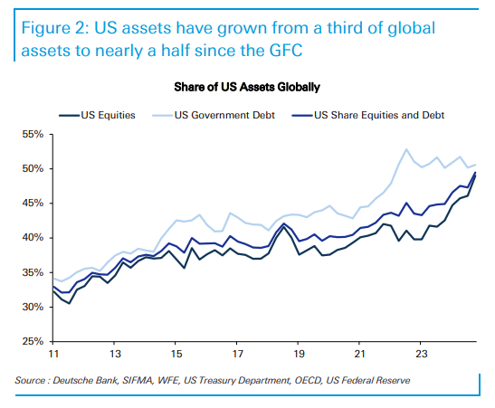
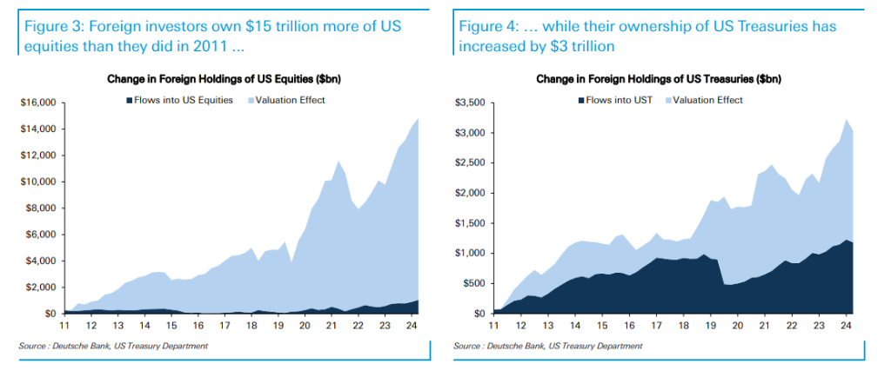
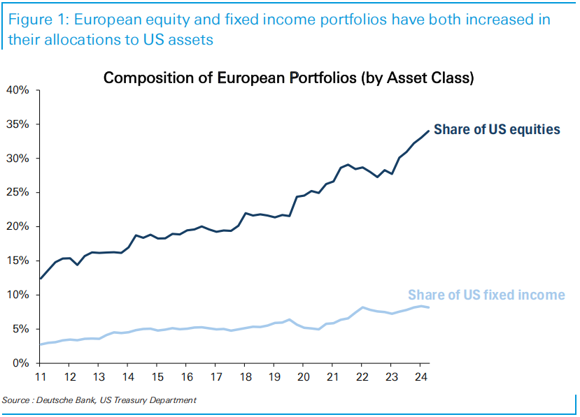

# “去美元化”大潮下，外资持有多少美元资产？

- 页面显示时间：2025-04-16T17:36:40+08:00
- 页面署名：房家瑶
- 标注来源：未单列，见正文
- 原文：[华尔街见闻](https://wallstreetcn.com/articles/3745320)
- 取得时间：2026-11-04T16:03:24+08:00
- [HTML阅读版](article.html) · [来源记录](metadata.json)

## 导语

德意志银行最新研究显示，外国投资者持有约18.4万亿美元的美国股票和7.3万亿美元的美国债券，尤其是欧洲和日本投资者过去十五年里大幅增配美元资产。德银警告称，随着外国投资者增加对美国资产的配置，其外汇风险敞口也显著上升，部分机构甚至完全不对冲外汇风险，这种美元超配状态若逆转，可能对美元汇率和全球金融市场造成显著冲击。

---

全球对美国资产的超配到底有多严重？

美东时间4月15日，德意志银行发布研报称，自金融危机以来，美股和美债在绝对规模、全球金融资产占比均显著提高。

根据SIFMA和世界交易所联合会数据，截至2024年第四季度，美国上市股票市值超过60万亿美元，占全球上市股票的50%，较2011年占比三分之一大幅增长。类似的趋势也出现在债市，仅美债就占OECD国家政府债务的50%。

其中，外国投资者持有约18.4万亿美元的美国股票和7.3万亿美元的美国固定收益资产。自2010年以来，美国债券市场的外国持仓增加了约3万亿美元，几乎翻倍。而美国股市的外国持仓增长了15万亿美元，增幅高达六倍。令人惊讶的是，这一增长的90%来自美国资产价值的升值，而非新资金的流入。

德银警告称，随着外国投资者增加对美国资产的配置，其外汇风险敞口也显著上升，部分机构甚至完全不对冲外汇风险，这种美元超配状态若逆转，可能对美元汇率和全球金融市场造成显著冲击。

## 欧洲和日本配置比例飙升

从地区来看，欧洲和日本在过去十五年里大幅增加了对美国资产的配置。具体来说，欧洲对美国资产的配置比例从2010年的5%跃升至2024年的20%，增长了四倍，而日本的这一比例也从7%增长至14%。

对于美国股票，欧洲投资者的配置比例已经从2011年的约10%增长至现在的35%。对美国国债的配置比例也从不到3%增长至接近10%。相比之下，日本对美国股票的持有比例翻倍，从8%增长至16%，但增长幅度不及欧洲，且与美国股票市场的总规模相比，日本的持股比例变化较小。

日本对美国国债的持有比例变化较复杂，尽管自2015年以来有所上升，但增长速度不及美国国债的供应量，导致其在美国国债市场中的占比逐渐下降。

## 外汇风险敞口上升

值得警惕的是，随着外国投资者对美国资产配置的增加，外汇风险敞口也悄然上升。

根据报告，来自日本、瑞典和欧元区的数据表明，外国投资者在美国资产的外汇风险敞口非常高。例如，瑞典的公共养老金基金等大型投资机构，对美元的敞口处于十年来的最高水平，部分机构甚至完全不对冲外汇风险。

这意味着，外国投资不仅暴露在美国资产的风险中，还面临汇率波动的风险。如果投资者认为美国的贸易政策未来将发生结构性转变，从而削弱美国股市的独特性，可能会增加对非美国市场的配置，这将在短期到中期内对美元产生压力。德银警告称：

> "我们的分析得出结论，外国投资者美元配置持续向历史正常水平回归，有可能产生巨大的负面美元资金流动。"

德银指出，外汇对冲的资金流动有时会比资产本身的变化还要大。举个例子，如果外国投资者的对冲比例增加1%，就可能导致2600亿美元的美元卖出量，这几乎等于过去两年美国债券和股票流入总量的大小。

风险提示及免责条款

市场有风险，投资需谨慎。本文不构成个人投资建议，也未考虑到个别用户特殊的投资目标、财务状况或需要。用户应考虑本文中的任何意见、观点或结论是否符合其特定状况。据此投资，责任自负。
