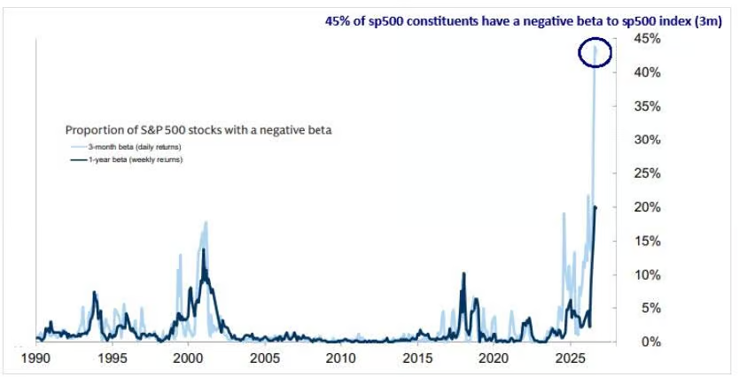
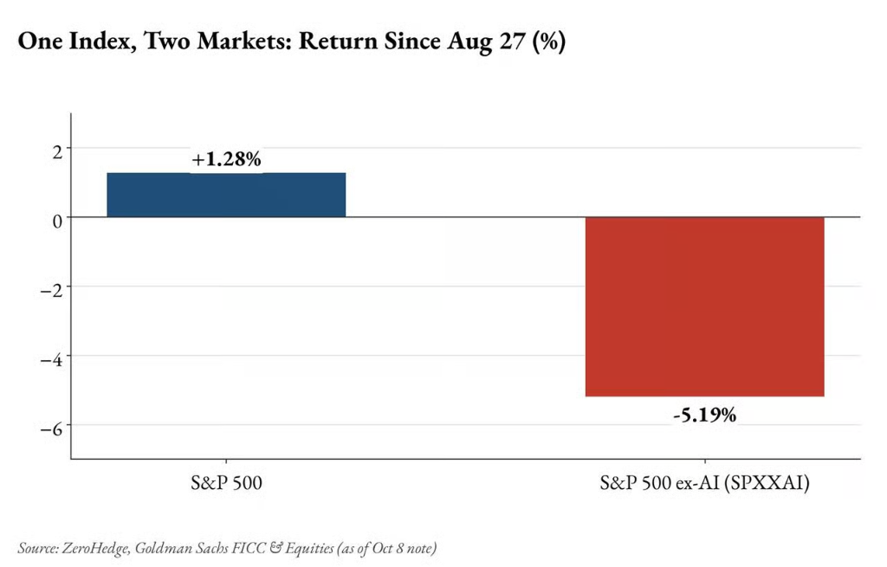
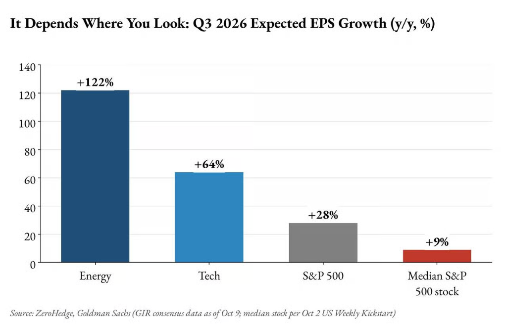
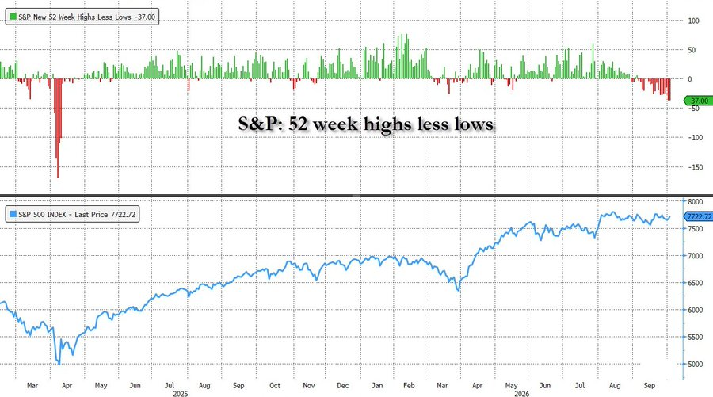

# “只剩一笔交易”的美股牛市

- 页面显示时间：2026-10-11T10:40:04+08:00
- 页面署名：卜淑情
- 标注来源：未单列，见正文
- 原文：[华尔街见闻](https://wallstreetcn.com/articles/3783355)
- 取得时间：2026-11-04T16:03:46+08:00
- [HTML阅读版](article.html) · [来源记录](metadata.json)

## 导语

高盛对冲基金负责人警告，当前美股涨势"基本上只是一笔大交易"——AI，指数屡创新高，但市场广度持续恶化，约六分之一标普500成分股较高点回撤逾50%。叠加利率持续攀升，多头的防线只剩下英伟达与美光能否在即将到来的财报季兑现预期。高盛虽维持看多立场，但已不再确信美股未来5%的上涨空间。

---

美股正站在一个令人不安的高点：指数创历史新高，但支撑它的只有一个主题。

高盛对冲基金覆盖业务负责人Tony Pasquariello在最新客户报告中坦承， **当前美股涨势"基本上只是一笔大交易"——人工智能。** 他维持看多美股的主基调，但措辞明显趋于谨慎， **不再愿意断言未来5%的方向向上** 。与此同时，高盛数据显示， **标普500成分股中约有六分之一已较高点回撤逾50%，而指数本身距历史高点仅一步之遥** 。

这一分裂格局正在引发市场对集中度风险的深层担忧。利率持续攀升、市场广度恶化、仓位向AI板块极度集中，多重压力信号同时亮起，而 **多头的防线只剩下英伟达与美光能否在即将到来的财报季兑现预期** 。

## 极度分化：一场只在特定角落成立的牛市

标普500指数本周一度触及7818点的历史新高，随后因OpenAI营收预警消息回落至7765点。表面上，牛市旗帜仍在飘扬，但内部结构已高度扭曲。

高盛同事Brian Garrett统计的数据揭示了这一分裂的深度： **过去三个月，标普500约45%的成分股与指数本身呈负相关，这一比例创历史新高。**

高盛的Adrien Simonet进一步量化：自8月27日以来，标普500整体上涨1.28%，而剔除AI相关股票后的"标普500 ex-AI"（SPXXAI）则下跌5.19%，两者之间的滚动30日差距接近AI交易自2023年1月启动以来的最大值。

与此同时，罗素2000指数在过去20个交易日中有16个交易日跑输纳斯达克，落后幅度约9个百分点。 **Pasquariello将这场行情定性为"极度狭窄的上涨"——美国大型科技股如火车头般狂奔，而利率敏感型和周期性板块则持续承压。**

## 仓位"干净"，但风险集中于一处

尽管指数处于历史高位，市场整体仓位却出人意料地偏低。高盛Prime Book数据显示，9月份对冲基金对美股的净敞口处于1年、3年和5年低位；基本面多空策略的净杠杆率连续三周下滑，降至去年特朗普公布对等关税以来最低水平；高盛情绪指标也徘徊在多年低点附近。

Pasquariello的解读是： **低配美股本身已成为一笔拥挤的交易，对于那些担心错过标普500冲上8100点的机构而言，看涨期权的成本相对低廉。**

然而，低净敞口并不等于低风险，因为总敞口依然高企，且残余仓位被极度集中在同一个方向。

9月份， **科技股是对冲基金唯一净买入的板块，买入规模为2025年2月以来最大。**

高盛Prime Book数据显示，"Mag 7"净敞口目前约占美股总敞口的22%，为2022年初有记录以来的历史最高值；半导体仓位占比达12%，较年初翻倍。Simonet补充指出，杠杆半导体ETF资产规模已达约1150亿美元，一旦市场下行，将产生机械性的放大效应。

周四，在OpenAI消息冲击后，高盛TMT交易台在半导体、AI及大型科技股方向录得逾10亿美元净卖出，已是一次小规模预演。

## 盈利增长亮眼，但高度依赖少数公司

财报季即将开启，Pasquariello抛出第三个论点：面对标普500同比28%的盈利增长预期，谁愿意做空？这一数字较上周的27%预测还在上修。

但这同样是一个"取决于看哪里"的故事。

高盛Ben Snider的Q3盈利预览显示 **，标普500中位数股票的盈利增速已从Q2的14%放缓至Q3的9%。按板块拆分，科技板块增速高达64%，能源板块更达122%。**

高盛的Wilson测算，本季度标普500盈利增长的68%将由前10大贡献者贡献，高于上季度的48%；其中仅美光和英伟达两家公司就占据了这68%的一半。更值得关注的是，高盛27%的全年盈利增速预测在其自身模型中已是本轮周期高点，此后三个季度将逐季放缓；超大规模云计算商（hyperscaler）的资本开支增速（Snider估计为116%）也可能在本季度见顶。增速高点与资本开支高点同步到来，叠加股价和持仓均处于历史极值，这种组合往往在事后才被描述为"早有预兆"。

## 利率从逆风升级为系统性风险

这是Pasquariello措辞变化最显著的部分。 **十天前，他将利率上行定性为股市的"逆风"，但明确排除了"破坏性"的可能。而在最新报告中，他的表述升级为：利率上行正在成为主权债务和企业债务的"更大风险"。**

市场数据印证了这一转变。周四，30年期美债拍卖得标利率达5.618%，为2000年8月以来最高；10年期美债收益率收于5.23%。高盛经济学家预计，"Warsh美联储"在9月加息至3.75%-4%后，将于12月再度加息。高盛的Rikin Shah测算，10年期收益率108个基点的抛售中，有98个基点来自实际利率，30年期实际收益率3.33%已接近2010年以来的区间上沿。他的结论是：美债市场正在寻找两个临界点之一——AI融资需求开始对利率敏感的水平，或者经济中其他环节率先断裂的水平。

在企业信用层面，高盛信用策略师指出，美元投资级信用债年初至今回报率为-292个基点，并重点关注面临贷款到期再融资压力的软件发行商。高盛经济学家估算，当前利率水平可能通过住房、消费和资本开支渠道，在2027年拖累经济增长0.5个百分点。

Simonet的警示尤为直接：期限溢价冲击不会区分AI故事的优劣，它会同时对所有十年期现金流重新定价。他认为真正的左尾风险，是美联储被迫超预期加息以维护长端信誉，而CPI数据将是近期的触发器。

## 牛熊两面，同一个赌注

Pasquariello在报告中引用了一位他显然颇为敬重的投资者的话，这也是他认为全文最重要的一句：

> **"你知道吗，这基本上只是一笔大交易。"**

他没有反驳。将六项判断并排审视——趋势、仓位、盈利、利率、集中度——会发现它们不过是同一个观察的不同侧面：趋势向上，因为AI；仓位偏低，但AI除外；盈利增长，靠的是AI及其能源需求；利率上行，部分原因是AI的融资需求。牛市和熊市的论据，都指向同一个标的。

Pasquariello还提出了一个"科技与能源并驾齐驱"的友好视角：过去11年中，两个板块各半的组合有10年录得正收益，年均回报18.7%，夏普比率1.2。但这同样是在描述同一笔交易及其能源约束。

## 季节性与中期选举：最后一道变量

Pasquariello的第六项判断相对简短：Q4季节性规律较为有利，但他预计11月3日的中期选举将带来一波波动。

高盛的Alec Phillips指出， **预测市场给予民主党夺回众议院的概率超过90%，参议院为65%，通用选票领先优势达8.9个百分点，"横扫"已成为市场的基准情景。**

与此同时，VIX周四收于15.4，但高盛波动率交易台报告称，当天有买家在约6小时内买入约1000万美元vega的年底标普500看跌期权。有人正在为"友好的季节性"买保险。

## 一个出口的市场

Pasquariello最终给出三点结论：牛市成立，但取决于你看哪里，近期风险回报不明朗，建议"注意速度限制"；坚守两匹最快的马——美国和日本；以及用做多股票搭配做空利率的组合来对冲。

这一对冲策略本身耐人寻味：如果持有股票的建议是同时做空债券，那么实际上是在说两者将同步下跌，而"做空利率"只有在收益率继续上行时才能盈利——而这恰恰是那85%已深度回撤的成分股最难承受的，也终将成为另外15%的融资成本压力。

多头情景需要美光和英伟达兑现业绩，需要超大规模云计算商资本开支不见顶，需要美联储止步于两次加息，还需要有人愿意在5.6%的收益率水平接盘长债。空头情景只需要其中一项落空。

一笔大交易，上涨时固然美好。但它的定义，也意味着整个市场只有一个出口。

风险提示及免责条款

市场有风险，投资需谨慎。本文不构成个人投资建议，也未考虑到个别用户特殊的投资目标、财务状况或需要。用户应考虑本文中的任何意见、观点或结论是否符合其特定状况。据此投资，责任自负。
