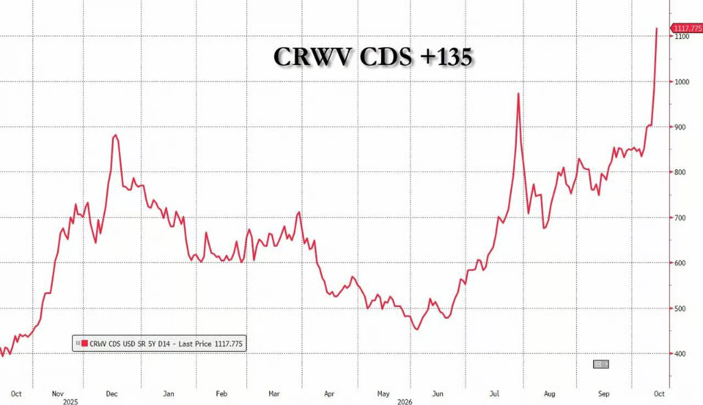
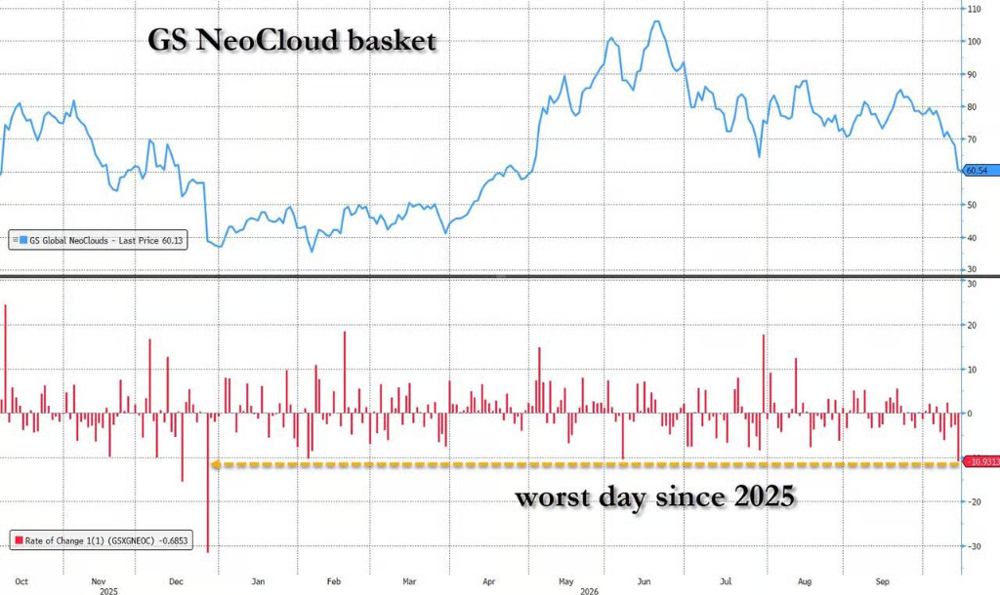

# “超八成新云厂商将出局”！机构警告：一旦CoreWeave违约，行业将迎来一场灾难

- 页面显示时间：2026-10-15T15:20:13+08:00
- 页面署名：许超
- 标注来源：未单列，见正文
- 原文：[华尔街见闻](https://wallstreetcn.com/articles/3783693)
- 取得时间：2026-11-04T16:03:20+08:00
- [HTML阅读版](article.html) · [来源记录](metadata.json)

## 导语

AI算力租赁行业正经历估值重构。CoreWeave单日暴跌15.5%，五年期CDS利差飙至1117个基点，隐含违约概率高达63%；Gartner警告，2030年前逾八成新兴云厂商将无法独立存续，行业面临减值风险资产超3.5万亿美元。超支与回报之间4.9万亿美元的剪刀差，正将这场AI盛宴推向信用危机边缘。

---

AI算力租赁行业正面临一场严峻的估值重构。信用市场对CoreWeave违约风险的定价持续飙升，知名研究机构Gartner警告，预测逾八成新兴云计算服务商（neocloud）将在2030年前无法独立存续。

CoreWeave周三收跌15.5%，报65.78美元，盘中跌幅一度达17%，创上市以来最大单日跌幅纪录。公司五年期信用违约互换（CDS）利差扩大135个基点至历史新高1117个基点，隐含五年内违约概率约为63%。CoreWeave首席执行官Michael Intrator在一份内部备忘录中将市场反应归咎于"误判"，称公司对自身商业模式充满信心——然而备忘录发出后，CDS利差反而继续走阔至上述纪录水平。

Gartner的报告为本已动荡的市场再添变量。该机构预计， **到2030年AI基础设施行业面临减值风险的资产规模将超过3.5万亿美元，并预测行业整体要到2032年底才有望达到12%的最低回报率门槛。**

## Gartner警告：八成新兴云厂商将被淘汰

Gartner在周三发布的报告中指出，到2030年，成本压力与缺乏差异化商业模式将迫使超过80%的neocloud提供商停止独立运营—— **这意味着每五家租用英伟达GPU的公司中，有四家将被并购或直接退出市场。**

Gartner预计，AI服务商仅2026年一年在AI基础设施上的支出就将接近1万亿美元，2027年至2030年间还将再投入约6万亿美元。然而， **该行业预期能够获得的收入远低于支撑这一规模投资所需的水平，两者之间存在约4.9万亿美元的缺口。**

Gartner同时预测，由于大多数AI原生公司采用轻资产模式，"不足一半的AI收入将流向拥有重大AI基础设施的提供商"。

具体到neocloud所在的AI优化基础设施即服务（IaaS）赛道，其市场规模预计从2027年的660亿美元增长至2030年的1740亿美元—— **Gartner认为，在现有芯片被更新一代替代之前，这一体量对于大多数AI算力提供商而言仍"不足以收回投资"。**

值得注意的是，Gartner今年6月曾预测neocloud将在2030年的2670亿美元AI云市场中占据20%的份额。 **两份预测并不矛盾：市场蛋糕变大了，但能分到蛋糕的玩家会大幅减少。**

## 超支与回报的剪刀差：行业结构性困局

CoreWeave的财务状况清晰呈现了整个行业的结构性矛盾。

截至6月末，公司总债务约为520亿美元，较一年前的约150亿美元大幅攀升。第二季度利息支出从2.67亿美元跳升至6.4亿美元，约占当季25.8亿美元营收的四分之一，同期净亏损达6.26亿美元。

D.A. Davidson分析师Gil Luria将问题浓缩为一句话： **CoreWeave的借款成本约为9%，而其投资回报率仅约为1%。他警告称，一旦AI支出热潮降温，"股权价值将归零"。**

高盛估算得出的结论类似：六大美国科技支出商2026至2027年的算力投资，仅2028年至2030年间便需产生约1.4万亿美元的收入方能收回成本，折合每吉瓦每年约116亿美元， **行业所承诺的收入规模，是当前终端需求所能实际消化的数倍。**

## 信用市场的警报：从CoreWeave蔓延至整个行业

信用市场拉响的警报早于股票市场。

CoreWeave的12.5亿美元2032年到期无担保债券收益率周二触及15%，随后在周三进一步走阔，CDS利差达到1117个基点的历史高位。

这场压力已蔓延至更广泛的AI融资生态。据高盛跨资产部门的报告，单个交易日内宏观信用利差出现数月来最大扩张：甲骨文CDS利差走阔31个基点，超大规模云厂商现金债券利差走阔4至5个基点，数据中心债券利差走阔7个基点， **高收益AI数据中心债券的表现与CoreWeave高度联动。**

## 底线：整合或许已是最乐观的情境

卖方机构或将Gartner的80%淘汰预测解读为行业整合的积极信号——强者吸收弱者，幸存者以折价获取GPU，AI建设大潮继续推进。

这是一条可能的路径。然而，在CDS市场已将这一行业旗舰企业五年内违约概率定价逾六成的背景下， **更大概率的路径是：整合以资产减值、困境交换和重组顾问登门的形式到来，Gartner预测的3.5万亿美元减值风险或将提前兑现。**

摩根大通市场情报部门周三仍维持对半导体板块"战术性看多"立场，认为存在"逢低买入的潜在机会"， **但同时将"AI相关信贷事件"与"利差扩大"列为当前主要风险，且其中一项已在当日成真。AI行业的融资逻辑正在接受市场最严格的压力测试。**

风险提示及免责条款

市场有风险，投资需谨慎。本文不构成个人投资建议，也未考虑到个别用户特殊的投资目标、财务状况或需要。用户应考虑本文中的任何意见、观点或结论是否符合其特定状况。据此投资，责任自负。
