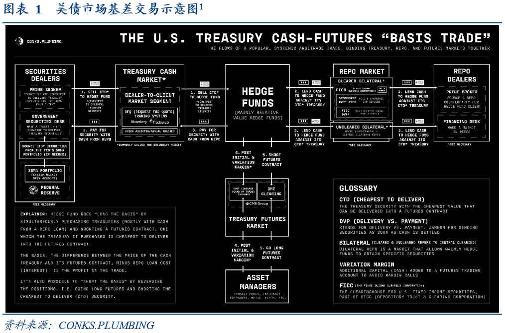
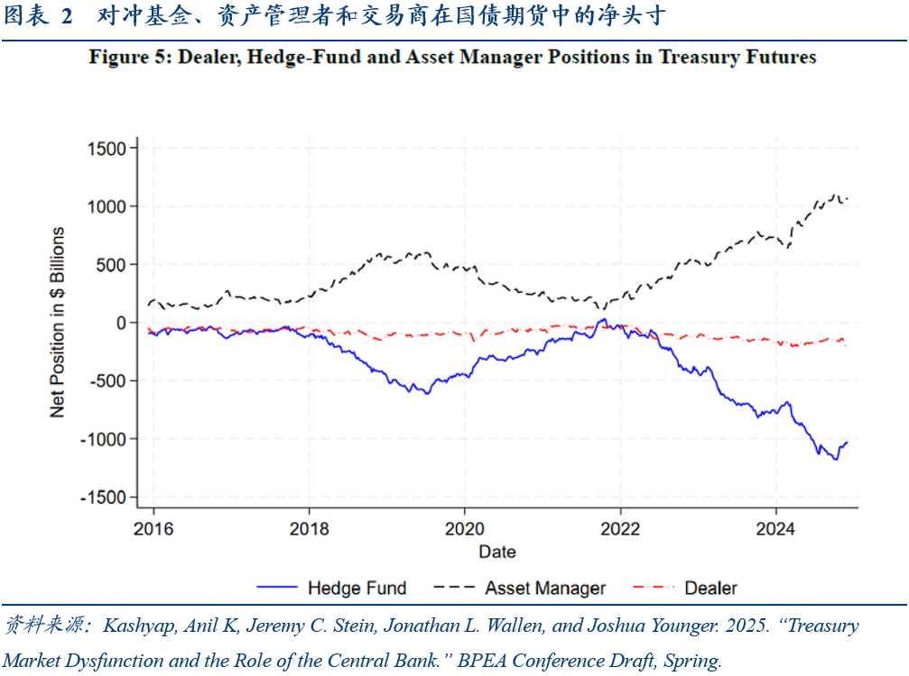
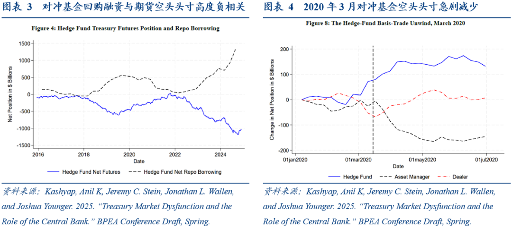
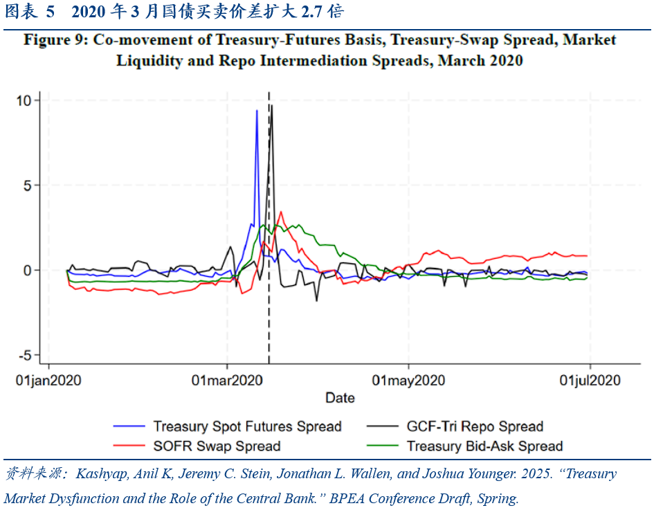
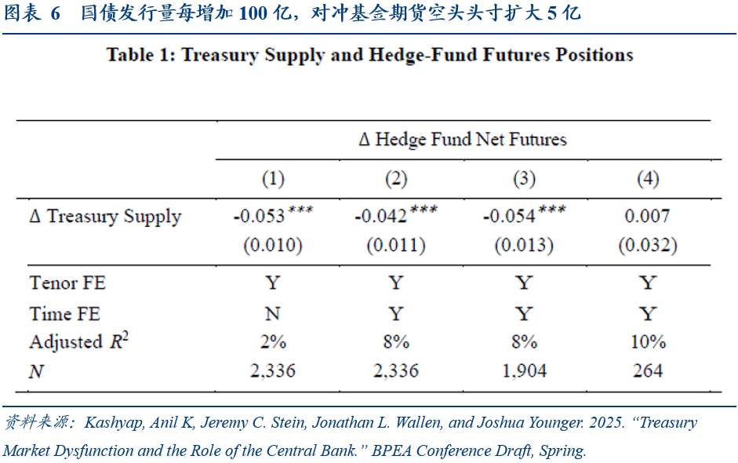

# 一文读懂隔夜美债崩盘的“罪魁”——基差交易

- 页面显示时间：2025-04-09T13:39:46+08:00
- 页面署名：李笑寅
- 标注来源：华创证券张瑜
- 原文：[华尔街见闻](https://wallstreetcn.com/articles/3744871)
- 取得时间：2026-11-04T16:02:16+08:00
- [HTML阅读版](article.html) · [来源记录](metadata.json)

## 导语

华创证券张瑜认为，对冲基金通过高杠杆进行国债现券-期货的基差交易，是市场脆弱性的主要来源。随着国债供应持续增长，对冲基金基差头寸同样持续增长，任何外部冲击可能引发更严重的流动性危机。

---

> **编者按：** 隔夜美债再度上演大跳水，10年期美债收益率一夜暴涨11个基点至4.3%，在美股大幅回调之际，美债收益率却罕见大幅上涨，这一反常现象背后的重要原因之一就是：基差交易。
>
> 那么，什么是基差交易？基差交易为何会引发暴跌？4月1日，华创证券张瑜发布了题为《对冲基金基差交易引发美债市场脆弱性担忧》的研报，详细解释了何为基差交易、基差交易如何影响美债市场及其可能的潜在风险。

**核心观点**

1）随着国债供应持续增长，对冲基金基差头寸同样持续增长，任何外部冲击可能引发更严重的流动性危机。2）美国国债市场的脆弱性来源于三个方面，即对冲基金高杠杆基差交易、经纪交易商缓冲能力有限以及国债供应增长加剧脆弱性。其中，对冲基金通过高杠杆进行国债现券-期货基差交易，是市场脆弱性的主要来源。3）尽管调整杠杆率、提高初始保证金等传统政策工具可以改善美债市场脆弱性，但是仍有诸多局限。相比传统政策工具，Kashyap et al.（2025）建议美联储在购买国债的同时，通过卖空期货对冲利率风险，保持久期中性。这种操作仅提供流动性支持，且不改变货币政策立场

**报告摘要**

**一、对冲基金基差交易引发美债市场脆弱性担忧**

布鲁金斯学会的专家建议，美联储应考虑设立一项紧急计划，一旦规模达29万亿美元的美国国债市场发生危机，该计划将平仓高杠杆的对冲基金交易。

**（一）什么是美债市场基差交易？**

基差（Basis）指的是现货市场（国债现券的价格）和期货市场（国债期货价格）之间的价差。在美债市场中， **基差交易通常是指利用国债现券与国债期货之间的价格差异进行套利的策略。** 基差交易的目标是通过买入低估的一方（现货或期货）并卖出高估的一方，在价差收敛时获利。

**（二）美债基差交易主要参与者？**

根据Kashyap et al.（2025） **，美债基差交易中有三大参与者，即资产管理者（Asset Manager）、对冲基金（Hedge Fund）以及经纪交易商（Dealer）。** 资产管理者的衍生品需求推高基差，吸引高杠杆对冲基金套利，而交易商受限于资本约束，在压力时期无法充分吸收平仓冲击，导致市场功能恶化。

**（三）为什么担忧基差交易风险？**

**美国国债市场的脆弱性来源于三个方面，即对冲基金高杠杆基差交易、经纪交易商缓冲能力有限以及国债供应增长加剧脆弱性。** 其中，对冲基金通过高杠杆进行国债现券-期货基差交易，是市场脆弱性的主要来源。此外，国债供应的持续增加将促使对冲基金在国债-期货基差交易中持有更大的杠杆头寸。

**（四）如何应对基差交易的风险？**

**传统政策工具的局限性。** 尽管调整杠杆率、提高初始保证金等传统政策工具可以改善美债市场脆弱性，但是仍有诸多局限，包括无法解决基差交易的根本脆弱性、无法应对资本冲击驱动的平仓、无法消除周期性保证金上调的放大效应、对市场流动性危机的缓解作用有限等。

**对冲式购买的四大优势。** 相比传统政策工具，美联储在购买国债的同时，通过卖空期货对冲利率风险，保持整体久期中性。这种操作仅提供流动性支持，不改变货币政策立场，且具备四大优势，包括明确区分市场功能与货币政策、无需预设退出时间表、降低利率风险暴露以及缓解道德风险等。 

**报告正文**

## 一、对冲基金基差交易引发美债市场脆弱性担忧

根据彭博新闻报道，布鲁金斯学会的专家建议，美联储应考虑设立一项紧急计划，一旦规模达29万亿美元的美国国债市场发生危机，该计划将平仓高杠杆的对冲基金交易。本周报对这一话题进行探讨。

**（一）什么是美债市场基差交易？**

基差（Basis）指的是现货市场（国债现券的价格）和期货市场（国债期货价格）之间的价差。在美债市场中，基差交易通常是指利用国债现券与国债期货之间的价格差异进行套利的策略。由于国债期货的价格反映了对未来某一特定国债（“可交割债券”）的预期，而现货价格是当前实际交易的价格，两者之间往往存在微小但可利用的差异。

基差的具体定义为：基差=现货价格-期货价格×转换因子（Conversion Factor）。其中，转换因子是期货合约用来标准化不同可交割国债的工具，因为国债期货允许交付多种符合条件的国债。基差交易的目标是通过买入低估的一方（现货或期货）并卖出高估的一方，在价差收敛时获利。

**（二）美债基差交易主要参与者？**

根据Kashyap et al.（2025），美债基差交易中有三大参与者，即资产管理者（Asset Manager）、对冲基金（Hedge Fund）以及经纪交易商（Dealer）。资产管理者的衍生品需求推高基差，吸引高杠杆对冲基金套利，而交易商受限于资本约束，在压力时期无法充分吸收平仓冲击，导致市场功能恶化。

**1、资产管理公司**

作为“真实资金”投资者（如养老基金、保险公司、债券基金），资产管理公司是基差交易中唯一主动承担利率风险（久期风险）的主体。其核心动机是通过组合现券与衍生品实现久期匹配，同时优化资产负债表。

具体来看，1）现券持有，即直接购买长期国债，承担利率波动风险；2）衍生品使用，即通过期货或利率互换延长久期，节省资产负债表空间以投资公司债等高收益资产。资产管理者对期货的净多头需求推高期货价格，压低期货隐含收益率，导致基差扩大，吸引对冲基金和经纪交易商入场套利。

**2、对冲基金**

对冲基金通过现券-期货基差交易套利，即买入现券（Long Cash Treasuries）同时做空等久期期货（Short Futures），赚取基差收益。对冲基金的融资方式是通过回购市场以高杠杆融资获得现券头寸，仅需少量自有资本。3、经纪交易商 经纪交易商则有着双重角色，即做市与套利。其中，日内做市是指提供现券买卖流动性，赚取买卖价差，而基差套利是指持有现券多头并做空期货，但需完全对冲利率风险，套利收益为基差。当对冲基金平仓时，交易商被迫吸收现券头寸，挤占做市资本，导致买卖价差和回购利差同步扩大。

**3、经纪交易商**

经纪交易商则有着双重角色，即做市与套利。其中，日内做市是指提供现券买卖流动性，赚取买卖价差，而基差套利是指持有现券多头并做空期货，但需完全对冲利率风险，套利收益为基差。当对冲基金平仓时，交易商被迫吸收现券头寸，挤占做市资本，导致买卖价差和回购利差同步扩大。

**（三）为什么担忧基差交易风险？**

根据Kashyap et al.（2025），美国国债市场的脆弱性来源于三个方面，即对冲基金高杠杆基差交易、经纪交易商缓冲能力有限以及国债供应增长加剧脆弱性。 其中，对冲基金通过高杠杆进行国债现券-期货基差交易，是市场脆弱性的主要来源。

**1、对冲基金高杠杆基差交易**

**对冲基金基差交易的核心机制是，对冲基金通过回购融资高杠杆持有国债现券，并通过卖空期货对冲利率风险，形成“现券-期货基差交易”。** 由于保证金比例较低，对冲基金仅需少量资本即可持有大规模头寸，依赖短期融资滚续。

但是，高杠杆基差交易存在明显的脆弱性：一是保证金上调，即市场波动时，期货交易所可能提高初始保证金，导致对冲基金被迫追加抵押品；二是回购融资断裂，即交易商中介能力受限时，对冲基金面临融资成本飙升或断贷风险。

回顾2016-2024年间的历史数据，对冲基金回购融资规模与期货空头头寸高度负相关。此外，2020年3月，我们看到对冲基金在美国国债期货中的空头头寸急剧减少。具体来说，在3月3日至17日的短暂间隔内，对冲基金空头头寸减少了620亿美元，而对冲基金的回购融资证券也出现了类似的下降。

**2、经纪交易商缓冲能力有限**

**经纪交易商通过做市（提供流动性）和套利（吸收基差）实现维持市场的功能，但受到监管约束（补充杠杆比率）的限制。** 由于经纪交易商需在做市、基差套利、回购中介间分配有限资本，压力时期被迫收缩业务。例如，2020年3月，经纪交易商吸收对冲基金抛售的570亿美元现券，但导致做市能力下降，国债买卖价差扩大了2.7倍。

**3、国债供应增长加剧脆弱性**

**国债供应的持续增加将促使对冲基金在国债-期货基差交易中持有更大的杠杆头寸。** 资产管理者（Asset Manager）需通过期货延长久期，推高对冲基金（Hedge Fund）以及经纪交易商（Dealer）的套利需求。根据Kashyap et al.（2025）的实证结果，国债发行量每增加100亿，对冲基金期货空头头寸扩大5亿。

**（四）如何应对基差交易的风险？**

**1、传统政策工具的局限性**

**根据Kashyap et al.（2025），尽管调整杠杆率、提高初始保证金等传统政策工具可以改善美债市场脆弱性，但是仍有诸多局限。** 具体来看，1）调整杠杆率可缓解交易商压力，但实证表明其效果有限（Cochran et al.,2023），且无法解决基差交易的根本脆弱性。2）扩大回购工具覆盖范围允许非银机构（如对冲基金）直接使用美联储回购工具可改善融资压力，但无法应对资本冲击驱动的平仓（如保证金上调或投资者赎回）。3）设定最低保证金要求通过提高初始保证金可抑制杠杆，但无法消除周期性保证金上调的放大效应，且需动态调整监管规则以应对压力情景。4）中央清算虽能通过跨保证金降低基差交易成本，但无法阻止由资本冲击引发的强制平仓，对市场流动性危机的缓解作用有限。

**2、对冲式购买的四大优势**

**相比传统政策工具，Kashyap et al.（2025）建议美联储在购买国债的同时，通过卖空期货对冲利率风险，保持整体久期中性。** 这种操作仅提供流动性支持，不改变货币政策立场。且具备四大优势：1）明确区分市场功能与货币政策，避免2020年量化宽松混淆政策目标的教训，防止市场误读利率信号；2）无需预设退出时间表，可根据市场恢复情况灵活平仓；3）降低利率风险暴露，避免美联储因持有未对冲国债而承担潜在损失；4）缓解道德风险，对冲操作不会创造“Fed Put”，减少对冲基金过度冒险的动机。

 本文作者：华创证券张瑜，来源：[一瑜中的](https://mp.weixin.qq.com/s?__biz=MzI3NTUyMDkzMw==&mid=2247594171&idx=6&sn=385340dd08b0f56bef414a69bca21c61&chksm=ea7e3a287581693934960d6283abe4220c7aff6ab7c62f40661d43784e8bde529fa6c291297b&scene=0&xtrack=1#rd)，原文标题：《对冲基金基差交易引发美债市场脆弱性担忧——海外周报第84期》，华尔街见闻有所删减

风险提示及免责条款

市场有风险，投资需谨慎。本文不构成个人投资建议，也未考虑到个别用户特殊的投资目标、财务状况或需要。用户应考虑本文中的任何意见、观点或结论是否符合其特定状况。据此投资，责任自负。
