# 上半年的A股：哪些历史规律已经打破，哪些历史规律即将被打破？

- 页面显示时间：2026-07-01T11:21:19+08:00
- 页面署名：龙玥
- 标注来源：未单列，见正文
- 原文：[华尔街见闻](https://wallstreetcn.com/articles/3775922)
- 取得时间：2026-11-04T16:03:42+08:00
- [HTML阅读版](article.html) · [来源记录](metadata.json)

## 导语

旧地图找不到新大陆。广发证券刘晨明团队梳理了上半年A股已被打破的六条历史规律——连续三年提估值、AI主线走牛第四年、电子持仓超20%不见顶、TMT成交占比突破40%至45%、顺周期博弈政策拐点逻辑失效等。判断下半年市场大概率进入存量博弈，AI与非AI业绩增速差将继续扩大；顺周期投资逻辑已从博弈政策拐点转向确认真实业绩改善，储能、铜、创新药、券商等方向需基本面支撑而非政策博弈。

---

一个新时代到来时，用旧地图找不到新大陆。

2026年上半年，全球股市走势极致分化，A股同样如此，AI vs 非AI的定价裂口持续扩大。广发证券策略刘晨明团队在6月30日发布的2026年中期策略报告中指出，这背后是A股第一次真正参与并见证的全球通用技术创新——其量级可类比蒸汽机、电力、计算机革命，而非过去二十年A股经历过的消费电子、半导体或新能源周期。

规律，正在被打破。

那些在过去二十年反复被验证、被引用的规律，本质上是对“过去二十年中国经济与股市结构”的总结。但那个结构，已经变了——地产周期谢幕，人口红利越过峰值，A股的利润和市值结构已发生根本性变化。

当然，并非所有规律都该抛弃。有一类经验依靠“第一性原理”，即从事物运行的最本质逻辑出发得出的结论，这类规律当下仍然有效。最典型的就是： **决定A股风格走向的，是相对盈利优势，而不是别的任何变量。**

## **已经打破的六条规律**

**第一条：A股从未连续三年提估值。**

历史上，估值连续两年抬升出现过三次：2006-07年、2014-15年、2019-20年。但2024-2026年，A股已经连续三年提估值。这条规律，打破了。

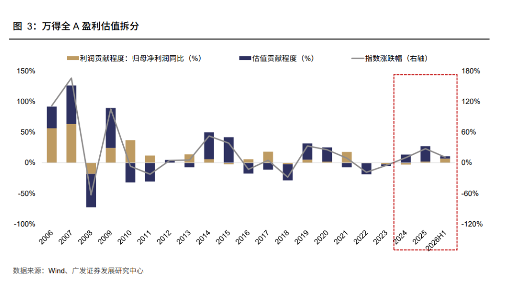

**第二条：“事不过三”——行业很少连续领涨超三年。**

历次A股牛市主线，最长持续约2到2.5年。但本轮电子、通信已连续走牛至第四年，AI主线从2024年9月起算，仍未见景气拐点。

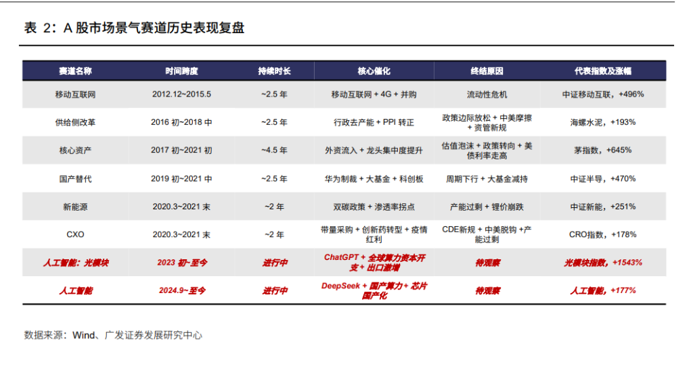

**第三条：机构对单行业持仓达到20%，基本见顶。**

2004年以来的6次历史案例，20%的集中度几乎都对应行业股价高点。但电子行业自2025年一季度持仓接近20%，至今已过五个季度，股价持续走强。

这背后有个关键细节：电子持仓绝对比例达到20%，但如果扣除行业流通市值占比，当前的超配比例其实是历史上最低的一轮。新兴产业市值已今非昔比，对"机构抱团"的理解必须跟着变。

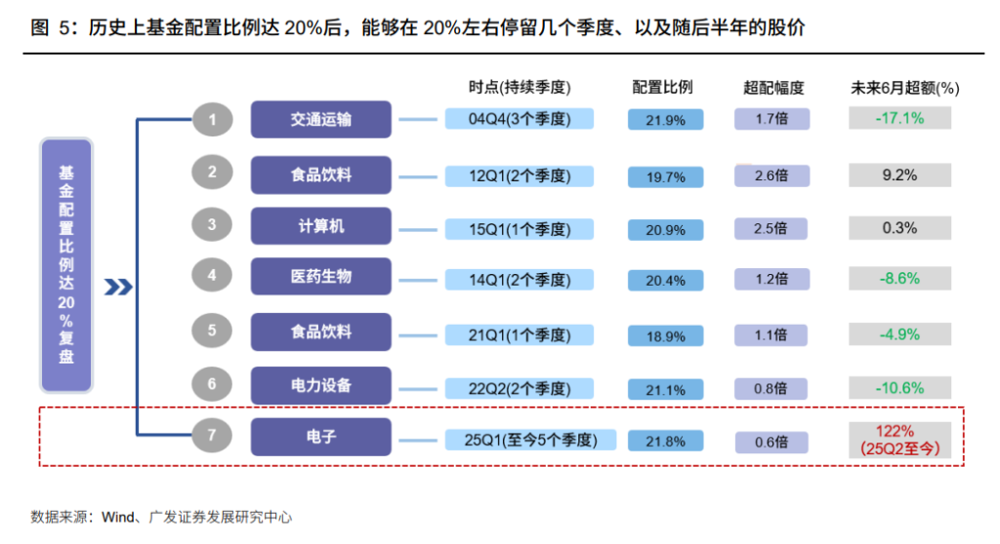

**第四条：单季度加仓最猛的行业，下季度必然跑输。**

通信板块自2025年二季度以来连续四个季度加仓位居前二，但之后四个季度超额收益分别是+31%、+14%、+10%、+37%。拘泥于这条规律，就完整错过了光模块的主升浪。

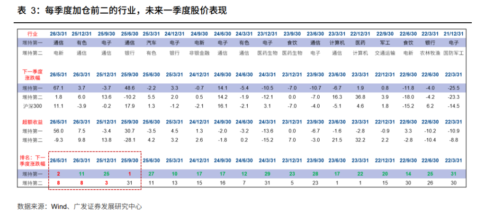

**第五条：TMT成交额占比上限是40%。**

这条规律在2019-2023年间极为准确，一度被用于板块择时。但DeepSeek问世后，上限已突破至45%，且有进一步上移的可能。

回溯来看，这个上限本来就是动态的：2009-10年智能手机周期顶部约17%，2013-15年移动互联网约30%，2019-24年初约40%，现在是45%。每一轮技术产业浪潮，都在系统性抬升这个中枢。

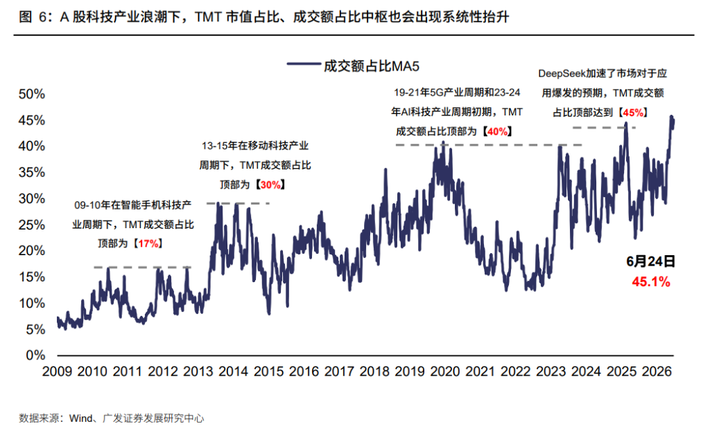

**第六条：库存周期触底，就该博弈政策拐点。**

过去二十年，这条逻辑高度可预测：库存同比跌至零附近，财政刺激必然跟进，顺周期板块集体受益，可预见性强。

但这次不一样。产成品库存同比增速在2023年6月便已滑落至历史低位，三年过去了，大规模财政刺激始终没有出现。这不是政策失灵，而是政策理念本身发生了转变——从"逢低必刺激"转向了更具定力的"战略克制"。

结果是：顺周期板块今年只有输入性通胀品种（即受全球商品价格带动的资源品）有所表现，内需相关品种涨幅不大。贝塔逻辑已经失效，必须切换到阿尔法逻辑——自下而上找真正有业绩改善的细分行业和公司。

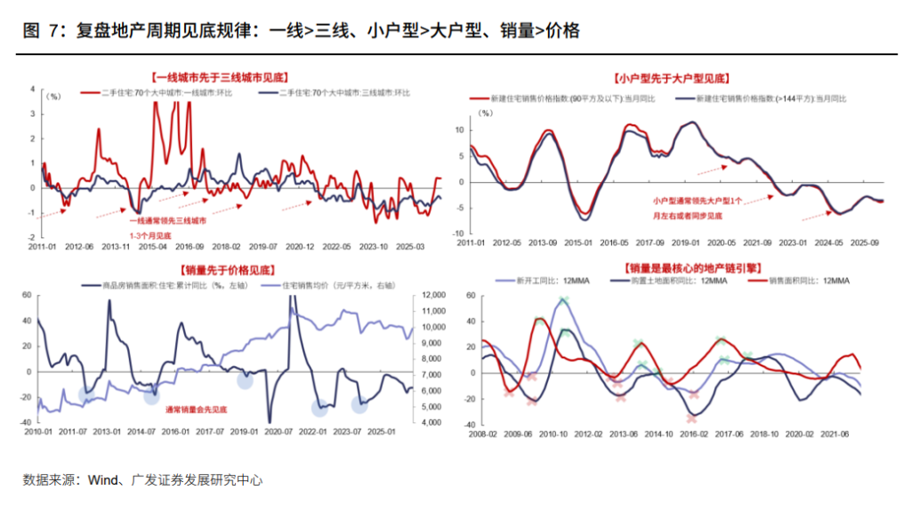

## **两条规律，正在被挑战**

除了已经打破的六条规律，还有两条正处于临界点。

**其一，A股前5%个股的成交集中度，正在逼近历史上限，可能还会继续突破。**

截至6月24日，前5%个股成交占比（20日均线）已达49.8%，逼近2015年和2021年的历史高点。

参照美股经验，这个上限并非不可突破。1990年代科网周期期间，美股前5%个股成交占比曾大幅突破此前二十年的阈值，目前仍维持在72%左右的高位。规律是：在外部出现重大技术变革的时刻，成交集中度的上限本身就会被重写。

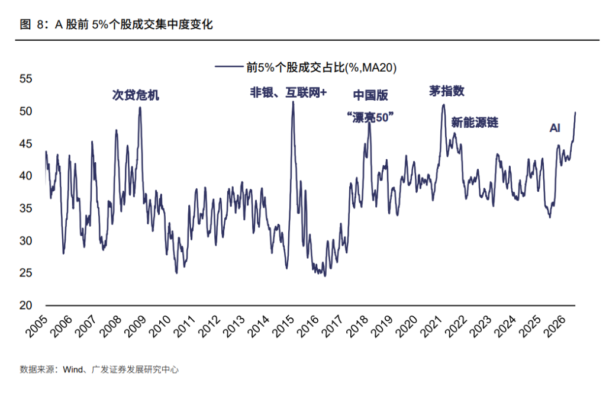

**其二，行业估值分化程度，已刷新历史最高水平。**

当前用行业PB历史分位数的标准差来衡量估值分化，数值已超过历史上任何一次。

很多人的直觉反应是：估值这么分化，一定会收敛，高估值板块要跌。但历史上6次极致分化的案例表明， **估值分化的峰值不等于牛市顶点** 。2020年7月离散度达到历史高位后，在高位持续了整整20个月。有产业趋势支撑的情况下，即便最终出现收敛，高估值行业也通常不会跑输。

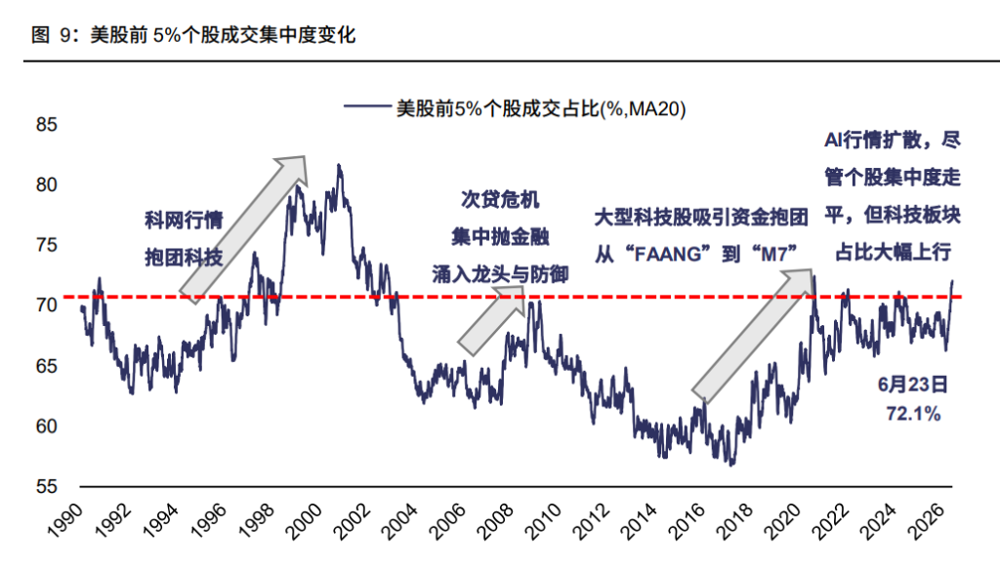

## **全球经济“K型”分裂，下半年会合拢吗？**

上半年A股的定价逻辑令人不安：营收增速排前10%的公司，年内平均涨幅超40%；而现金流好、股息高、估值低的公司，反而跌得更多。

这不是A股孤立的现象，而是全球经济"K型"分裂的映射。AI投资驱动下，制造业显著强于服务业；拥有AI产业链资产的国家和地区（美国、日本、韩国）景气持续上行；缺乏AI资产、服务业权重大的经济体则走弱。

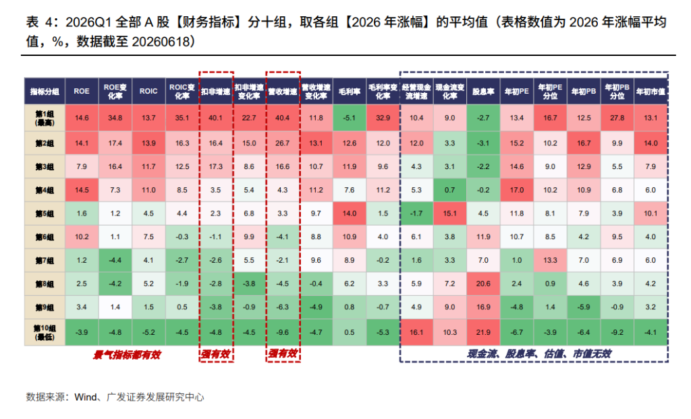

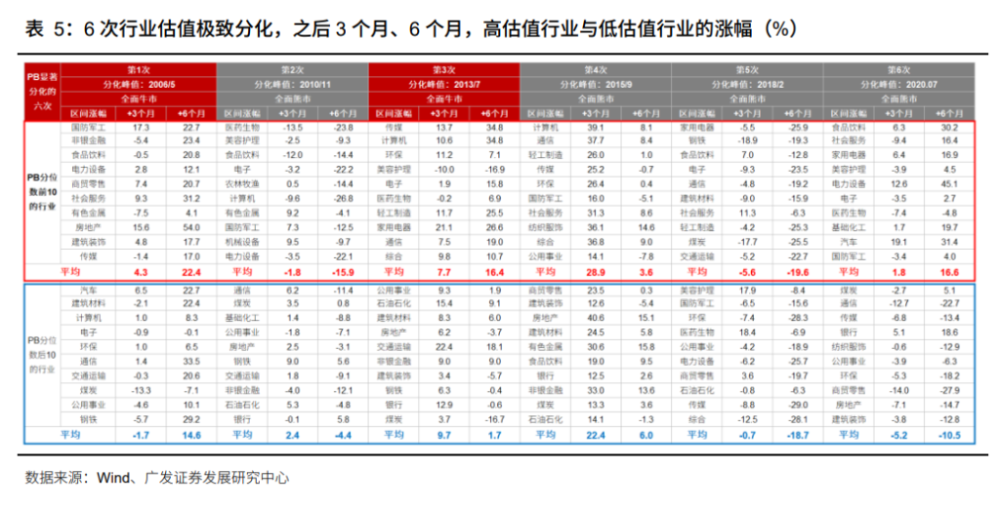

这种分裂，下半年会合拢吗？

答案取决于两端。

**K型上沿** ：AI产业景气仍无拐点迹象。全球大厂资本开支持续上修，Top5云厂商2026年合计CAPEX预计达7690亿美元，较年初预期再度上调。算力租赁价格持续创新高，H100租赁价已突破每小时2.8美元。豆包日均Token调用量6月突破180万亿，谷歌月耗Token量接近3000万亿。需求端不弱，而中游制造供给弹性极低（AI制造业供给响应需5-8个月，传统制造业只需1个月），短期需求波动根本动摇不了中游景气。

**K型下沿** ：中国财政保持定力，核心原因之一是外需给了"喘息空间"。当前中国主要出口国多处于财政扩张周期，全球在"替中国"承担需求扩张的功能，这延缓了国内逆周期政策发力的必要性。

因此，下半年国内政策是否会做重大调整，需持续跟踪两个变量： **全球主要经济体财政扩张的可持续性** ，以及 **海外库存周期的位置** ——一旦海外补库动能衰竭，外需支撑减弱，国内政策才可能真正加码。

货币政策方面，全面降息概率不大。银行净息差已降至1.40%的历史低位，欧洲央行6月已重启加息，汇率稳定形成硬约束，预计下半年以结构性工具为主。财政方面，1-5月支出端同比-0.3%，远低于预期，三季度可能托底补量，但以稳为主，不是全面刺激。

**利率上行会打断AI行情吗？** 历史上没有一个案例能证明这一点。复盘A股和美股中五段成长股行情（1999年科网、2023年AI、2013年移动互联、2017年供给侧、2021年新能源），每一段都经历过利率上行阶段，但只要产业EPS持续上修，利率扰动最终都是短暂的。当前AI产业EPS验证持续兑现，加息预期不改变中期趋势判断。

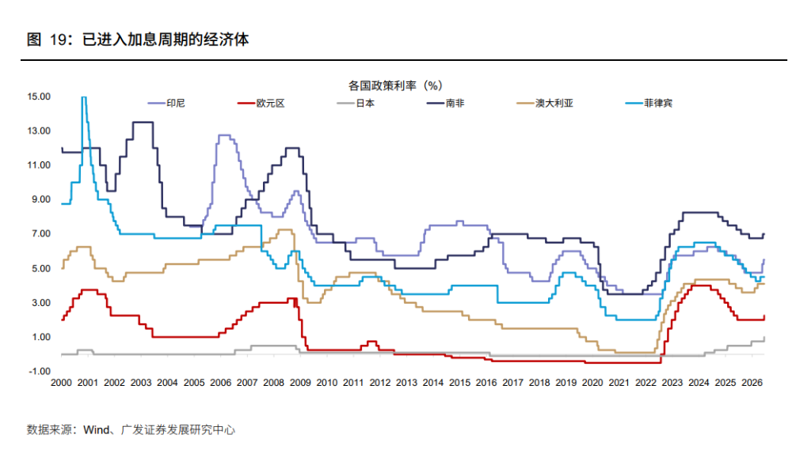

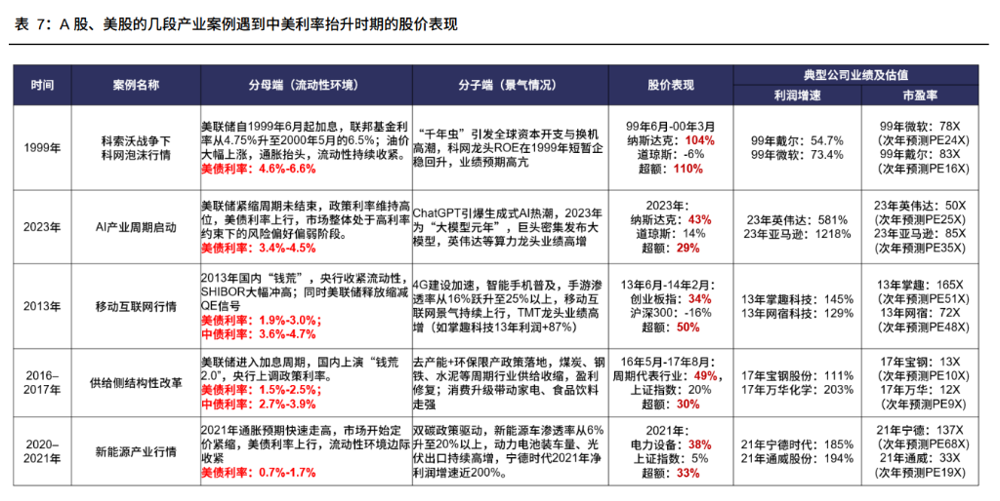

## **下半年：增量市还是存量市？**

资金面给出的信号是： **从增量市转向存量市。**

上半年，两融加杠杆、偏股基金发行和险资增配共同撑起了偏宽裕的流动性环境，居民资金净流入从2025年下半年的约6900亿增至上半年的约8600亿。

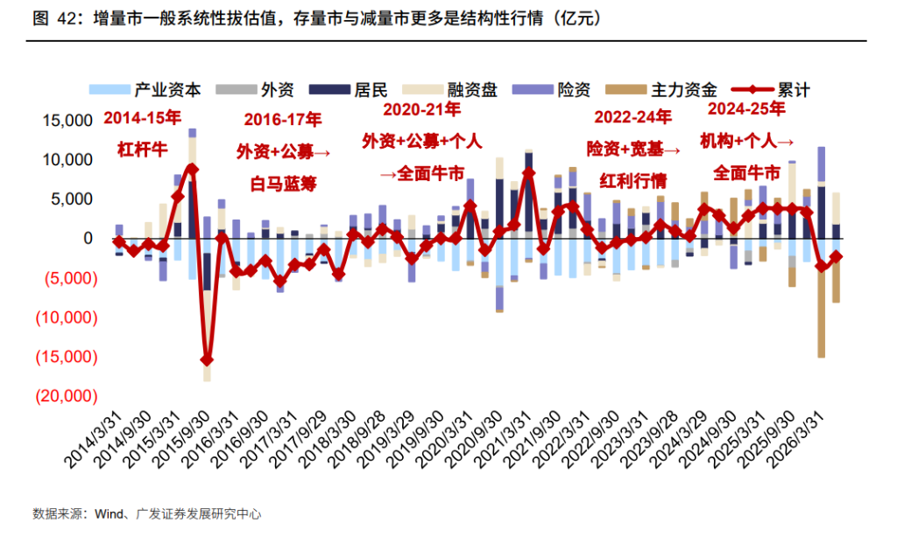

但下半年，资金供需差预计缩窄超1000亿。原因：两融动能放缓，北向资金受美债利率压制，产业资本跟随解禁高峰加速减持，还有长鑫科技等巨型IPO预计上市带来的资金分流。

结构上，居民和机构的分化正在加剧。

居民这边，存款搬家的大叙事未变。当前活期存款偏离趋势线的程度，距离历史上活期存款搬家的高峰仍有约1万亿元空间。楼市、债市、定存的性价比都远不如2022-2024年，新开户热情依然高，主动偏股基金回本比例已过半（净值回本数量占比50.8%，规模占比59.9%），赎回潮明显缓解。

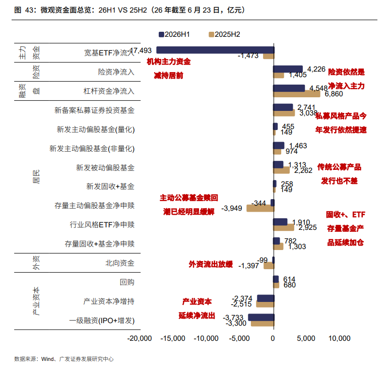

机构这边，主动公募仓位小幅下行（偏股混合型基金仓位降至85.7%），主动私募仓位年内也小幅回落至62.3%。机构整体在兑现。

主力资金的策略，从2025年的"托底"切换到了2026年的"控温"。宽基ETF的抛售节奏有规律可循：上证指数在100日均线下方时抛压小，大幅超过100日均线后就有控温动作。

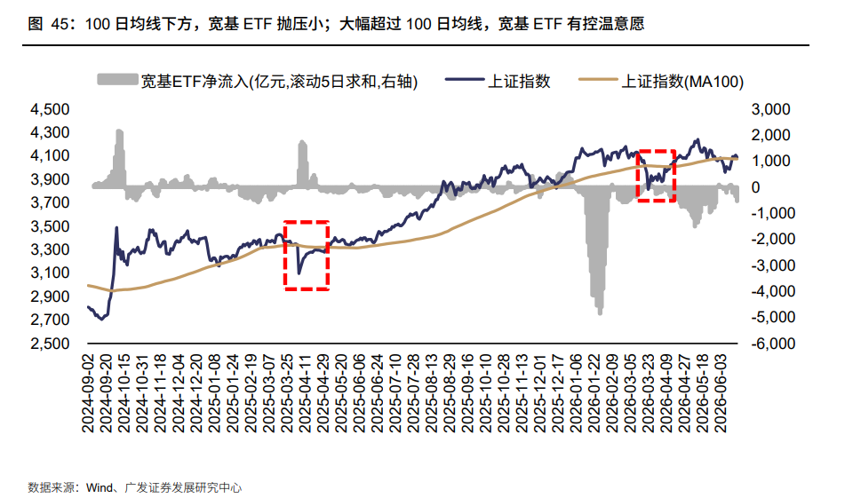

险资依然是重要的托底力量。2026年一季度险资入市规模创2013年以来新高，且当前股票风险溢价（ERP）并不低，下半年险资增量仍可期待。

存量博弈格局下，没有增量资金的板块很难有系统性行情，结构性极致化将延续。

## **AI之外，哪些方向有真实的基本面支撑？**

以中报为时间锚点，市场将再度进入基本面定价窗口。当前景气高度聚焦"AI"与"储能"两条主线，此外有几个方向值得关注，但共同前提是： **需要基本面的真实支撑，不建议博弈政策。**

**AI产业链** ，2026年已出现"量价共振"的景气扩散。上游存储价格仍在历史高位，DRAM和NAND均无见顶迹象；中游算力租赁持续涨价；下游Token调用量指数级上升。跟踪逻辑已从"下游需求验证"转向"中游供给约束验证"——只要中游产能缺口没有明显收敛，景气持续性就可能持续超出市场预期。

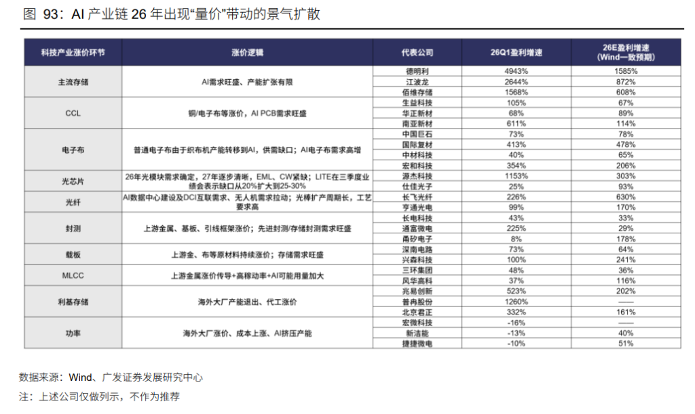

**有色金属** （黄金和铜），3月美伊冲突后板块跌幅超20%，定价过于悲观。黄金的底层逻辑未变：全球政府债务扩张、美元储备地位弱化、央行购金潮在2026年一季度环比上升。铜的供需缺口结构性更强：需求端电网投资、AI数据中心、电动车共同拉动，供给端矿山品位下降、新项目周期长，2026年3月开始全球铜产量同比已跌入负区间。

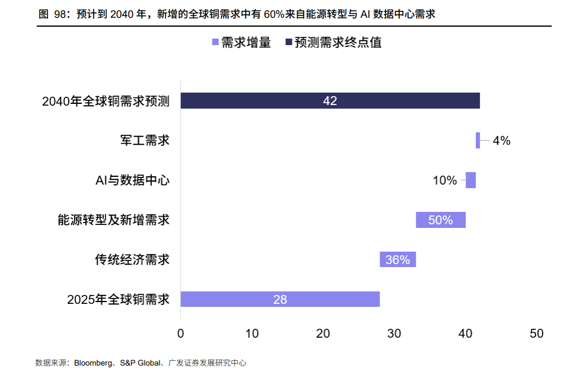

**储能锂电** ，是AI之外基本面恢复至拐点右侧最确定的β。合同负债代表订单持续恢复，CAPEX自2021年高点消化4年后企稳，2026年6月中国锂电市场排产约268GWh，连续第四个月刷新历史峰值。碳酸锂价格近期从高点回落，对储能IRR的压力缓解。

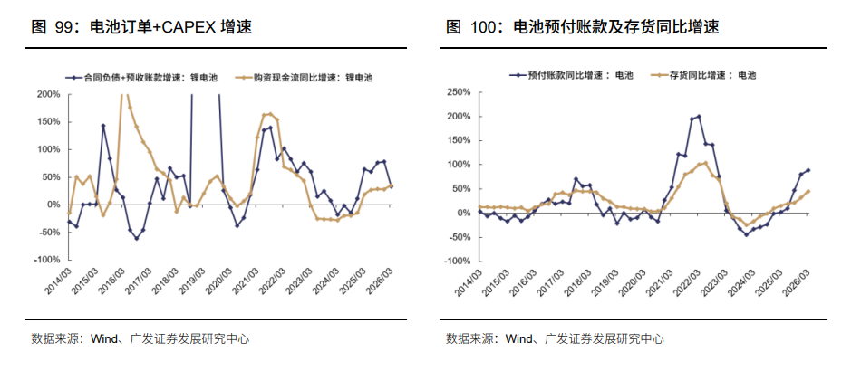

**创新药** ，龙头估值已处于均值减一倍标准差以下。恒瑞估值跌至历史低点，全球BD交易中中国企业占比从去年的50%跳升至今年的70%。这个方向需要一个触发条件：美伊冲突缓和、美债利率阶段性回落，届时估值修复空间较大。

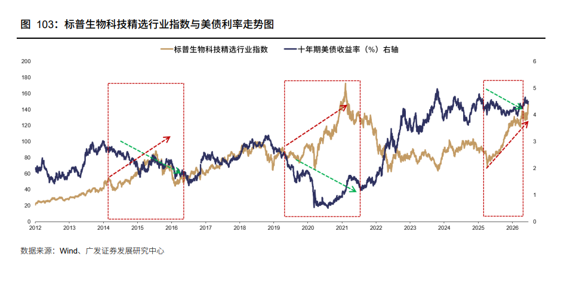

**非银金融和金融IT** ，中报业绩确定性高。2026年资本市场成交额维持高位，基准新规推动资金配置更均衡，券商估值与盈利共振的逻辑清晰。

## **“第一性原理”：哪些规律永远有效**

在所有会被打破的规律之外，有一条规律始终没有失效，未来也不会失效： **相对业绩优势，决定相对股价表现。**

无论是科创创业板对沪深300，还是科技成长对低波红利，中期股价走势，大致围绕每个财报季净利润增速的相对优劣来展开，正相关性非常稳定。

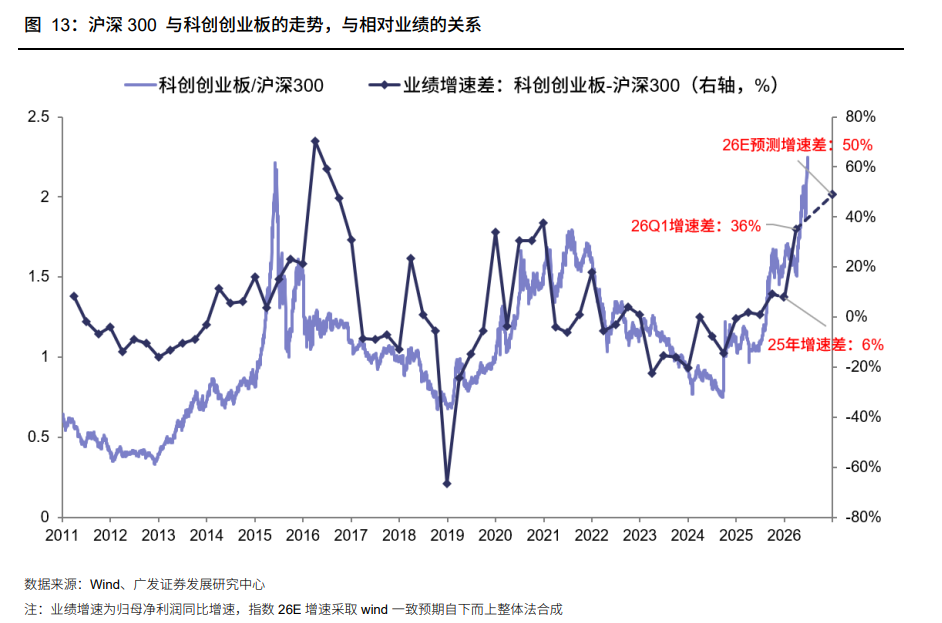

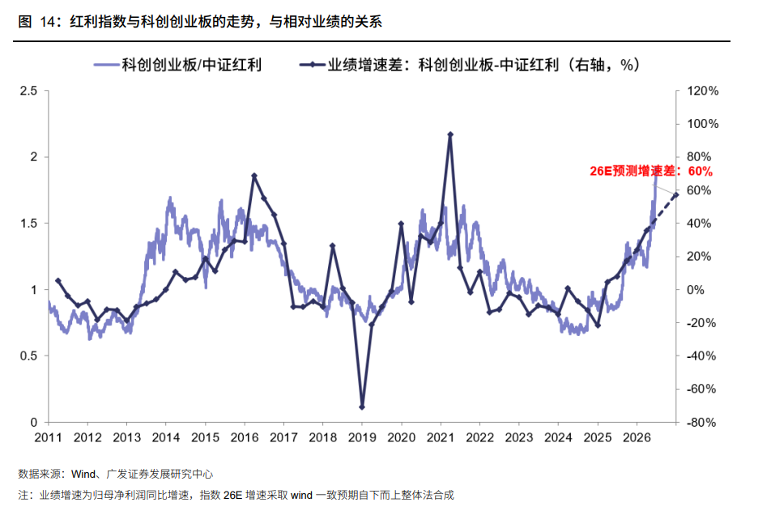

这个框架能帮助我们过滤大量噪音。今年上半年，每当美伊冲突加剧、美联储加息预期升温，市场就担心科技板块受压。但只要用"相对业绩"这把尺子去量，答案是清晰的：AI产业EPS在持续上修，非AI行业盈利没有加速改善。风格裂口，很难出现拐点。

下半年，AI和非AI的业绩增速差大概率继续扩大。如果基本面的K型格局不变，股市的K型格局也不会逆转。AI仍是最重要的主线。即便有其他板块的扩散机会，也需要等待真实的基本面拐点——而不是政策预期的轮动。

历史经验总是用来被打破的，但打破经验需要理由，这个理由叫做： **时代变了。**

风险提示及免责条款

市场有风险，投资需谨慎。本文不构成个人投资建议，也未考虑到个别用户特殊的投资目标、财务状况或需要。用户应考虑本文中的任何意见、观点或结论是否符合其特定状况。据此投资，责任自负。
