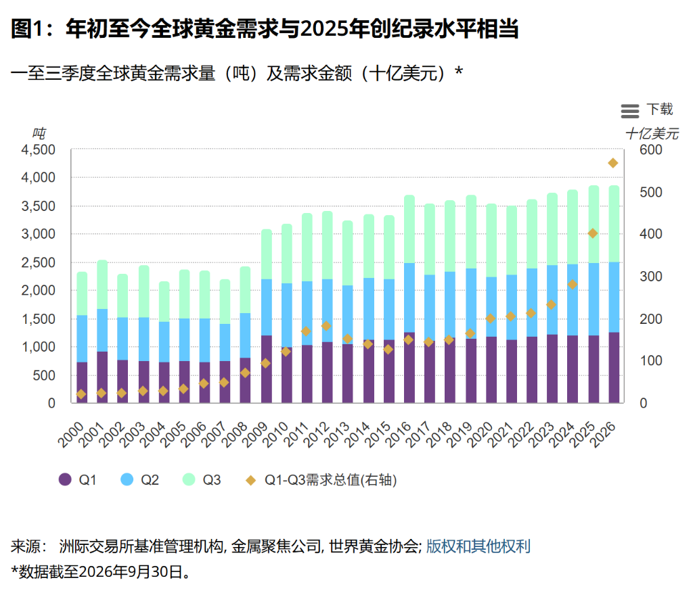
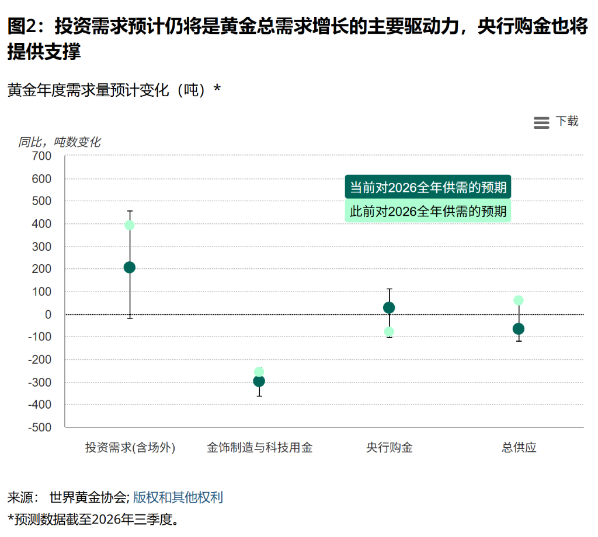
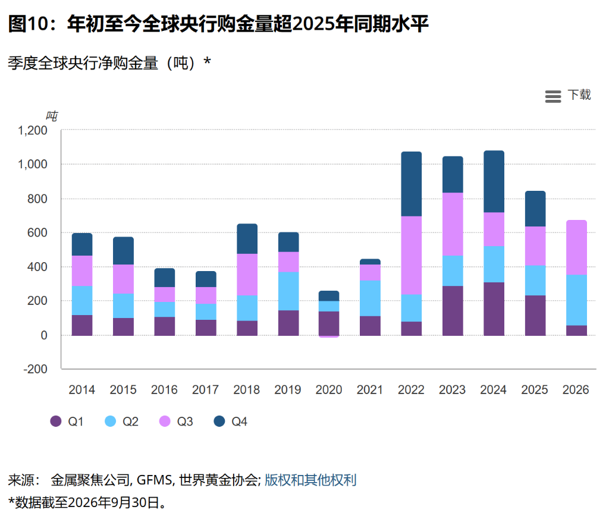
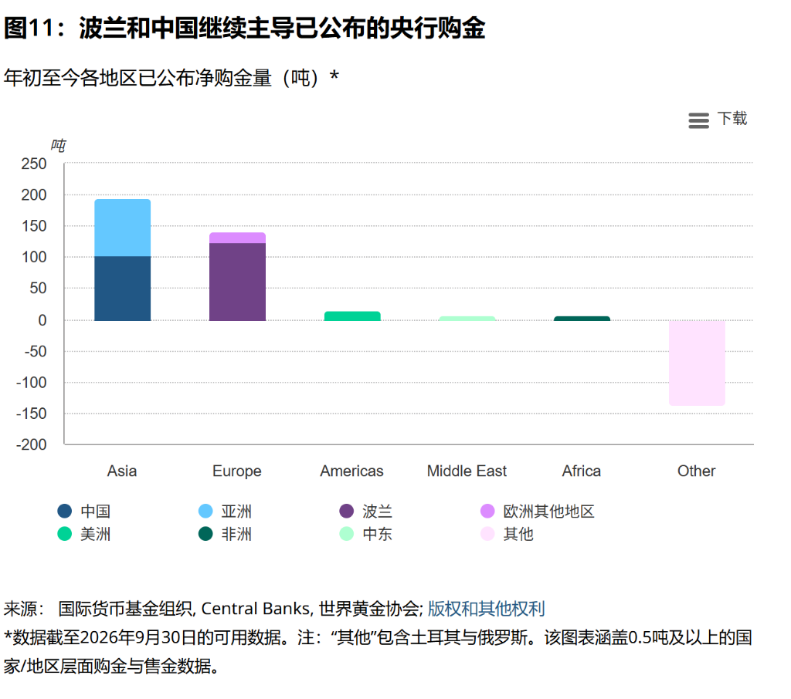
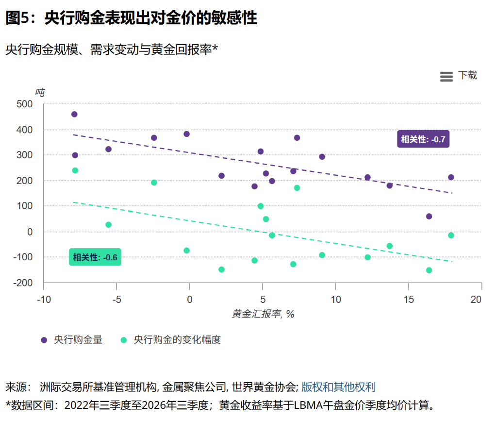
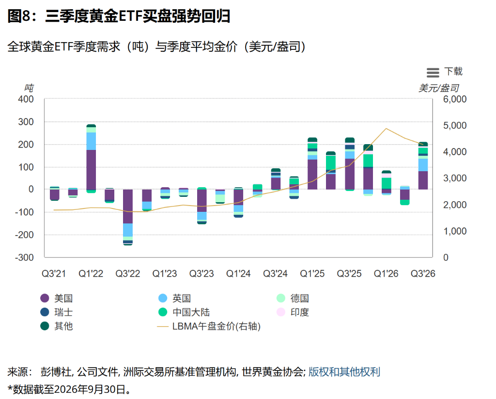
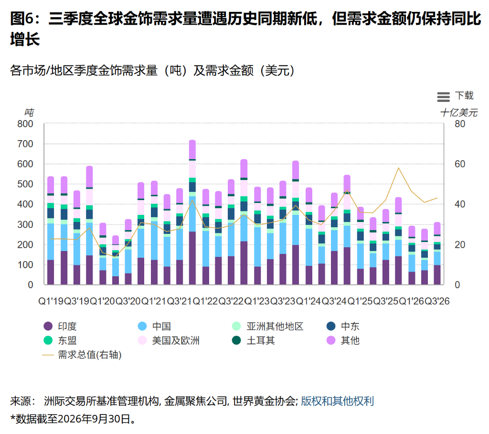
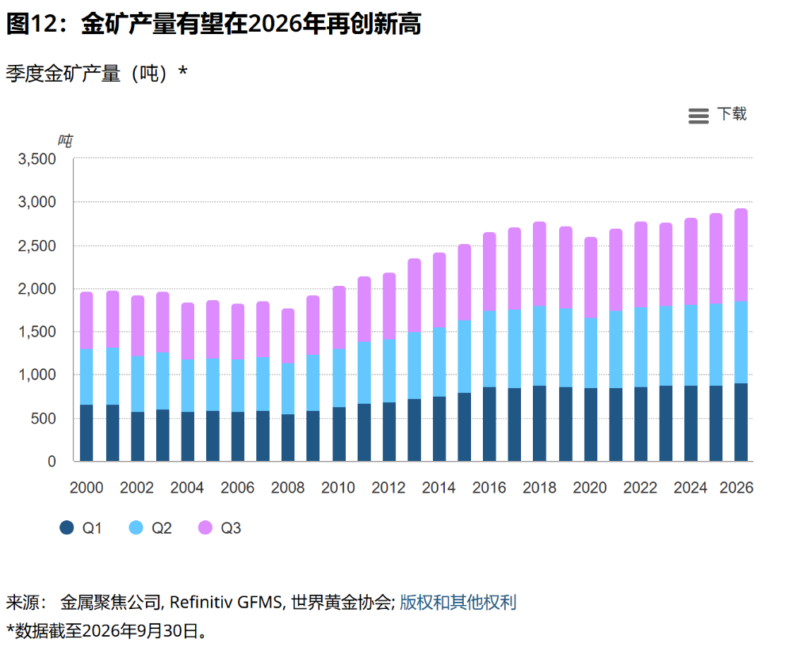

# 世界黄金协会：下调全年黄金投资需求增长预期至200吨，全球央行购金提速、ETF持仓创新高

- 页面显示时间：2026-11-03T15:58:13+08:00
- 页面署名：张雅琦
- 标注来源：未单列，见正文
- 原文：[华尔街见闻](https://wallstreetcn.com/articles/3785076)
- 取得时间：2026-11-04T16:03:33+08:00
- [HTML阅读版](article.html) · [来源记录](metadata.json)

## 导语

世界黄金协会下调2026年全球黄金投资需求增长预期至200吨，金价自历史高点回落约29%后，散户购金热情明显降温。央行购金同比增长42%至321吨，黄金ETF净流入211吨、持仓创历史新高。金饰消费降至历史同期最低，机构与央行战略配置需求持续强劲，成为黄金市场重要支撑。

---

受金价自历史高点大幅回落影响，全球实物黄金市场呈现明显分化：机构需求持续强劲，散户买盘则显著降温。世界黄金协会（WGC）周二将2026年全年黄金投资需求增长预测由400吨下调至200吨，原因是金条和金币需求明显放缓——尽管实物黄金ETF的表现超出此前预期。

根据WGC最新发布的2026年三季度《全球黄金需求趋势》报告， **三季度全球黄金总需求（含场外交易）同比下降1%，** 至1369吨，与2025年创纪录水平基本持平。

与此同时， **全球央行三季度购金量骤升至321吨，同比增长42%，为2024年四季度以来最高单季购金量，** 促使WGC同步上调全年央行购金预期至至少与2025年持平。

金价自今年1月触及每盎司5595美元的历史高点后，因伊朗战争推升油价、市场加息预期升温，至今已累计下跌约29%。价格持续高位运行叠加宏观逆风，使得散户投资者和消费者的购金意愿明显承压，而机构和央行层面的战略配置需求则表现出更强韧性，成为支撑金价的重要力量。

## 央行购金加速，中国与波兰居首

**三季度，全球央行净购金321吨，远超过去五年季度均值，且较二季度环比增长8%。** 年初至今央行净购金量累计达675吨，同比增长6%，略高于去年同期水平。

在已公布的购金数据中， **中国人民银行单季增持63吨，为最大已披露买家；波兰国家银行增持40吨，位居第二。** 两家央行合计贡献了当季已公布净购金量的约86%。哈萨克斯坦和乌兹别克斯坦各增持14吨，是另外仅有的两家单季增持超5吨的央行。俄罗斯则是当季唯一大规模减持方，合计售出19吨。

值得注意的是，三季度央行购金总量中，约有63%来自未公开披露的买盘，延续了2022年以来的市场特征。WGC高级市场策略师John Reade表示，三季度金价较前期有所回落，可能吸引部分央行加大购金力度；对于看空美元的央行而言，美元走强反而提升了将储备换购黄金的吸引力。

"如果你认为美元长期将走弱，持有的短期美债又在到期滚动，那么你或许会拿这些相对昂贵的美元去买黄金，"Reade说。

鉴于三季度表现超预期，且二季度数据小幅上修，WGC将全年央行购金预期上调至至少848吨，与2025年实际购金量持平。WGC高级EMEA分析师Krishan Gopaul表示，"今年央行全年购金总量有可能超过去年。"

## 实物黄金ETF重回净流入，持仓创历史新高

在散户需求走弱的背景下，机构投资者通过ETF渠道的黄金需求逆势走强，成为本季度的显著亮点。

**三季度，全球实物黄金ETF净流入211吨，完全扭转了二季度的流出态势，推动全球总持仓升至4256吨的历史新高，对应季度净流入金额约310亿美元，同创历史纪录。**

欧洲基金引领本季度增长，净流入92吨，为2022年一季度以来最大单季增幅。对财政可持续性、通胀及主权债券市场的担忧，增强了黄金作为对冲工具的吸引力。其中英国基金净流入53吨，法国、德国和瑞士分别净流入16吨、13吨和9吨。北美地区黄金ETF三季度净流入81吨，彻底扭转上半年疲弱态势。亚洲地区连续第三个季度净流入34吨，中国市场仍是区域增长主力，国内股市走弱和国债收益率下行提升了黄金的相对吸引力。

WGC指出，尽管债券收益率大幅走高、美元走强，且地缘政治风险指数有所回落，ETF需求仍保持强劲，"这表明市场对财政层面的担忧及更广泛的不确定性，在一定程度上抵消了持有黄金机会成本上升带来的不利影响。"

## 金条与金币需求降至四年低位

与ETF需求形成对比，散户实物投资热情明显消退。三季度，全球金条和金币需求同比下降19%至268吨，为近四年来最低单季水平。

WGC将这一走弱归因于多重因素叠加：金价在三季度整体区间震荡，缺乏明确趋势；市场预期美国利率将维持高位更长时间；股市上涨亦分流了部分资金。

**分地区来看，中国是少数实现需求增长的主要市场之一，金条和金币需求同比上升7%至79吨，年初至今累计需求达393吨，创历史新高。** 印度则是全球降幅最大的市场，三季度需求同比骤降40%至55吨，对全球同比降幅的贡献占比约60%，其中节日时间错位及部分投资者转向数字黄金是重要原因。

美国市场三季度金条和金币需求同比下降40%至8吨，创2019年四季度以来季度新低；欧洲同比下降31%至20吨，其中瑞士降幅尤为显著，需求近乎腰斩。伊朗受战争冲突持续扰乱日常生活影响，部分民众被迫出售金条金币，需求同比下降51%。

尽管季度表现疲软，年初至今全球金条和金币需求仍达1053吨，为2013年以来同期最高水平，显示年初的强劲需求奠定了较高基数。

## 金饰需求创历史同期最低，高金价持续压制消费

高金价对消费端的打压在金饰市场表现最为直接。 **三季度全球金饰消费量同比下降17%至313吨，** 不仅低于上年同期，甚至低于新冠疫情冲击下2020年三季度的331吨，创下WGC统计数据中三季度的历史最低纪录。

中国金饰消费同比下降22%至66吨，年初至今消费量累计下降27%至202吨。印度金饰消费同比下滑20%至100吨，国内金价同比涨幅约45%显著压缩消费购买力，节日时间错位亦将部分需求推迟至四季度释放。

各主要地区消费量均录得同比降幅：美国下降18%至21吨，欧洲（不含独联体）下降11%至11吨，中东地区下降22%至26吨，越南降幅最大，达39%。

消费量与消费额的背离是本季度的突出特征。尽管吨量需求创历史同期新低，三季度全球金饰消费额仍同比微增2%，达430亿美元。年初至今全球金饰消费额同比上涨15%，接近1300亿美元。WGC预计，持续高金价将令金饰消费量在四季度继续承压，消费者倾向于选择轻克重、低纯度产品的趋势短期难以逆转。

## 金矿产量创季度新高，供应整体偏紧

供应端方面，三季度金矿产量同比增长3%至1071吨，创历年三季度历史新高；但由于回收金供应量同比下降8%至314吨，以及生产商净套保量持续收缩，黄金总供应量同比仍小幅下降1%，至1369吨。

产量增长较为突出的国家包括加拿大（同比增长22%）、印度尼西亚（同比增长21%）和智利（同比增长19%），主要受近期新矿投产和品位改善驱动。纳米比亚、土耳其和澳大利亚则因开采顺序调整或品位下降，产量有所回落。

WGC指出，回收金供应在当前高金价环境下的反应依然有限。三季度黄金均价较上季度环比下降5%，回收金供应量随之同步回落，但能源价格上涨、通胀走高及失业压力加剧，至今尚未引发消费者因财务困境而大规模变现黄金。

展望全年，WGC预计尽管金矿产量有望再创年度历史新高，但低迷的回收金供应将部分抵消这一增长，导致黄金总供应量全年小幅下降。

风险提示及免责条款

市场有风险，投资需谨慎。本文不构成个人投资建议，也未考虑到个别用户特殊的投资目标、财务状况或需要。用户应考虑本文中的任何意见、观点或结论是否符合其特定状况。据此投资，责任自负。
