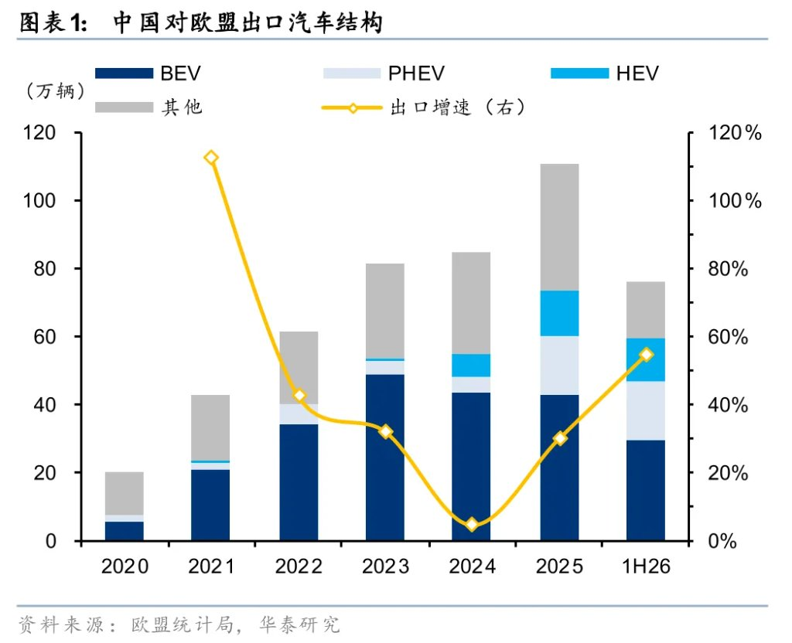
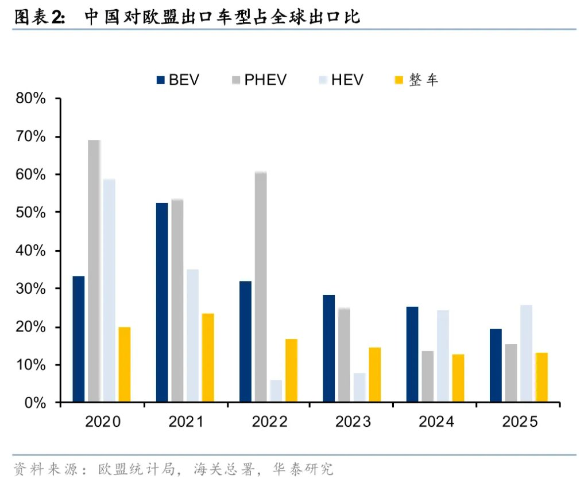
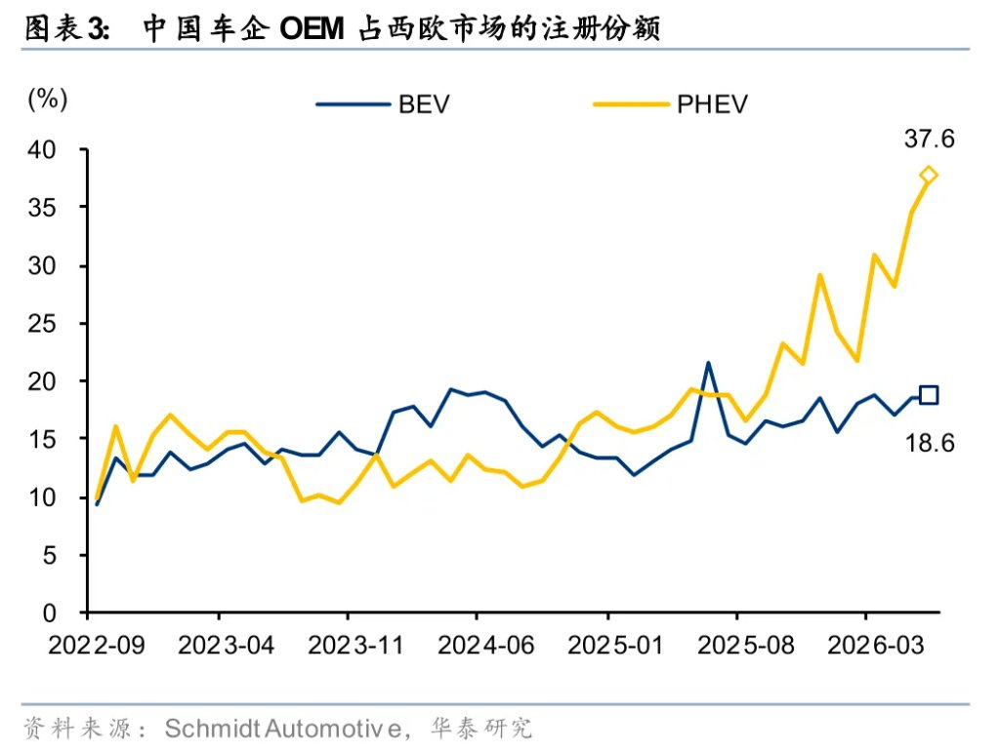
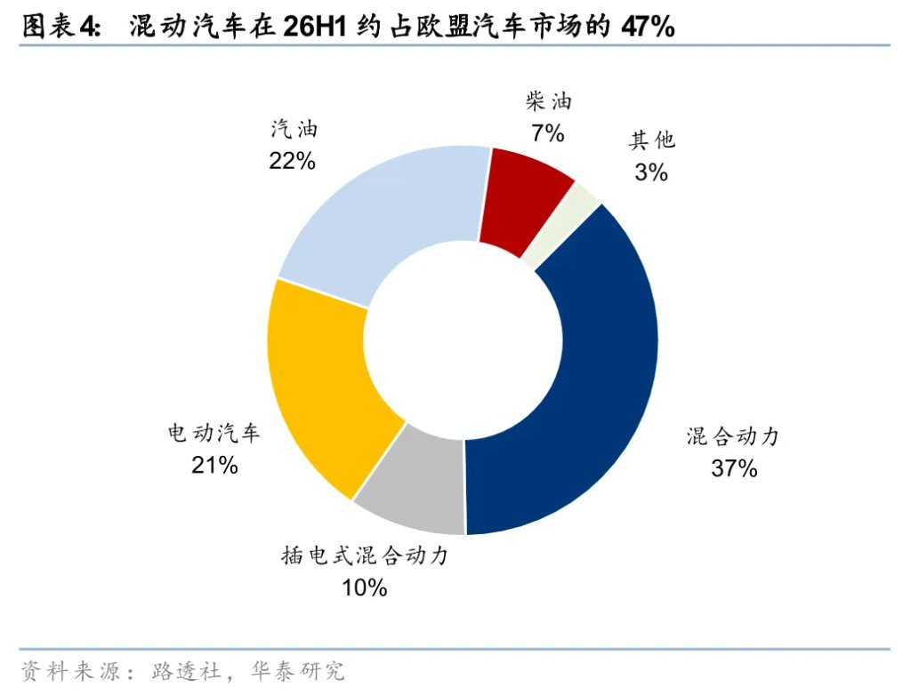

# 中欧经贸谈判点评：全面贸易冲突风险下降

- 页面显示时间：2026-10-12T08:07:47+08:00
- 页面署名：龙玥
- 标注来源：华泰睿思
- 原文：[华尔街见闻](https://wallstreetcn.com/articles/3783389)
- 取得时间：2026-11-04T16:03:50+08:00
- [HTML阅读版](article.html) · [来源记录](metadata.json)

## 导语

华泰证券认为，中欧双方各退一步，以时间换空间，以解决长期贸易分歧，能继续谈下去就是最大的胜利。然而，不容忽视的是双方结构性失衡与矛盾根深蒂固。短期关注10月15-16日举行的欧盟峰会（European Council）的态度和立场变化。

---

**事件**

10月8日-9日，中欧贸易投资磋商机制（TIC）第二次例会结束。双方会后发表的联合声明称，此次会议进行了“务实、富有成效”的讨论，并形成涵盖贸易和投资平衡、出口管制、知识产权及世贸组织改革四大领域16项成果共识。

**一、中欧贸易磋商平稳落地 避免摩擦升级风险**

中欧第二轮贸易投资磋商平稳落地，联合声明形成16项成果共识清单，并商定明年3月份第三轮贸易磋商时间表，在此之前双方将保持密切沟通。对于市场高度关注的汽车、稀土等领域取得谈判突破。中方表示双方以符合世贸组织规则的方式就混动汽车贸易达成谅解，欧盟贸易委员谢夫乔维奇10月9日会谈后表示，“未来四年中国对欧盟混动及插电混动汽车出口量可能降低50%”，双方各自解释和拉长落实周期，不失为一个更为现实的路径。

**二、汽车贸易各自解释 实施周期进一步拉长**

中欧就电动汽车（BEV）和混动&插电混动汽车（HEV和PHEV）贸易达成谅解，避免了局面升级。关于减少HEV和PHEV对欧出口方面，双方表述略有差异，在时间表、具体标准、实施细则上仍待进一步明确。

**1）关于HEV和PHEV，双方表述差异。**

中方：双方以符合世贸组织规则的方式就混动汽车贸易达成谅解，“避免了局面升级，维护了中国企业出口利益及双边混动汽车贸易的稳定”。

欧盟：谢夫乔维奇在会谈后出席新闻发布会，表示双方达成共识，对中国输往欧盟的HEV和PHEV出口数量进行调控，未来四年有望减少一半。（According to the projection we have, that's more than halving of the exports of hybrids and plug-in hybrids into the European Union under no change scenario.）

**2）为何针对HEV？**

2024年10月，欧盟对中国产纯电汽车加征反补贴税。BEV受关税压制后，中国出口车型大规模转向PHEV和HEV。中国HEV对欧出口由2024年的6.4万辆增至2025年13.1万辆。PHEV对欧出口由2024年的4.3万辆增至2025年的17.2万辆。据Schmidt Automotive Research统计，中国车企PHEV占西欧注册市占率从2025年1月的16.1%升至2026年6月的37.6%，HEV占西欧注册市占率从2025年1月的13.3%升至2026年6月的18.6%。

**3）对海外已建有产能的头部厂商影响暂可控，有望加快龙头企业出海进程。**

2025年欧盟自中国进口车辆整体达110.6万辆，占中国全年汽车出口量的13.0%；其中BEV43.1万辆；而HEV和PHEV合计为30.3万辆；二者合计占中国全年HEV和PHEV出口比重18.7%，占中国全年汽车出口比重为3.6%。近年来，比亚迪等厂商积极推进欧洲等海外产能建设，有望加快这一进程。

**4）关于配额限制知多少？**

布鲁塞尔推动中国对汽车出口实施自愿出口限制（VERs）是本轮关注的焦点。《金融时报》曾报道，欧盟要求中国自愿限制混动车出口，拟将中国产混动车在欧盟的市场份额上限设定为15%（当前超过30%）中国商务部发言人公开回应：“所谓自愿出口限制严重违反世贸组织规则，违背市场经济规律和公平竞争原则。中方对此坚决反对。

这一做法类似1986年日本自愿出口限制（VER）。日本汽车业以本地化建厂以应对这一挑战。

**三、出口管制：稀土vs先进计算芯片和半导体制造设备**

中国为稀土及永磁体对欧出口许可审批继续提供便利，将在列单前进行提前通报，而欧方将同成员国一道为解决两用领域（涵盖先进计算芯片与半导体制造设备）对华重点许可个案提供便利。

**四、其他成果**

关税减免：据欧方测算，中国对欧关税减让约 2.25 亿欧元

据欧委会官网披露，双方达成共识，通过下调最惠国关税，改善一系列欧盟产品进入中国市场的条件，涉及产品包括汽车零部件、橄榄油、鞋类等，当前相关出口总额接近40亿欧元，预计至少可带来2.25亿欧元的关税减免。

医疗器械市场准入：中国同意在进博会上扩大进口欧盟医疗器械采购。

逆变器：将进一步磋商。欧方澄清，欧盟对逆变器项目的融资指导文件不针对特定国家，双方将就该问题进一步磋商。

**五、整体评价：中欧能继续谈下去就是最大胜利 贸易工具构建持续推进**

我们 **认为，中欧双方各退一步，以时间换空间，以解决长期贸易分歧，能继续谈下去就是最大的胜利。然而，不容忽视的是双方结构性失衡与矛盾根深蒂固。** 我们认为，过去几年，以法德为首的欧盟主要成员国，逐步形成了对华强硬立场和共识，欧盟也在积极构建包括外国政府补贴条例（FSR）、工业加速器法案（IAA）、欧洲新版301等制度性工具。我们持续关注这些政策工具出台实施进展。短期关注10月15-16日举行的欧盟峰会（European Council）的态度和立场变化。

风险提示：中欧磋商成果不及预期；欧盟贸易反制工具立法进程超预期；关税减让测算基于引用数据，或与实际有所出入。

本文来源：[华泰睿思](https://mp.weixin.qq.com/s?__biz=MzA5NDI5MDQwMg==&mid=2649868290&idx=1&sn=aa497ccda024aeaf77503de244638dae&chksm=89d4da05987776816d8b9e8f21009710699c6226da5ba7c6bdbd638a9c64e45a3a0adea50d54&mpshare=1&scene=23&srcid=1012BqT2yzDrieD0J53isIu6&sharer_shareinfo=2605044f03ccb14bc89c5ab7b757b4cb&sharer_shareinfo_first=2605044f03ccb14bc89c5ab7b757b4cb#rd)

风险提示及免责条款

市场有风险，投资需谨慎。本文不构成个人投资建议，也未考虑到个别用户特殊的投资目标、财务状况或需要。用户应考虑本文中的任何意见、观点或结论是否符合其特定状况。据此投资，责任自负。
