# 中金：924两年后有何变化？

- 页面显示时间：2026-10-13T10:32:51+08:00
- 页面署名：董静
- 标注来源：中金刘刚、张巍瀚
- 原文：[华尔街见闻](https://wallstreetcn.com/articles/3783497)
- 取得时间：2026-11-04T16:03:30+08:00
- [HTML阅读版](article.html) · [来源记录](metadata.json)

## 导语

中金认为，恒生科技两年跌回原点，核心症结在于居民信用脉冲持续走弱，今年3月已跌破924水平，而财政重心转向科技产业、缩减消费端补贴，直接拖累恒科这一"大号消费指数"。资金面同步收紧，南向流入较去年骤降70%。当前港股极具超跌反弹的赔率价值，但要迎来真正的趋势逆转，必须依靠财政直接向居民端发力以修复信用，或期待互联网龙头的AI突破来催化。

---

尽管今年以来的全球市场都呈现巨大的分化和波动，但港股尤其是恒生科技的持续跑输依然显得尤为“扎眼”，恒科年初以来累积下跌23.9%，在全球范围内落后。如果从去年10月高点算起，更是下跌近40%。 **一个或许被忽略的事实是：** 时隔两年，恒生科技距离被视作本轮牛市起点的2024年924一度仅有不到4%的空间，两年之后几乎又回到了“原点”。

图表1：年初以来恒科下跌23.9%全球垫底

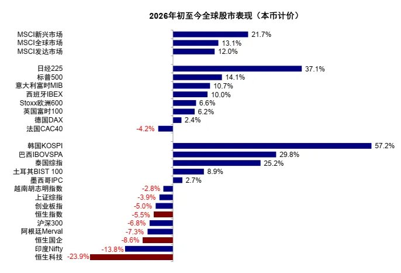

数据截至2026年10月9日

资料来源：Bloomberg，中金公司研究部

图表2：恒科目前距离回到2024年924原点仅一步之遥

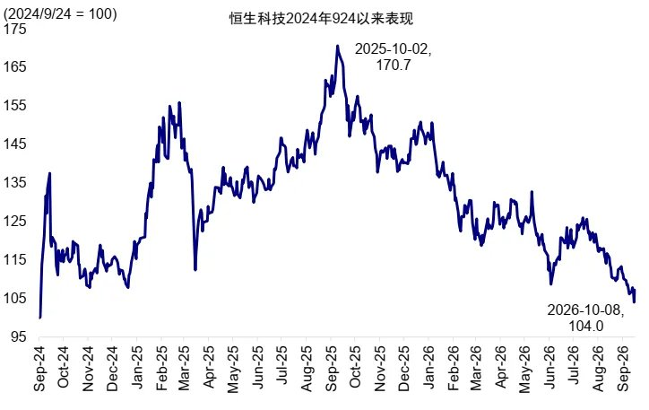

资料来源：Wind，中金公司研究部

**回望去年底，市场整体还弥漫着普遍的乐观情绪，诸多叙事言犹在耳：** 居民存款搬家、资产负债表修复、财富效应后的再通胀预期、A股“开门红”后港股接棒、人民币升值推动外资流入并受益港股等，不一而足。 **但我们并不认同当时的主流观点，并一直持谨慎看法：** 在2025年底《港股2026年展望：“牛市”的下一步》判断港股的上涨更多是政策脉冲叠加资金再平衡带来的阶段性修复，不具备持续大牛市的基础，指数上行本身存在明确的天花板。在《股市和汇率谁“错”了？》中提出，汇率升值不能视作港股上涨的原因，不考虑当前汇率升值原因就直接套用历史关系是一种谬误。在《港股市场2026下半年展望：热闹是他们的？》中我们进一步指出，港股今年大幅跑输的根源， **本质是内需基本面和居民信用脉冲走弱的折射，** 这一点如果没有变化，港股更多体现的仍是赔率价值。

回顾过去两年，经济毕竟还在增长、出口持续超预期推动顺差创纪录、人民币汇率大幅升值、全球和国内AI产业蓬勃向上，我们不禁要问的是： **港股为何能在2025年大涨、又在2026年大跌？为何唯独港股恒科跌回了原点？924以来两年改变了什么？是哪里出了问题？** 厘清这些问题，才能更好的帮助我们判断港股接下来是否会进一步跌破924低点，以及靠什么能再度崛起。

## 一、港股为何2025年表现强劲、2026年却落后全球主要市场？

港股尤其是恒生科技2025年上涨23.5%后，如果从2024年9月低点到2025年10月高点算涨幅甚至高达94%，但2026年却以23.9%的跌幅落后全球，这其中到底发生了什么变化？

**► 首先，最主要的变化是居民信用周期的走向。** 需要明确的是， **港股的结构决定了其与中国经济内需以及居民部门的信用周期紧密相关，尤其恒科更像是一个“大号版的消费指数”** ，当然恒指比恒科多了一些红利与本地地产与金融股，这也解释了为何今年的表现好于恒科。历史上，但凡是内需消费向好或者居民信用周期改善（如2017年棚改地产周期和2020-2021年疫情后的消费行情），港股尤其是恒科都大幅跑赢，但凡是消费走弱且居民信用周期收缩，港股普遍走弱或跑输。

图表3：恒科70%以上权重都集中在互联网、电动车、电商与消费电子等与消费息息相关的板块  

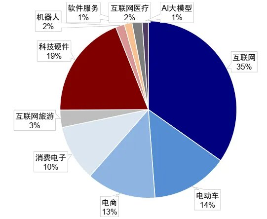

资料来源：Bloomberg，Wind，中金公司研究部

图表4：相比而言，恒指成分更加多元，比恒科多了一些红利与本地地产与金融股

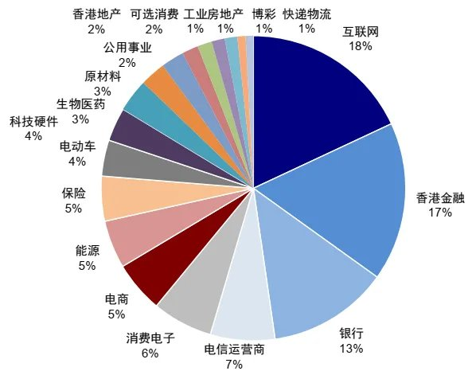

资料来源：Wind，中金公司研究部

图表5：内需消费向好或者居民信用周期改善时，恒科往往跑赢

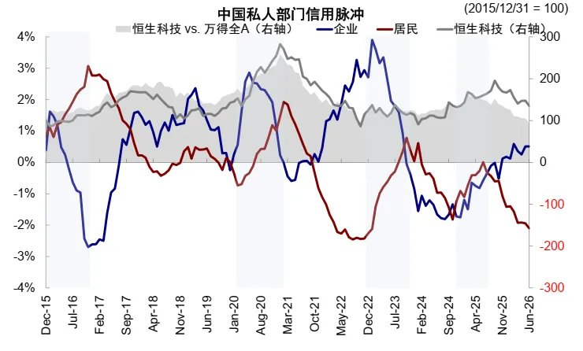

资料来源：Wind，中金公司研究部

**居民信用周期的起伏可以很好的解释2025年和2026年港股表现的巨大落差：** 1）2025年底以来，相比企业部门的韧性（尤其是科技和出口环节），居民部门信用脉冲却持续下行，今年3月起已经低于924起点，居民贷款余额也首次净减少。这一背景下，恒科的弱势就不奇怪了，与A股消费板块同样跌破924起点是一样的。 **本质上，在今年科技强而消费弱的K型分化下，恒科反映的就是K型分化的下半端。** 2）反之，同样的逻辑也可以解释为何2025年港股强势反弹。924后财政一度发力并补贴居民部门，拉动居民信用周期修复，成为港股率先反弹并大幅跑赢的关键。

图表6：居民信用脉冲自3月起低于924起点  

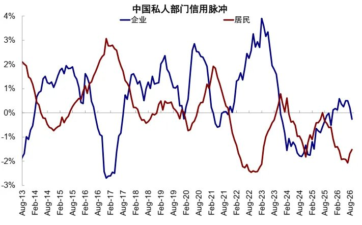

资料来源：Wind，中金公司研究部

图表7：自3月居民存量社融同比转负，为历史首次  

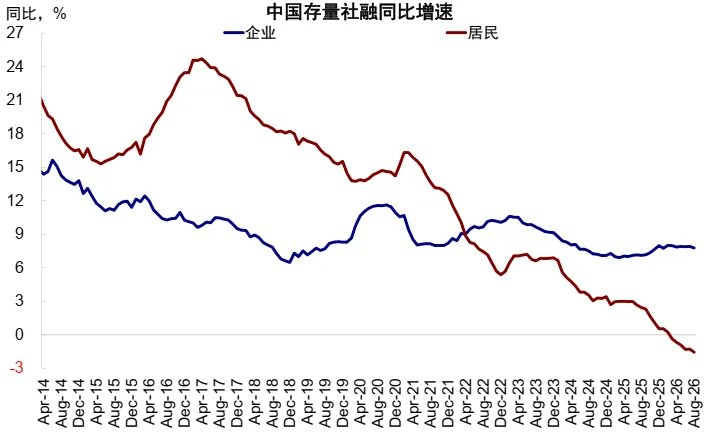

资料来源：Wind，中金公司研究部

**► 那居民信用周期为何再度下行？** 背后是财政发力方向的变化。除了收入预期和信心修复缓慢、地产持续拖累这些结构性的因素外， **2026年相比2025年的主要变化：** 是财政力度与去年基本持平（广义赤字率8.1%持平于去年的8.5%）， **发力方向还更多向科技与产业倾斜，居民端反而减少** （如以旧换新等）。

图表8：924之后，消费受益于财政发力、以旧换新等政策支撑，但近期明显回落  

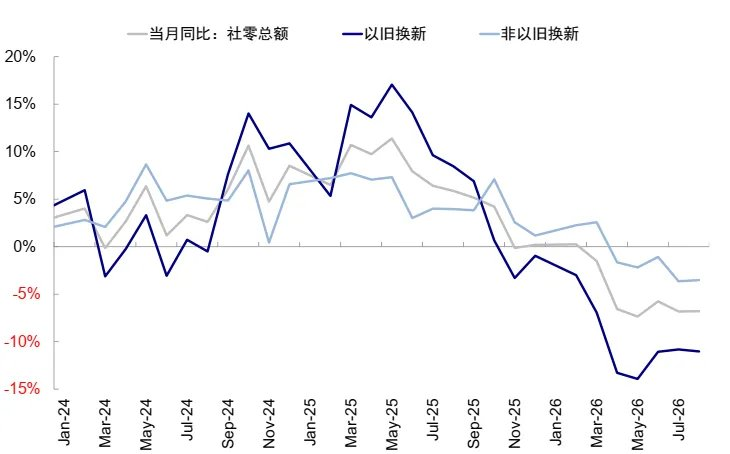

资料来源：Wind，中金公司研究部

这与我们在去年11月报告《“被忽略”的牛市：日股90年代三轮牛市启示录》中针对90年代日股三轮牛市经验复盘得到的经验高度契合：日本在 “失去的三十年”里也有三轮规模可观的牛市，但每次持续一年左右就结束了， **每次都始于财政刺激、也终于财政收缩** 。财政刺激能带来阶段性反弹，但如果深层次矛盾没有化解（如居民资产负债表修复与化债），一旦政策刺激消退，行情就很难维系，因此这三轮“牛市”放到长周期看没能逆转趋势，更像是“大的箱体震荡”，这与港股过去两年的表现何其相似。

图表9：日股90年代泡沫破裂后出现了三轮反弹50%、持续时间一年以上的牛市

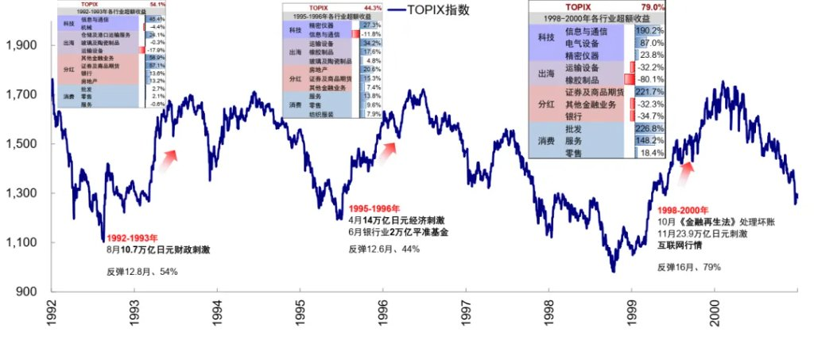

资料来源：Bloomberg，FactSet，中金公司研究部

图表10：但在更长时间维度看，最终都呈现“箱体震荡”格局

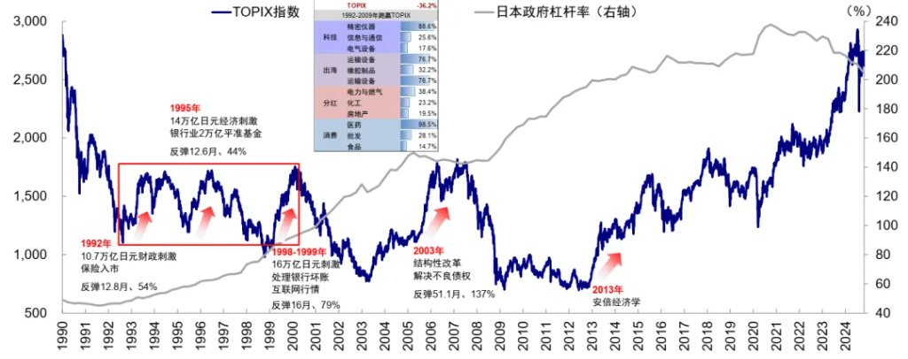

资料来源：Bloomberg，FactSet，中金公司研究部

**► 其次，科技硬件方向的缺失与港股头部互联网公司在AI投入上的落后。** AI行情从2025年的计算芯片和云厂商的主线转向了2026年存储的一枝独秀，但港股在硬件上的缺失使其错过了2026年科技硬件的行情。此外，港股龙头互联网公司除了受内需拖累外，在AI投资、模型研发和收入兑现上也落后于美国和中国其他大模型和未上市公司，不似2025年DeepSeek时刻后的势头，都拖累了整体指数表现。

图表11：AI行情从2025年的云厂商逐渐转向2026年的硬件

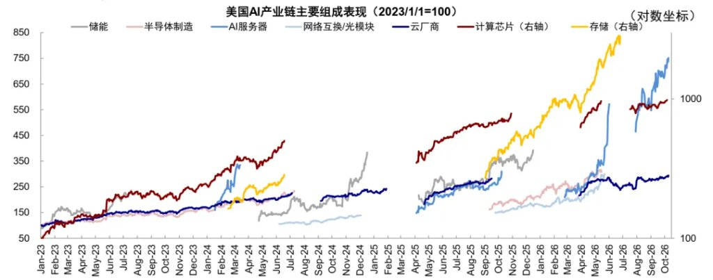

资料来源：Bloomberg，FactSet，中金公司研究部

图表12：模型研发上中国大厂也整体落后于美国和中国其他大模型和未上市公司

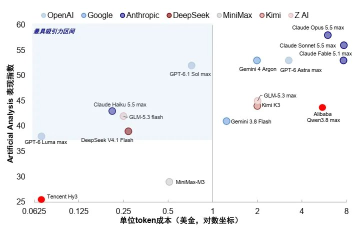

资料来源：Artificial Analysis，中金公司研究部

**► 资金面明显收紧。1）** 相比2025年充裕的资金面，港股2026年资金面明显趋紧，南向从2025年流入1.4万亿港元收缩至今年的4418亿港元；主动公募配置比例从2025年中的高点32.1%下滑至15.1%，低于924起点；海外主动资金也持续流出，对中国市场的配置比例从2025年中的7.2%降至6.0%。 **2）** IPO和再融资规模7150亿港元，已高于2025全年的6138亿港元。 **3）** 美债利率不断走高、美联储重启加息，也造成了额外压力（《加息如何影响中国市场》）。但需要明确的是， **资金更多是市场的结果，市场好的时候，资金流入形成强化市场表现的飞轮，而市场不好的时候，资金进一步流出形成压制市场的负反馈。**

图表13：南向资金从2025年的净流入1.4万亿港元收缩至年初至今仅4418亿港元

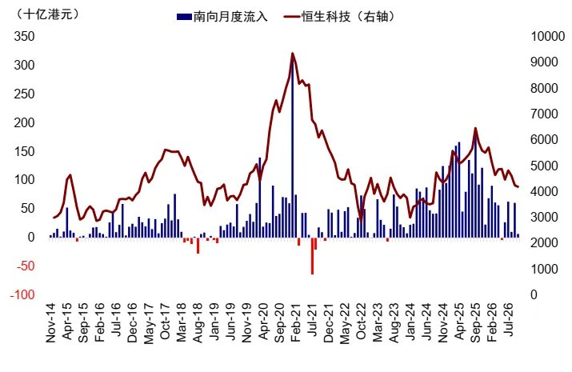

资料来源：FactSet，中金公司研究部

图表14：主动公募配置比例从2025年中的高点32.1%下滑至15.1%

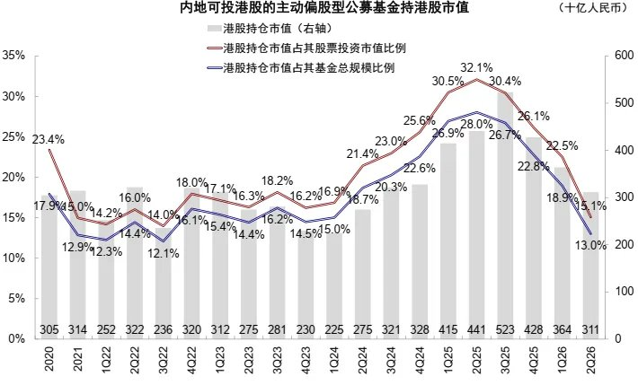

资料来源：Wind，中金公司研究部 

图表15：海外主动资金中国市场配置比例也从2025年中高点7.2%回落至6.0%  

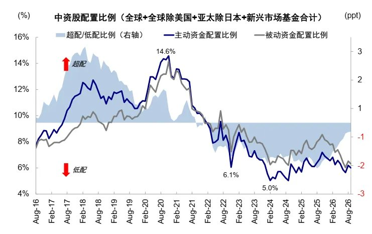

资料来源：EPFR，中金公司研究部

图表16：2026年IPO和再融资规模高达7150亿港元，已经高于2025全年的6138亿港元  

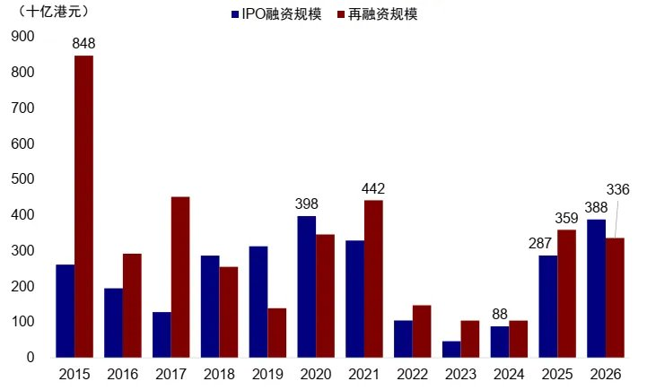

资料来源：Wind，中金公司研究部

## 二、924两年后：什么变了，什么又回到原点？

站在924政策底两周年和恒科重回原点的节点，对比两年前，哪些变了、又有哪些重回原点？我们从信用周期、市场表现、估值、盈利以及流动性等多维度复盘过去两年变化：

**► 信用周期：居民回到924原点，企业修复，财政持平。** 对比924前，财政脉冲基本持平，但政策重心从消费转向科技，因此企业部门（尤其科技、出口链条）信用周期继续修复，但居民信用脉冲从2025年三季度掉头向下，目前已经低于924政策底。

**► 市场表现：恒科几乎回到924原点，科技强而消费更低，分化更明显。** 恒生科技距离924起点仅有7.2%，几乎回到行情起点。拆解恒科的表现，盈利贡献了7.2%涨幅中的2.8%，估值扩张贡献了4.4%，都很有限。恒指与MSCI中国则仍有25%与17%的正收益。A股表现更强，相比924，万得全A上涨50%，科创50与创业板指涨118%与88%。

图表17：拆解恒科的表现，盈利基本持平，无风险利率则大幅拖累

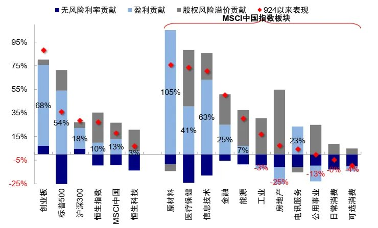

资料来源：Bloomberg，中金公司研究部

板块层面，相比924起点，通信设备（+114%）、半导体（+113%）及电子设备（+108%）翻倍，但消费板块中的酒店餐饮、个人用品表现最弱，跌幅均超30%。A股同样如此，通信、电子元器件领涨，涨幅179%与143%，食品饮料下跌4%，餐饮旅游和地产落后。

图表18：港股通信设备、半导体以及电子设备自924以来均翻倍，但内需消费板块走弱

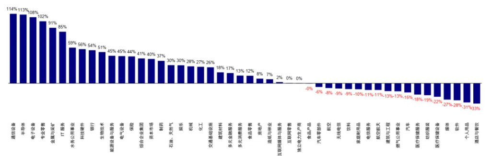

资料来源：FactSet，中金公司研究部

**► 估值：恒科估值几乎回到原点，无风险利率走高是主要拖累。** 时隔两年，恒科12个月动态PE 14.2，基本回到924前14倍的起点。对比看，恒指期初动态PE    8.7，当前9.9，扩张14.2%；A股估值修复更明显，上证指数动态PE由10.7升至12.4，扩张16.7%；创业板指估值由17升至19.3，扩张13.7%。

图表19：恒科估值回到原点，创业板虽领涨但估值变化不大

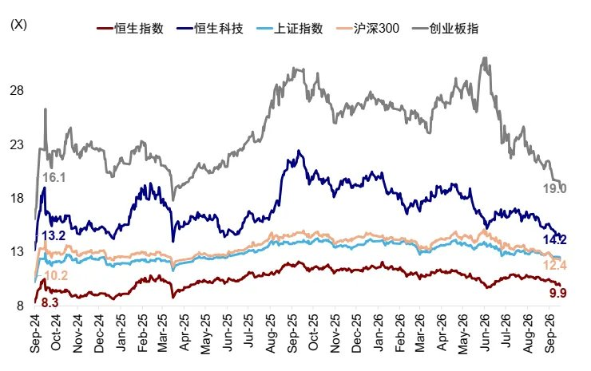

资料来源：Wind，中金公司研究部

进一步将估值拆解为无风险利率与股权风险溢价，我们发现港股估值主要受无风险利率拖累（中债与美债按南向成交占比的动态加权），美债利率的走高（从3.7%升至5.2%）拖累恒科估值13.7%，风险溢价的改善则贡献了18.1%。

分行业看，924以来，银行、资本品估值提升最显著，动态PE分别由4.4与7.8升至6.2与10.5；消费板块估值则大幅收缩，其中汽车及零部件由29.1降至12.6，收缩56.7%；食品零售由30.1降至14.9，收缩50.4%。对比之下，硬件设备、半导体、原材料这类领涨行业，动态PE同样收缩10%-20%不等，主要是得益于更强劲的盈利增长。

**► 盈利：恒科EPS原地踏步，科技增长消费下滑。** 924至今，恒科动态EPS仅小幅上行2.5%，在主要指数中垫底。恒指与MSCI中国EPS同期增长10%；A股盈利改善更突出，上证指数EPS增长14%，创业板指EPS增长69%，盈利增长贡献了88%涨幅中的绝大部分。

图表20：恒科动态EPS仅小幅上行2.5%，创业板指EPS扩张65%，业绩贡献绝大部分涨幅

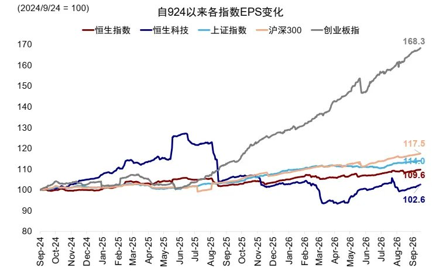

资料来源：FactSet，中金公司研究部

行业层面也是如此，原材料、硬件设备板块EPS增长83.3%、80%，股价上涨完全依靠盈利增长；相反，食品饮料、家用产品与耐用消费品等消费板块EPS普遍下修5%-20%，这也与前文中提到的居民信贷脉冲、存量信贷走弱的宏观信号相互印证。

**► 流动性：南向流入明显收窄，公募与海外基金配置均已接近甚至低于924。** 今年以来港股流动性显著趋紧，南向资金今年前9个月累计净流入仅4400亿港元，显著低于2025年1.4万亿港元流入。配置上，境内公募、海外主动基金对港股配置均已回落至924底部附近甚至更低。国内二季度主动偏股公募港股持仓占比由2025年中高点32.1%回落至15.1%，创2022年三季度以来新低。海外资金同样如此，EPFR显示海外主动资金今年以来持续流出，截至8月底对中资股配置比例从2025年中的7.2%降至6%，接近924时的5.6%。

总结而言： **924两年过去了，恒科“原地踏步”，估值回到起点、盈利也几乎零增长。** 这其中，科技板块的表现和盈利都显著增长，消费的表现、业绩与估值都大幅收缩且低于924， **意味着比924之前的结构分化更为显著** 。资金配置上，公募港股配置已经低于924，海外资金也基本回吐了过去两年的配置。

## 三、为何整体经济尚可，恒科却成为全球回报洼地？

过去两年，中国实际GDP增速维持在5.0%左右，总量增速不算差，产业层面并不乏亮点，如AI算力、新能源等新质生产力赛道蓬勃发展，外需维持高景气且持续超预期。但与之形成鲜明反差的是，港股尤其是恒生科技大幅回撤，几乎跌回924起点，指数回报与宏观经济明显背离。对比美国（2.2%左右），虽然实际GDP增速不如中国，但股市表现却更强。

**除了前文中港股恒科自身特殊的结构因素和资金面外，从总量上还有两层原因：** 一是美国的名义增长更高（美国2025年名义GDP增速约5% vs. 中国名义GDP增速4%）；二是名义增长（收入）向实际利润（盈利）的传导，这其中则包含了利润率与周转率的差异。

图表21：中国虽然实际GDP增长高于美国，但考虑通胀后的名义GDP增长层面美国更高

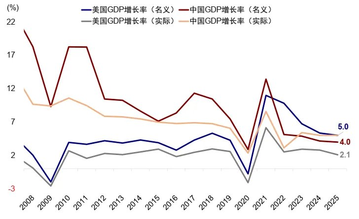

资料来源：Wind，中金公司研究部

经济总量扩张、出口增长和产业景气度提升，并不必然意味着上市公司利润同步增长，如果 **1）过于激烈甚至非理性的竞争导致利润率下降** ，则会“增收不增利”； **2）不考虑回报的过度投资会拉低周转率并增加杠杆** ，即便账面利润增长，也会挤占现金流，最终影响资本回报。具体来看，

**► 行业竞争加剧、原材料涨价、汇兑损失等因素都会导致利润率下滑，导致“增收不增利”。** 在需求不足、供给扩张较快的背景下，企业通过降价争夺市场份额、扩大收入规模，却可能面临利润率持续下滑。规模以上工业企业的毛利率（12个月平均）由2021年的17%降至当前的15%，2026年以来有小幅改善。此外，伴随产能利用率的不断下行，亏损企业数量占比升至30%，也反映出行业竞争的加剧。

上市公司层面，A股非金融企业毛利率由4Q21的18.3%降至2Q25的17.7%，2Q26回到18.3%，上半年港股非金融企业毛利率和净利率分别为22.8%和6.4%，也略有改善，但仍大幅低于2018年上半年25.8%和8.3%的高点。上述改善也由部分行业驱动，科技板块盈利能力改善，信息技术行业毛利率由2025年上半年的17.4%升至2026年上半年的18.9%，其中半导体净利率同期由3.8%大幅提升至9.0%。相比之下，消费板块持续承压，同期毛利率由29.6%降至28.8%，净利率由9.4%降至7.3%（《四季度如何配置？财报里的胜率赔率线索》）。

图表22：科技板块盈利能力改善，相比之下，消费板块持续承压，同期毛利率降至28.8%

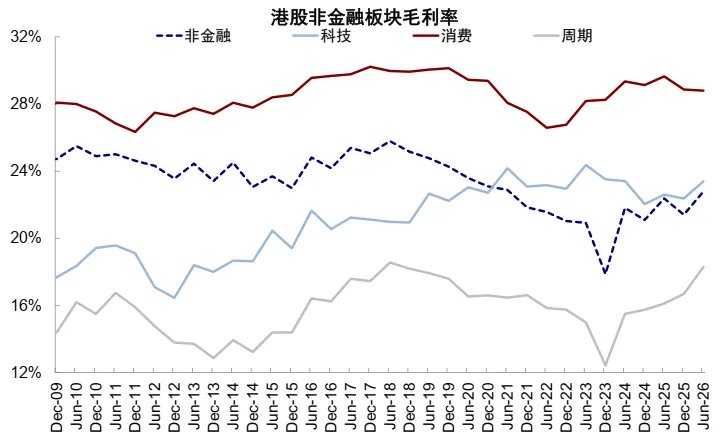

资料来源：Wind，中金公司研究部

**► 过度投资与低效扩张降低资本使用效率，即使账面的利润绝对值还在增长，仍可能压低ROE。** 即便通过大量新增投资短期可能带来利润抬升，但如果持续依赖加杠杆和低回报的产能扩张，最终资本回报率反而可能下降。低效产能出清偏慢，导致供给增长快于需求，不仅加剧价格竞争，也降低了既有资产的使用效率，应收账款回收周期拉长、存货周转放缓。例如，制造业应收账款平均回款周期已拉长至70天以上，产成品库存周转天数也升至21天，回款周期拉长、营运资本占用上升。

我们在《中美上市企业盈利对比》中曾深度探究了中国非金融上市企业盈利能力与美股公司的系统性差距，MSCI中国的ROE明显低于美股，利润率的差异解释了大部分ROE的不同，资产周转率也普遍偏低，与上文的结论一致，而这又可以归因于中美在一次分配中要素资源配置的效率（金融资源的分配机制）、二次分配中税收的差异、全球价值链中所处位置、行业集中度等方面的不同。

总结而言， **从景气行业的高投入转化为利润，需要匹配的高利润率、以及更高的资产周转率来支撑，过于激烈甚至非理性的竞争、或不考虑回报的过度投资，都有可能挤压最终的利润和资产回报。**

## 四、 是否会跌破924，又靠什么能再崛起？短期赔率价值凸显，但长期靠居民信用修复

短期看，根据我们在《港股市场的底部特征》中梳理的框架，恒科在近期新一轮快速回调后，已经再度具备了短期的底部特征，即赔率价值： **1）估值与风险溢价** ，当前14.2倍动态PE已是924以来最低，2.9%的风险溢价距6月底3%的高位也仅一步之遥； **2）情绪** ，14日RSI一度达到27.7的超卖水平； **3）资金** ，近期南向资金有加速流入迹象，根据《谁是“聪明钱”》中梳理的规律，可以视作短期的底部指标。 **我们最新的赔率胜率框架显示，恒科的赔率处于有吸引力的区间。**

图表23：恒生科技也再度触及了超卖区间

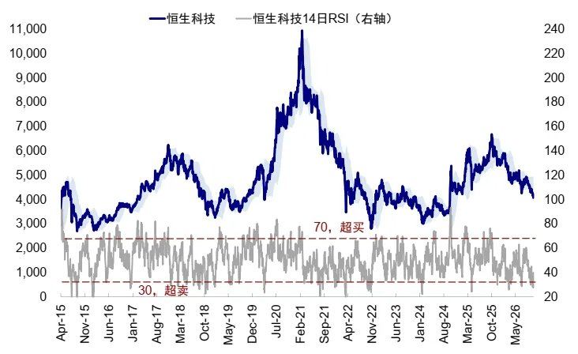

资料来源：Bloomberg，中金公司研究部

图表24：我们最新的跨资产与市场赔率胜率框架显示，恒科赔率处于有吸引力的区间

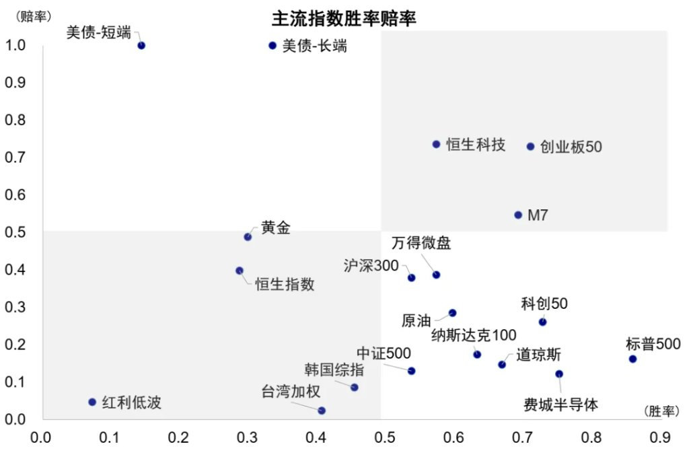

资料来源：Wind，FactSet，中金公司研究部

但要明确的是，也是我们一直强调的一点： **单纯靠超卖情绪、低位仓位、估值赔率仅构成短期反弹的条件，并不直接等同于趋势性大底已经确立，估值低可以不跌（赔率），但也未必涨（胜率）** ，这即是过去一年市场告诉我们的教训，也是90年代日本市场给我们的经验（《“被忽略”的牛市：日股90年代三轮牛市启示录》）。

**港股要再度崛起，核心要看信用周期、尤其是居民信用周期的实质改善，这也是2025年反弹的关键，而这在短期内又靠财政的倾斜发力** （重现924时刻）。本周财政部安排的5500亿元地方政府债务结存限额，将主要在11-12月落地投放，相较去年同期新增约500亿元， **我们测算四季度广义财政赤字脉冲有望小幅抬升，但仍需要更多对居民端直接发力** 。除此之外，港股互联网龙头的DeepSeek时刻也是另一个可以关注的催化（年底指数调整后有望小幅改善其结构，《恒生科技扩容的影响与意义》）。

因此， **恒科仍是赔率突出，但胜率不足的特征，要真正打开上行空间，需要重现“924时刻”或“DeepSeek时刻”** 。如果居民信用脉冲修复，恒科的弹性甚至会好于消费本身。配置层面，继续遵循“赔率博弈+结构选股”思路： **科技要等产业催化** （三季度业绩与Anthropic上市催化）， **周期看加息担忧缓解** （CPI与10月底FOMC）； **内需还得待更强财政信号** （年底经济工作会议）； **如果以上都没有，那么就只能以红利对冲了** 。我们最新更新的行业层面赔率胜率显示，近期排名靠前的行业分别是能源、交运、保险、汽车及零部件、原材料以及制药。

本文来源：[中金点睛](https://mp.weixin.qq.com/s?__biz=MzI3MDMzMjg0MA==&mid=2247863949&idx=1&sn=46ac10fee94d40390645bbd8ab0370ff&chksm=eb91abb446f10e2d92a712c5eba74ad79a073c4b4888cd5e8dc023ea9218a60686a58d179a29&mpshare=1&scene=23&srcid=1013aQC2eLKQSW1ogzyhYEOz&sharer_shareinfo=7131abada9c38d914d3cbc8f71167179&sharer_shareinfo_first=7131abada9c38d914d3cbc8f71167179#rd)

风险提示及免责条款

市场有风险，投资需谨慎。本文不构成个人投资建议，也未考虑到个别用户特殊的投资目标、财务状况或需要。用户应考虑本文中的任何意见、观点或结论是否符合其特定状况。据此投资，责任自负。
