# 中金：如何对冲AI风险？

- 页面显示时间：2026-10-22T08:17:23+08:00
- 页面署名：董静
- 标注来源：中金公司李昭等
- 原文：[华尔街见闻](https://wallstreetcn.com/articles/3784163)
- 取得时间：2026-11-04T16:03:47+08:00
- [HTML阅读版](article.html) · [来源记录](metadata.json)

## 导语

中金认为，除配置现金、中债、高股息股票等防御性资产外，美元贬值交易同样可对冲AI风险——AI降温将削弱美元需求，二者负相关可形成天然对冲。增配黄金是执行该交易的最优工具，2026年黄金与美元相关系数高达-81.2%，且历史上美元下跌期间黄金上涨胜率达92.3%，显著优于美债。

---

**中金研究**

> 我们仍看好AI资产回报前景，建议通过资产配置应对近期市场波动，为AI资产“购买保险”。在现金、债券和高股息股票等防御性资产外，美元贬值交易同样有助于对冲AI资产风险，增配黄金或为该交易的有效策略。

**从AI交易交易到“AI美元”，美元成为全球股市分化的“分界线”**

在国际货币秩序重构背景下，我们认为“去美元化”仍是大势所趋，美元面临长期贬值压力（《去美元化结束了吗？》）。但2026年以来，美元走势阶段性偏强，除地缘冲突引发通胀压力外，AI行情可能提供关键支撑。一方面，先进芯片、云服务和算力等AI产业链跨境交易较多采用美元结算，产业扩张可能阶段性增加美元需求，形成所谓“AI美元”效应。另一方面，AI投资增强相关经济体的增长动能，尤其是美国，预计2026年实际GDP增量近三成来自AI。经济增长韧性为美联储加息创造条件，美债利率上升推高美元。但对于AI受益程度较低的经济体，美元走强带来的外部融资条件收紧和资本流出压力，反而会拖累经济与市场表现。

在上述机制影响下， **美元成为AI革命中全球股市分化行情的分界线：** 2026年以来，深度参与AI产业链的美国、日本和韩国股市与美元正相关，而AI受益相对有限的印度股市、恒生指数则与美元负相关。

图表1：2026年以来，日经225指数与美元呈正相关

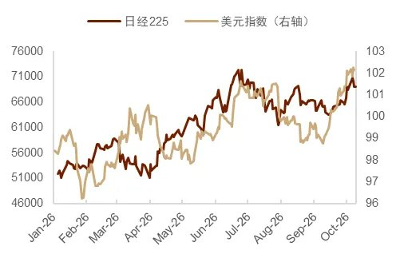

资料来源：Wind，中金公司研究部

图表2：2026年以来，韩国KOSPI指数与美元呈正相关

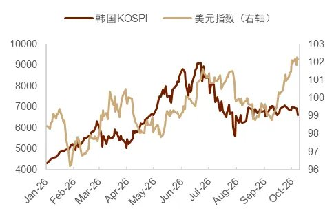

资料来源：Wind，中金公司研究部

图表3：2026年以来，恒生指数与美元呈负相关

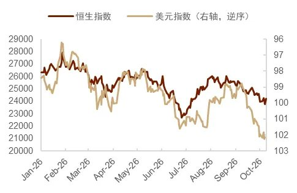

资料来源：Wind，中金公司研究部

图表4：2026年以来，印度股市与美元呈负相关

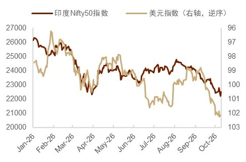

资料来源：Wind，中金公司研究部

图表5：2026年以来美元指数与主要资产走势的相关性：美元成为全球股市分化的“分界线”

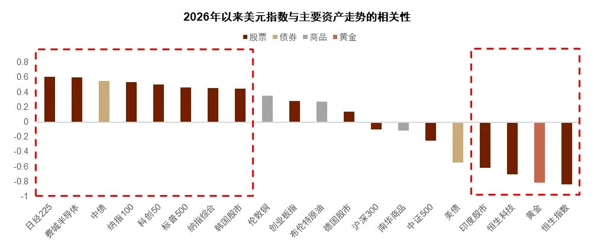

注：各类资产数据截至10月8日。

资料来源：Wind，中金公司研究部

## AI交易波动加大，除增配防御性资产外，美元贬值交易也可作为对冲选择

尽管AI革命仍处于早期阶段，但市场已开始担忧头部厂商的增长放缓，以及未来回报能否覆盖当前的大规模投入。市场预计，美国AI七巨头资本开支同比增速将由2026年的约90%降至2027年的36%，投资回报的不确定性也加剧了AI资产波动。

图表6：市场预期2027年AI资本开支仍将增长，但增速明显放缓

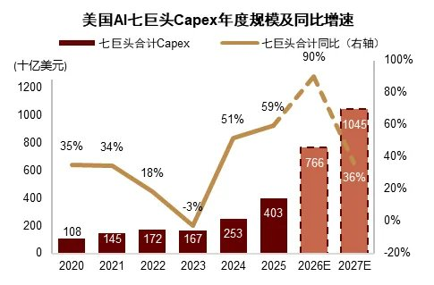

资料来源：Bloomberg，中金公司研究部

在此背景下， **增配现金、中债和高股息股票等防御性资产具有合理性。** 在此之外，根据前文分析，AI交易降温可能削弱美国相对增长优势及美元需求，美元贬值交易亦有望对冲AI资产的调整压力。

美元贬值交易的另一优势在于，其获利情景并不限于AI行情转弱：如果美伊局势缓和推动油价回落，或美国通胀明显改善、促使美联储转向降息，AI资产受益于流动性改善，美元贬值交易从中受益，此时AI股票也可能同步上涨。因此， **相比单纯减持AI资产，布局美元贬值交易既可保留AI上涨的收益敞口，也可在多种情景下提供组合保护。**

这一对冲逻辑的主要风险是美元流动性危机。如果AI行情剧烈调整引发全球资产集中抛售，投资者争相变现、获取美元现金，美元可能走强，与股票反向波动，对冲能力失效。但当前AI行情调整主要体现为投资回报担忧引发的风险偏好下降和资产再配置，尚未演变为无序的流动性冲击，美元与科技股更可能正相关。近期美股科技股调整期间，美元指数亦从10月14日高位回落，与这一判断相符。

上述分析主要聚焦汇率与股市的短期关系；拉长时间看，即使AI革命成功，股票上涨也未必伴随美元升值，原因在于“逆巴萨效应”带来实际汇率贬值压力（详见《AI冲击下的“逆巴萨效应”》）。

## 黄金是布局美元贬值交易的有效工具，建议增配

布局美元贬值交易，最直接的方式是做空美元，但外汇交易面临诸多限制，增配黄金或是更便利的策略表达。从理论上看，黄金作为美元体系的替代性资产，与美元存在负相关的基础，但由于金价同时受到利率、通胀和避险需求等多重因素影响，这一关系在历史上并不始终稳定。但进入2026年，黄金与美元负相关性明显增强，相关性升至-81.2%。 **美元与黄金成为一个硬币的两面，让增配黄金成为美元贬值交易的有效工具。**

图表7：2026年以前，黄金与美元相关性并不稳定

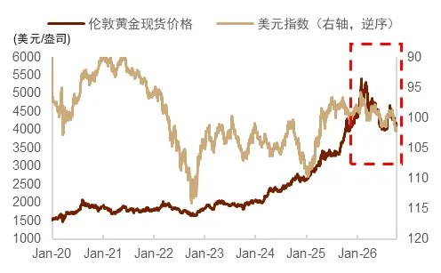

资料来源：Wind，World Gold Council，中金公司研究部

图表8：2026年以来，黄金与美元负相关明显增强，相关系数高达-81.2%

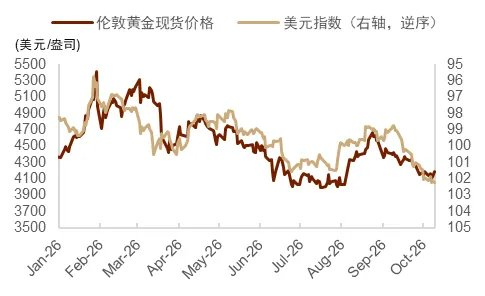

资料来源：Wind，World Gold Council，中金公司研究部

相比之下，油价和美债利率对黄金的影响更多体现为阶段性扰动：年内油价大幅涨跌均未持续主导金价走势，美债收益率上行也未能始终压制黄金表现。

图表9：5-6月油价下跌，并没有利好黄金；8月油价大涨，并没有压制黄金

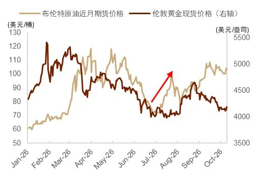

资料来源：Wind，World Gold Council，中金公司研究部

图表10：7月之后美债利率加速上行，但并未妨碍黄金8月上涨

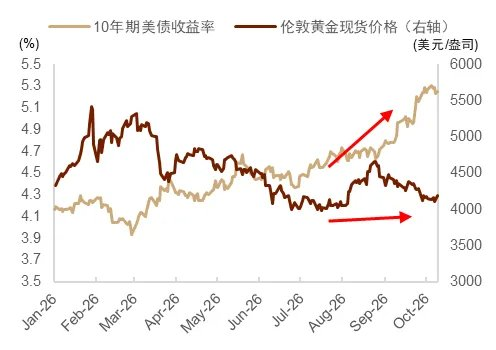

资料来源：Wind，World Gold Council，中金公司研究部

除黄金外，美债也是布局美元贬值交易的潜在选择，但胜率可能低于黄金：如果美元贬值源于通胀回落和美联储降息，黄金与美债均可能受益；如果美元贬值源于美国债务风险上升或美元信用动摇，黄金可能受益于替代性资产需求，美债却可能因期限溢价上升而下跌。

历史复盘也支持上述判断。我们复盘了2000年以来持续至少14天的全部91段美元下跌区间，黄金上涨84次，胜率达到92.3%，区间收益率中位数为5.46%；同期2年期和10年期美债收益率下降的比例分别为68.1%和64.8%。

图表11：2000年以来美元指数下跌期间，黄金上涨胜率高于其他大类资产

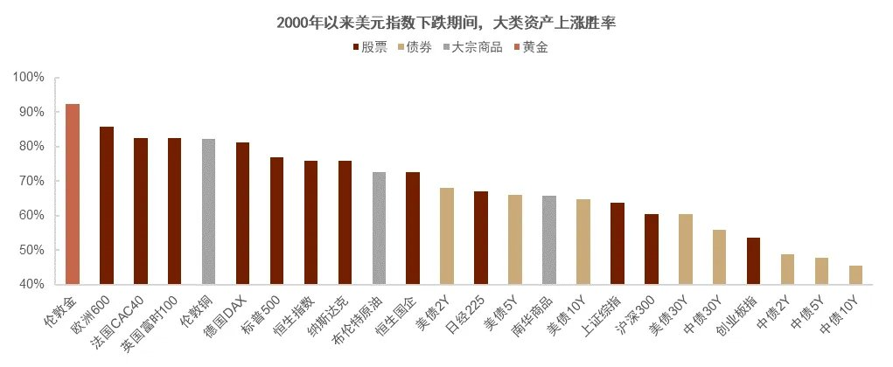

资料来源：Wind，中金公司研究部

综上所述，我们建议在增配高股息、现金与中债之外，增加黄金配置，布局美元贬值交易，对冲AI资产风险。美债的配置性价比可能也会逐步提高，建议保持密切关注。

本文来源：[中金点睛](https://mp.weixin.qq.com/s/wIEuj2yAkhXjBrfLENfoKw)

风险提示及免责条款

市场有风险，投资需谨慎。本文不构成个人投资建议，也未考虑到个别用户特殊的投资目标、财务状况或需要。用户应考虑本文中的任何意见、观点或结论是否符合其特定状况。据此投资，责任自负。
