# 中金：市场如何见底？

- 页面显示时间：2026-11-02T09:35:49+08:00
- 页面署名：董静
- 标注来源：中金刘刚、张巍瀚等
- 原文：[华尔街见闻](https://wallstreetcn.com/articles/3784961)
- 取得时间：2026-11-04T16:02:16+08:00
- [HTML阅读版](article.html) · [来源记录](metadata.json)

## 导语

中金认为，当前港股估值与机构配置已接近2024年初低点，具备短期反弹的赔率条件，但回购规模大幅缩水、一级市场供给依然火热、居民信用周期尚未实质改善，真正的市场底部仍需财政政策进一步发力并向居民部门倾斜，方能重现"924时刻"。

---

**摘要**

近期，中国市场表现疲弱，情绪降温。港股恒生科技从去年10月高点后持续下跌，前期就已经跌回“924”原点（《924两年后有何变化？》）（图表1）。近期A股表现也走弱，科创50与创业板指从6月底高点均已回撤接近45%（图表2）。

图表1：恒科目前已经跌破2024年924起点

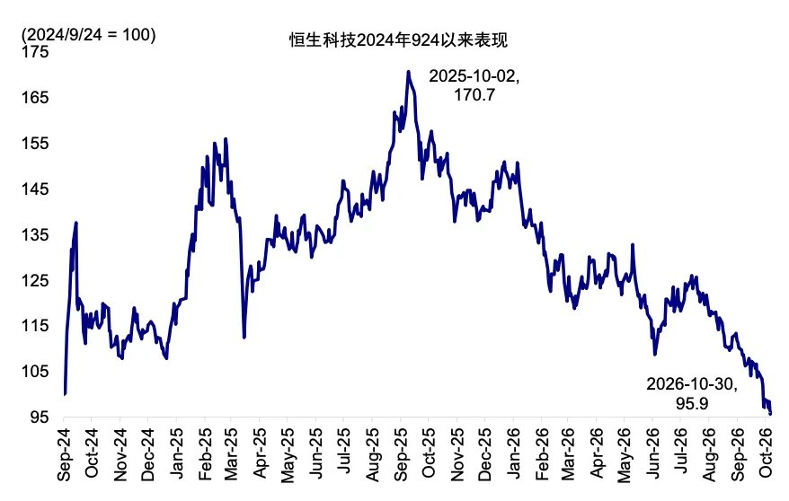

资料来源：Wind，中金公司研究部

 

图表2：科创50与创业板指从6月底高点均已回撤接近45%

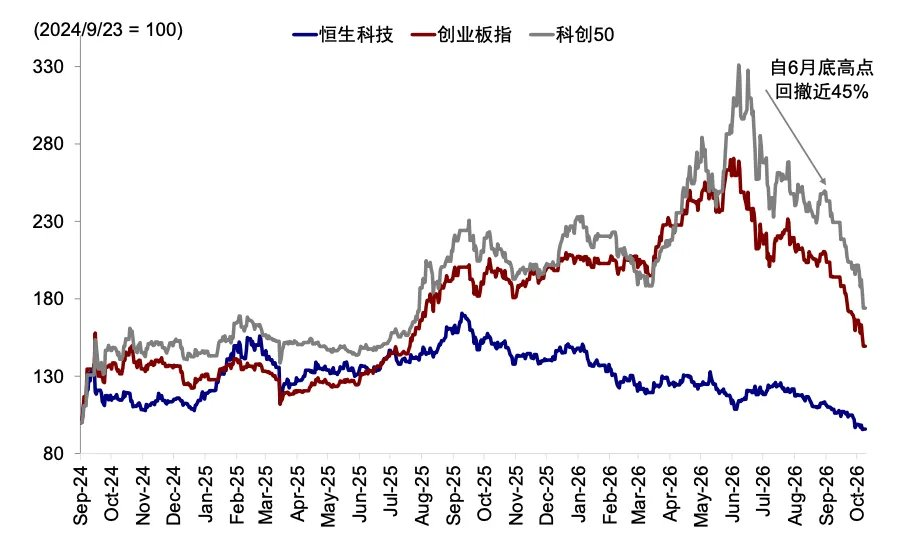

资料来源：Wind，中金公司研究部

**我们对市场的这一表现并不完全意外，至少是对港股** 。去年底以来，与市场上弥漫的各种乐观叙事不同（如人民币升值推动外资流入、居民资产负债表修复和再通胀、中国资产重估等等，不一而足）， **我们一直持谨慎看法，核心的理由就是整体信用周期震荡、尤其是居民部门信用脉冲回落** （图表3） **，会明显拖累市场表现，特别是内需敞口大的方向** （图表4） **，除非财政加大发力力度** （《2026年展望：“牛市”的下一步》、《2026下半年展望：热闹是他们的？》、《股市和汇率谁“错”了？》）。

今年以来，随着居民信用周期持续走弱、资金面大幅收紧，港股尤其是“大号版消费”的恒科持续跑输，也验证了我们这一看法（图表5）。

图表3：居民部门信用脉冲持续下行，今年3月起已经低于924的起点

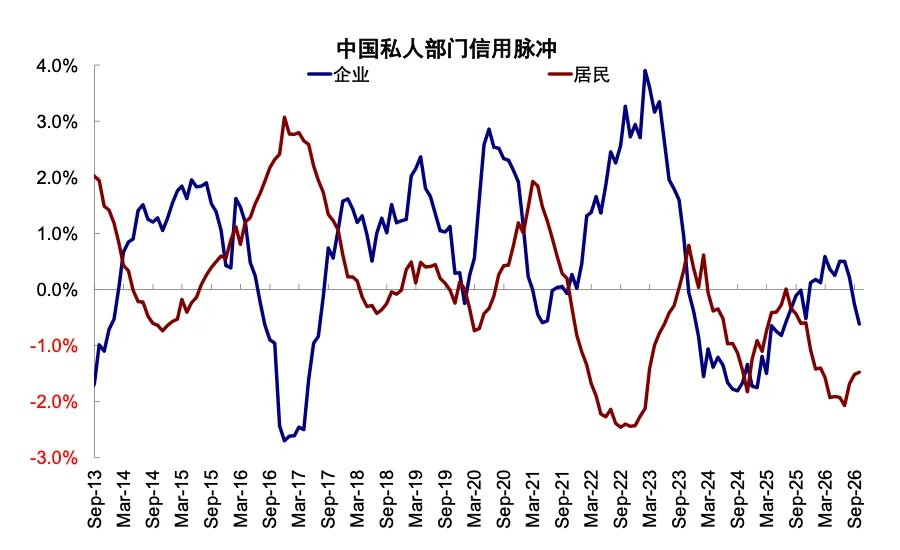

资料来源：Wind，中金公司研究部

图表4：这一背景下，市场表现整体承压，特别是内需敞口大的方向

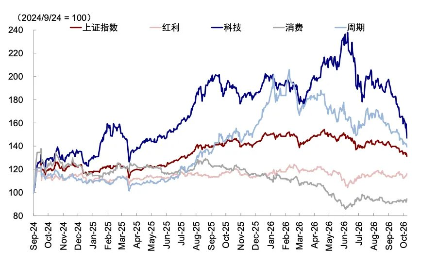

资料来源：Wind，中金公司研究部

图表5：恒科70%以上权重都集中在互联网、电动车、电商与消费电子等与消费息息相关的板块

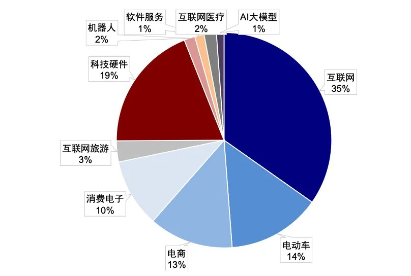

注：数据截至2026/10/31

资料来源：Wind，中金公司研究部

**既然现在已经大幅回调，市场何时或者在什么条件下能够见底，就自然成了更重要的问题** 。一谈到底部，2024年的924就是最容易被唤醒的记忆，不单是因为距离我们足够近，更因为底部的时间更久更深刻，也因为后续的反弹更强劲。

回顾过去多年的周期起伏， **港股与A股有一些容易被忽略的事实：1）港股总是领先A股见顶** （2021年2月恒科见顶、领先创业板8-9个月；此次2025年10月恒科见顶，同样领先创业板8-9个月，图表6）； **反过来，港股往往也是领先A股见底** ； **2）924并非港股的底部，港股“真正”的底部在2024年1月底** ，领先A股8-9个月（图表7）； **3）港股过去十年基本遵循“一年修复、一年大牛，一年大跌、一年震荡”的规律，即“一次管三年、三年等一次”** ，如2016年修复、2017年大涨、2018下跌、2019年震荡；2020-2021年初大涨、2021-2022年下跌，2023年震荡；4）2024年修复、2025年大涨，2026年大跌（图表8）， **这背后只是“如有雷同”的巧合，还是另有什么规律可循？**

图表6：从近年来两地市场的见顶时点上看，恒科往往领先创业板指8-9个月见顶

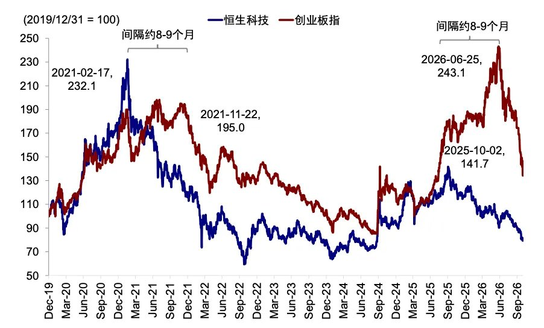

资料来源：Wind，中金公司研究部

图表7：两地市场见底的时点同样有类似规律，恒科2024年1月已见底，但创业板要等到924

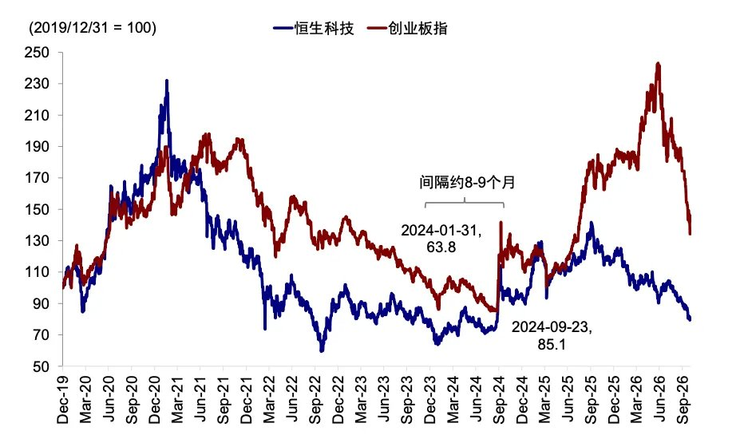

资料来源：Wind，中金公司研究部

图表8：港股大致呈现3-4年左右的周期规律

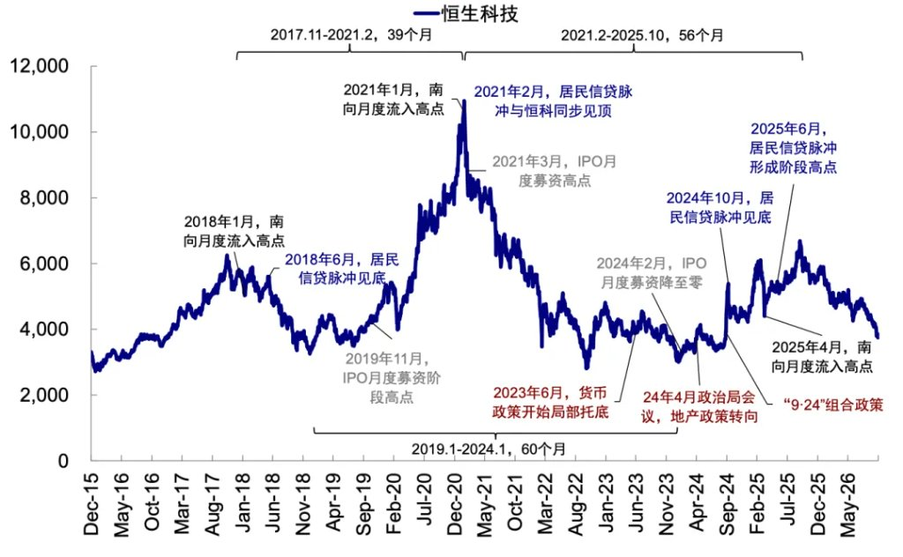

资料来源：Wind，中金公司研究部

本文中，我们通过对比分析上述周期，回答当下市场最关切的核心问题： **市场如何见底？**

**正文**

## 一、港股为何总是“领先”A股见顶和见底？领先见顶是因为对经济周期尤其是内需更敏感，领先见底则是因为避险思维和红利更多

**一个有意思的现象是，在过去五年两轮中国市场的起伏周期中，港股不仅领先A股见顶，也更早见底。** 这一看似巧合的现象，背后反映的其实是两地市场行业结构、定价机制和资金偏好的差异。

**首先说顶部** ，上一轮港股在2021年2月便开始调整，互联网监管、地产信用收缩及企业扩张放缓率先压制其表现，但A股部分成长板块行情仍延续至当年11月，两者相差约8-9个月。本轮也是如此，港股恒科2025年10月见顶，但A股科技成长行情受益于AI硬件的景气，直到6月底见顶，恰好也相差8-9个月（图表6）。 **两轮调整中相似的时间差，也反映出港股与A股在基本面暴露和资金定价机制上的差异** 。

**► 首先，行业结构决定港股更早反映经济周期尤其是居民信用周期变化，A股则靠景气结构延续更久，直到新动能也耗尽。** 我们在近期多篇报告中强调，港股尤其是恒科更像是一个“大号版的消费指数”，互联网、电商、消费电子等泛消费板块占据较高权重，恒指还包含较多金融、地产等信用敏感行业（图表9）。因此，当居民信用收缩、地产销售和消费需求走弱时，港股盈利预期和估值更容易率先承压。2021年便是如此，互联网监管和地产信用收缩拖累港股，而A股新能源、半导体等高景气行业仍能支撑行情延续（图表10）。本轮同样如此，2025年底以来居民信用脉冲持续下行，拖累港股互联网和消费板块，但A股AI硬件、算力及部分出口链条仍具备较高景气度，使两地表现再度分化；

图表9：相比而言，恒指成分更加多元，比恒科多了一些红利与本地股

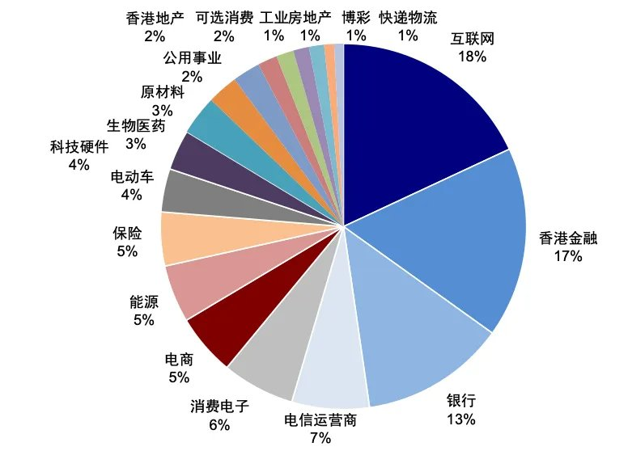

注：数据截至2026/10/31

资料来源：Wind，中金公司研究部

图表10：2021年互联网监管和地产信用收缩拖累港股，而A股新能源、半导体仍支撑行情延续

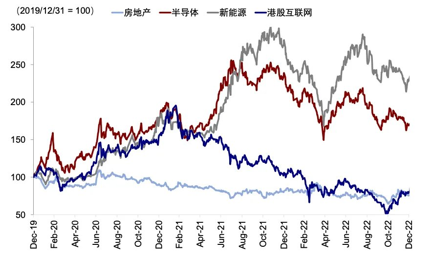

资料来源：Wind，中金公司研究部

**► 其次，离岸市场属性使港股更容易提早感受到风险偏好的“风吹草动”，A股在未完全开放的资本账户下有自己的“独立气候”。** 不同于A股以境内资金为主、跨境配置受到一定约束，港股作为离岸市场，需要与全球其他市场持续竞争资本。因此一旦国内盈利预期放缓、其他市场相对回报更具吸引力，海外投资者便可能率先降低港股配置，推动股权风险溢价（ERP）抬升（图表21）。以外资动向为例，2021年，港股在互联网与地产风险显现后率先承受估值收缩压力，EPFR数据显示海外主动资金自2021年3月流入便开始放缓并整体震荡（图表11），主动资金配置比例也同样在当年1月底到达高点13.6%后走低，并自9月起转为低配；本轮也是类似，海外主动资金配置比例在去年10月底从6.9%降至目前5.7%，但A股市场资金直到9月以后才出现明显的负反馈（图表12）。

图表11：EPFR显示海外主动资金自2021年3月流入明显放缓转为震荡

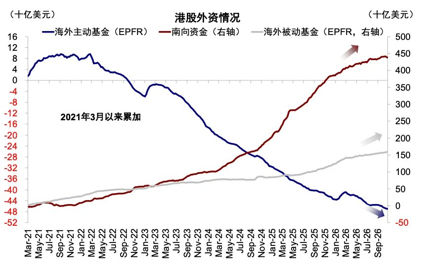

资料来源：EPFR，Wind，中金公司研究部

图表12：配置比例上则体现的更为显著，2021年1月与2025年10月均是当时主动资金配置高点

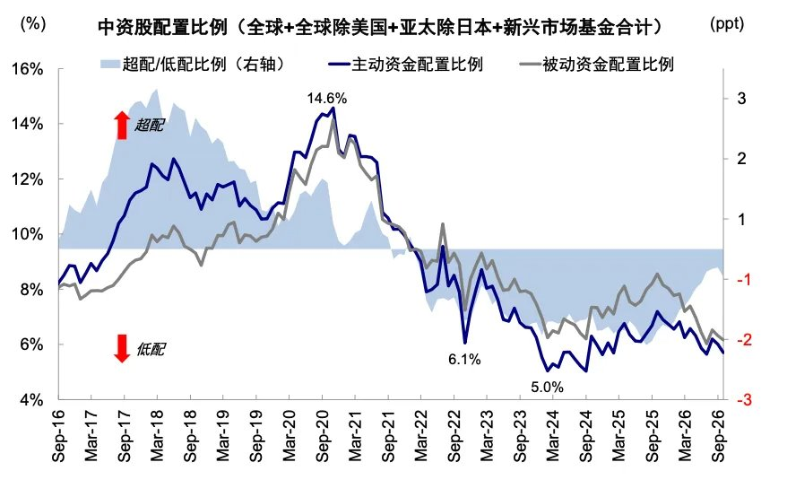

资料来源：EPFR，Wind，中金公司研究部

**其次看底部，港股似乎也领先A股见底。** 2024年便是典型案例。市场通常将“924”视为上一轮行情的起点，但港股实际上早在2024年1月便已见底，比“924”提前约8个月。但细看后就会发现， **这并非经济和盈利的见底，而是投资者在不确定环境中追求分红的固定回报，恰好港股红利占比多，进而推动指数率先企稳，本质还是一种避险思维。**

**► 首先，港股调整更早、幅度更深，仓位更低，都提供了率先企稳的条件** 。从估值、股息率、风险溢价和资金配置比例看，港股在2024年初就已经到了相当极端的位置（图表21图表11）。对比之下，A股上证以及创业板指在2024年初虽然也经历大幅回撤，但综合各个维度并没有港股这么极端，例如创业板指风险溢价也曾到过3.9%，但这一位置相比当时恒科的并不算极致（图表13）。

图表13：2024年1月底创业板指风险溢价也曾到过3.9%的高位，但相比恒科并不算极致

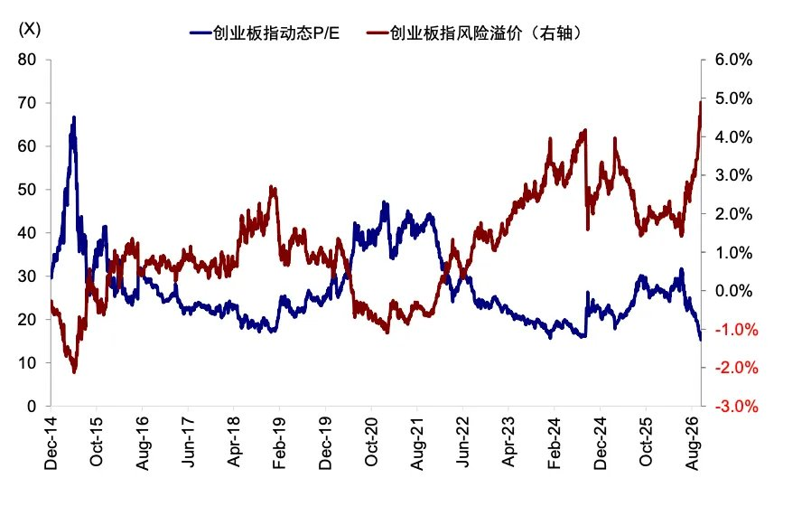

资料来源：EPFR，Wind，中金公司研究部

**► 其次** ， **港股提前见底不是基本面的见底，而恰是投资者避险的体现** 。2024年1月底港股逐步见底直到924的底部，板块上主要是腾讯为代表的科技互联网板块（涨幅20.5%，后同）、保险（16.1%）、银行（12.3%）等高分红板块领先，但必需消费（-15.9%）与房地产（-11.4%）依然落后（图表14），恒生高股息指数2024年持续跑赢恒指与恒生科技（图表27）；盈利在2024年1月底市场底部前夕，恒指与恒科EPS尚未抬升，仍处于企稳或下修阶段（图表28），这说明当时市场见底并非源于基本面企稳。 **相反，红利策略大行其道恰恰说明投资者在增长不确定的环境下追求稳定受益来避险。**

图表14：2024年2月初至924前港股互联网与红利板块领涨，但必需消费与房地产依然疲弱

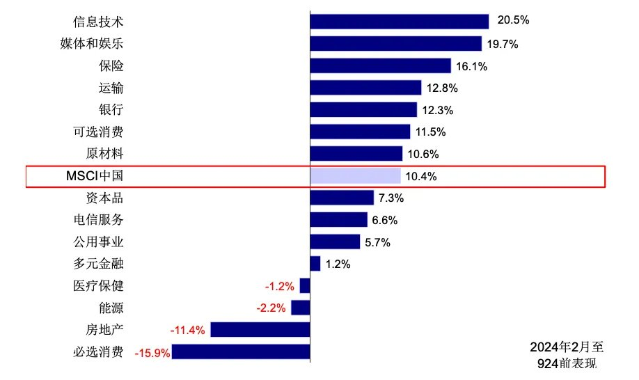

注：图中为MSCI中国各板块在2024年2月初至924前的涨跌幅

资料来源：Wind，EPFR，中金公司研究部

**2024年的互联网因增加回购也起到了与分红类似的“股东回报”效果。** 阿里于2024年2月新增250亿美元回购授权，腾讯于3月宣布全年回购规模至少达到1,000亿港元。2024年2月至924，腾讯累计上涨39.9%，港股红利指数上涨15.8%（图表16）。恒生科技指数回购收益（Buyback yield）一度高达2.4%，腾讯的回购收益从2023年的1.8%升至2.9%（图表15）。

图表15：2024年腾讯回购规模大幅增加，年度回购回报从2023年的1.8%增加至2.9%

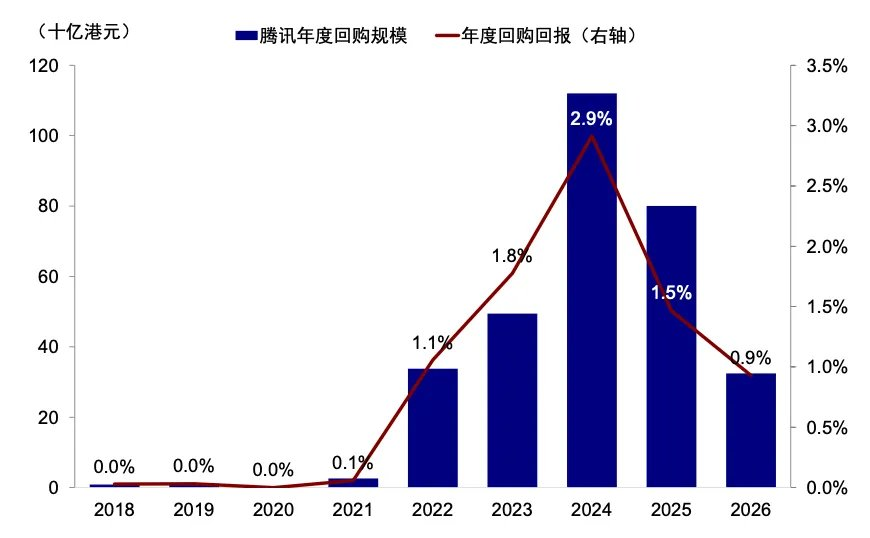

资料来源：Wind，中金公司研究部

图表16：实际上早在2024年2月港股便已启动，但那时更多是红利+回购的回报逻辑

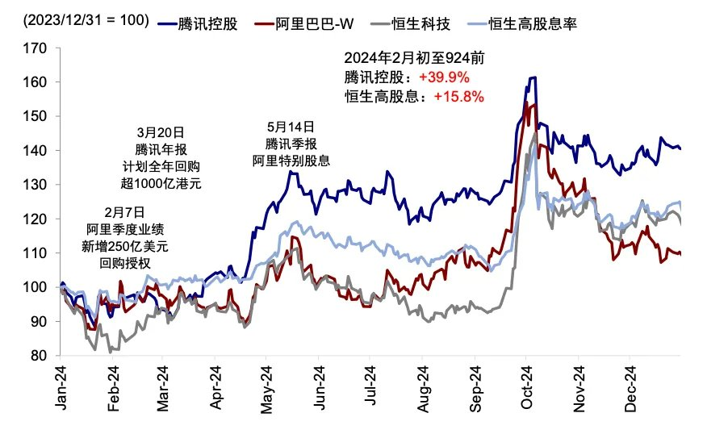

资料来源：Wind，中金公司研究部

其实A股也是类似，2024年924前，也是红利风格和板块，如通信、有色、银行等领涨（图表17）。 **只不过，港股的红利板块占比更高** （图表18）、 **股息率更高** （图表19）、 **再加上保险资金买港股红利也无需负担股息税** （图表20）， **因此红利策略占主导的时候，港股就更受益且先见底了** 。

图表17：A股市场同样如此，2024年初至924红利板块领涨，而消费与地产落后

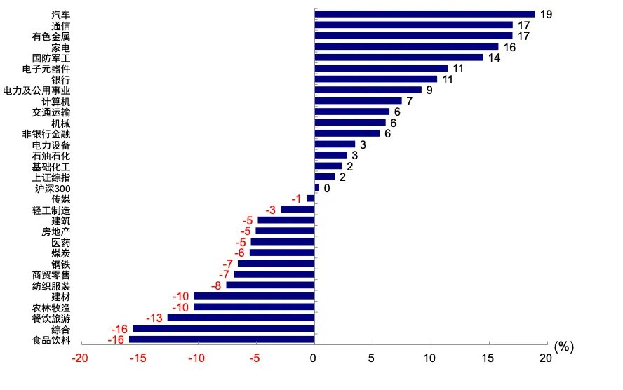

资料来源：EPFR，Wind，中金公司研究部

图表18：对比沪深300与恒生指数中红利相关标的的权重占比，港股明显更高接近40%

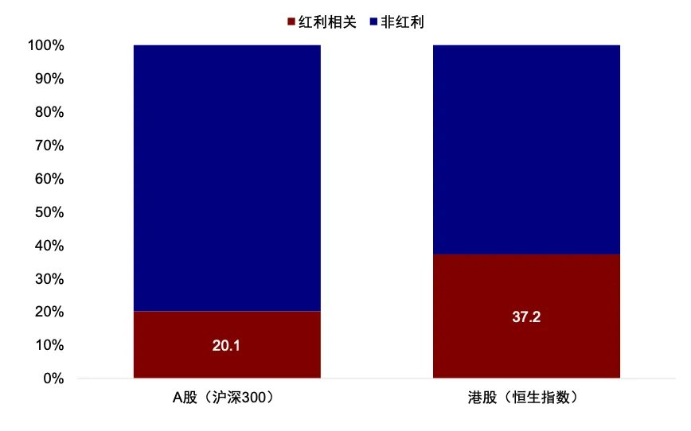

资料来源：EPFR，Wind，中金公司研究部

图表19：无论是恒指对比沪深300，还是恒生高股息对比中证红利，港股股息率均更占优

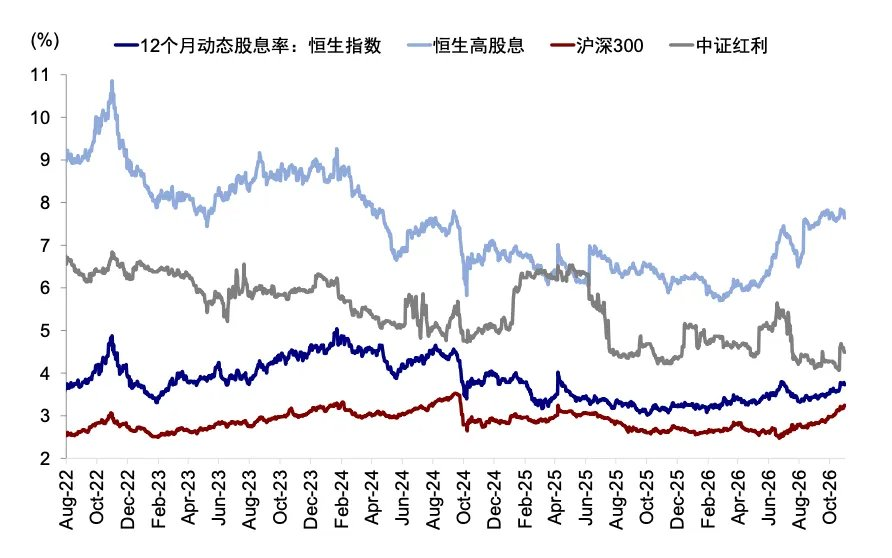

资料来源：EPFR，Wind，中金公司研究部

图表20：港股通红利税计征情况

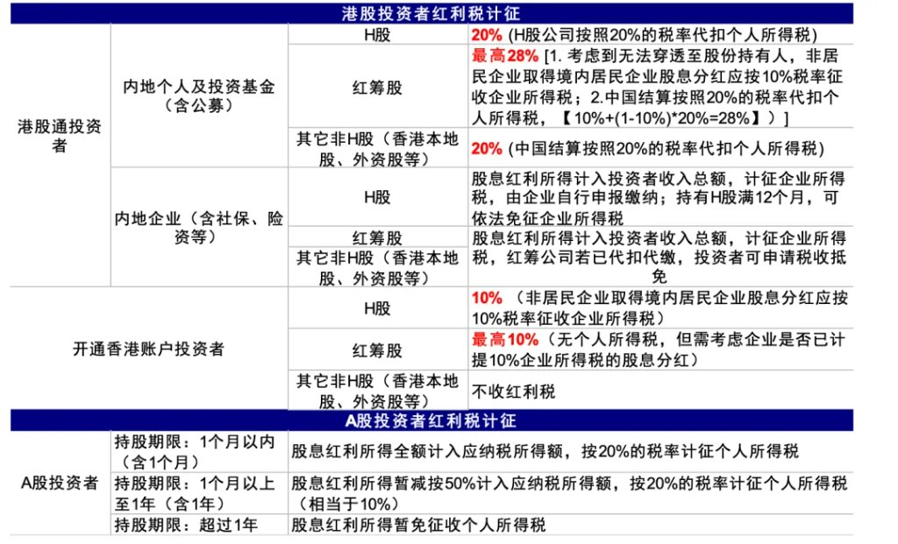

资料来源：中国证监会，中金公司研究部

当然，一些专门针对港股的政策可能也起到了支撑效果，但不应该作为固有因素去归因，如2024年4月19日证监会发布五项资本市场对港合作措施\[1\]等。

## 二、港股为何呈现大致“三年一轮”的周期性？信用周期决定行情趋势，资金供求与交易决定拐点

**港股大致呈现三到四年一轮的周期特征，过去十年基本遵循“一年修复、一年大牛，一年大跌、一年震荡”的规律，俗称“一次管三年、三年等一次”。** 以拐点计，2016年1月、2019年1月和2024年1月三个重要底部分别相隔约36个月和60个月；2017年11月、2021年2月和2025年10月三个顶部分别相隔约39个月和56个月（图表8）。

这种看似“如有雷同”的高度巧合，背后其实体现了信用变化、股价表现和资金供求之间交叉的影响。 **整体看，信用周期决定中期趋势，资金供求与交易决定拐点。**

**► 信用周期与港股表现高度相关，居民信贷脉冲顶部与恒科顶部同步至领先约12个月。** 顶部方面，2016年11月居民信贷脉冲见顶，领先2017年11月恒科顶部约12个月；2021年2月两者同步见顶；2025年6月居民信贷脉冲高点，领先2025年10月恒科顶部约4个月。底部方面，2018年6月居民信贷脉冲触底，领先2019年1月恒科底部约7个月；2024年10月居民信贷脉冲触底，较2024年1月31日恒科价格底滞后约9个月。但这也恰恰说明2024年1月的价格底是分红、回购等股东回报支撑的“分红底”，并非基本面底。

**那为何有三年一轮的规律？** 信用周期下行后，库存、产能等商业周期通常滞后信用拐点约3-17个月仍在下行；政策响应也需要时间，局部托底后2至16个月信用周期触底，全面发力则可使信用周期更快如1个月触底。 **因此，所谓的三年一轮的规律，恰是商业周期调整与政策反应、发力和传导时滞共同形成这一规律。**

**下行阶段，库存和产能顶点滞后信用顶约1个季度至14个月，政策从局部托底到全面发力可间隔约15个月，两者共同拉长信用下行和筑底过程。** 以2021年至2024年这一轮为例，2021年2月居民信贷脉冲见顶后，产能利用率到2Q21才见顶，滞后约1个季度；产成品存货同比到2022年4月才见顶，滞后约14个月。 **政策响应也需要时间。** 2023年6月，7天期逆回购利率和MLF利率先后下调10个基点，当月LPR也下调10个基点，货币政策开始局部托底；2024年1月宣布降准、2月下调5年期以上LPR，仍属局部托底。“9·24”才全面发力，距2023年6月约15个月；居民信贷脉冲到10月触底，全面发力领先信用底约1个月。

**上行阶段，政策全面发力可使信用快速见底，库存底滞后信用底约10至17个月，市场顶与信用顶基本同步至滞后约12个月。** 以2024年至2026年这一轮为例，“9·24”政策全面发力后，居民信贷脉冲于2024年10月触底，仅滞后一个月；产成品存货同比到2025年8月才见底，滞后信用底约10个月。2025年6月居民信贷脉冲形成阶段高点，恒科到10月才见顶，市场顶滞后约4个月。

**► 一级市场融资：高点与恒科顶部基本同步到滞后24个月，供给落地慢于行情。** 市场上涨、估值提高和风险偏好改善后，企业上市与再融资意愿增强，但IPO需要经过申报、审核和发行，配售、供股及代价发行也需要筹划和实施，新增供给往往在行情中后段才逐步增加。2017年11月恒科见顶后，IPO募资到2019年11月才达到高位，滞后约24个月，上市后募资则与恒科顶部基本同步；2021年2月恒科见顶后，IPO和上市后募资分别到2021年3月和4月达到高位，分别滞后约1个月和2个月。2025年10月恒科见顶后，IPO和上市后募资分别于2026年7月和8月形成阶段高点，分别滞后9-10个月，但是否为本轮最终高点仍待确认。

**融资低点在2024年滞后恒科价格底约1至7个月，解禁又使供给压力进一步向后延续。** 2024年1月恒科形成价格底后，IPO月度募资到2月降至零，滞后约1个月；上市后募资到8月才触底，滞后约7个月。IPO和再融资完成后，基石投资者、控股股东及其他受限股份仍需经过不同期限的锁定期，前期融资高峰形成的潜在供给可能在市场转弱后继续释放。

**► 二级市场：南向与主动外资筹码高点与恒科顶部基本同步，并在市场见顶后回落。** 主动外资配置比例于2018年1月、2021年1月和2025年10月达到各轮高位，分别较恒科顶部滞后约2个月、领先约1个月和基本同步。公募基金港股持仓占权益持仓比例在2017年四季度为36.9%，2018年四季度降至32.8%；2020年四季度为23.4%，2021年四季度降至15.0%；2Q25达到32.1%，3Q25仍为30.4%，4Q25降至26.1%。 **流量方面** ，南向月度净买入于2018年1月、2021年1月和2025年4月达到高点，分别较恒科顶部滞后约2个月、领先约1个月和领先约6个月。主动外资月度流入高点分别出现在2018年1月、2021年2月和2026年2月，分别较恒科顶部滞后约2个月、基本同步和滞后约4个月。

**底部阶段，南向与主动外资筹码低点均与恒科价格底基本同步，但主动外资超配比例低点滞后约18个月。** 公募基金港股持仓占权益持仓比例在4Q23降至16.2%，1Q24回升至16.9%，低点与2024年1月价格底基本同步；主动外资配置比例在2024年1月降至5.0%，也在同月见底。主动外资超配比例则在2025年7月降至-1.60个百分点，较价格底滞后约18个月，此后低配幅度逐步收窄。

**综上，港股“三年一轮”并非由单一变量决定，也非完全的巧合，而是信用、资金和政策依次传导的结果。1）** 居民信贷脉冲顶部与恒科顶部基本同步至领先约12个月， **市场降温后，二级市场资金与筹码先行出清，一级市场融资随后降温，但两者均有一定时滞，尤其是后者** ：主动外资流入高点与恒科顶部基本同步至滞后约4个月，一级市场融资高点则可滞后约24个月。 **2）反之，当市场走弱后，政策从反应、发力到传导也需要时间** ，局部托底到全面发力可间隔约15个月，全面发力领先信用底约1个月，库存底又滞后信用底约10至17个月，上述时滞叠加形成大致三年一轮的周期。

## 三、市场如何见底？以924为例，年初形成价格底，924推动修复扩散

**2024年市场如何见底，是一个当下有意义的借鉴。实际上，港股见底较924提前8个月** ，是估值和情绪充分调整、筹码出清、股东回报提高等多维因素共振形成价格底；924是政策预期全面转向、A股完成底部修复和港股修复扩散的关键节点。

**► 估值与情绪：2024年初和924都比当前更极致** 。经历2021年以来的持续调整后，恒科动态市盈率在2024年1月底降至12.9倍，动态股权风险溢价（ERP）升至4.3%；924反弹前夕的9月16日，两者分别为12.6倍和4.8%（图表21）。

图表21：恒科无论是估值还是风险溢价在2024年初就已率先到达极致位置，为反弹提供赔率

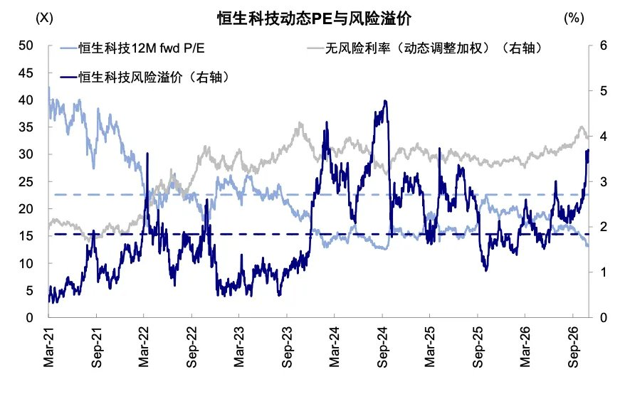

资料来源：EPFR，Wind，中金公司研究部

**对比当前** ，恒科动态市盈率13.1倍、ERP 3.9%，较2024年1月底和9月16日仍分别低0.4和0.9ppt。虽然恒科较2025年10月高点回撤44%，但风险溢价尚未回到当时极端水平。

**► 公司回购：2024年显著增加，当前却连续回落。** 2024年港股回购金额约2655亿港元，较2023年的约1268亿港元增长109%。主要公司中，腾讯当年全年回购由2023年的约494亿港元增至2024年的约1120亿港元，美团回购约278亿港元。

**对比当前** ，受资本开支影响，2025年港股回购金额回落至约1798亿港元，同比减少约32%；2026年截至10月31日约1282亿港元，较2024年同期减少约42%，较2025年同期减少约12%（图表22）。上市公司回购提供的资金支持明显弱于2024年。

图表22：2024年港股市场回购显著增加，当前回购距2024年仍有距离

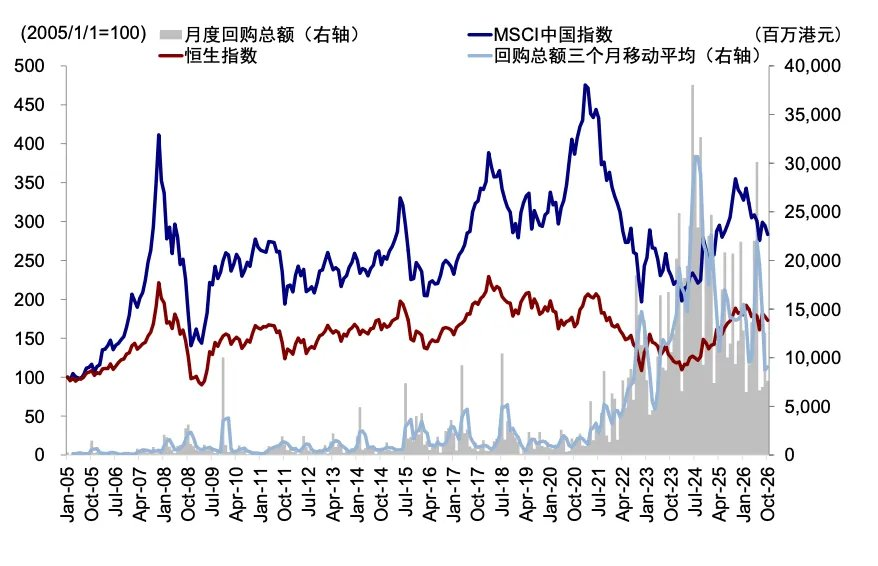

资料来源：EPFR，Wind，中金公司研究部

**► 机构仓位：当前接近2024年初主动外资和公募仓位的低点。** EPFR口径下，主动外资配置中国比例由2020年10月的14.6%降至2024年1月的约5.0%；主动公募港股持仓占股票投资市值比例也在2023年四季度降至16.2%，2024年一季度小幅回升至16.9%。

**截至2026年9月** ，主动外资配置中国比例约5.7%，较彼时高0.7个百分点；2026年三季度主动公募港股持仓占比为18.3%，较当时高1.4个百分点（图表23）。整体看，当前机构仓位已处相对低位，与2024年初较为接近，但筹码出清尚未达到当时的程度。

图表23：当前主动偏股型公募基金港股持仓占比回升至18.3%，相比2024年初水平更高

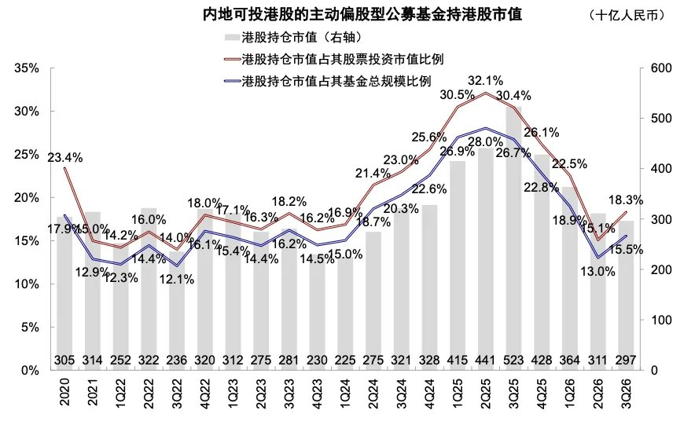

资料来源：EPFR，Wind，中金公司研究部

**► IPO与再融资：2024年IPO及再融资显著收缩，当前明显更高。** 2024年港股IPO和上市后募资分别约881亿和858亿港元，合计约1740亿港元，明显低于2021年的约7805亿港元。以月度募资情况看，IPO在2024年2月降至零，上市后募资于2024年8月触底。

**对比当下，一级市场供需平衡远未至“底部区域”。** 2025年港股IPO与上市后募资合计6138亿港元，2026年前10个月进一步升至7489亿港元，其中IPO约4014亿港元、上市后募资约3476亿港元（图表24）。

图表24：2024年全年IPO与再融资十分冷清，但今年维持火热

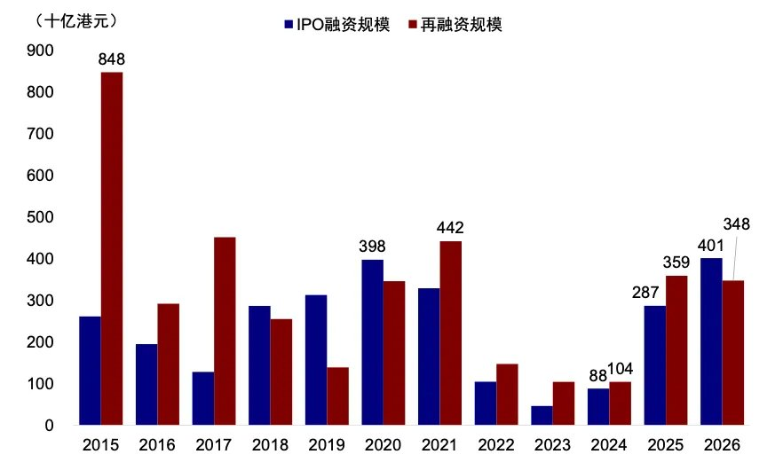

资料来源：Wind，中金公司研究部

**► 政策环境：2024年初已有局部托底措施，但全面转向要到924。** 2024年初，政策已开始逐步发力：1月24日央行宣布降准0.5个百分点，2月6日中央汇金宣布扩大ETF增持范围，证监会推动机构入市并支持回购增持，2月20日5年期以上LPR下调25个基点至3.95%；此后4月19日推出五项资本市场对港合作措施，4月30日政治局会议提出统筹研究消化存量房产和优化增量住房。 **这些措施有助于改善市场预期，但总体仍以局部托底为主。直到924集中推出降准降息、降低存量房贷利率和首付比例、支持资本市场及回购增持等一揽子政策** ，政策预期才出现更为全面的转向，推动市场由阶段性企稳走向更广泛的修复。

**相比之下** ，市场大跌、信用风险、10月PMI超季节下降，都增加了短期发力概率，如再度股票回购。但当前财政脉冲仍偏弱，尤其能够有效推动居民部门资产负债表改善的政策组合当前仍显不足。

**总结而言，2024年初恒科先见底，是估值和情绪调整充分、机构配置降至低位、市场偏好红利、公司回购增加等多重因素的结果** ，924在此基础上，通过更大力度政策转向推动市场修复扩散。对比当时，估值尚未到当时极端水平，机构配置接近低位，公司回购更少、一级市场供给更多。

**仅从市场自身条件看** ， **低估值、低配置和对红利的追逐，构成了局部的相似局面，但回购和一级市场条件都仍不如当时** ， **更何况真正促成基本面底部的基本面政策** 。这与我们在《[924两年后有何变化？](https://mp.weixin.qq.com/s?__biz=MzI3MDMzMjg0MA==&mid=2247863949&idx=1&sn=46ac10fee94d40390645bbd8ab0370ff&scene=21#wechat_redirect)》的判断一致，低估值、超卖情绪构成短期反弹条件，即赔率价值， **但若要向上反转，核心在于居民信用周期的实质改善，而这需要财政政策进一步发力且向居民部门倾斜，重现“924时刻”。**

图表25：整体信用周期震荡、尤其是居民部门信用脉冲回落，会明显拖累市场表现

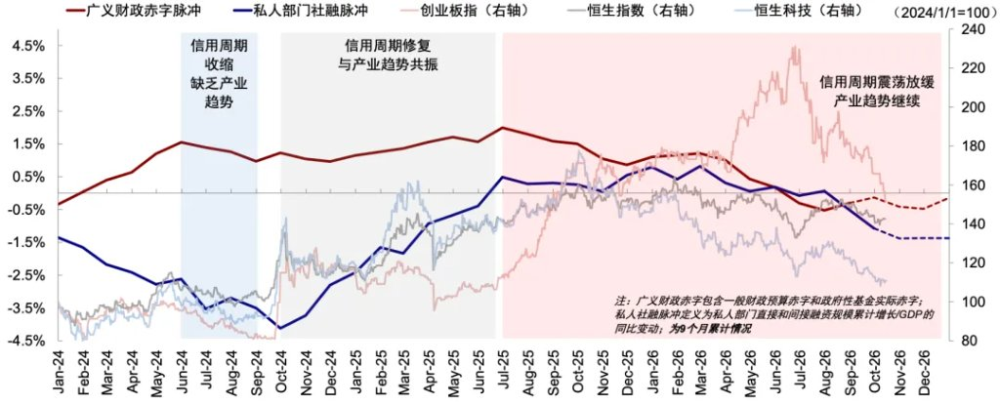

资料来源：Wind，中金公司研究部

图表26：恒科可以看做一个“大号版消费”，中证消费实际上早已低于924起点

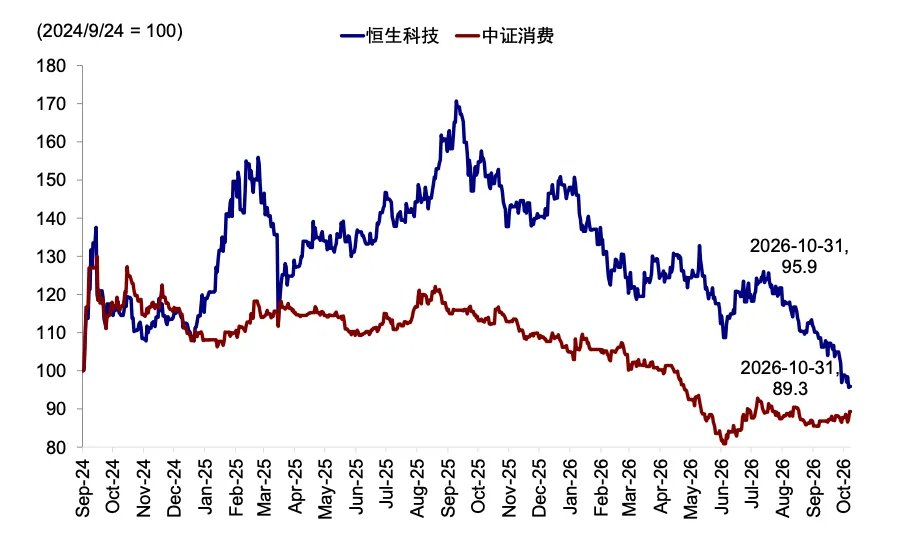

资料来源：Wind，中金公司研究部

图表27：2024年初至全年港股红利策略持续跑赢恒指与恒科

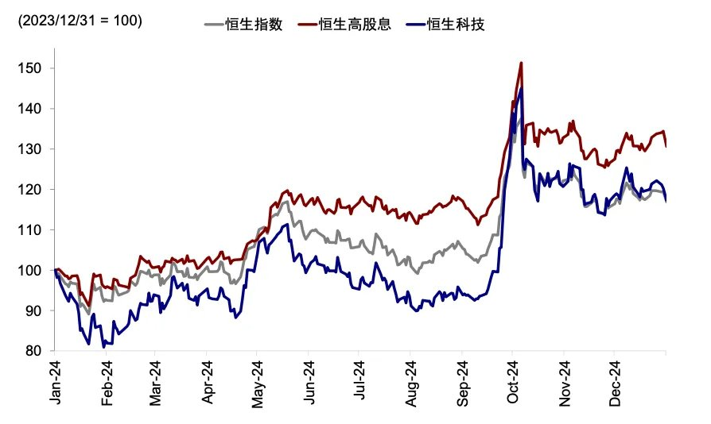

资料来源：Wind，EPFR，中金公司研究部

图表28：2024年1月底市场底部前夕，恒指与恒生科技EPS尚未抬升，仍处于企稳或下修阶段

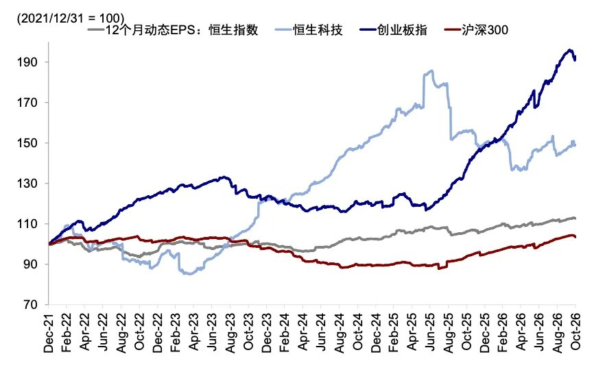

资料来源：EPFR，Wind，中金公司研究部

图表29：南向月度流入高点领先恒科顶部约6个月至滞后约2个月

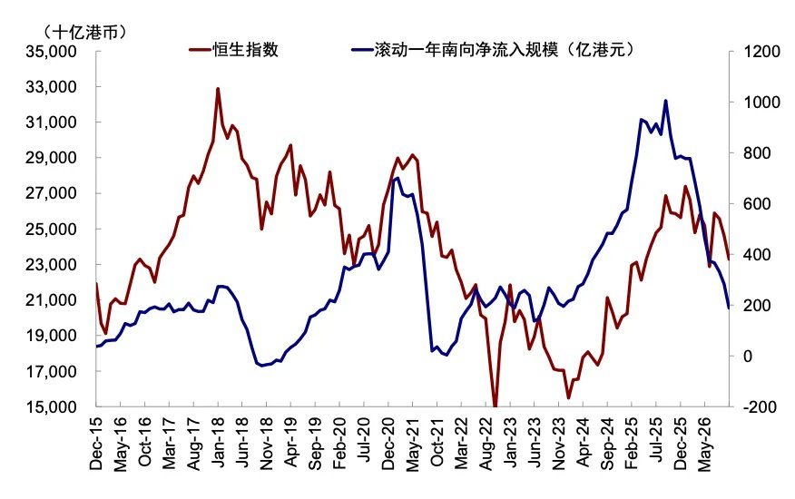

资料来源：EPFR，Wind，中金公司研究部

图表30：主动外资月度流入高点与恒科顶部基本同步至滞后约4个月

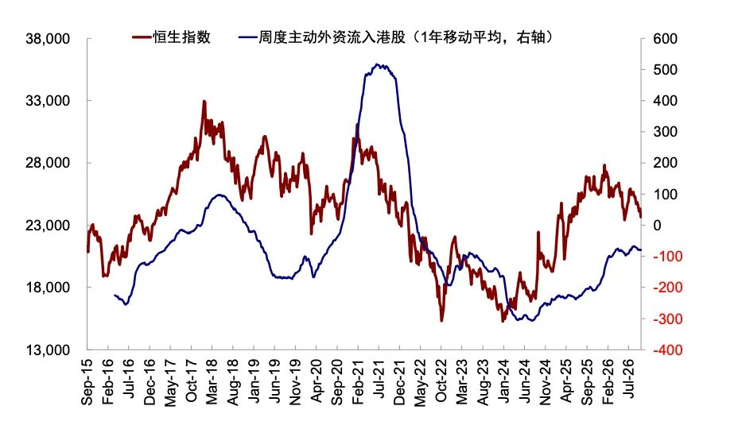

资料来源：EPFR，Wind，中金公司研究部

图表31：港股IPO规模周期滞后于市场周期

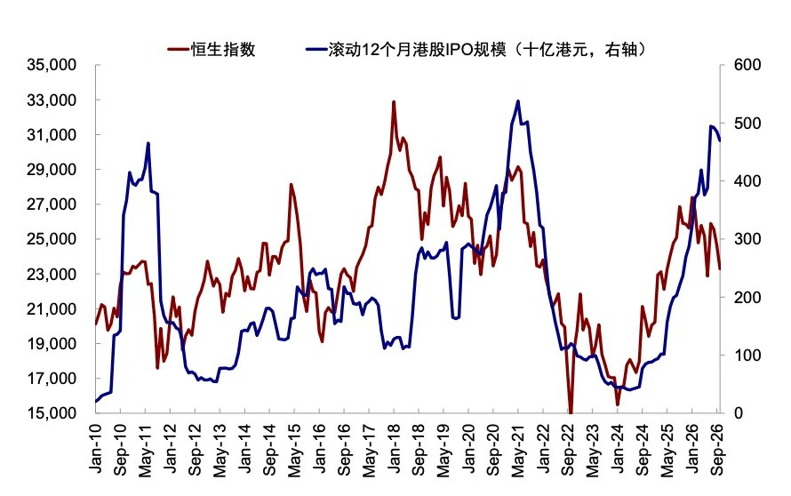

资料来源：Wind，中金公司研究部

图表32：今年9月和明年1月会是港股解禁规模的高点

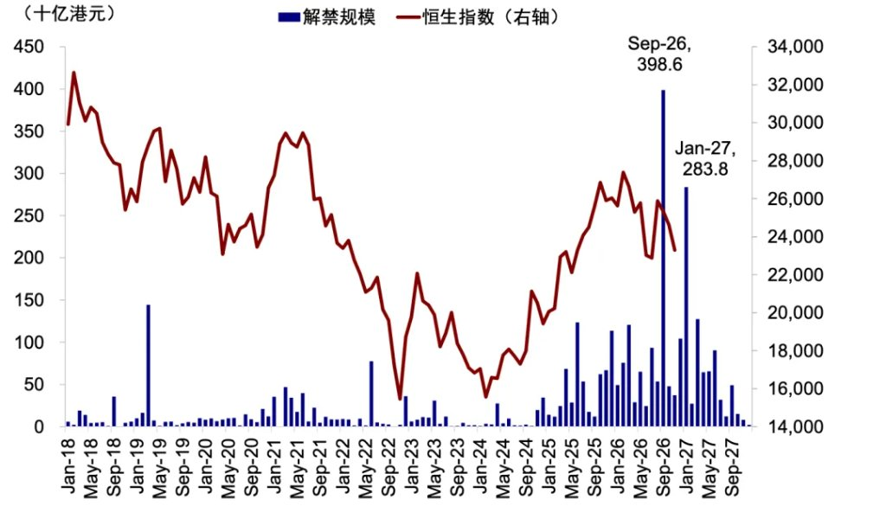

资料来源：Wind，中金公司研究部

本文来源：[中金点睛](https://mp.weixin.qq.com/s/xc38EEk1U7_Ix_WohgOOGQ)

风险提示及免责条款

市场有风险，投资需谨慎。本文不构成个人投资建议，也未考虑到个别用户特殊的投资目标、财务状况或需要。用户应考虑本文中的任何意见、观点或结论是否符合其特定状况。据此投资，责任自负。
