# 中金：黄金超过5500美元是一个重要分水岭

- 页面显示时间：2026-02-02T09:25:38+08:00
- 页面署名：董静
- 标注来源：中金刘刚、项心力等
- 原文：[华尔街见闻](https://wallstreetcn.com/articles/3764710)
- 取得时间：2026-11-04T16:02:16+08:00
- [HTML阅读版](article.html) · [来源记录](metadata.json)

## 导语

中金认为，黄金突破5500美元标志着存量黄金总价值（38.2万亿美元）已与美债存量相当，这是80年代以来首次，意味着以美元为锚的全球货币体系出现松动。本轮上涨核心动力是对美国不信任引发的美元信用替代。要终结黄金趋势，需美国花大代价重塑美债信任，解决低通胀、低利率和美元霸权的"三选二"难题。

---

**引言：5500美元是黄金能触及的天花板，还是划时代变化刚开始的起点？**

**开年短短一个月，黄金的表现就创下多项记录：** 1）上涨斜率几乎超出了所有人的预期，虽然看多黄金是市场的主流，但短短一个月内涨幅高达25%，还是80年代以来的首次，即便对于大多数黄金多头而言恐怕也始料未及；2）转眼间短暂超过5500美元/盎司后“满减”，一天之内跌幅超过10%，也是1984年以来的前所未见。

**在这一急涨与暴跌交织的巨震面前，任何点位测算都显得苍白且无力，是因为：** 1）金价显然已超越单纯的基本面主导，所以传统的黄金测算模型如实际利率已经早早失效；2）影响更大的地缘与货币体系重构的宏大叙事又很难给出具体兑现的时间表，反而给人以短期可以任意遐想的空间；3）短期内黄金急涨有很大情绪和资金驱动，更使得节奏难以把握。

图表1：2022年后黄金和实际利率脱锚

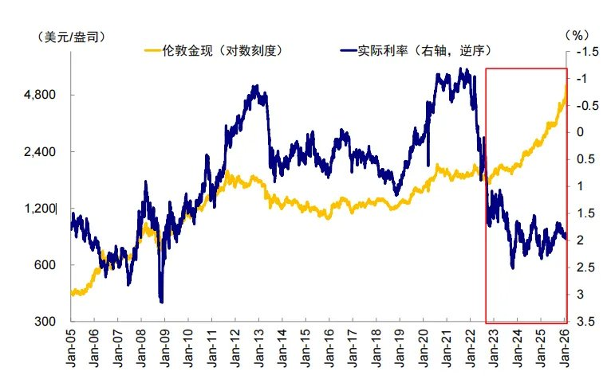

资料来源：Wind，中金公司研究部  

图表2：我们构建的美元、实际利率、不确定性和动量四因子模型近期对金价解释力度下降

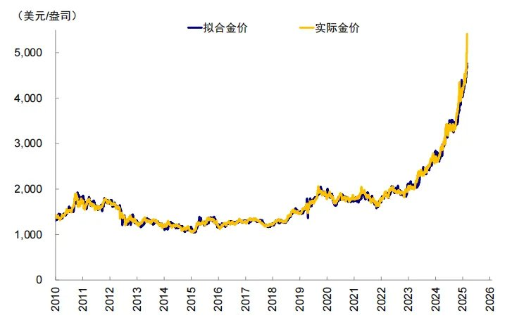

资料来源：Bloomberg，Wind，中金公司研究部

**这三点决定了对金价的测算很难兼顾方向与时间，更不用说过程中上下起伏的节奏了，也凸显出“定投”二字的含金量** ，例如我们在去年11月发表的年度展望《跟随信用扩张的方向》中就根据存量黄金规模等于美债规模反推出5500美元/盎司这个“关口”，但也未曾预料到短短三个月就已经触及。 **有人会说，只要方向对了就行，时间没那么重要，其实并非如此** ，试想，如果这一点位要三年后才兑现而非三个月，谁又愿意为三年的远景机会而在短期内重仓呢？更不用说过程中的剧烈动荡能否拿得住了。

其实，伴随黄金的急涨， **陡增的波动率和巨大的ETF流入已经给上涨暗暗标下了“价码”** ，全球黄金ETF中规模最大的SPDR黄金ETF持有量已回升至2022年俄乌冲突附近水平，且ETF和金价过去两年相关系数抬升至0.98，为历史高点，都表明情绪已经亢奋到一定程度，至于说沃什的提名只是扮演了一个风暴所需要的催化剂，不然美股美债和美元为何没有这么大的动荡呢？

图表3：黄金的14天RSI达90，持续位于超买区间

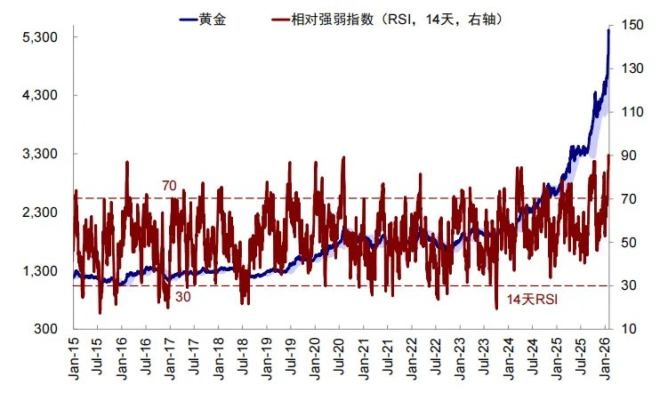

资料来源：Bloomberg，中金公司研究部 

图表4：黄金的波动率明显加大，高于其它资产

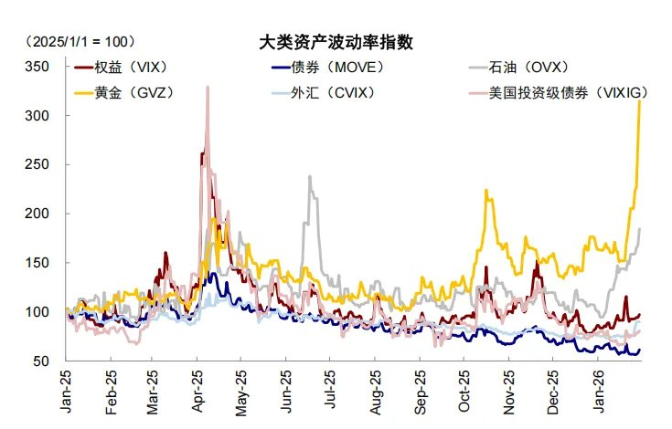

资料来源：Bloomberg，中金公司研究部

图表5：金价与ETF相关性达有数据以来最高值

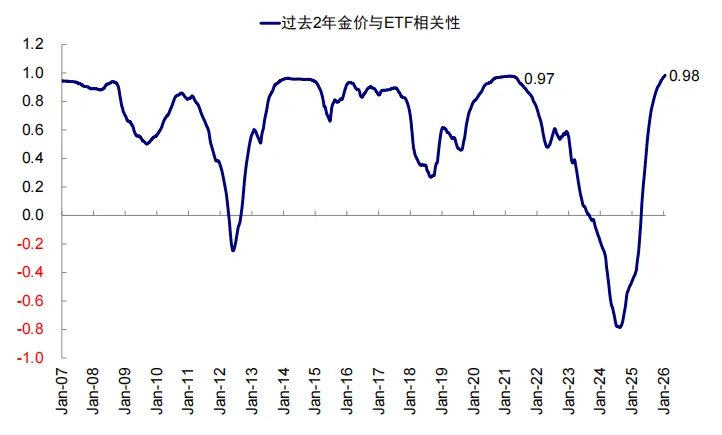

资料来源：Wind，中金公司研究部

不过，抛开短期的急涨暴跌， **黄金超过5500美元/盎司的确也是一个重要的分水岭，它标志着存量黄金的总价值（38.2万亿美元）已与美债的总存量相当（38.5万亿美元）\[1\]，这是上世纪八十年代以来的首次，意味着布雷顿森林体系解体后确立的全球以美元为锚、美元以美债为基础的大厦已出现一些松动迹象。**

图表6：我们测算当金价涨至5500美元/盎司，存量黄金规模与存量美债规模相当…

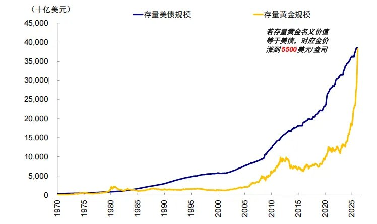

资料来源：Wind，IMF，WGC，UCGS，中金公司研究部 

图表7：…为上世纪80年代以来首次出现

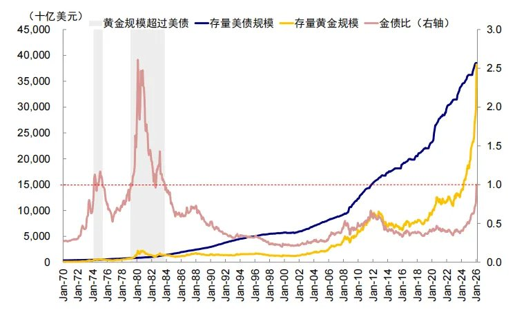

资料来源：Wind，IMF，WGC，UCGS，中金公司研究部

已经久久不在国际货币体系日常运转中心的黄金，竟然能涨到与作为美元的土壤且拥有强大结算和交易便利的美债同等规模， **到底是黄金能触及的天花板，还是一个划时代变化刚开始的起点？** 一个偶然的巧合是，金价甫一触及这个位置，立刻面临剧烈回调，似乎暗示着这一位置的敏感性。 **这一问题的答案，取决于美国能否重塑美债信任，也决定了黄金是否会面临“沃尔克时刻”** ，这也是我们在本文中重点讨论的问题。

## **一、黄金上涨的动力？对美国不信任引发的对美元信用的局部替代**

本轮黄金的牛市究竟是什么因素驱动？找到原因才能更好地判断未来。回答这个问题，我们先从影响金价的几个关键因素着手分析：

**► 是因为美元走弱吗？是主要贡献，但作用不如70年代大。** 美元主导大宗商品定价，同时美元的走弱又加强黄金的储备价值。2022年以来，黄金步入新一轮牛市，从2022年9月1622美元/盎司最高上涨239%，恰好对应美元指数从2022年9月114的高点下跌16%至当前的96。近期特朗普开年以来让市场大跌眼镜的政策“乱象”加大了市场对地缘风险升级的担忧，同时也使得“去美元化”的预期升温，导致美元跌至近4年以来新低（《特朗普想“要”什么？》）。不过，本轮牛市金价和美元的负相关性（2022年以来二者R2为0.23）比70年代牛市低（70年代二者R2为0.57）。

图表8：本轮2022年9月以来的黄金牛市对应美元的走弱

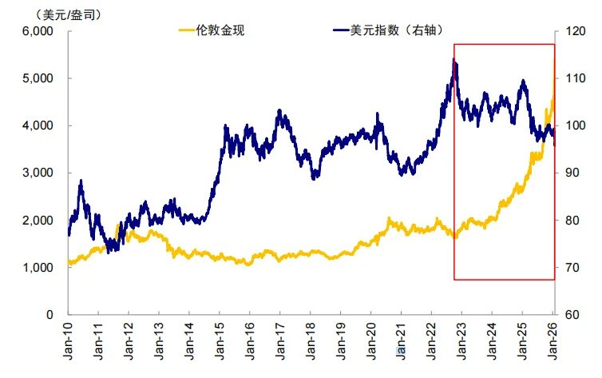

资料来源：Wind，中金公司研究部   

图表9：2022年以来金价和美元的R2为0.23

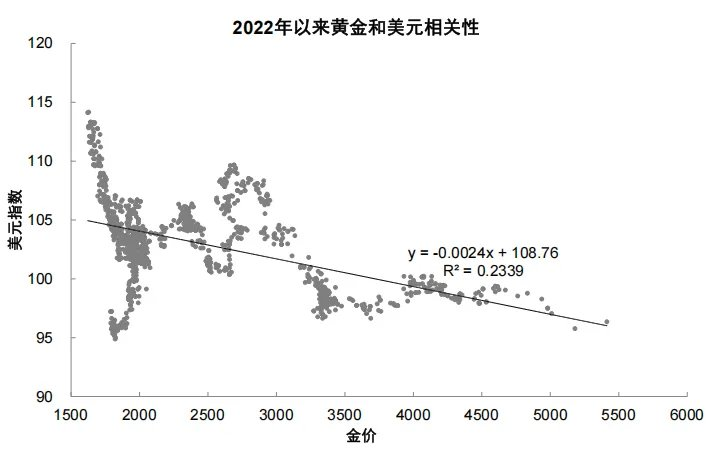

资料来源：Wind，中金公司研究部

图表10：70年代金价和美元的R2为0.57

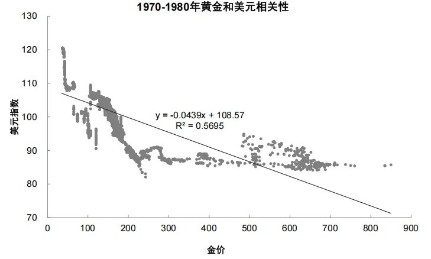

资料来源：Wind，中金公司研究部

**► 是因为实际利率走低吗？不是。** 实际利率是黄金传统定价框架的关键，可看作持有黄金的机会成本，也是黄金抗通胀属性的体现。然而，实际利率从2022年9月的1%最高升至2023年10月的2.5%，黄金却逆势上行。远的不说，2025年11月以来金价上行斜率再度变陡，但在美国降息预期摇摆的情况下，实际利率整体从1.7%走高至1.97%，也无法解释这波金价上涨。

**► 是因为地缘风险下的避险需求吗？也是重要因素。** 2022年以来地缘风险频发，2025年特朗普再度当选总统并发起“对等关税”后，美国经济政策不确定性指数快速攀升，对应金价上行斜率变陡。

图表11：2025年以来美国经济政策不确定性指数明显抬升，伴随金价上行斜率变陡

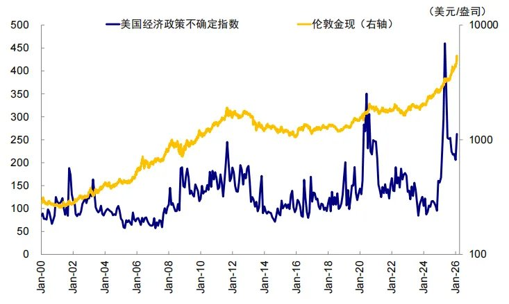

资料来源：Wind，中金公司研究部

**► 是因为资金助推吗？是的，资金流入加速了上涨。1）央行储备：** 自2022年俄乌冲突以来，以中国等为代表的亚洲新兴国家央行增加黄金储备，全球新兴国家央行黄金储备的同比变化从2024年8月的低点-244吨抬升至2024年1月高点578吨，可以解释2022-2024年的金价上涨（图表13）。2024年后，各央行仍在增持黄金储备，不过速度有所放缓。 **2）私人部门：** 与之对应地，SPDR黄金ETF（全球最大的黄金ETF，占比27%）持有量从2024年3月的低点821吨升至当前的1087吨，且ETF和金价过去两年相关系数也抬升至有数据以来高点，证明近期金价的上涨很大程度上也与私人部门投机性资金流向有关。

图表12：2022年8月以来，新兴国家增持黄金储备，推动金价上涨

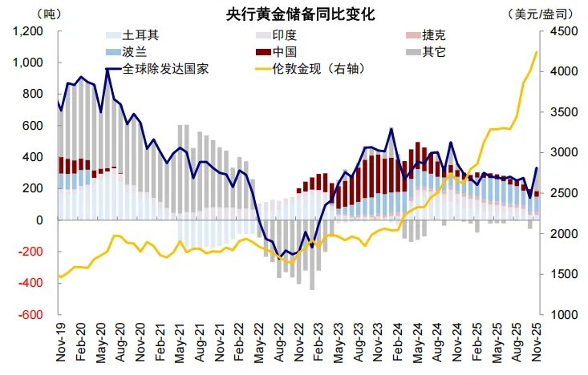

资料来源：Wind，IMF，中金公司研究部

图表13：SPDR黄金ETF持有量快速回升，接近2022年俄乌冲突时水平

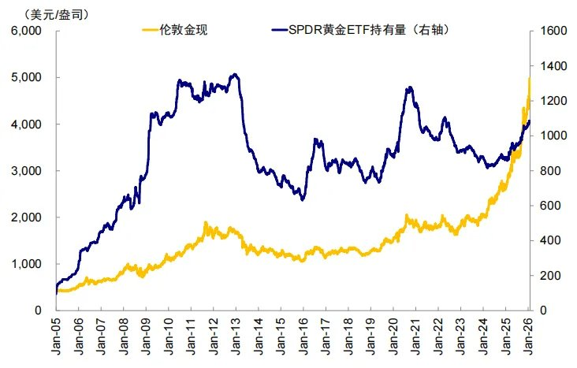

资料来源：Wind，中金公司研究部

简单的梳理可以看出，传统的通胀和避险需求可以解释黄金的一部分上涨，但绝对解释不了如此大幅的上涨，这才导致金价与传统定价模型的偏离， **底层更关键的动力，是因为对美国（确切的讲是对特朗普时期的美国）不信任引发对美元信用的局部替代，即所谓的“去美元化”，这才是黄金的“终极价值”** 。不难发现，过去一两年，很多地缘和政策风险恰恰是来自美国自己，所以原本也可以起到避险功能的美元反而无效。一个简单的对比是，拜登政府的后半段2022-2024年虽然也面临俄乌地缘局势、美元走弱、美债规模高企、通胀走高等一系列和当前类似的问题，但黄金涨幅却不及特朗普第二任期。2022年9月本轮黄金牛市起点到2024年11月大选前，两年内金价涨幅仅为50%，而如今特朗普上任一年的时间里金价涨幅超过100%。

## **二、美债自身的问题？偿债约束“刚性化”、持有结构“内生化”、相对价值“缩水”**

除了特朗普的种种政策损害了全球的信任外， **美债本身是否还“安全”也是一个实实在在的促使全球货币当局和投资机构思考多元化配置需要的原因** 。换言之，如果未来换了一个新总统，是否这个趋势就能逆转？“不再安全”并非指开始违约，而是回报降低且信用质量边际下降，具体体现为：

**► 偿债约束“刚性化”：** 尽管美债不可能违约，但处在超然地位也天然的要求其有更完美的安全性， **美债的利息覆盖率（利息支出/财政收入）** 自2021年起持续攀升至18.5%的历史新高，超过标普\[2\]和穆迪\[3\]等机构在主权信用评级时划定的15%“警戒线”。付息压力的增加也意味着美国为了维持债务的可持续性，财政自由裁量空间和弹性也在随之缩窄，挤占其他财政支出空间，换句话来讲就是美债“还得起的质量”在下降。

**► 持有结构“内生化”：** 外国投资者持有美债比例的变化反映了全球对美债作为安全资产的需求强度，这一指标自2014年34%的高位持续回落至2022年的23%后小幅抬升至当前的25%。这种从全球储备资产向普通主权债务模式的转变，意味着美债此前享有的“额外信用需求”在减弱。

**► 相对价值的“缩水”：** 黄金名义价值与美债的比值自2022年0.35持续抬升至当前的0.99，这一指标的持续抬升反映了投资者对美元主权信用资产偏好的边际下降，转而向实物黄金寻求终极的价值避险。

图表14：美国利息覆盖率攀升至18.5%的历史新高，外国投资者持有占比却趋势性下降

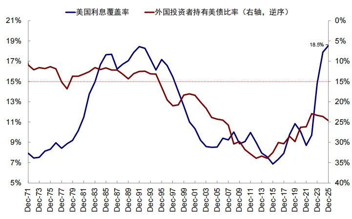

资料来源：Haver，中金公司研究部   

图表15：黄金相对美债的价值自2022年的0.35持续抬升至当前的0.99

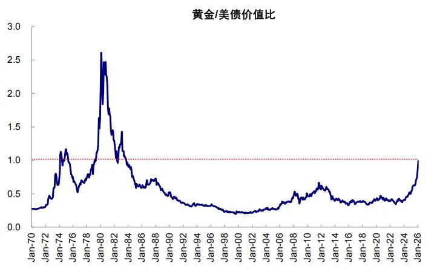

资料来源：Haver，中金公司研究部

简单而言， **从基本面角度看，高利率、高付息、高杠杆也使得美债存在让人诟病与担忧的问题。**

## 三、以黄金替代美债的“去美元化”？泾渭分明的“两个阵营”，有人在增持黄金，有人还在增持美债

对美国的不信任和美债本身的问题，共同促使了局部的美元信用替代，这是“去美元化”，也是黄金上涨的核心动力。 **但到目前为止，“去美元化”暂时还只是泾渭分明的“二元化”割裂。**

之所以这么说，是因为我们注意到， **一部分货币当局在抛售美债买入黄金** （以亚洲及新兴国家为主，如2022年以来中国大陆、土耳其和印度央行分别增持357吨、253吨和133吨），而 **一部分货币当局仍在继续买入美债买到新高** （如2025年以来英国、日本、比利时分别增持1657亿美元、1411亿美元、1064亿美元美债），形成“泾渭分明”的两个阵营。

图表16：2022年以来中国、土耳其、印度等国家增持黄金储备最多

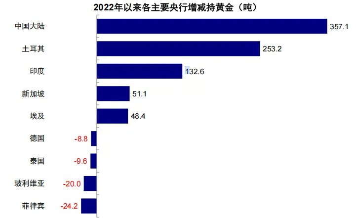

资料来源：Wind，中金公司研究部   

图表17：2024年以来日本、英国、比利时等国增持美债

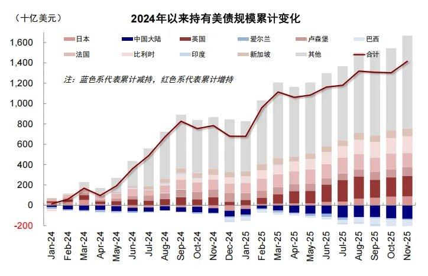

资料来源：Wind，中金公司研究部

**从金价涨幅分地区拆解与ETF资金流向也可看出“分化”：** 1）对2025年以来金价涨幅进行分时段拆分，截至1月29日，亚洲时段涨幅达33.5%，远高于欧洲时段的9.7%和美洲时段的11.2%，而2026年以来金价这波强势上涨中，更是主要来自于亚盘的力量，亚洲、欧洲、美洲时段分别上涨11.4%、0.3%、2.0%。2）从黄金ETF分地区流向来看，近期黄金ETF的净流入主要来自亚洲和北美，2026年以来净流入49.5亿美元和48.9亿美元，而欧洲2026年以来仅流入33.6亿美元。

图表18：2025年以来，亚洲、欧洲、美洲时段黄金分别累计上涨33.5%、9.7%、11.2%

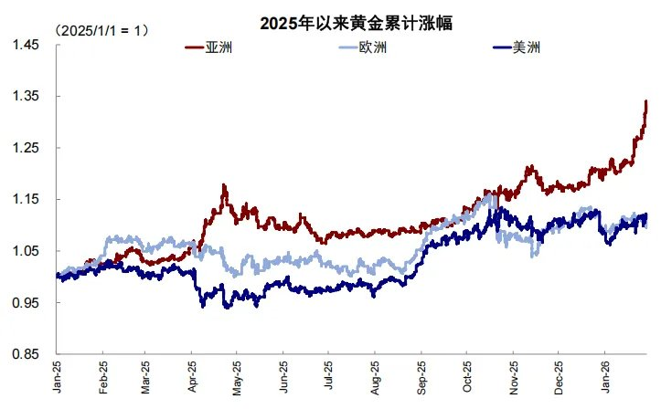

资料来源：Wind，中金公司研究部；数据截至1月29日

图表19：近期黄金ETF的流入以亚洲和北美为主

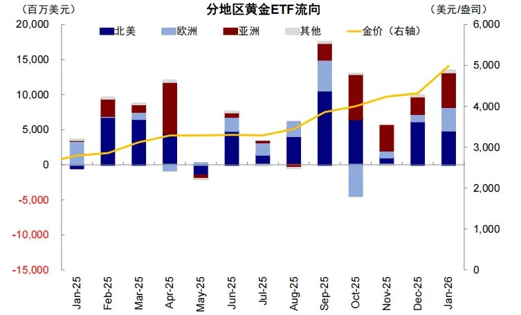

资料来源：WGC，中金公司研究部；数据截至1月23日

**细看全球主要国家在黄金和美债的持有动机也有很大不同。** 我们以黄金占官方外储的比例超过15%（全球中位数）、美债持有量占外储的比例（由于TIC数据包含外国官方及私人部门总持仓，部分国家美债占比可能超过 100%）来构建象限，具体来看： **1）高美债+低黄金：** 包括加拿大、挪威、英国、澳大利亚、日本、新加坡等仍处于美元体系并追求需要流动性的外向型经济体，持有高比例美债可以满足频繁的跨国贸易结算需求，同时也能在汇率波动时提供弹药。其中， **加拿大和挪威在官方外汇储备中完全不持有黄金** ，但持有美债的规模相当于其外储规模的372%和242%。 **2）低美债+高黄金：** 这其中既包括拥有深厚黄金储备历史的德国和意大利，也包括对抗高通胀和本币信用危机而大幅增持黄金的土耳其，以及为了安全战略而主动“去美元”的俄罗斯和波兰。 **3）低美债+低黄金：** 以中国、印度、韩国、巴西、墨西哥等为代表的多元配置派，既不盲目依赖美元，也不过度囤积黄金； **4）高美债+高黄金：** 荷兰和法国呈现“双保险”机制，在持有高比例的美债同时，依然保留规模显著的黄金储备。对比黄金大涨前的2023年， **挪威、加拿大、新加坡和韩国配置美债的规模显著增加，而土耳其、俄罗斯、意大利、波兰、德国和中国等配置黄金的比例明显抬升。**

图表20：黄金和美债占外储规模比例的四象限

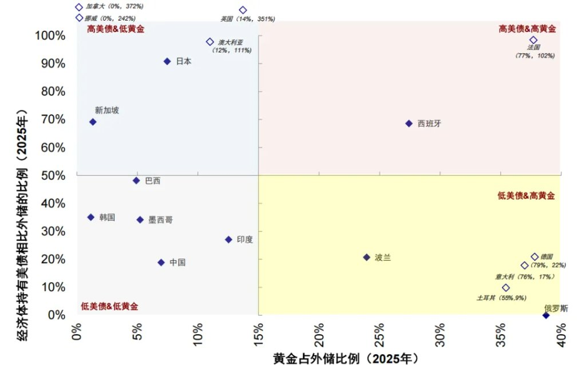

资料来源：Haver，中金公司研究部；数据为2025年均值

图表21：相比黄金大涨前的2023年底，挪威、加拿大、新加坡和韩国配置美债的规模显著增加，而土耳其、俄罗斯、意大利等配置黄金的比例明显抬升

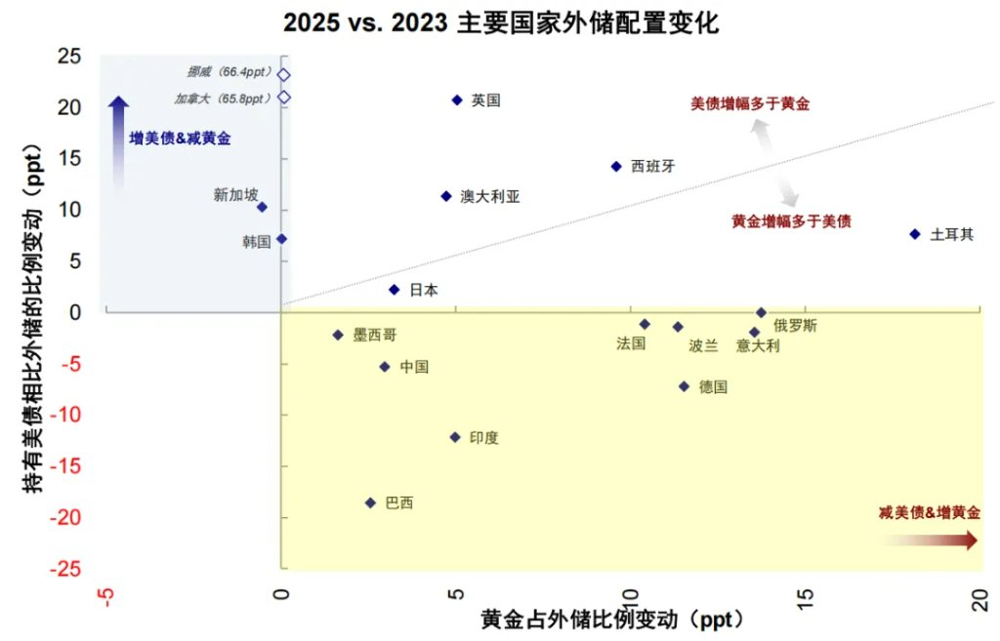

资料来源：Haver，中金公司研究部

**这说明，“去美元化”还并未上升到一个全球普遍的共识，更多是“泾渭分明的两拨人在做不同的事情”** ，毕竟对于多数仍在美元体系内的国家和经济体而言，没有必要去美元化，去了也没有更好的选择。但是，对于另外一拨人而言，面对制裁、美元储备资产被武器化等风险，去美元化也是无奈且必须的选择，那增加黄金储备就成了一个几乎必然的选项，这些需求也就成为驱动过去几年上涨的主要动力。

但现在的问题是，2025年特朗普第二任期以来，针对全球尤其是“盟友”们的关税，挑战现有国际秩序的种种做法，再加上黄金超过美债这个关键分水岭的出现， **是否会导致这个原本“泾渭分明”的阵营的界限变得越来越模糊？使得越来越多属于美债阵营的市场也开始转向黄金？**

## 四、黄金规模超过美债意味着什么？并非马上兑现的数字节点，却是心理上的重要分水岭

**当黄金不断上涨已经超过美债存量这个关键分水岭后，会发生什么变化？** 是否会使得更多处于中间地带的央行也在想可以适度多极化锚定，增加一些对黄金的配置？特朗普不断挑战现有国际秩序、拿关税作为武器，是否使得传统盟友们也要开始审视与美元的绑定关系？美国不断累计的债务和利息支出，加之难以有效回落的债券利率和通胀，是否使得持有美债的普通投资者也担心短期收益和美国财政可持续性？

**从这个意义上，黄金超过美债并非马上兑现的数学节点，但却是心理上的重要分水岭** 。对于那些已在“去美元化”的国家来说，自不必说仍需要增加黄金储备，但对于那些仍在美元体系中的国家、尤其是摇摆不定的“中间派”而言，一旦认为美债正在从“全球唯一的无风险资产”降级为“一种普通的高风险主权资产”，不再是特殊的、唯一的、绝对安全的，那就有可能会形成预期自我实现的循环效应。“去美元化”不可能很快实现，也不需要马上兑现，但信心总是一点点被侵蚀的，有时候只要有这个疑问就够了，就足以促使一部分投资者开始思考多元化配置需求，虽然过程是缓慢的。

**当然，我们也需要理性地看待这个过程** 。 **在可预见的未来，美元和美债很难被完全取代** ，无可否认的是美元的储备货币地位仍然稳固，更可能的是美元体系的局部松动，从单一化走向多元化。

**1) 储备份额：** 截至2025年三季度，美元在储备货币中占比仍有57%，远高于其它货币。但若按占全球储备资产中比例计算，外国官方持有的美债（21.3%）已经低于黄金（28.6%，按最新金价计算）。

图表22：截至2025年三季度，美元在全球储备货币中占比仍有57%，远高于其它货币

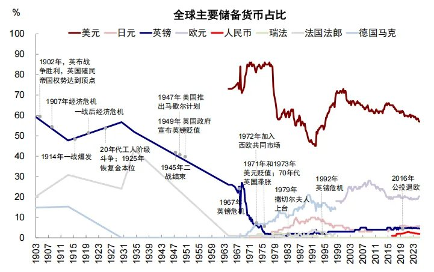

资料来源：IMF，中金公司研究部

图表23：按最新金价计算，黄金占全球储备资产比例已超过外国官方持有美债占全球储备资产比例

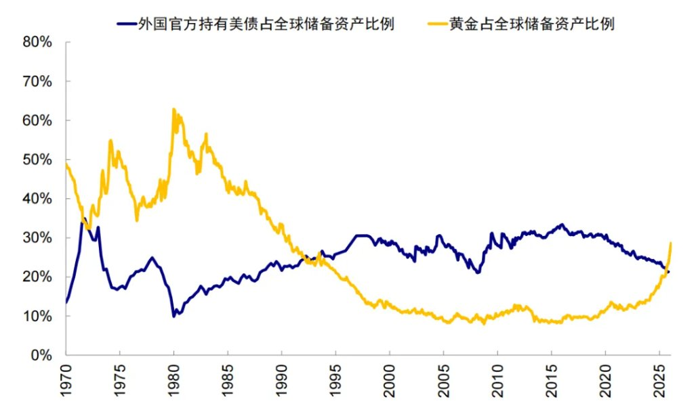

资料来源：IMF，美国财政部，中金公司研究部；黄金占比按1月30日最新金价计算

**2) 国际支付份额：** 截至2025年12月，美元在全球支付中份额占50.5%，远超第二名的欧元（21.9%）。全球银行系统（SWIFT）和衍生品交易大多锚定美债，已形成一定网络效应，切换系统的成本极其高昂。

图表24：截至2025年12月，美元在SWIFT全球支付中份额占50.5%，远超其它货币

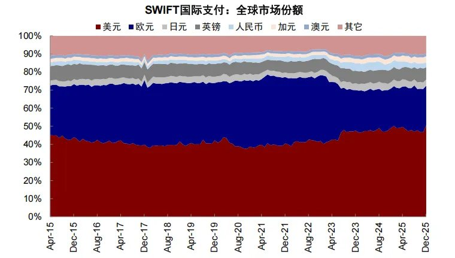

资料来源：SWIFT，中金公司研究部

**3) 贸易融资份额：** 截至2025年12月，美元在全球贸易融资市场份额为79.5%，远超第二名的人民币（8.3%）。

图表25：截至2025年12月，美元在全球贸易融资市场份额为79.5%

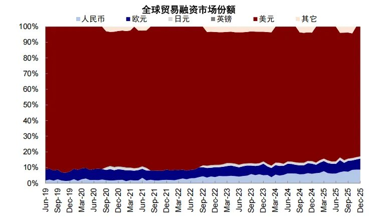

资料来源：SWIFT，中金公司研究部

**4) 美元没有替代品（There is no alternative, TINA）** 。黄金虽然值钱，但不生息，在美元信用受损的情况下可充当避险和储值资产，但无法替代信用货币在利率流动性供给与资产定价中的功能，且由于物理总量限制，无法支撑全球庞大的贸易结算。欧元市场深度不够，人民币未完全开放资本账户，都不足以完全接纳38万亿美元规模的资产池。 **更重要的是，所谓“美元霸权”，并不仅在于美国政府信用以及美国的经济实力，背后还有美国的军事和科技力量** 。只要这些还在，美元信用体系就还有继续维持的底气。

**此外，“去美元化”的过程也完全可能反复甚至出现逆转，而“旧秩序”也不可能甘心任由被取代** ，例如可能的变数来自，美国新总统改弦更张，重新拥抱全球化或者至少与盟友们积极合作重获信任；美国经济重新找到支点实现强劲增长；美国强调财政纪律且美联储强力抑制金融扩张，通过这种短期阵痛的方式重塑美债安全资产的信任；甚至针对黄金实施管控、卖黄金和征税的行政手段等等。 **上世纪八十年代就出现过黄金超过美债的情形，但最终以沃尔克强力加息的巨大代价，重塑美债信任，换取了随后四十年至今的美元全球霸权地位。**

## 五、历史上有无可借鉴的经验？70-80年代两次超过，始于通胀失控，终于强力加息

上世纪70年代布雷顿森林体系解体后，也曾出现过两段黄金规模超过美债的阶段： **1）1974年4月-1975年4月（总共持续13个月，超越后八个月黄金见顶、涨幅9%）** ：始于布雷顿森林体系解体后美元贬值以及第一次石油危机带来的高通胀，终于通胀压力消退、美国政府卖黄金干预金价。 **2）1979年5月-1983年9月（总共持续53个月，超越后七个月黄金见顶、涨幅244%）** ：始于第二次石油危机引发地缘冲突和滞涨，终于1979年沃尔克强硬加息。

图表26：上世纪70-80年代出现两段较长时间黄金规模超过美债阶段

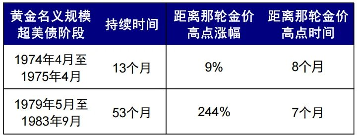

资料来源：Wind，中金公司研究部   

图表27：不过最终结束于沃尔克大幅加息，美元大幅走强

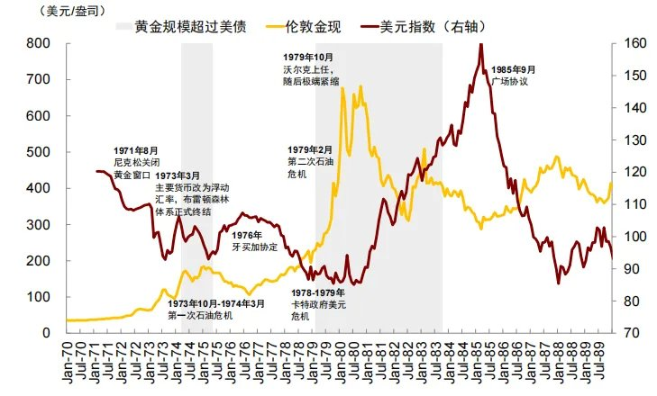

资料来源：Wind，中金公司研究部  

**1）第一次黄金规模超美债：1974年4月，八个月后黄金见顶，涨幅9%**

**布雷顿森林体系解体后美元贬值，叠加第一次石油危机带来高通胀和美国衰退，共同推动1974年黄金规模首次超越美债** 。1973年3月，主要货币改为浮动汇率，布雷顿森林体系在实质上终结，加速美元的贬值。1973年10月，OPEC在宣布石油禁运，布伦特原油价格从2.7美元/桶一度暴涨至13美元/桶，美国通胀压力上升，实际利率转负，美国经济也陷入衰退，加剧美元贬值、黄金升值。

**黄金规模超越美债后，美联储加息态度不坚决** 。油价上涨推动CPI同比在1974年继续上行，并在当年12月达到12.3%的高点，实际利率则下滑至-4.9%。但在滞胀压力下，美联储早早转为宽松，联邦基金利率在1974年7月就开始回落，意味着货币政策没能在遏制通胀和金价方面做出“应有的贡献”，金价从1974年4月黄金规模超美债时的168美元/盎司一度上涨到1975年2月的高点184美元/盎司。

**如何逆转？1）供给侧通胀压力消退** ：1975年1月起，油价同比转负，带动美国CPI同比进入长达两年的下行期。 **2）政府直接干预黄金市场** ：1974年12月，美国政府宣布取消居民持有黄金的禁令，美联储将其解读为“政府决定终结黄金货币功能”的信号，随后1975年1月6日起，美国政府开始公开拍卖黄金库存，加大市场供给，遏制了金价上涨趋势。

**但美联储并未彻底解决通胀问题** 。根据费城联储的研究，这个时期美联储的犹豫态度强化了通胀预期，并最终反映在了更高的通胀数据上；1975-1976年CPI同比虽然下行，但都维持在5.0%以上。 **这也为1979-1980年更顽固的通胀和更大的金价涨幅埋下伏笔。**

**2）第二次黄金规模超美债：1979年5月，7个月后黄金见顶，涨幅244%**

**第二次石油危机的地缘冲突升级和滞胀，导致1979年黄金规模再度超越美债** 。1978年下半年起伊朗局势逐步失控，1979年初爆发伊朗伊斯兰革命，第二次石油危机爆发。 **1）地缘冲突** ：与第一次石油危机中OPEC主动禁运和提价不同，此次产油国内部政治秩序的不确定性达到高峰，地缘冲突升级为黄金上涨提供了更多动力。 **2）滞胀** ：布伦特油价在12美元/桶的基础上飙升至42美元/桶，供给侧压力再次推动通胀上行、实际利率转负。金价涨幅比此前更甚，从1979年5月的247美元/盎司飙升至1980年1月的高点850美元/盎司。

**随后不久沃尔克采取强硬手段对抗通胀** 。1979年8月，沃尔克接任美联储主席。幸运的是，虽然彼时美国饱受高通胀侵扰，但财政压力不大，甚至高通胀稀释了部分压力。美债规模占GDP比例1978-1979年逐步下滑，在沃尔克上任时仅30-31%（vs. 2025年均值121.5%）；政府利息覆盖率虽然在1979年上升至9.2%，但和1970年的7.5%相比增幅可控，也明显低于2025年接近20%的均值。 **这为货币政策紧缩提供了较大空间** 。1979年10月，沃尔克宣布将政策目标直接转为“货币供应量”，意味着联邦基金利率的上行将不受约束。

**何以逆转？沃尔克强力加息叠加“里根大循环”，美国走出滞胀、美元大幅走强** 。一方面，在沃尔克的“极端”货币紧缩下，联邦基金有效利率从1979年10月前的11.4%飙升至1981年1月的19.1%，CPI同比在1980年4月触顶后开始降温，带动实际利率从1980年6月的低点-4.6%不断回升并在当年11月转正。另一方面，1981年里根总统上任后系列减税、放松管制等政策带领美国经济重新繁荣，美元在1980年触及85的底部后重回升值通道，直至1985年广场协议前的高点180。金价从1980年7-9月起逐步回落，但由于此前金价涨幅过大，直到1983年美债规模才得以反超黄金规模。 **此次沃尔克强硬的货币政策成功打破了通胀的自我实现机制\[8\]，此后再未出现长期的“黄金名义规模超过美债”的情况。**

## 六、美国当前的“难题”：低通胀、低利率和美元霸权的“三选二”；很难没有“代价”重塑美债信任

不难看出，八十年代黄金规模超越美债后，是以沃尔克强力加息这种“杀敌一千自损八百”的巨大代价，锚定通胀，重塑美债信任，换取了随后四十年的美元全球霸权地位。

**对于美国政府和美联储而言，当前的一个现实“难题”是，既想要低通胀，又想要低利率压低债务成本，还想要维持美元的霸权地位不被取代** 。在这三者之间，当年沃尔克是强力加息牺牲了第二个，但与当时不同的是，虽然通胀水平远低于当时， **但面对比当时庞大的多的债务水平和付息压力，要想通过大幅加息来锚定通胀和重塑美债信任，却并非件易事** ：1）当前美债存量38.5万亿美元、占美国GDP比例122%，远高于1979年8万亿美元、占GDP31%的美债规模。2）当前美国的利息覆盖比率（利息支出与财政收入之比）为19.8%，远高于1979年黄金规模超过美债时的9.2%。

图表28：当前美国债务压力远大于70年代

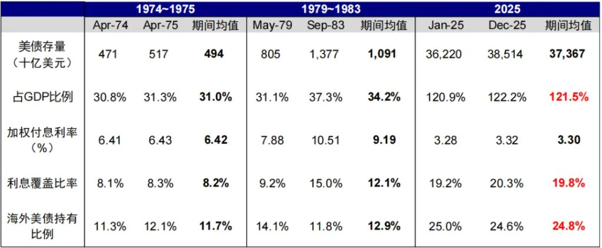

资料来源：Haver，中金公司研究部

**一个对美国和美联储“最理想”的状态是：** 1）有一个新增变量突然出现解决了通胀，例如AI大幅提升生产效率，导致大幅的工资与商品通缩，2）此时，美联储就可以在降低短端利率的环境下，通过缩表来实现金融抑制，适度提高长端利率，提升美债的吸引力和信任，这恰恰就是美联储新提名主席凯文·沃什的核心主张， **所以某种程度上，沃什被提名后贵金属的大跌是“沃尔克时刻”的预演。**

图表29：新提名的美联储主席沃什主张降息和缩表

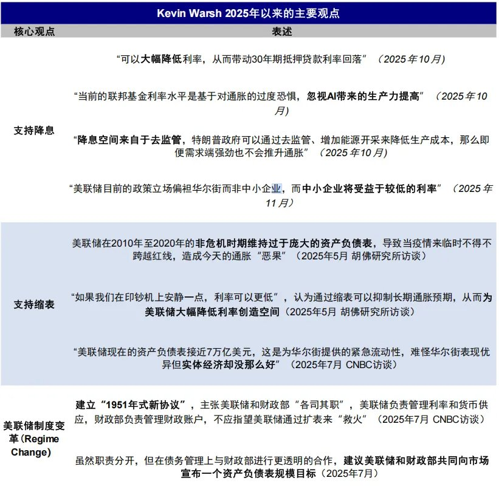

资料来源：CNBC，胡佛研究所，Reuters，中金公司研究部

**但实际过程中却可能挑战重重，没有想象的那么简单** ，比如：1）AI的效率提升能有多大？能否带动通胀有效下行；2）美联储缩表难道不会影响金融流动性充裕度和引发市场动荡，尤其是考虑到中期选举临近，使其投鼠忌器？3）缩表不会增加美国国债的融资成本么？存量美债的加权久期（weighted maturity）为5.8年，小于美联储持有美债8.8年的加权久期，的确可以通过“卖长降短”腾挪，但过程可能无法那么“丝滑”，那美联储是否需要开启YCC以稳定长端利率？但如此一来卖出更多短债，岂不又和降息矛盾？4）若降息过多，是否又会重燃通胀预期？还是有利黄金？5）如果最终面临保债还是保汇的“二选一”，那汇率无疑是代价最小的那个。如80年代“广场协议”般的主动大幅贬值或许不现实，但适度提高通胀容忍度和小幅美元汇率贬值，则可以有效地化解存量债务压力（用未来更便宜的钱来还当前更贵的钱），但是以损害美债长期信任为代价，最终受益的还是黄金。

图表30：存量美债以中长期债券为主，短债占比仅有21.6%

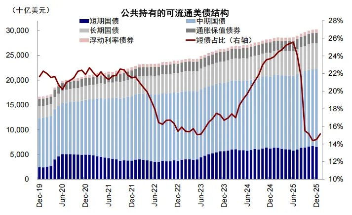

资料来源：Haver，中金公司研究部

图表31：美联储持有的美债以中长期债券为主

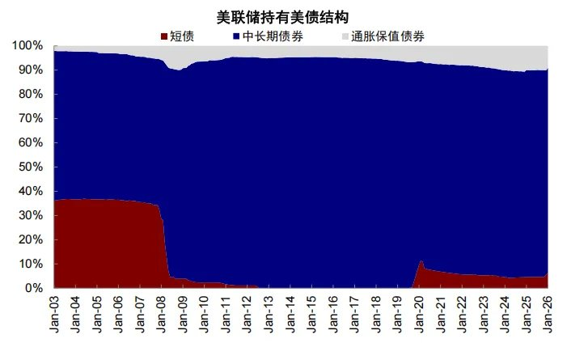

资料来源：Haver，中金公司研究部

## **七、现在能判断是黄金趋势的终结吗？还不能，需要美国花大代价解决美国和美债的信任问题**

回到本文一开始的问题，5500美元/盎司到底是黄金所能触及的天花板，还是一个新时代刚开始的起点？ **我们认为，若要彻底终结黄金这一趋势，需要看到美国开始花大代价开始解决低通胀、低利率和美元霸权这个“三选二”难题，重塑对美债甚至对美国的信心。**

**但幅度还能有多少？坦白的讲，我们无法给出终极答案，上两次超越后一次涨了9%，一次却翻了两倍。不过，有一点倒是可以肯定的，黄金自此进入了一个几十年不曾见的“未知领域”（uncharted territory），“旧秩序”也不可能放任被取代（新提名的美联储主席沃什是否会成为新时代的沃尔克？），因此也会伴随剧烈的博弈与动荡。对投资者而言，长期的趋势固然重要但太过宏大，短期的波动事关头寸却脚踏实地，再次凸显了“定投”二字的含金量。**

参考70年代经验，金价的大幅回调需要以下几个条件，趋势的终结则要解决美债信任、美国信任、资产回报三个层面的问题：

**► 美国强调财政纪律且美联储强力抑制金融扩张，解决美债信任的问题** 。沃什降息+缩表的组合如果能够走通，不失为一种新的尝试，值得密切关注，1月30日黄金大跌某种程度上就是“沃尔克时刻”的心理预演，这代表这一种潜在的思路转变，单看缩表本身影响倒没那么大（2017年和2022年缩表后一个月金价分别小幅下跌了0.4%和1.9%）。 **但这条路需要强大的意志，也需要天时（AI）、地利（金融市场）、人和（政治环境）的配合，美国与美联储或许还有机会重塑美元和美债信用，但如果错过这个时机，可能彻底走向失控。**

图表32：参考此前缩表经验，缩表初期黄金小幅下跌

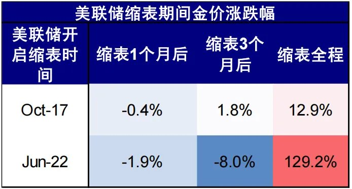

资料来源：Wind，中金公司研究部

图表33：但从缩表全程金价表现来看，缩表并非金价的决定性因素

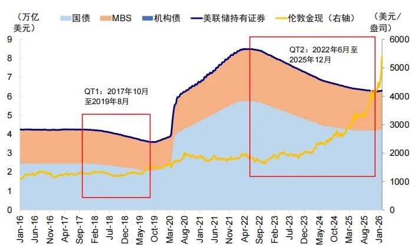

资料来源：Wind，中金公司研究部 

**► 美国改弦更张重新拥抱全球化，或者至少与“盟友们”积极合作重获信任，解决美国信任的问题** 。这需要特朗普不再造成地缘扰动，市场对特朗普任期内的期待很低，中期选举后可再做观察。

**► 美国经济重新找到支点实现强劲增长，解决资产回报的问题** 。这需要美国信用周期大幅向上，AI是最有可能独担重任的选项，而不论降息还是财政扩张，依然无法彻底解决美债底层问题。

**► 政府采取管控措施** 。针对黄金实施管控，如卖黄金和惩罚性税收的行政手段等等，例如像1975年那样美国政府公开卖黄金，会加大短期波动，但不解决根本问题。

本文来源：[中金点睛](https://mp.weixin.qq.com/s/ZN6AySbfDfveOXAvFWT6Qw?scene=1&click_id=1)

风险提示及免责条款

市场有风险，投资需谨慎。本文不构成个人投资建议，也未考虑到个别用户特殊的投资目标、财务状况或需要。用户应考虑本文中的任何意见、观点或结论是否符合其特定状况。据此投资，责任自负。
