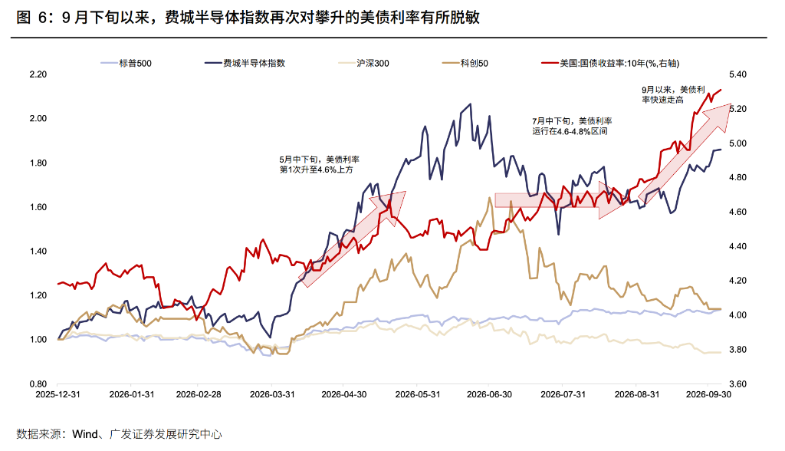
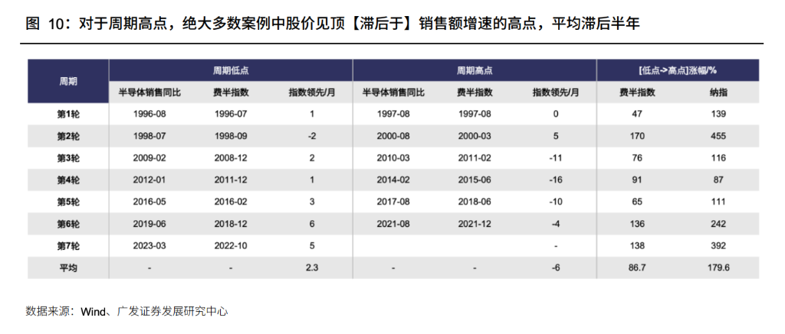
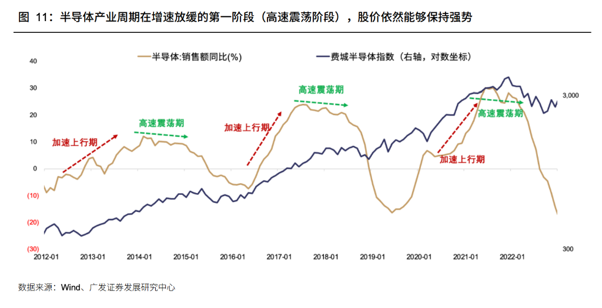
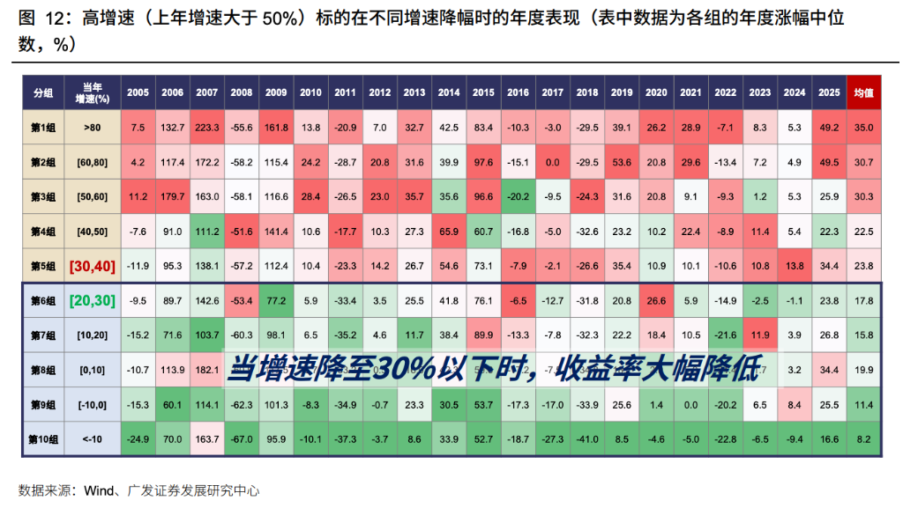
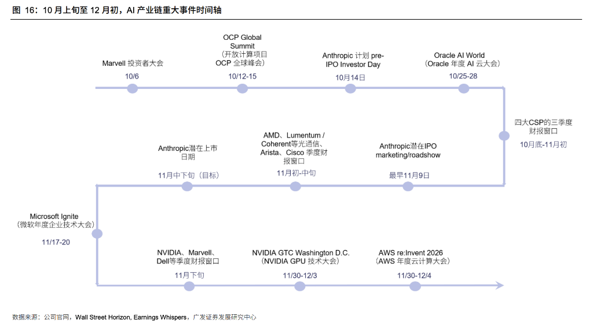

# 为何美债收益率、纳指同步新高？广发刘晨明：产业周期大幅降速才是科技股牛熊“分水岭”

- 页面显示时间：2026-10-07T18:59:46+08:00
- 页面署名：李佳
- 标注来源：未单列，见正文
- 原文：[华尔街见闻](https://wallstreetcn.com/articles/3783119)
- 取得时间：2026-11-04T16:03:44+08:00
- [HTML阅读版](article.html) · [来源记录](metadata.json)

## 导语

广发证券刘晨明团队认为，当前全球半导体周期仍处于“加速上行”或“高速震荡”阶段，科技股对利率上行已表现出明显脱敏。历史经验显示，产业增速正常回落并非行情拐点，大幅降速才是牛熊分水岭。四季度AI技术、业绩与商业化催化密集，科技板块仍有进一步挖掘α的空间。

---

国庆假期期间，美债收益率与纳斯达克指数同步创出新高：10年期美债收益率升至5.3%以上，创2002年以来新高，英伟达、台积电等科技龙头股价也持续走强。利率上行通常意味着估值承压，但这一轮科技行情却呈现出明显的“利率脱敏”，背后的关键在于产业周期仍处于高景气阶段。

广发证券刘晨明团队报告指出， **当前全球半导体周期大概率仍处于“加速上行”或“高速震荡”阶段，而不是即将进入大幅降速期。对于科技股而言，利率变化更多影响短期估值，真正决定中期行情方向的仍是产业景气度。**

历史数据也印证了这一点。过去三十余年，道琼斯工业指数与10年期美债收益率的相关系数为-0.41，而费城半导体指数仅为-0.13；相比之下，费城半导体指数与全球半导体销售额同比增速的相关系数达到0.40，道琼斯工业指数仅为0.20。 **这意味着，相较于利率变化，半导体股价与产业景气度的联动更为紧密。**

更值得注意的是， **历史上费城半导体指数见顶通常晚于全球半导体销售额增速见顶。** 换言之，科技行情并不惧怕产业增速从高位正常回落，真正的牛熊“分水岭”是产业周期是否出现大幅降速。

只要AI驱动的半导体需求和盈利增长仍能维持，产业周期就有望继续支撑科技股表现，利率上行更多只是阶段性扰动。

## 利率不是关键变量，产业周期才是

报告指出，历史上费城半导体指数的见顶时间，多数滞后于全球半导体销售额增速高点，平均滞后约6至10个月。这意味着，即使产业增速从“加速上行”转为“高速震荡”，股价也未必立即见顶；真正需要警惕的是产业周期进入大幅降速阶段。

从历史周期看，全球半导体周期平均持续42个月，其中上行23个月、下行19个月。本轮周期低点始于2023年4月，若以2025年三季度作为AI驱动的新一轮半导体销售周期起点， **按照历史规律，上行阶段有望延续至2027年三季度附近。**

增速端同样尚未出现明显失速信号。英伟达管理层在8月最新财报中给出2027年自然年70%的营收增长指引，并表示如果供应链瓶颈得到缓解，明年的增长实际上可能“指向翻倍”。在广发证券看来，这意味着半导体产业β仍有望维持在较高水平。

## “大幅降速”才是科技行情的牛熊分水岭

市场对于科技产业增速回落并非完全没有容忍度。 **历史景气投资经验显示，对于上一年度增速超过50%的公司，通常要等到当年增速降幅超过30%，市场表现才会明显恶化；对于上一年度增速超过80%的公司，则往往要等到增速降幅超过50%，才容易出现明显的估值杀跌。**

因此，产业增速从高位回落本身并不足以构成牛熊切换信号。只要增长仍处于较高水平，或者仅从“加速上行”切换至“高速震荡”，科技股仍可能维持强势。真正决定行情是否发生趋势性逆转的，是产业周期是否从高位震荡进一步转向大幅降速。

这也意味着，当前美债收益率创新高却没有压制纳指，并非市场忽视利率风险，而是AI驱动的产业增长仍足以支撑科技股盈利预期。 **只要产业周期没有明显失速，估值端的利率压力就可能被盈利增长部分抵消。** 

## 四季度AI催化密集，科技α仍有挖掘空间

报告认为，10月至12月初，AI产业链将进入“技术路线更新—业绩兑现验证—商业化定价重估”的密集催化期。

10月12日至15日的OCP全球峰会、11月30日至12月3日的英伟达GTC华盛顿大会，将成为观察定制芯片、光互连、机柜级系统以及供电散热等技术路线的重要窗口；10月底至11月初四大云厂商财报，以及随后英伟达、戴尔等公司的财报，则将进一步验证“云端投入—硬件订单—收入利润”的传导链条。Oracle AI World、Microsoft Ignite等会议，也将提供观察企业级Agent和AI商业化进展的重要窗口。

在广发证券看来， **当前全球科技产业β仍处于相对平稳的高位，四季度AI技术、业绩和商业化催化有望继续强化需求预期。在产业周期尚未出现大幅降速的情况下，科技行情的β基础仍在，A股科技板块也仍有进一步挖掘α的空间。**

风险提示及免责条款

市场有风险，投资需谨慎。本文不构成个人投资建议，也未考虑到个别用户特殊的投资目标、财务状况或需要。用户应考虑本文中的任何意见、观点或结论是否符合其特定状况。据此投资，责任自负。
