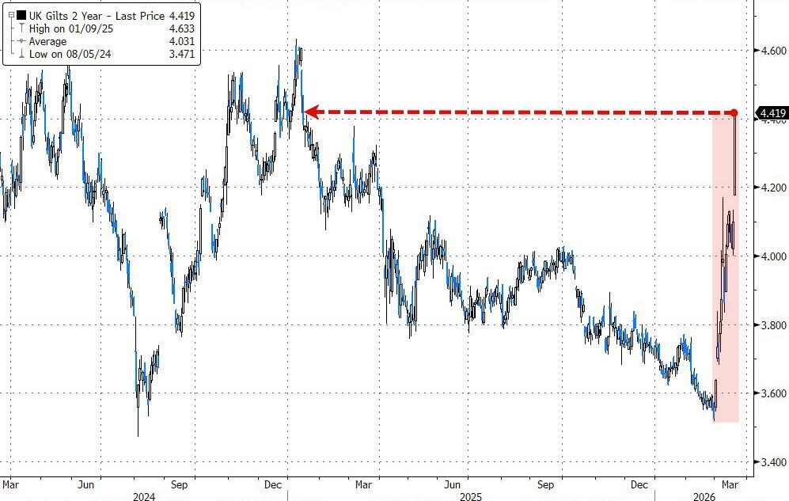
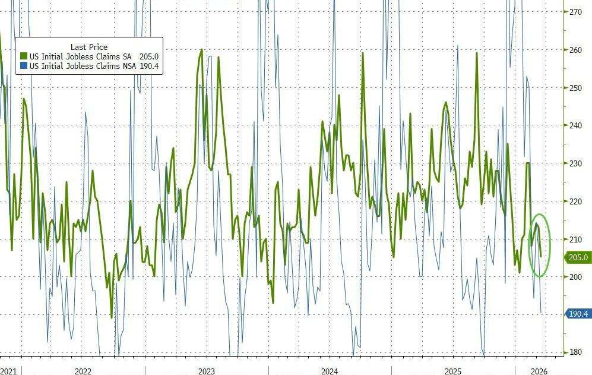

# 从降息到加息！债券市场对美联储政策路径预期发生历史性转变

- 页面显示时间：2026-03-20T08:23:34+08:00
- 页面署名：杨宸
- 标注来源：杨宸、鲍奕龙
- 原文：[华尔街见闻](https://wallstreetcn.com/articles/3767947)
- 取得时间：2026-11-04T16:03:16+08:00
- [HTML阅读版](article.html) · [来源记录](metadata.json)

## 导语

受英国央行意外“放鹰”冲击，英债抛售带动美债收益率上行；叠加今晚刚公布的当周初请失业金人数意外下降，进一步削弱了美联储维持宽松立场的依据。美联储降息预期被彻底抹平，市场叙事快速从“何时降息”逆转为“是否加息”。新债王Gundlach指出，美国两年期国债收益率暗示，美联储可能要加息。

---

全球债券市场正在经历一场深刻的预期重构。受英国央行鹰派转向冲击，交易员已将美联储2026年降息的可能性彻底定价出局，部分投资者甚至开始对接下来数月内加息的情景进行对冲。

英国央行货币政策委员会周四以全票通过维持利率不变， **同时警告将"随时准备出手"应对中东战争引发的通胀上升风险。**

这一措辞触发连锁反应——英国国债遭到抛售，两年期英债收益率单日飙升逾35个基点至4.46%，欧洲债市随之下行，并将压力传导至美国国债市场。 **两年期美债收益率随即上涨11个基点至3.89%。**

与此同时， **美国劳工部当周初请失业金人数意外下降，进一步削弱了美联储维持宽松立场的依据。** 掉期市场已将年内美联储宽松预期悉数撤出，美债期货成交量也随收益率上行而显著放大。

**随着中东战事持续，油价再度飙升，债券交易员撤回了对今年美国降息的押注，部分交易员甚至开始对未来数月可能出现的加息进行对冲。“新债王”Gundlach认为，美国两年期国债收益率暗示，美联储可能要加息。**

## **英国央行鹰派转向，触发全球债市重新定价**

不足三周前，市场普遍预期英国央行将于本次会议宣布降息，因彼时英国劳动力市场持续走弱。然而，形势急转直下。布伦特原油周四突破每桶118美元，作为能源进口依赖型经济体，欧洲与英国面临的输入性通胀压力尤为突出。

英国央行行长Andrew Bailey在声明中明确表示，货币政策必须 **"对英国CPI通胀出现更持久影响的风险作出回应"** 。掉期市场目前已定价英国央行年内三次加息，每次25个基点，首次行动预计最早于下月落地。

Principal Asset Management首席全球策略师Seema Shah表示，"货币政策委员会被迫完成了一次急速转向。就连委员会中立场 **最为鸽派的成员Swati Dhingra也投票支持维持不变** ，足以说明央行对通胀问题的高度警惕。"

LB Macro SA首席执行官及创始人Luigi Buttiglione则指出，"市场此前显然过于自满，仍幻想一个更关注产出而非通胀的央行。但对于英国央行这样一个通胀目标制机构而言，面对供给冲击，这并不符合其运作基因。"

## **美联储加息对冲头寸浮现，政策路径预期骤然收紧**

美联储主席鲍威尔周三在利率决议后表示， **进一步降低借贷成本将取决于通胀走势，措辞已明显偏向审慎。**

Mischler Financial Group董事总经理Tom di Galoma表示，"这一切都是由英国央行利率决定驱动的，市场目前已在定价2026年加息50个基点。欧洲债市处于自由落体状态，并进而推高了美债收益率。"

他同时指出，当前市场流动性格局的特征是"买盘几乎缺失，卖盘主导一切"，市场情绪受制于对冲突延续的预期。"目前的主流判断是，伊朗战争可能持续数月而非数周。"

**美国劳工部最新公布的每周初请失业金人数意外下滑，进一步为债市抛售提供了动能。** 强劲的劳动力市场数据表明，美国经济或不再需要低利率来支撑就业， **掉期市场随即将年内美联储任何形式的宽松操作全部定价出局。**

本轮全球债市调整特征：中东冲突推升能源价格，能源价格强化通胀预期，通胀预期倒逼央行收紧立场，进而引发利率敏感资产的系统性重新定价。短短数周内，市场叙事已从"何时降息"切换至"是否加息"，这一转变的速度与幅度均超出此前预期。

风险提示及免责条款

市场有风险，投资需谨慎。本文不构成个人投资建议，也未考虑到个别用户特殊的投资目标、财务状况或需要。用户应考虑本文中的任何意见、观点或结论是否符合其特定状况。据此投资，责任自负。
