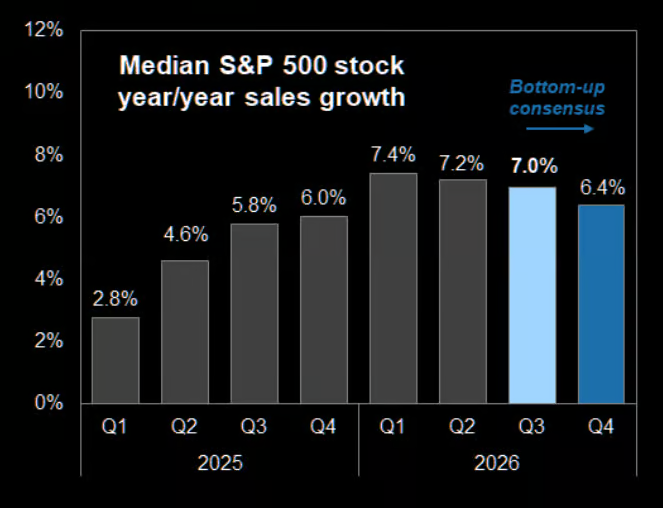
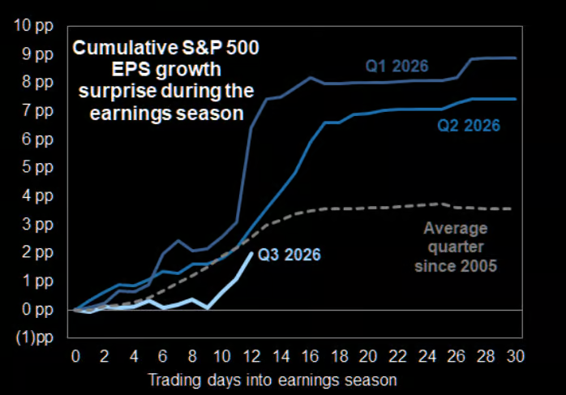
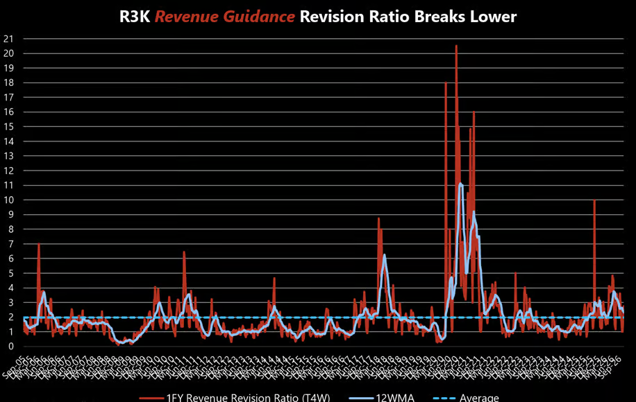
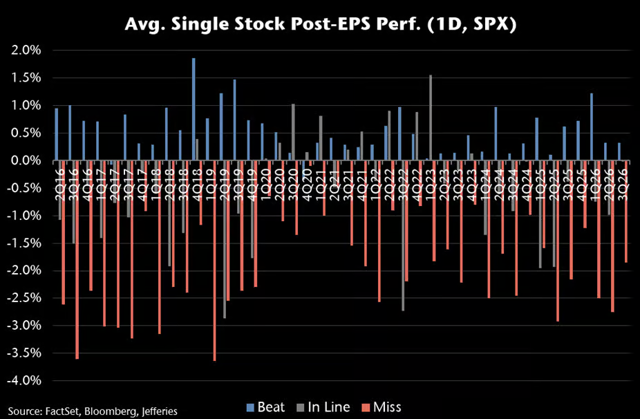

# 企业盈利增长加速时代终结，美股牛市立足的磐石正在动摇

- 页面显示时间：2026-11-02T20:06:57+08:00
- 页面署名：张雅琦
- 标注来源：未单列，见正文
- 原文：[华尔街见闻](https://wallstreetcn.com/articles/3785000)
- 取得时间：2026-11-04T16:03:49+08:00
- [HTML阅读版](article.html) · [来源记录](metadata.json)

## 导语

好消息几乎激不起涟漪，坏消息则遭到猛烈惩罚。标普500指数前向市盈率已回落至18.4倍，市场显然开始为明天担忧，而非庆祝昨日的成绩。

---

美国企业盈利增长依然强劲，但加速时代已经终结。随着三季度财报季接近尾声，增长放缓、超预期幅度收窄、业绩指引趋于保守等信号正在同步出现，支撑美股牛市的核心叙事开始出现裂缝。

高盛David Kostin将问题一语道破："三季度财报结果凸显了股票投资者面临的根本挑战：盈利增长依然强劲，但已不再加速。"他指出，此前连续数个季度呈现的盈利加速态势，正走向终结。

与此同时，高盛Tony Pasquariello直言，三季度财报最终将以"令人失望"被市场铭记——尤其在超大规模云计算资本开支明确未见放缓的背景下，多家科技巨头的核心业务却出现了业绩缺口。

市场的反应已经说明问题。 **好消息几乎激不起涟漪，坏消息则遭到猛烈惩罚。标普500指数前向市盈率已回落至18.4倍，市场显然开始为明天担忧，而非庆祝昨日的成绩。**

## 加速时代终结，增长方向难以美化

数据层面，放缓的轨迹清晰可见。据FactSet数据，标普500中位数公司的营收增速从一季度的7.4%降至二季度的7.2%，再降至三季度的7.0%，市场一致预期四季度将进一步放缓至6.4%。

这并非断崖式下滑，但方向本身已愈发难以被市场解读为乐观信号。增长的斜率在掉头，而非加速——对于依赖盈利动能定价的股票市场而言，这一转变的意义不容低估。

## 超预期机器仍在运转，但产出在缩水

美国企业仍在超越分析师预期，只是超预期的幅度今非昔比。据高盛数据， **三季度累计每股盈利超预期幅度明显低于一、二季度的高水平。**

"超预期机器"并未停机，但正在生产越来越小的惊喜。在过去数个季度，超预期本身就是推动股价上涨的重要催化剂，而这一引擎的功率正在衰减。

## 营收指引走弱，利润端的韧性难以掩盖隐忧

Jefferies的研究揭示了一个更值得警惕的分化：2026年营收指引修正已明显趋于负面，而每股盈利修正目前仍保持强劲。

"我们发现，2026年营收指引修正在总体上已大幅转向不乐观，"Jefferies指出。

**这意味着企业正在通过成本控制等手段维系利润端表现，而非依靠顶线的真实扩张。** 对于多头而言，利润暂时守住令人稍感宽慰，但没有营收动能支撑的盈利韧性，难以成为持续做多的有力理由。

## 市场奖惩不对称，大型科技股首当其冲

当前财报季最显著的市场特征之一，是超预期与不及预期之间的待遇极度不对称。据Jefferies数据，业绩超预期的公司股价几乎得不到奖励，而业绩不及预期的公司则遭到市场的严厉惩罚——大型科技股尤为如此。

这一信号本身耐人寻味：当好消息不再能驱动股价，坏消息却引发剧烈下跌，市场的风险偏好已在悄然收紧。

## 展望比现实更受关注，超大规模云计算成争议焦点

高盛Tony Pasquariello点出了本季度的核心矛盾：在资本开支明确未见放缓的情况下，多家超大规模云计算平台的核心业务仍出现了不及预期的表现：

> "尽管少数云业务在庞大基数上仍实现了复合高增长，三季度财报最终将以失望被铭记。在围绕资本回报率、资本支出和自由现金流的无休争论之外，在我看来，这才是当下最核心的问题：当超大规模云计算资本开支意图明确没有放缓，几家大玩家的核心业务却在某些环节出现了失误。"

Jefferies亦强调， **真正主导市场情绪的，已不是已披露的历史数据，而是日益趋于谨慎的前瞻性指引。** 标普500指数前向市盈率回落至18.4倍，印证了市场定价重心的转移——投资者开始为不确定的明天重新定价，而非为强劲的昨日支付溢价。

风险提示及免责条款

市场有风险，投资需谨慎。本文不构成个人投资建议，也未考虑到个别用户特殊的投资目标、财务状况或需要。用户应考虑本文中的任何意见、观点或结论是否符合其特定状况。据此投资，责任自负。
