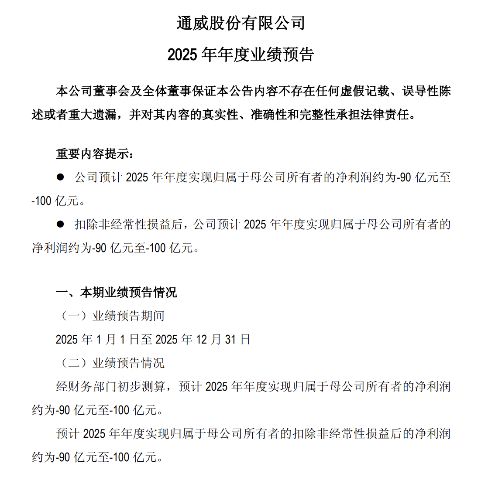
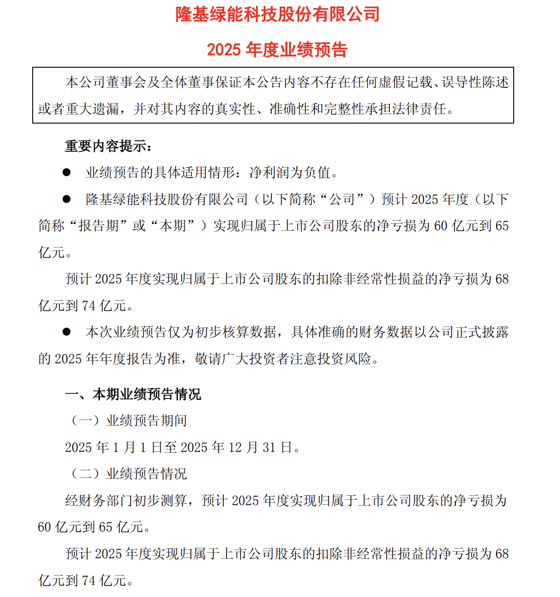

# 光伏巨头通威、隆基预亏近百亿，行业深度调整未见拐点

- 页面显示时间：2026-01-18T17:28:44+08:00
- 页面署名：赵颖
- 标注来源：未单列，见正文
- 原文：[华尔街见闻](https://wallstreetcn.com/articles/3763536)
- 取得时间：2026-11-04T16:04:07+08:00
- [HTML阅读版](article.html) · [来源记录](metadata.json)

## 导语

通威股份和隆基绿能相继披露年度业绩预告，分别预计净亏损90—100亿元和60—65亿元，标志着行业深度调整仍在持续。通威股份表示，多晶硅业务虽全年销量及销售均价同比下滑，但伴随三季度价格提升，下半年已实现经营性盈利，全年减亏约6亿元。隆基绿能则表示，2025年光伏行业供需错配、低价内卷式竞争持续，开工率维持低位，同时国内电力市场化改革不断深入，海外贸易壁垒持续加剧，企业经营环境严峻复杂。

---

光伏行业龙头企业2025年业绩预亏潮继续蔓延。 **1月18日，通威股份和隆基绿能相继披露年度业绩预告，分别预计净亏损90—100亿元和60—65亿元，标志着行业深度调整仍在持续。**

此前，硅料龙头大全能源、组件巨头晶科能源、天合光能已相继披露2025年全年业绩预亏。这些头部企业的集中亏损，直接反映出光伏产业在产能过剩、价格竞争激烈、海外贸易壁垒加剧等多重压力下，仍处于周期下行的深度调整阶段。

从二级市场表现看，大全能源、通威股份等龙头股纷纷创下近半年新低，反映出资金对光伏板块估值的谨慎态度。 **隆基绿能在业绩预告中指出，四季度银浆、硅料成本大幅上涨，显著推升了产品成本，使得企业经营进一步承压。**

市场监管总局1月6日的专题约谈会，直指光伏硅料行业"自律联盟"涉嫌垄断，要求暂停所有限产、限价相关的自律行为，意味着行业短暂建立的"反内卷防线"被击穿，市场重新回到自由竞争状态。

## 亏损来源各异，产业链全线承压

从具体业务看，龙头企业亏损来源呈现差异化特征。通威股份披露，工业硅业务在产能投产爬坡调试及产品价格持续低迷影响下，导致净利润亏损同比加剧约9亿元；电池及组件业务销售均价受市场行情影响进一步下跌，硅片-电池-组件业务合计导致亏损同比加剧约12亿元。值得注意的是， **多晶硅业务虽全年销量及销售均价同比下滑，但伴随三季度价格提升，下半年已实现经营性盈利，全年减亏约6亿元。**

隆基绿能则表示，2025年光伏行业供需错配、低价内卷式竞争持续，开工率维持低位，同时国内电力市场化改革不断深入，海外贸易壁垒持续加剧，企业经营环境严峻复杂。受制于产品价格持续低迷和成本压力，公司经营业绩仍然亏损。

## 行业供需双弱格局延续

中国有色金属工业协会硅业分析指出，尽管光伏产品出口退税政策落地对电池、组件出口的短期预期形成支撑，但部分需求已在2025年提前预支，对当前需求的实际拉动效果相对有限。另一方面，白银价格持续高涨大幅推升了电池片及组件环节的生产成本，而终端电站对成本上涨的接受度尚不明朗，致使下游开工率调整的不确定性较高。目前市场各方均在等待更为清晰的需求信号。

有分析表示，光伏行业正处于供需双弱的格局中，需求经过前两年大幅释放后进入平稳阶段，中东、澳大利亚等海外市场仍能贡献增量需求，但在光伏产品出口退税实施以及企业"抢出口"窗口期结束后，海外市场需求如何变化存在较大不确定性。价格方面，去年下半年以来光伏产业链价格表现为"控产预期推涨"与"实际需求疲软"的博弈，价格整体持稳但上行阻力仍较大。

风险提示及免责条款

市场有风险，投资需谨慎。本文不构成个人投资建议，也未考虑到个别用户特殊的投资目标、财务状况或需要。用户应考虑本文中的任何意见、观点或结论是否符合其特定状况。据此投资，责任自负。
