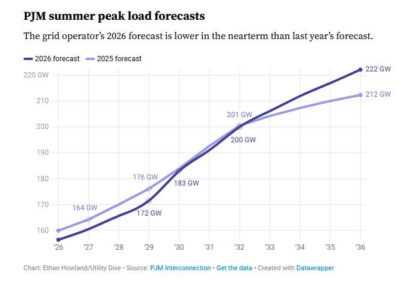

# 全美最大电网PJM重磅调整：严查数据中心“注水”，短期负荷预测罕见下调

- 页面显示时间：2026-01-16T16:29:12+08:00
- 页面署名：张雅琦
- 标注来源：未单列，见正文
- 原文：[华尔街见闻](https://wallstreetcn.com/articles/3763458)
- 取得时间：2026-11-04T16:03:33+08:00
- [HTML阅读版](article.html) · [来源记录](metadata.json)

## 导语

PJM下调2028年夏季峰值需求预测2.6%，主要源于对数据中心等大型负荷实施更严格审查。分析师指出，此调整反映项目延期而非需求疲软。长期看，PJM将2036年负荷年增长率上调至3.6%，预示电力市场持续偏紧，未来容量拍卖价格或仍触及上限。

---

美国最大电网运营商PJM Interconnection对未来电力需求做出矛盾性调整：在收紧数据中心审查标准后下调近期负荷预测，但同时上调长期增长预期，凸显电网规划者在AI算力热潮下面临的不确定性挑战。

根据PJM周三发布的年度报告， **该电网运营商将2028年夏季峰值需求预测下调4.4 GW，降幅达2.6%。2027年夏季预测同样下调约4 GW，使该容量年度的备用容量缺口收窄至约2.6 GW。** 这一调整将直接影响PJM定于6月30日启动的2028/29年度容量拍卖。

据PJM称，预测下调主要源于三方面因素： **对计划建设的数据中心和大型负荷实施更严格审查，以及更新电动汽车和经济活动预测。** 其中，大型负荷审查使今年夏季峰值预测下降0.7%，经济活动调整贡献0.5%降幅，电动汽车因素影响0.1%。

Jefferies股票分析师在周三研报中强调，预测下调反映的是项目延期而非需求疲软。他们预计即便PJM通过采购程序额外获得10 GW容量，未来两次容量拍卖的价格仍将"轻松触及"约530美元/兆瓦-日的上限。

## 严格审查大型负荷推动预测调整

PJM此次调整的核心在于改变了对数据中心等大型负荷的评估方式。该电网运营商在新闻稿中表示， **更严格的审查程序是近期预测下调的首要驱动因素，单此一项就使今年夏季峰值预测降低0.7%。**

这一变化发生在PJM利益相关方去年未能就改革大型负荷接入流程达成一致之后。PJM称，其董事会预计将在未来几周"概述快速通道关键议题的前进路径"。改革可能包括修改PJM审议大型负荷预测的流程。

PJM使用年度负荷预测进行输电规划，并据此确定容量拍卖中应采购的容量规模。此次调整将直接影响其下一次基础容量拍卖的参数设定。

## 长期需求增长预期不改

尽管下调近期预测，PJM对未来十年的电力需求增长预期实际有所上调。 **该电网运营商预计，到2036年夏季峰值负荷将以年均3.6%的速度增长至约222 GW，高于此前3.1%的预测。未来10年总增长量约为65.7 GW。**

这一长期乐观预期与短期调整形成鲜明对比。与去年预测相比，PJM将2032年之后的负荷增长预期上调，但将2032年之前的预测有所下调，反映出数据中心等大型项目落地时间表的不确定性。

Jefferies分析师指出， **负荷预测修正反映的是"推迟/延期，而非需求疲软"。** 他们预计未来两次拍卖的容量缺口将改善3-4 GW，但市场仍将面临短缺，建议采取"加速的后备采购方案"。

## 容量市场价格预期维持高位

尽管近期负荷预测下调，分析师仍预计容量价格将保持在高位。 **Jefferies分析师认为，即便预测调整使容量缺口改善，PJM未来两次容量拍卖的清算价格仍将"轻松"达到约530美元/兆瓦-日的最高限价。**

这一判断基于供需基本面依然紧张的现实。2027年容量年度的备用容量缺口虽然从更高水平收窄至约2.6 GW，但仍显示供应不足。分析师强调，市场需要通过加速后备采购程序来弥补缺口。

PJM的年度负荷预测是其容量市场定价的关键输入变量，此次调整将为市场参与者提供新的投资信号，但长期增长预期的上调表明电力需求增长的根本趋势未变。

风险提示及免责条款

市场有风险，投资需谨慎。本文不构成个人投资建议，也未考虑到个别用户特殊的投资目标、财务状况或需要。用户应考虑本文中的任何意见、观点或结论是否符合其特定状况。据此投资，责任自负。
