# 公募基金三季报：大幅加仓科技成长，工业富联、寒武纪新晋公募前二十大重仓

- 页面显示时间：2025-10-29T17:36:09+08:00
- 页面署名：张雅琦
- 标注来源：兴业证券张启尧
- 原文：[华尔街见闻](https://wallstreetcn.com/articles/3758183)
- 取得时间：2026-11-04T16:03:39+08:00
- [HTML阅读版](article.html) · [来源记录](metadata.json)

## 导语

兴业证券表示，公募基金2025年三季报显示，其主动权益定价权底部企稳，并在配置上大幅加仓科技成长板块，推动电子行业仓位突破历史经验上限（25.52%）。基金减持了消费、金融地产等板块。具体到个股，工业富联、寒武纪等科技股新晋公募前二十大重仓，而消费和金融类重仓股（如贵州茅台、招商银行）被减仓，个股和行业集中度同步上升。

---

**一、主动权益定价权企稳，存量赎回压力加速出清**

2025年三季度，在市场快速上涨行情驱动下，主动权益基金管理规模迅速反弹，与此同时，主动权益基金的定价权也迎来底部企稳。我们以主动权益基金持股市值占全A自由流通市值比例，衡量主动权益基金的市场定价权。从今年以来，主动权益基金持股比例降幅放缓，而今年三季度主动权益持股占自由流动市值比自2023年以来首次增长，主动权益基金的定价权呈现底部企稳的特征。

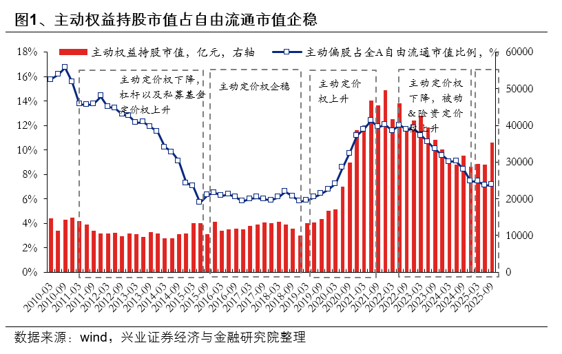

三季度存量基金赎回压力加速释放出清，负债端赎回已不构成主动创造超额的制约。2025Q3，三类主动偏股基金存量产品被净赎回2200亿份，共计净赎回2900亿元，其中2020-2021年高点发行、持营的产品净值回水是驱动基金持有人赎回交易的主要驱动原因。尽管三季度存量主动净赎回2900亿元为近年单季度最大赎回金额，但三季度主动偏股较沪深300指数实现接近10个点的超额收益，反映主动负债端的赎回已经不构成其创造超额收益的制约。

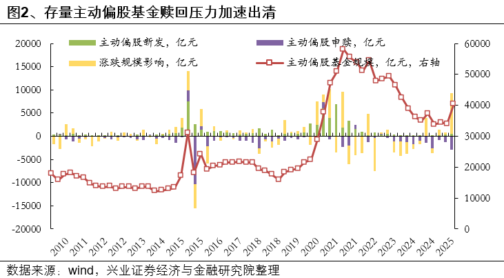

从仓位角度看，2025Q3主动偏股基金股票仓位进一步提升，处于历史最高水平。25Q3主动偏股基金仓位提升1.46pct至87.43%，其中普通股票型上升0.93pct至91.04%，偏股混合型上升1.33pct至89.79%，灵活配置型上升1.87pct至79.41%。

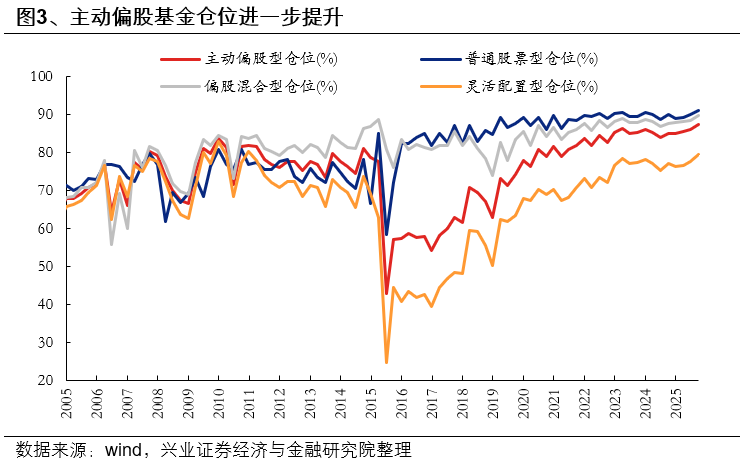

**二、配置上，大幅加仓科技成长，减仓消费、金融地产**

（一）板块层面，创业板、科创板仓位上升，主板仓位下降

1）2025年三季度，科创板的配置比例为17.45%，较2025Q2上升2.12个百分点，科创板超配比例小幅上行，超配比例由7.69%提升至7.72%。

2）2025年三季度，创业板的配置比例为23.73%，较2025Q2上升4.70个百分点，创业板超配比例明显上升，超配比例由5.38%上升至8.77%。

3）2025年三季度，主板的配置比例为58.51%，较2025Q2下降6.71个百分点，低配比例进一步加大，低配比例由-12.67%变化至-16.06%。

4）2025年三季度，北交所的配置比例为0.31%，较2025Q2下降 0.11个百分点。

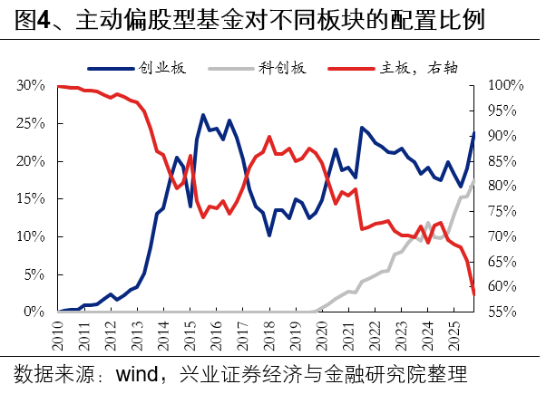

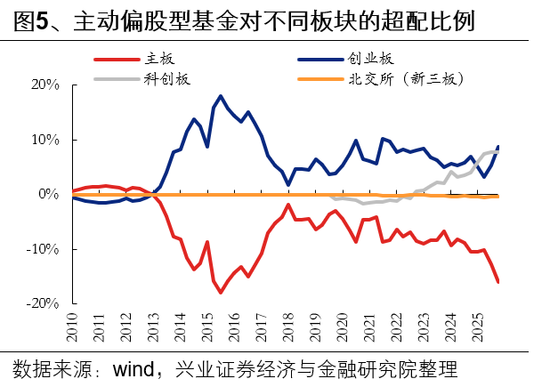

（二）风格层面，加仓科技成长、金融地产、医药

2025年三季度，主动偏股基金大幅加仓科技成长，相对应的，主动偏股基金在消费、金融地产、周期、医药上的仓位下降。2025Q3，主动偏股型基金对科技成长、金融地产、消费、医药和周期的配置比例分别为55.27%、 3.86%、 14.75%、 9.72%、 16.30%，较上一个季度的变化分别为+12.53pct、 -3.46pct、 -6.32pct、 -1.16pct、 -1.56pct。

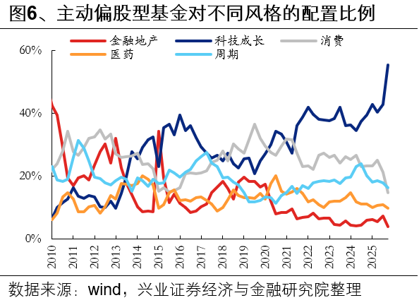

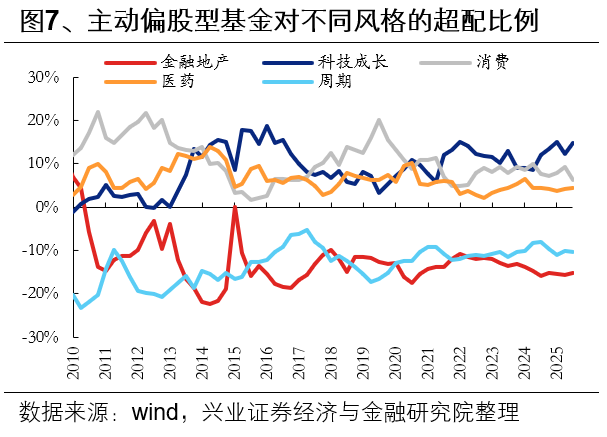

 

（三）行业配置层面，加仓电子、通信、电力设备

从一级行业仓位变动来看，2025Q3主动偏股基金加仓较多的行业是电子、通信、电力设备、有色金属、传媒，加仓比例分别为6.77pct、3.96 pct、2.42 pct、1.13 pct、0.56 pct。2025Q3主动偏股型基金减仓较多的行业是银行、食品饮料、家用电器、汽车、国防军工，减仓比例分别为-3.05pct、-1.81pct、-1.62pct、-1.45pct、-1.18pct。

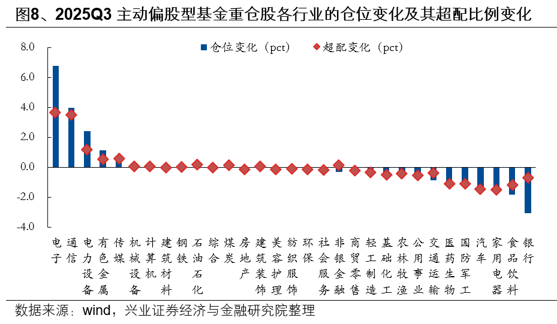

剔除主题/行业基金后，公募大幅加仓电子、医药生物、通信、电力设备。将新能源/医药/消费/TMT主题或行业基金剔除后，25Q3主动偏股型基金加仓较多的行业是电子、医药生物、通信、电力设备，加仓比例分别为4.91pct、3.91 pct、3.57 pct、2.62 pct，减仓较多的行业是银行、国防军工、家用电器、食品饮料，减仓比例分别为-3.74pct、-1.64 pct、-1.54 pct、-1.41 pct。对比全口径来看，剔除行业/主题基金后，公募对医药生物板块反而显著加仓，反映均衡配置型主动基金在增配科技成长板块的过程中，同样调整增配了一定仓位的医药生物板块。

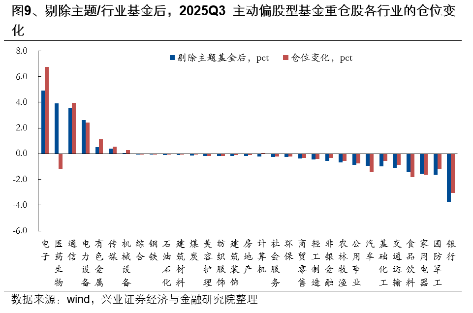

从二级行业仓位变动来看，2025Q3主动偏股型基金加仓较多的二级行业是通信设备、消费电子、半导体、电池、元件，加仓比例分别为4.45pct、3.09 pct、2.34 pct、1.97 pct、1.69 pct。2025Q3主动偏股型基金减仓较多的二级行业是白色家电、城商行Ⅱ、白酒、股份制银行、化学制药，减仓比例分别为-1.67 pct、-1.45 pct、-1.02 pct、-0.96 pct、-0.93 pct。

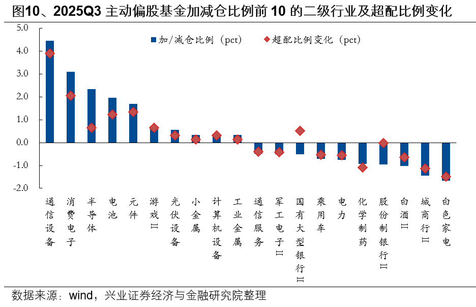

从一级行业绝对仓位来看，电子仓位突破25%大关，是过去十五年单一行业最高配置比例，而食品饮料退出主动前五大重仓行业。主动偏股型基金仓位前五的行业分别是电子、电力设备、医药生物、通信、有色金属，配置比例分别为25.52%、12.37%、9.72%、9.26%、5.72%。仓位后五的行业分别是综合、社会服务、纺织服饰、美容护理、环保，配置比例分别为0.09%、0.15%、0.21%、0.24%、0.26%。从持仓历史分位数来看，电子、通信、有色金属、电力设备、汽车仓位处于历史较高的水平，而银行、房地产、社会服务、商贸零售的仓位处于历史极低水平。

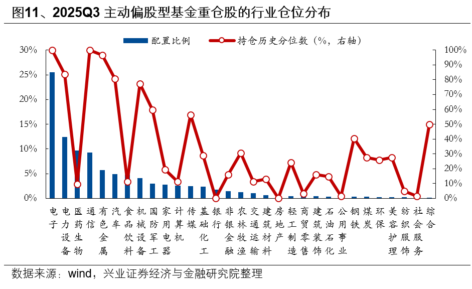

从一级行业超配比例来看，主动偏股型基金超配电子、电力设备、通信、医药生物、有色金属。2025Q3主动股票型基金的重仓股超配前五的行业分别是电子、电力设备、通信、医药生物、有色金属，超配比例分别为13.30%、5.36%、4.40%、3.29%、1.92%。超配比例后五的行业分别是银行、非银金融、石油石化、公用事业、计算机，低配比例分别是-10.38%、 -5.04%、 -3.10%、 -2.76%、 -1.73%。从分位数来看，电子、通信、有色金属、电力设备、传媒等的超配比例的历史分位数较高，公用事业、计算机、社会服务、基础化工、轻工制造等处于历史较低水平。

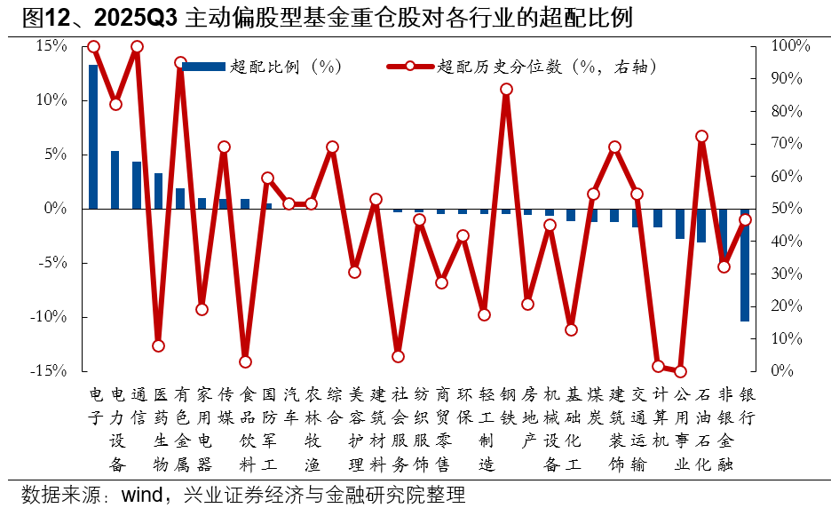

从二级行业绝对仓位来看，半导体、通信设备、电池的仓位居前。具体来看，主动股票型基金仓位前5的二级行业有半导体、通信设备、电池、消费电子、元件，配置比例分别为12.84%、9.02%、8.07%、6.21%、5.35%。

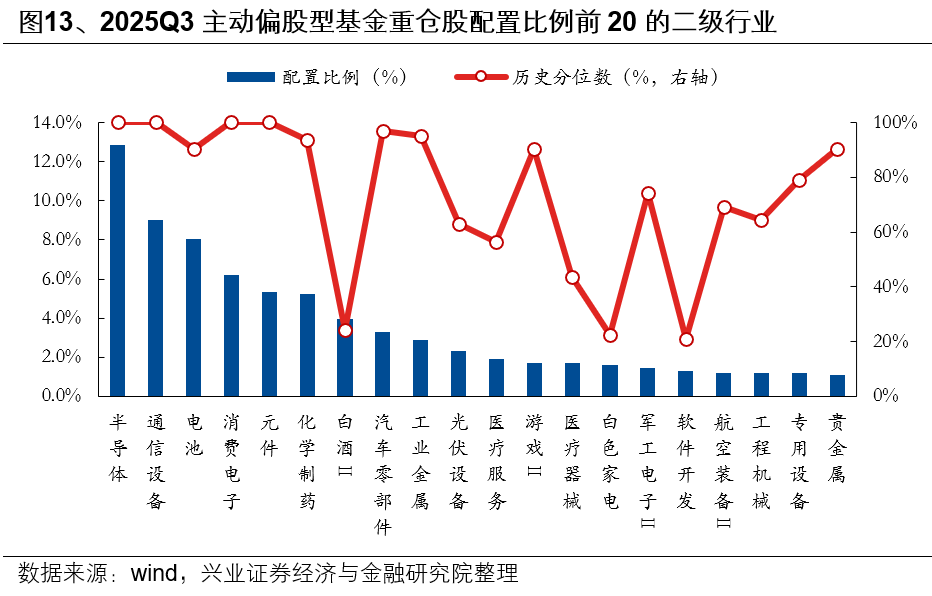

从二级行业超配比例来看，主动偏股型基金超配通信设备、半导体、电池、元件、消费电子。具体来看，2025Q3主动股票型基金超配前5的二级行业分别是通信设备、半导体、电池、元件、消费电子，超配比例分别为7.03%、6.81%、4.89%、3.94%、3.18%。

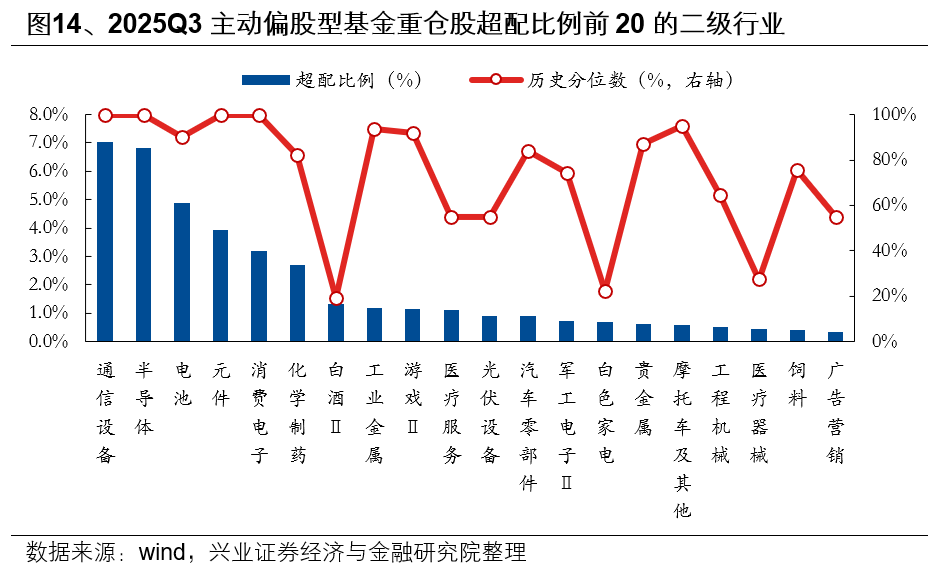

**三、三个维度看科技成长板块配置创历史新高**

科技成长内部细分板块上看，上游算力与PCB等高景气领域连续两个季度持续增配，同时北美算力加仓更为显著。从上游算力内部结构来看，三季度主动偏股基金同时增配北美算力与国产算力，但持仓仍以北美算力为主，国产算力持仓占算力持仓整体比例下降6.2pct至28.8%，与24年中水平接近。

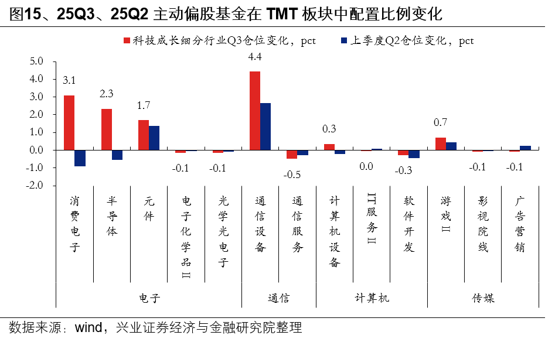

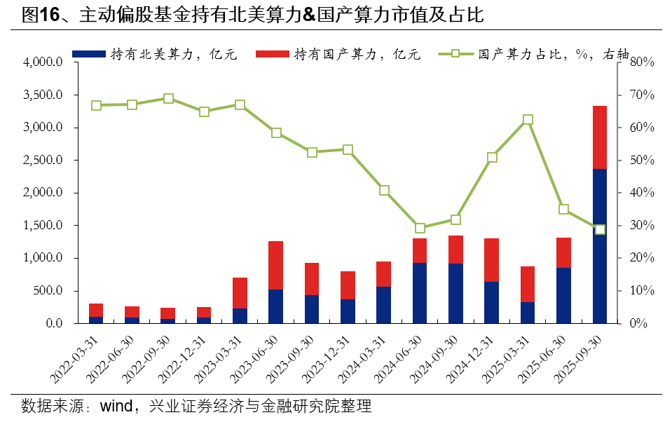

剔除掉涨跌幅影响来看，三季度公募实际重仓净流入科技成长板块310亿元，并且主要流向消费电子板块，而通信设备、半导体、元件配置增长主要由上涨贡献。主动权益重仓行业配置及变化反映的是，立足当前视角下的主动基金筹码分布与变动情况，但若回顾过去一个阶段公募的买入卖出交易操作，需要剔除涨跌幅影响以计算净流入。三季度，公募基金净买入科技成长板块310亿元，相较于科技成长板块配置比例提升12.53pct而言明显较小，反映三季度尽管公募有所加仓科技成长板块，但更多由股价上涨带动市值膨胀而被动提升，相反主动趋势加仓科技成长板块并不算多。

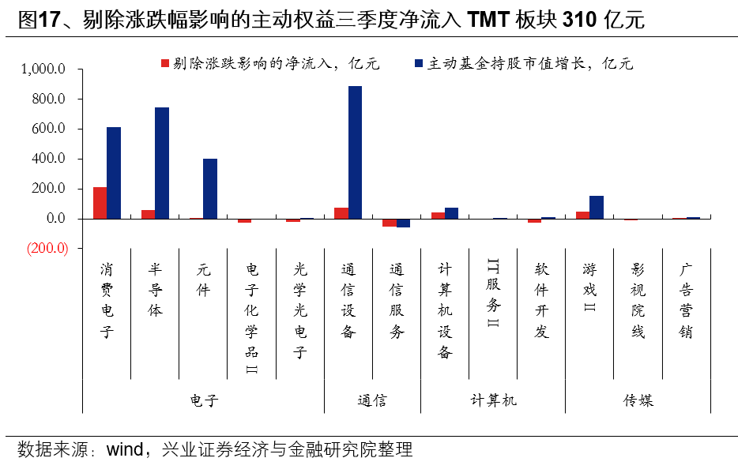

根据电子板块当前重仓配置比例来看，已经突破过去几轮主动基金对于单一行业配置比例20%的历史经验上限。从过去例次公募基金对于单一行业配置达峰后，往往面临行业超额收益收敛、跑赢宽基指数的胜率降低的困境。但历史并非没有主动对于单一行业配置超过20%的情况，在2006年下半年至2010年上半年主动对于银行板块配置长期处于20%以上，并且期间银行板块相较全A指数实现小幅超额。

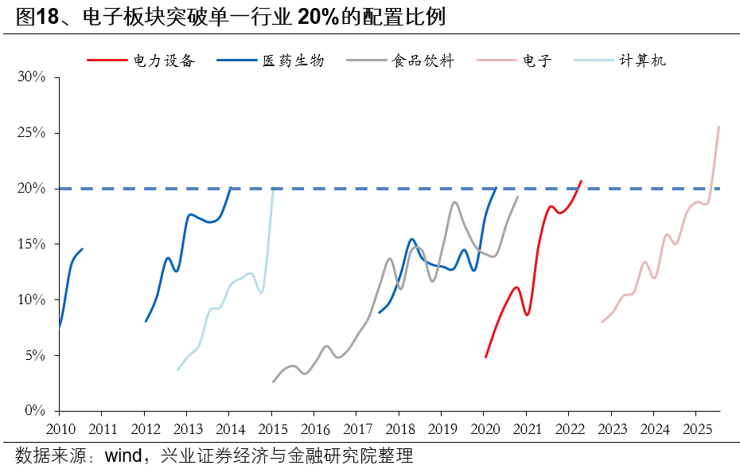

跟2006-2010年银行类似，经济重要性行业可能不单单以产业逻辑理解，随着科技成长领域发展与经济增长的相关性逐步提升，电子板块的配置比例短期并不一定要向20%回归。回顾过去7次主动权益抱团单一行业有较多的相同点，例如具有大行业、资金容量大的特点，并且处于快速增长的成长期、具有强行业逻辑，也因此将单一行业仓位推升至20%的高位。但仅有2006-2010年银行板块配置比例突破并长期维持在20%以上，不同的一点在于银行不单单有行业产业逻辑，在当时银行板块与经济发展是相互共振的，是投资拉动经济的基础。反过来看，当前科技成长领域也逐步成为经济增长的引擎，主动公募在电子板块的配置短期并不一定要向20%回归。

**四、红利板块配置比例大幅下降**

红利低波指数和中证红利指数配置比例均大幅下降，中证红利配置比例降至历史最低水平。偏股基金重仓股中持有红利低波指数下降2.61pct至2.61%，持有中证红利指数成分股仓位上升3.09pct至2.90%。

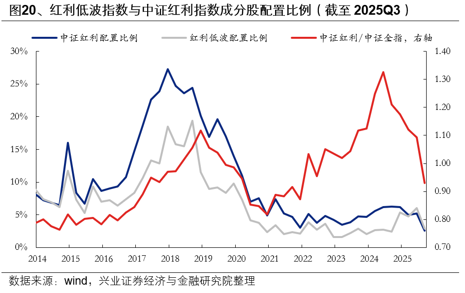

**五、工业富联、寒武纪等新晋公募前二十大重仓**

2025年三季度，主动偏股型基金加仓比例前5的个股分别是中际旭创、工业富联、新易盛、寒武纪、立讯精密，持股比例较上一季度分别增加2.17pct、2.03 pct、1.92 pct、0.91 pct、0.63 pct；减仓比例前5的个股为美的集团、招商银行、顺丰控股、贵州茅台、格力电器，持股比例较上一季度分别减少0.98pct、0.67 pct、0.61pct、0.53pct、0.50pct。

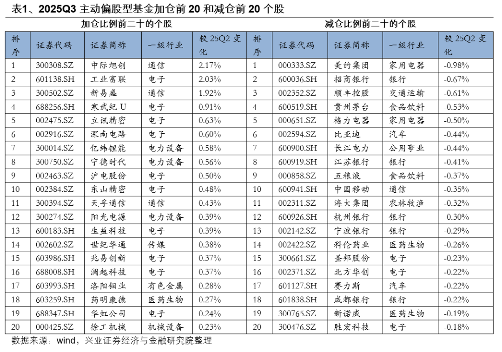

截至2025Q3，主动偏股型基金的前十大重仓股分别是宁德时代、新易盛、中际旭创、工业富联、立讯精密、紫金矿业、贵州茅台、寒武纪、沪电股份、恒瑞医药，持仓规模占全部重仓股持股市值的比例分别为4.50%、3.38%、3.36%、2.20%、2.20%、1.91%、1.67%、1.58%、1.34%、1.26%。

与上一季度相比，具体有如下变化：

工业富联、寒武纪、亿纬锂能、阳光电源、东山精密、深南电路、天孚通信新晋主动偏股型基金持仓的前20名。

招商银行、五粮液、山西汾酒、海大集团、顺丰控股、格力电器、分众传媒退出主动偏股型基金持仓的前20名。

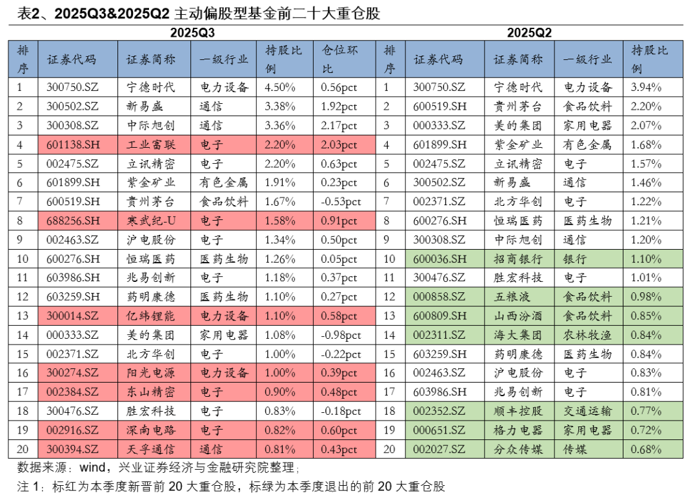

**六、个股与行业集中度同步上升**

三季度主动偏股型基金个股与行业集中度上升。前5/10/30/50/100的重仓股集中度均明显上升，较一季度分别上升4.19pct、5.75pct、7.74pct、7.01pct、6.34pct。行业视角下，主动偏股基金前3/5/10大重仓行业集中度均上升，较一季度分别上升8.02pct、10.02 pct、6.29pct。

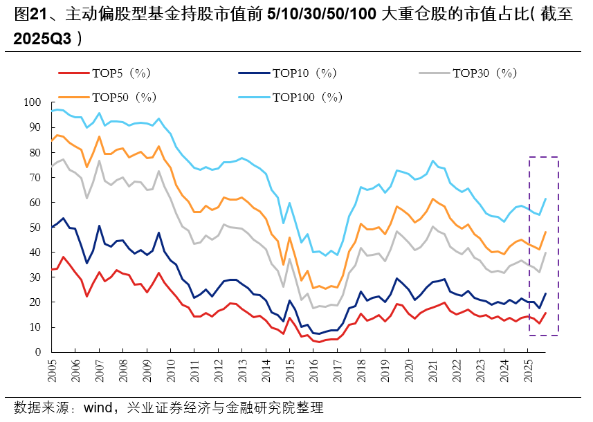

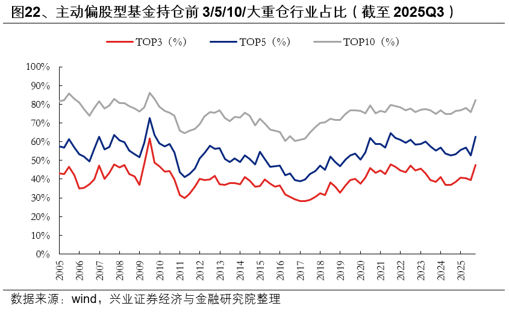

**七、港股仓位小幅下降，结构上增配医疗保健、原材料**

2025Q3，主动偏股基金的港股仓位小幅下降。截至三季度，主动型基金持有港股重仓股规模为3873.8亿元，较上季度末增加654.8亿元，港股仓位由19.85%小幅下降至19.09%。

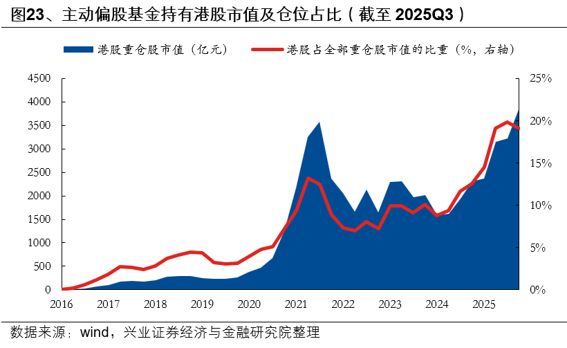

行业方面，公募持有港股医疗保健业、原材料业仓位环比上升，电讯业、金融业仓位回落。重仓股口径下，2025Q3主动偏股型基金加仓较多的行业是医疗保健业、原材料业，加仓比例分别为3.16pct、1.51pct；2025Q3主动偏股型基金减仓较多的行业是电讯业、金融业，减仓比例分别为-2.60pct、-0.98pct。

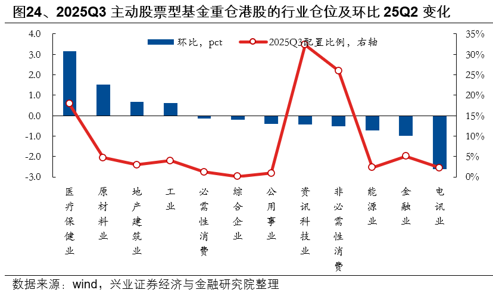

重仓股层面，腾讯连续维持公募的港股第一大重仓地位。截至2025年三季度，港股前5大重仓股为腾讯控股、阿里巴巴、中芯国际、信达生物、泡泡玛特，持股市值分别为678亿元、488亿元、286亿元、140亿元、106亿元，与2025Q2相比，港股前20大重仓中，新增华虹半导体、紫金矿业、药明合联、药明生物、石药集团、招金矿业，同时，美团-W、中国联通、建设银行、金蝶国际、老铺黄金、百胜中国-S退出港股前20大重仓。

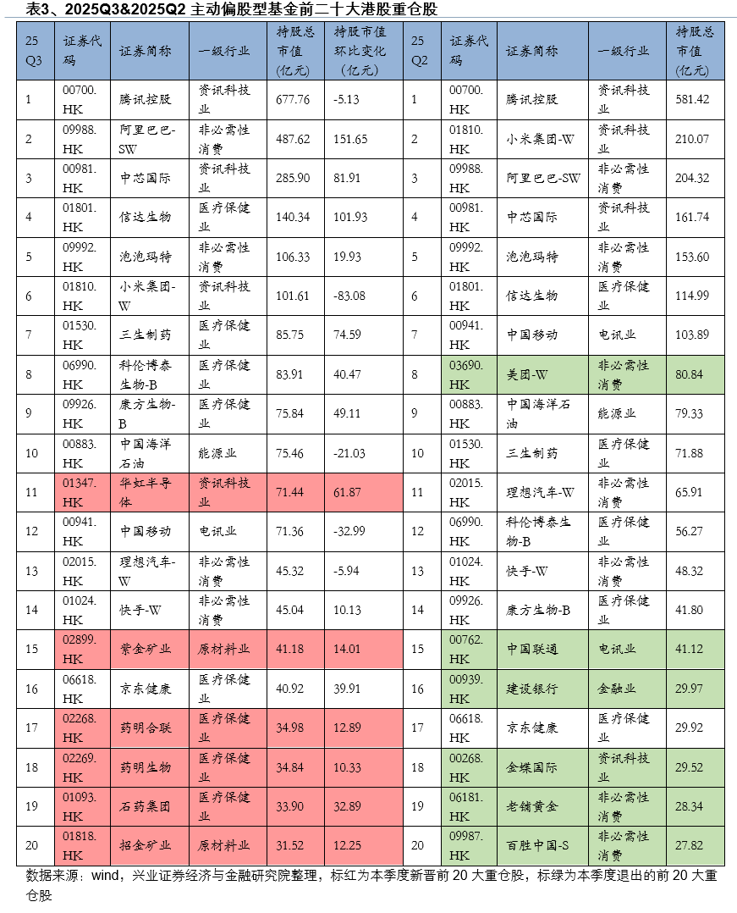

本文作者：张启尧，来源：[尧望后市](https://mp.weixin.qq.com/s?__biz=MzU1MjkwNDY1MQ==&mid=2247583576&idx=1&sn=6f442d8c4645cb3786a5d54aceb08bec&chksm=facd71ca0fef5a1cf52cc8639822a12781b402c1aaa270c1e67bf18b2ddc704a3d172d75765d&scene=0&xtrack=1?clueId=4102168112)，原文标题：《【兴证策略张启尧团队】基金三季报的七大看点》

风险提示及免责条款

市场有风险，投资需谨慎。本文不构成个人投资建议，也未考虑到个别用户特殊的投资目标、财务状况或需要。用户应考虑本文中的任何意见、观点或结论是否符合其特定状况。据此投资，责任自负。
