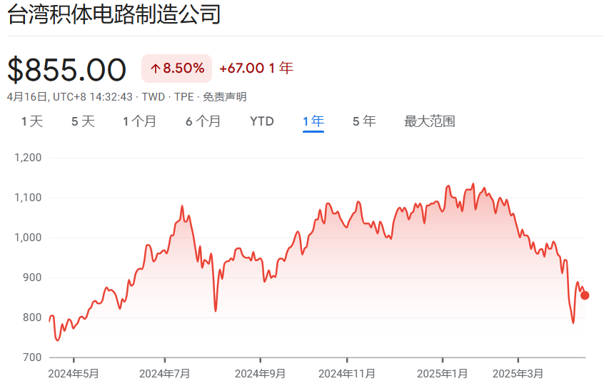

# 关税和全球经济放缓影响，摩根大通下调台积电CoWoS需求

- 页面显示时间：2025-04-16T18:34:01+08:00
- 页面署名：卜淑情
- 标注来源：未单列，见正文
- 原文：[华尔街见闻](https://wallstreetcn.com/articles/3745329)
- 取得时间：2026-11-04T16:03:56+08:00
- [HTML阅读版](article.html) · [来源记录](metadata.json)

## 导语

摩根大通将其对台积电CoWoS先进封装技术在未来两年的消费预期分别下调了7%和3%，理由是来自亚马逊自研AI芯片的需求减少，以及基于宏观经济的不确定性。摩根大通预测，受关税和全球经济放缓的影响，台积电管理层可能将2025财年的收入增长指引从约25%下调至20%左右。

---

受特朗普关税和全球经济放缓预期的影响，摩根大通小幅下调了台积电CoWoS的需求预测。

当地时间周三，摩根大通的Gokul Hariharan分析师团队发布研报， **将其对台积电CoWoS先进封装技术在未来两年的消费预期分别下调了7%和3%，理由是来自亚马逊自研AI芯片的需求减少，以及基于宏观经济的不确定性。** 报告预测，考虑到关税和全球经济放缓的影响， **台积电管理层可能将2025财年的收入增长指引从约25%下调至20%左右。**

考虑到亚马逊Trainium 2芯片供应链的波动较大，摩根大通将2025年Trainium 2的出货量预测大幅下调至约110-120万台。

此外，亚马逊Trainium芯片被外部客户采用的前景有限。摩根大通现在预期，未来两年，下一代Trainium项目的生命周期单位仅增长5-10%，市场可能会对亚马逊的定制芯片（ASIC）项目持更为谨慎的态度。

尽管如此，摩根大通预测， **2025年台积电CoWoS的整体需求仍预计增长107%，2026年继续保持37%的增长，这主要得益于英伟达的强劲需求、ASIC项目增加（尤其是博通和联发科）以及苹果WMCM芯片封装业务的启动。**

## 英伟达仍是CoWoS最大客户，但增长预期趋于理性

报告预计，台积电的CoWoS产能将在2025年继续保持紧张，但到2026年可能会达到供需平衡。

英伟达继续是CoWoS-L需求的主要驱动力，大摩预计，该公司将获得足够的CoWoS分配，以在2025年生产约550-600万个Blackwell B200/B300芯片和约70万个Hopper芯片。

摩根大通将2026年的英伟达CoWoS消耗预估上调约10%，这主要是由于Rubin芯片的晶圆产出率较低（每片CoWoS晶圆仅能支持生产11-12颗芯片），封装面积增加了30-35%。

值得注意的是，这一预测并未假设GPU单位有明显增长（可能维持在约700万单位）。预计英伟达将在2025和2026年分别占据总CoWoS产能的65%和60%。

**摩根大通维持对台积电“增持”评级，但目标价从1500元新台币下调至1300元新台币，较当前股价高52%左右。**

据预测，由于N4/N5和N3工艺的强劲需求、部分旧制程急单以及先进封装业务的增长， **台积电今年第二季度收入可能按季增长5%至8%** 。然而，关税和全球经济放缓的影响可能导致台积电管理层将2025财年的收入增长指引从约25%下调至20%左右。目前，摩根大通预计台积电全年收入将增长23%（按美元计价）。

[台积电的业绩情况似乎不容过于乐观](https://wallstreetcn.com/articles/3745317)，越来越多分析师预测其业绩将疲软。德意志银行表示，随着客户适应关税变化，台积电也可能会撤回业绩指引。

风险提示及免责条款

市场有风险，投资需谨慎。本文不构成个人投资建议，也未考虑到个别用户特殊的投资目标、财务状况或需要。用户应考虑本文中的任何意见、观点或结论是否符合其特定状况。据此投资，责任自负。
