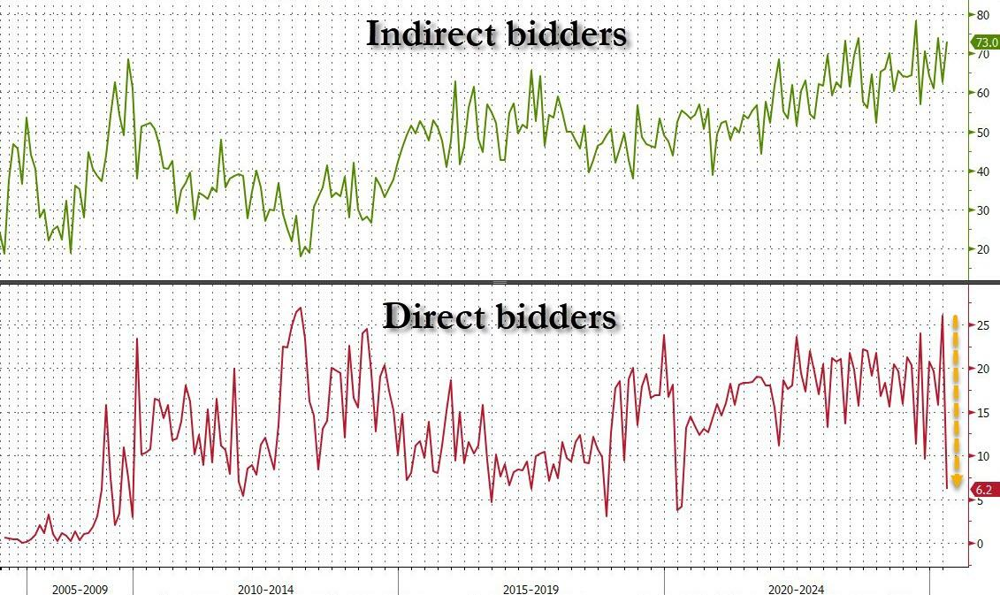
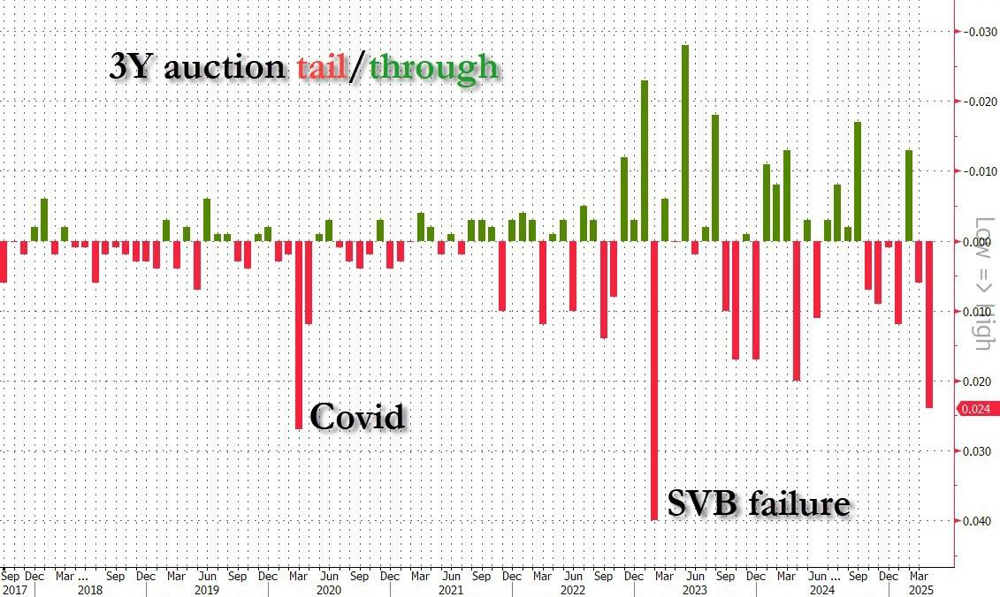

# 关税战会如何摧毁“美元循环”？美债已掀起风暴，接下来有个关键时点

- 页面显示时间：2025-04-09T14:16:58+08:00
- 页面署名：许超
- 标注来源：未单列，见正文
- 原文：[华尔街见闻](https://wallstreetcn.com/articles/3744872)
- 取得时间：2026-11-04T16:03:24+08:00
- [HTML阅读版](article.html) · [来源记录](metadata.json)

## 导语

目前投资者紧盯本周接下来的十年及三十年期美债拍卖，伴随着日本新财年开始，日本投资者可能大规模调整其配置策略，将资金从美债转向收益更具吸引力的欧洲债券。此举将进一步挑战美国国债的全球地位，并可能在特朗普关税政策、德国财政扩张等多重因素影响下，引发全球债券市场格局重构。

---

关税战引发的美债风暴或许只是刚刚开始，全球投资者应对全球收益率变化的早期迹象可能在几天内出现。

伴随着日本新财年开始，日本投资者可能大规模调整其配置策略，将资金从美债转向收益更具吸引力的欧洲债券，这可能引发美债市场的进一步动荡。

## 美债拍卖拉响警报

本周一的美债拍卖为投资者拉响警报。

隔夜[三年期美债拍卖“惨淡收场”](https://wallstreetcn.com/articles/3744847?keyword=%E7%BE%8E%E5%80%BA%E6%8B%8D%E5%8D%96)。作为衡量美国国内需求的指标，包括对冲基金、养老基金、共同基金、保险公司、银行、政府机构和个人在内的直接竞标者（Direct Bidders）获配比例为6.2%， **为历史上最低记录之一，较上个月的26%雪崩。**

财经金融博客Zerohedge点评称，这是一场非常糟糕的拍卖， **仅略好于新冠和硅谷银行危机时的3年期债券拍卖。** 不过好的一面是，虽然美国国内机构需求崩盘，但外国买家目前仍在继续支撑美国国债。 **但问题是，外国投资者还能继续为美国财政赤字买单多久？这个疑问并不会很快消失。**

目前市场担心， **随着日本新财年开始，日本投资者可能大规模调整其配置策略，将资金从美债转向收益更具吸引力的欧洲债券。** 此举将进一步挑战美国国债的全球地位，并可能在特朗普关税政策、德国财政扩张等多重因素影响下，引发全球债券市场格局重构，直接影响投资者的收益和风险敞口。

日本是全球债券市场的关键参与者，日本央行数十年来的超低利率政策促使日本投资者走向更广阔的世界寻求回报。考虑到今年欧债及日债收益率持续上涨，它们的相对吸引力正显著提升。这种情况可能诱使投资者将资金配置转向自己的本土市场。

## 接下来会发生什么？

**目前投资者紧盯本周接下来的十年及三十年期美债拍卖，如果数据依然惨谈，不排除市场进一步动荡。**

华尔街见闻[此前分析文章指出](https://wallstreetcn.com/articles/3743707)，短期美国存在股债汇“三杀”的风险：

> 技术层面上看，自2022年美联储缩表以来，美国对冲基金（尤其是多策略平台基金）成为美债最大的边际买家。
>
> 对冲基金持续大规模购买美债并非出于看多美债，而是在做美债基差套利交易（Treasurybasistrade）：左手做多美债现券、同时右手做空美债期货，当市场波动不大时，期货持有到期可以较低风险地赚取期限价差basis。这些对冲基金往往在回购市场上加杠杆买入美债现券，以此来增厚收益。
>
> 该交易规模可能已达到2019年下半年历史高点的近两倍，而2020年3月全球金融市场震荡（抛售一切资产换取现金）的导火索便是当时史高规模的基差套利交易的意外平仓。该交易本质上是做空波动率，因此波动率一旦大幅上升，易引发平仓风险进而资产抛售。
>
> 哪些因素可能触发金融市场波动率大幅上升？我们认为债务上限的解决是关键事件。债务上限一旦解决，之前财政部受债务上限制约没能新增发行的美债之后将补发出来。在没有债务重组的情况下，美国股债汇“三杀”风险将上升。

风险提示及免责条款

市场有风险，投资需谨慎。本文不构成个人投资建议，也未考虑到个别用户特殊的投资目标、财务状况或需要。用户应考虑本文中的任何意见、观点或结论是否符合其特定状况。据此投资，责任自负。
