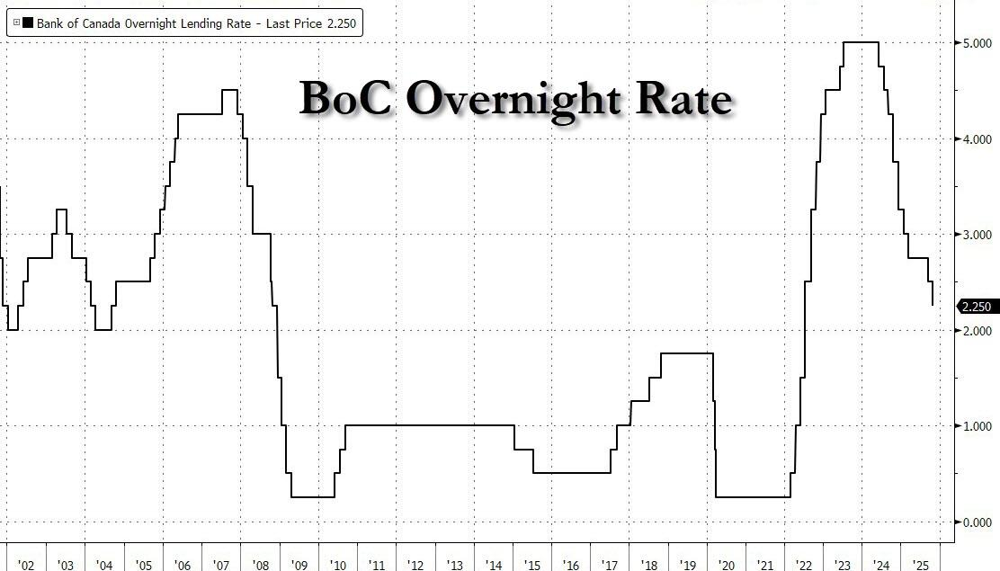

# 加拿大央行再如期降息25基点，称当前利率合适，大幅下调经济增长预期

- 页面显示时间：2025-10-29T23:47:48+08:00
- 页面署名：张茜
- 标注来源：何浩
- 原文：[华尔街见闻](https://wallstreetcn.com/articles/3758221)
- 取得时间：2026-11-04T16:03:16+08:00
- [HTML阅读版](article.html) · [来源记录](metadata.json)

## 导语

加拿大央行连续第二次会议将基准隔夜利率下调25个基点，本次降息后利率为2.25%，是自2022年7月以来的最低水平。加拿大央行称美国关税造成的损害仍在持续，但表示只要经济大致符合预期，当前利率水平合适。尽管加拿大央行对进一步降息的预期反驳，但不少业内人士预计，降息还未完成。

---

当地时间周三，加拿大央行下调利率，为连续第二次会议将基准隔夜利率下调25个基点，本次降息后利率为2.25%，是自2022年7月以来的最低水平。

 

加拿大央行同时大幅下调了经济增长预期，描绘出一幅黯淡的经济图景。在事先准备的讲话中，加拿大央行行长Tiff Macklem将与美国的贸易冲突称为一种结构性转变，并表示这场冲突削弱了加拿大的经济前景。

但加拿大央行也对进一步降息的预期进行了反驳，称当前的政策利率处于大致合适的水平，既能使通胀保持在接近2%的目标，又能帮助经济度过调整期。这取决于通胀和经济活动是否与预测一致。“如果前景发生变化，我们已做好应对准备。”

加拿大央行此次利率决议和货币政策报告发布的时间，正值该国总理卡尼（Mark Carney）政府准备公布首份预算案的前一周。该预算预计将大力投资基础设施和其他重大项目以推动经济增长。

## 关税冲击

加拿大央行政策制定者们重申，由贸易争端引发的供应冲击限制了他们采取刺激措施的空间。贸易冲突造成的结构性损害降低了经济潜力并增加了成本。这限制了货币政策在保持低通胀的同时刺激需求的能力。

Macklem表示，随着关税正式实施、美国保护主义根深蒂固，其对加拿大的影响变得更加清晰，尽管未来关税的水平和范围仍不确定。他仍强调预测中的重大不确定性：“可能的结果范围比平时更宽，我们必须对预测保持谦逊。”

加拿大央行表示，随着关税推高企业成本并加剧不确定性，投资预计将保持疲软，主要由于美国对加拿大出口需求减少。

由于美国关税问题仍无解决迹象，加拿大央行在本季度货币政策报告中恢复提供基准经济预测，此前在4月和7月的报告中使用了情景分析，以反映当时加拿大面临的贸易不确定性。

## 经济和通胀预期

加拿大央行预计，在预测期内该国经济将处于产出过剩状态。加拿大央行的政策制定者们将2025年下半年经济增长预期下调至0.75%。Macklem在讲话中表示，到2026年底，加拿大经济预计将比1月份的预测小1.5%。

与1月份的预测相比，加拿大央行将2025年的经济增长预期从1.8%下调至1.2%；将2026年的增长预期从1.8%下调至1.1%；预计到2027年，增长将小幅回升至1.6%。

与此同时，随着人口增长放缓和就业市场疲软拖累收入，加拿大的消费增长预计也将放缓。按人均计算，2026年和2027年消费预计平均仅增长1%。

Macklem还承认，加拿大央行首选的核心通胀指标仍然顽固地保持在约3%，但他重申上升势头已经消退，并再次指出更广泛的指标显示潜在价格压力约为2.5%。

尽管加拿大央行承认贸易中断推高了成本，但也指出，通胀影响比此前预计的更轻，因为加拿大已取消了大部分对美反制关税。该央行预计，通胀将在2027年前后保持接近2%的目标水平。

## 市场反应和分析点评

加拿大央行利率决议公布后，加元扩大涨幅，对美元汇率升至1加元兑1.3915美元，为10月1日以来的最高水平，实现连续第三天上涨。加拿大政府债券收益率全线走高。隔夜掉期交易员将12月再次降息的预期从逾30%下调至约20%。

媒体分析称，综合来看，这些表态表明加拿大央行的官员们仍不愿进一步采取货币刺激措施，以避免助长通胀压力。决策者们预计全球价格上涨和贸易争端导致的供应链中断将继续推高通胀。

尽管如此，不少业内人士认为，加拿大未来还可能会进一步降息。他们指出：

- 加拿大降息是因为经济正承受巨大压力，这并不是值得庆祝的事。持续的地缘政治不确定性促使加拿大央行采取利率保险式的预防措施。加拿大的工业部门正经历着关税打击。这是一个需要支持的经济体。加拿大央行的降息行动可能还没结束。
- 降息决定反映出持续的经济担忧。尽管通胀与增长之间的风险平衡仍不明朗，但在经济存在较大过剩产能的情况下，政策利率需要保持较低水平。随着下周加拿大联邦预算出台，预计其中的刺激措施不会改变今年的货币政策方向。
- 中性利率可能低于加拿大央行的估计值。不过从加拿大央行周三的表态来看，降息行动可能要到2026年初。

 

风险提示及免责条款

市场有风险，投资需谨慎。本文不构成个人投资建议，也未考虑到个别用户特殊的投资目标、财务状况或需要。用户应考虑本文中的任何意见、观点或结论是否符合其特定状况。据此投资，责任自负。
