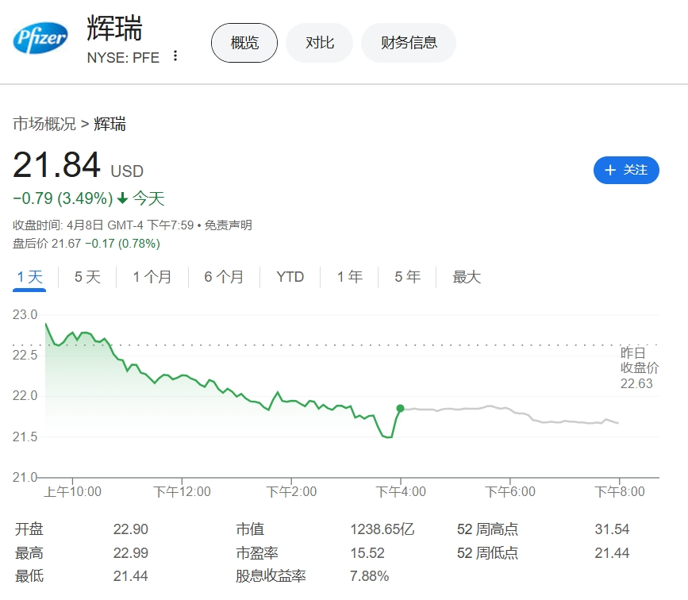

# 医药白马股也暴雷！瑞银下调，辉瑞股价跌回1997年水平

- 页面显示时间：2025-04-09T11:00:12+08:00
- 页面署名：董静
- 标注来源：未单列，见正文
- 原文：[华尔街见闻](https://wallstreetcn.com/articles/3744865)
- 取得时间：2026-11-04T16:04:04+08:00
- [HTML阅读版](article.html) · [来源记录](metadata.json)

## 导语

瑞银分析师下调辉瑞一季度每股收益预测至0.67美元，低于0.71美元的共识预期。瑞银认为辉瑞的新冠药物销售，包括Paxlovid治疗药物和Comirnaty疫苗，可能在第一季度低于华尔街的预期。

---

曾经的全球最大药企辉瑞正在经历着一场噩梦。在瑞银分析师下调业绩预期之后，辉瑞股价跌回1997年水平，且还面临着债务负担和产品线挑战等多重利空因素的冲击。

周二4月8日，辉瑞股价下跌3.5%，收于21.84美元，盘中一度触及21.44美元的52周新低。辉瑞目前市值仅为1250亿美元，仅为行业领头羊礼来制药的20%。

根据巴伦周刊报道，周二的收盘价已经回到了1997年的水平，与2021年新冠药物热潮期间超过60美元的高峰形成鲜明对比。

## 瑞银下调业绩预期

瑞银分析师Trung Huynh在周二的报告中指出，辉瑞的新冠药物销售，包括Paxlovid治疗药物和Comirnaty疫苗，可能在第一季度低于华尔街的预期。

这位分析师将辉瑞2025年每股收益预测从2.92美元下调至2.89美元，并预测第一季度每股收益为0.67美元，低于0.71美元的共识预期。

Huynh在报告中写道：

> “我们对辉瑞保持中立评级，需要看到新冠业务的稳定，关键资产(Nurtec、ADCs等)的持续增长，以及药物管线执行情况才会对该公司更加看好。"
>
> 这里的ADC指的是被称为抗体药物偶联物的癌症治疗方法。

## 债务负担与资本配置困境

辉瑞在2024年没有回购股票，并且无意在2025年进行回购，因为公司正专注于减少一系列收购产生的债务。

辉瑞在2024年底的净债务（债务减去现金）约为450亿美元。

对于投资者而言，在如此低迷的股价下，缺乏股票回购计划是另一个令人沮丧的因素，这也是公司通过昂贵收购来强化其药物管线所付出的代价。

## 口服减肥药能否成为救命稻草？

瑞银分析师Huynh表示，投资者迫切希望了解辉瑞GLP-1减肥药danuglipron的更多数据，该药物目前正在进行临床试验。这种口服形式的药物可能有潜力与目前仅以注射形式提供的现有GLP-1药物竞争。

如果这一药物能够获得成功，对辉瑞来说可能是一个关键的增长点，特别是在当前新冠相关产品销售下滑的背景下，公司迫切需要新的收入来源来支撑其庞大的股息支付承诺和减轻债务负担。

目前辉瑞的股息率已达7.9%，这不仅是主要制药股中的最高水平，也是标普500指数中最高的股息率之一。尽管投资者质疑股息的安全性，但是辉瑞首席财务官David Denton此前已经表示：

> "我们致力于维持和增加股息，并在2025年底前实现去杠杆目标，提供更平衡的资本配置。"

风险提示及免责条款

市场有风险，投资需谨慎。本文不构成个人投资建议，也未考虑到个别用户特殊的投资目标、财务状况或需要。用户应考虑本文中的任何意见、观点或结论是否符合其特定状况。据此投资，责任自负。
