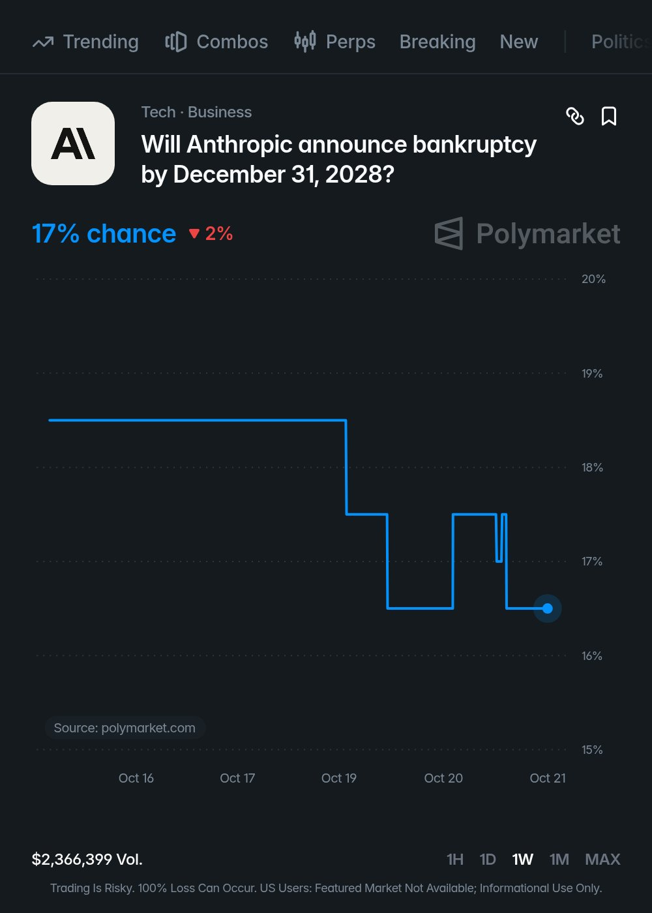

# 半年亏807亿美元、算力豪赌7500亿，Anthropic破产概率为何仅被定价17%

- 页面显示时间：2026-10-22T15:24:26+08:00
- 页面署名：董静
- 标注来源：未单列，见正文
- 原文：[华尔街见闻](https://wallstreetcn.com/articles/3784200)
- 取得时间：2026-11-04T16:03:21+08:00
- [HTML阅读版](article.html) · [来源记录](metadata.json)

## 导语

支撑低破产概率的论据包括：营收增速仍处于高位；谷歌、亚马逊等战略投资者具有强烈的动机维持公司运营；IPO本身将提供新的资本补充渠道；以及807亿美元净亏损中的绝大部分为非现金项目，不构成即期现金压力。

---

预测市场给出Anthropic17%的破产概率，折射出AI模型公司高资本开支模式下，市场对其生存能力的复杂判断。

据预测市场平台Polymarket最新数据，Anthropic在2028年底前宣告破产的概率仅为17%。这一定价与该公司本周曝光的IPO草案形成鲜明张力—— **招股草案显示，Anthropic 2026年上半年净亏损超过807亿美元，算力基础设施承诺支出最高可达7500亿美元。**

[华尔街见闻文章此前写道](https://wallstreetcn.com/articles/3784062)，据《华尔街日报》援引Anthropic最新版S-1招股草案报道，807亿美元净亏损中约720亿美元为非现金会计调整项，实际运营亏损约87亿美元，但这一数字已超过2025年全年逾80亿美元的运营亏损总额。与此同时，公司2026年上半年营收达163亿美元，第三季度营收环比增长45%至168亿美元，显示出一定的商业化势头。

然而，营收增速的放缓已在潜在IPO买家中引发估值分歧。管理层在投资者日披露，营收环比增速从第一季度至第二季度的约140%大幅放缓至第三季度的45%至46%，促使部分机构投资者将参考估值区间从2万亿美元下调至约1.5万亿美元。 **Polymarket的17%破产概率定价，本质上是市场在押注：Anthropic的营收增长轨迹足以在资金耗尽之前实现规模化盈利——但这一赌注的前提条件正在变得愈发苛刻。**

## 营收增长的隐忧：集中度风险与增速放缓

市场给予Anthropic较低破产概率的核心逻辑，在于其营收的快速增长。但这一增长本身存在结构性隐患。

**招股书显示，2026年上半年163亿美元营收中，约20%即约32.6亿美元来自仅两家客户。** 公司同时警告投资者，"在可预见的未来"，营收将持续高度集中于"有限数量的客户"，且许多大型企业客户并未签订长期合同，理论上可随时切换供应商。

与此同时，营收增速的放缓已引发机构投资者的重新定价。管理层在投资者日披露，环比增速从第一、二季度之间的约140%大幅放缓至第三季度的45%至46%。尽管45%的季度环比增速在绝对意义上仍属强劲，但与此前增速的落差，已足以促使部分机构将估值参考区间从2万亿美元下调至约1.5万亿美元。

Anthropic表示，2026年第二季度已实现经调整后的正利润，但在完整审计财务数据公布之前，"调整后"利润的具体口径仍有待厘清。

## 17%的定价逻辑：市场在押注什么

Polymarket 17%的破产概率定价，本质上反映了市场对以下核心判断的概率加权： **Anthropic的营收增长轨迹能否在2028年底前覆盖其固定算力负债，同时维持足够的融资能力以弥补运营缺口。**

支撑低破产概率的论据包括：营收增速仍处于高位；谷歌、亚马逊等战略投资者具有强烈的动机维持公司运营；IPO本身将提供新的资本补充渠道；以及807亿美元净亏损中的绝大部分为非现金项目，不构成即期现金压力。

**但这一定价所隐含的风险在于，它可能低估了固定算力负债在营收增速持续放缓情景下的流动性压力，以及客户高度集中所带来的收入脆弱性。** AI模型公司高资本开支模式的可持续性，最终取决于一个尚未被历史数据充分验证的假设：算力投入能够以足够快的速度转化为可防御的、长期锁定的营收。

Anthropic的IPO，将是这一假设接受公开市场检验的第一次真正压力测试。

## 天文级亏损：807亿美元的两层结构

[华尔街见闻文章](https://wallstreetcn.com/articles/3784062)写道， **Anthropic的807亿美元半年净亏损，在会计层面由性质迥异的两部分构成。**

其中约720亿美元为非现金会计调整项。随着公司私募估值在历次融资轮次中持续攀升，美国通用会计准则（GAAP）要求将向早期投资者发行的可转换票据及其他复杂融资工具的公允价值负债相应上调，由此在账面形成大规模"纸面亏损"。这一会计处理方式在高速融资的科技初创公司中并不罕见，但807亿美元的绝对规模仍属罕见。

剥离这一会计调整，公司上半年实际运营亏损仍高达约87亿美元，已超过2025年全年逾80亿美元的运营亏损总额。 **核心驱动因素在于算力支出的爆炸式增长：2026年上半年，Anthropic在计算资源与基础设施方面的直接支出接近90亿美元，较2025年上半年的23亿美元增长近四倍，甚至超过2025年全年73亿美元的算力总开支。**

这意味着，在支付任何研究人员、管理层或销售人员薪酬之前，每一美元营收中已有逾55美分流向数据中心运营商与芯片供应商。这一成本结构，是理解Polymarket定价逻辑的关键起点。

## 7500亿算力账单：从弹性支出到不可撤销负债

**Anthropic算力投入的真正风险，不在于规模本身，而在于其合同结构已从灵活的按需付费模式，演变为固定的、不可撤销的长期负债。**

[华尔街见闻文章](https://wallstreetcn.com/articles/3784062)提及，据《华尔街日报》报道，公司锁定的算力基础设施支出承诺已突破6000亿美元，若正在谈判的额外1500亿美元协议落地，总额将达到7500亿美元。根据最新招股草案，公司在未来七至十年内须承担约4500亿美元的云计算合同义务，且绝大多数协议明确注明"无论实际使用量如何均须支付"。

主要合同条款包括：与谷歌云签订1110亿美元合同；与亚马逊云服务（AWS）签订1100亿美元合同；与微软签订310亿美元合同；分别与AI云服务商Nscale和Lambda签订的合计最高860亿美元芯片租赁协议，租期延伸至2033至2034年。此外，公司还通过与博通的独立安排，承担了逾1600亿美元的谷歌TPU芯片租赁义务。

**招股书还披露了一个供应侧困境：Anthropic已寻求超过AWS、谷歌与微软愿意提供的算力上限，部分原因在于三大超大规模云服务商日益将其视为直接竞争对手。** 被迫转向替代供应商后，公司开始自建数据中心并与第三方设施运营商合作，而招股书坦承，这些运营商"运营历史有限"，可靠性存在不确定性。招股书同时提及，部分算力安排通过特殊目的载体（SPV）和私人信贷工具以表外形式融资，进一步增加了财务透明度方面的不确定性。

风险提示及免责条款

市场有风险，投资需谨慎。本文不构成个人投资建议，也未考虑到个别用户特殊的投资目标、财务状况或需要。用户应考虑本文中的任何意见、观点或结论是否符合其特定状况。据此投资，责任自负。
